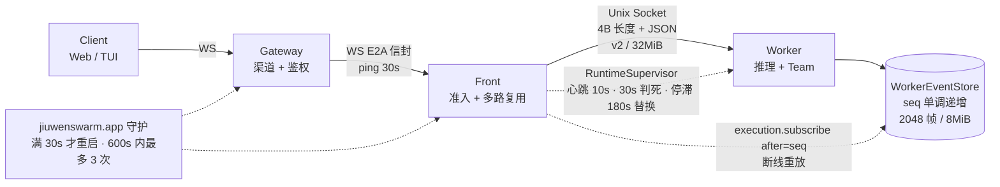
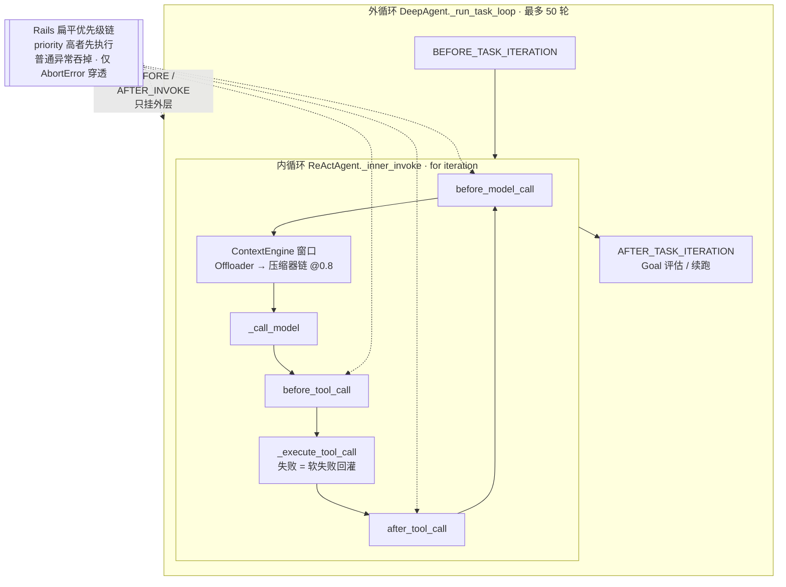
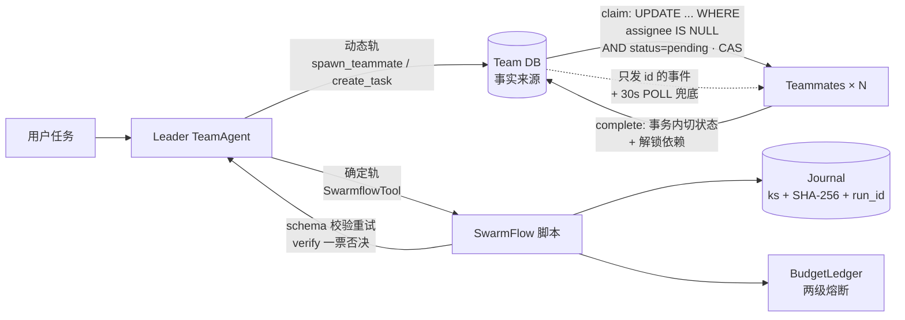
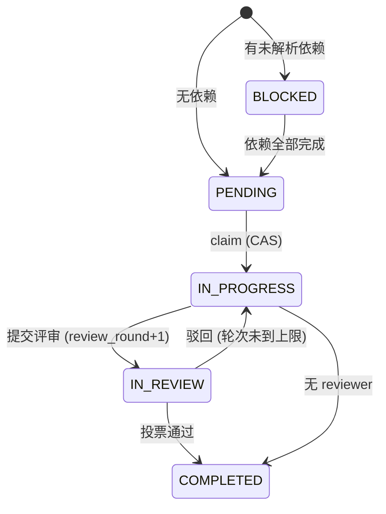

# 00 · 总控速查手册（Master Cheatsheet）

> 01~04 全部文档 + `scripts_diag/repro_and_bench.py` 实测结果的极限压缩版。考前 15 分钟扫一遍。
> 路径：`AC/`=`agent-core/openjiuwen/`，`AT/`=`AC/agent_teams/`，`JS/`=`jiuwenswarm/jiuwenswarm/`。
> 实测口径：**本地受控微基准**（无 LLM、无网络，真实仓库类 + 真实补丁，`git archive HEAD` 导出后 `git apply patches/*.patch` 对比）。不是线上数据，面试时照此口径说。

---

## 1. 核心概念一页纸（15 个核心类）

| # | 类 | 位置 | 一句话职责 | 最致命的缺陷 / 妥协 |
|---|---|---|---|---|
| 1 | `DeepAgent` | `AC/harness/deep_agent.py:313` | 外循环：`_run_task_loop` 的 `while coordinator.should_continue()`（外轮上限硬编码 50），承载 Goal 续跑与 Rails 挂载 | 外循环 Token 预算没接线：`LoopCoordinator.add_token_usage` 无调用点，`TokenBudgetEvaluator` 永不触发 |
| 2 | `ReActAgent` | `AC/core/single_agent/agents/react_agent.py:548` | 内循环：`_inner_invoke` 里 `for iteration`，`_call_model` → `_execute_tool_call` | 工具失败是软失败（回灌 ToolMessage 继续跑）；DeepAgent 未配置时把 `max_iterations` 改成 `sys.maxsize` |
| 3 | `AgentRail` | `AC/core/single_agent/rail/base.py:875` | 切面契约：13 个 `AgentCallbackEvent`，priority 默认 50、高者先执行 | 扁平链不是洋葱；普通异常被吞，安全 / 预算 Rail 会 fail-open |
| 4 | `AsyncCallbackFramework` | `AC/core/runner/callback/framework.py:212` | Rail 回调的实际执行器（串行 `trigger` / 并行 `trigger_parallel`） | 串行 `trigger` 忽略回调 `timeout`：挂起的 hook 卡死主循环。**实测**：卡死 ≥5s → 补丁后 0.50s 熔断（0002） |
| 5 | `ContextEngine` | `AC/core/context_engine/context_engine.py:28` | 上下文窗口 + 处理器链（Offloader → Dialogue / CurrentRound / RoundLevel 压缩，0.8 触发）；溢出时 `recover_from_model_exception` 压缩重试 | 三个历史压缩器里只有 CurrentRound 保住历史前缀，其余从 system 之后整体打掉 KV-Cache |
| 6 | `RuleCompressionPipeline` | `AC/core/context_engine/processor/forked/offloader/rule_compression/pipeline.py:29` | 对超大 ToolMessage 做确定性压缩（JSON / HTML / LOG / diff / 搜索结果），原文落盘留 `[[OFFLOAD:]]` 句柄 | 类型误判（**实测**）：`[ERROR]` 开头的日志被 json_repair 修成 JSON 数组，13KB 压成 `["ERROR"]` 还标"无损" |
| 7 | `TeamAgent` | `AT/agent/team_agent.py:173` | Leader 与 Teammate 共用一个类，按 role 区分；由 `TeamAgentSpec.build()`（`AT/schema/blueprint.py:849`）装配 | 审批兜底丢弃：`:687` 丢弃 dict 恢复输入。**实测** 1000/1000 丢失 → 补丁后 0（0001） |
| 8 | `PyZmqMessager` | `AT/messager/pyzmq_backend.py:372` | 跨进程 / 跨节点通知总线：ROUTER/DEALER 点对点 + XPUB/XSUB 广播 | 先跑 handler 再 ACK（队头阻塞）+ 吞异常照样 ACK + DEALER routing id 固定导致并发发送被丢。**实测** 51/51 ACK 超时 → 0（0003） |
| 9 | `TaskDao` | `AT/tools/database/task_dao.py:452` | Team DB 事实来源：`claim_task`（`:906`）用 `WHERE assignee IS NULL AND status=pending` 做 CAS | `update_task*` 先 SELECT 再改，写锁只在进程内；跨进程部署会 Lost Update |
| 10 | `TeamScheduler` | `AT/agent/scheduling/scheduler.py:107` | `dispatch_mode="scheduled"` 时的强调度：五个幂等扫描阶段 + 评审投票（全员投票、单票否决、inspector 均分 ≥0.85、最多 3 轮） | 没有失败重派；reviewer 任务 `create_task` 不留引用（`:766`），Leader 暂停后仍在投票 |
| 11 | `Journal` | `AT/workflow/engine/journal.py:105` | SwarmFlow 断点续跑：`位置键 ks + SHA-256 内容签名 + run_id` 命中缓存；WAL 追加 + `os.replace` 快照 | 签名不含外部状态；WAL 不 fsync；严格 utf-8 读取，半个中文字符就让 resume 崩溃。**实测**命中率 0% → 99.5%（0005） |
| 12 | `BudgetLedger` | `AT/workflow/engine/budget.py:23` | SwarmFlow Token 账本：`spent += n` + 入口 `_check_budget` 抛 `BudgetExhausted` | 先检查后扣费：并发分支同时过检，问题不在锁。**实测** 16 并发超支 230% → 预留制 5%（0006） |
| 13 | `EvolutionRail` | `AC/harness/rails/evolution/evolution_rail.py:241` | 自演进入口：after_invoke → 后台 `_trigger_evolution`（600s / 团队 720s）→ 打分 `0.5E+0.3U+0.2F` → 审批 → `append_record_transactional` | `evolutions.json` 解析失败返回空日志，下次写入覆盖、历史清空；锁只在进程内 |
| 14 | `RuntimeSupervisor` | `JS/server/supervisor/runtime_supervisor.py:85` | Front 侧守护 Worker：Unix socket 帧协议、10s 心跳 / 30s 判死、循环停滞超过 180s 替换；流式帧由 `WorkerEventStore`（`JS/server/worker/event_store.py:74`）编号缓存，支持重放 | Front 断连不向 Worker 发任何帧；`KIND_CANCEL` 只有消费端（`JS/server/worker/dispatcher.py:188`），没有发送方 |
| 15 | `RuntimeSessionCoordinator` | `JS/runtime/session/coordinator.py:73` | 会话注册、generation、执行句柄、取消（`cancel_execution` 对 handle 调 `task.cancel()`） | 关闭只置 CLOSED，`_sessions/_generations` 永不 pop。**实测**稳态斜率 1095 KB/1000 会话 → 2.4 KB（0004） |

> 第 16 个备用：`SandboxGatewayClient`（`AC/core/sys_operation/sandbox/gateway/gateway_client.py:11`）—— `release()`（`:60`）生产代码**无调用方**，沙箱 lease 从不释放，idle 回收两层默认关闭。

---

## 2. 面试白板默写图（每张 2 分钟内可手绘）

### ① 三进程 + 序列号重放拓扑

**口播要点**：故障域隔离（Worker OOM 不影响渠道连接）+ resident Worker 让 Front 重启后可重新挂接 + `seq` 补齐断档帧。**主动认的短板**：断连 ≠ 取消，`KIND_CANCEL` 无发送方。

### ② DeepAgent 内外双循环 + Rails 切面 + Context 压缩链

**口播要点**：`_register_rail_selective` 把模型和工具事件挂到内层、invoke 事件挂到外层；控制面通道是 `request_force_finish` / `request_retry` / `push_steering` / `_skip_tool`；动态内容通过 `PromptAttachmentManager` 以增量 UserMessage 追加，不改 system prompt 和历史前缀，从而保护 KV-Cache。

### ③ AgentTeams + SwarmFlow 双轨协同与 DB CAS 状态机

**口播要点**：原则是"DB 是事实来源，消息只负责唤醒"，所以 PyZMQ 的 at-most-once 可以接受。**主动认的短板**：审批没遵循这条原则（兜底路径丢弃，见 S1）；`human()` 的回复只存在内存里。

---

## 3. 面试官追问条件反射表（20 张速记卡）

格式：**问** → 观点（先抛结论） · `关键词1` `关键词2`（亮肌肉） · ✦ 金句（拔高度）

| # | 问 | 一句话核心结论 | 源码关键词 | 架构演进金句 |
|---|---|---|---|---|
| 1 | 和 LangGraph / AutoGen 本质区别？ | 不比谁更强，比取舍：同一底座上的动态组队 + 确定性脚本双轨，外加产品化的会话运行时 | `SwarmflowTool` `TeamAgentSpec.build` | ✦ "LangGraph 的确定性来自图拓扑，我们的来自 Python 控制流加调用路径键。" |
| 2 | 为什么拆三进程？ | 渠道连接和推理负载的扩缩容维度、故障模式完全不同 | `RuntimeSupervisor` `PROTOCOL_VERSION=2` | ✦ "Agent 是长时、有状态、故障域大的负载，不能按 Web 服务的方式部署。" |
| 3 | Front ⇄ Worker 为什么不用 gRPC？ | 同机走 Unix socket，延迟最低、免服务发现；长度前缀 JSON 方便调试 | `kind` 多路复用 `32MiB 帧上限` | ✦ "跨机时这一跳可以一一映射到 gRPC streaming，协议语义不变。" |
| 4 | 断线后流式输出怎么不丢？ | Worker 侧给每帧分配单调递增序号并缓存，重连后按 after 重放 | `WorkerEventStore` `execution.subscribe{after}` | ✦ "把流当成日志，就能用偏移量做断点续传。" |
| 5 | 客户端断开会停止推理吗？ | Web 关 tab 不会（有意设计）；显式中断会，但靠消息而不是 CancelledError；沙箱 exec 停不下来 | `chat.interrupt` `KIND_CANCEL 无发送方` | ✦ "取消必须是一等协议，而不是寄希望于异常一路冒泡。" |
| 6 | 会话怎么回收？ | 惰性回收，只在请求路径的 finally 里执行，TTL 2h；协调器以前只增不删 | `AgentManager` `_retire_closed_session`（0004） | ✦ "实测稳态斜率 1095 KB → 2.4 KB / 千会话，靠的是有界历史加单调 generation 下限。" |
| 7 | Rails 和普通 callback 区别？ | Rails 能控制流程，不只是观察；按事件分流挂到内层或外层 | `_register_rail_selective` `push_steering` | ✦ "切面的价值在于把护栏从业务代码里剥离出来。" |
| 8 | Rail 卡住或抛异常会怎样？ | 卡住会阻塞主循环，抛异常会被静默吞掉，两者都是隐患 | `framework.py:1129` `AbortError` | ✦ "实测：挂起的 hook 原来卡 ≥5s，补丁后 0.50s 熔断；fail-open 还是 fail-close 应该由 Rail 自己声明。" |
| 9 | 上下文压缩怎么做？ | 先卸载超大工具输出（规则压缩、原文落盘），占用到 80% 再用 LLM 压缩；溢出时压缩后重试一次 | `MessageSummaryOffloader` `recover_from_model_exception` | ✦ "压缩的第一原则是可召回，所以留 `[[OFFLOAD:]]` 句柄而不是直接删。" |
| 10 | 怎么保护 KV-Cache？ | system prompt 只放静态段；动态内容按 sha256 判断变化，只追加增量；压缩时失效边界可计算 | `PromptAttachmentManager` `first_changed_index` | ✦ "改历史一个字，后面的缓存全部作废，所以只追加、不改写。" |
| 11 | 为什么用 PyZMQ 不用 Kafka？ | 消息只负责唤醒，事实在 DB；brokerless 方便私有化零依赖部署 | `XPUB/XSUB` `30s POLL 兜底` | ✦ "实测 51/51 ACK 超时 → 0，修的是 ACK 时机和 routing id，不是换中间件。" |
| 12 | 多个 Teammate 抢同一任务？ | claim 是条件 UPDATE，看影响行数判断是否抢到；complete 在事务里解锁依赖 | `claim_task:906` `TASK_TRANSITIONS` | ✦ "单机 CAS 是对的，跨进程还需要版本号加 `retry_on_locked`。" |
| 13 | 权限审批怎么闭环？ | ASK 时中断本轮，Leader 用 `approve_tool` 批准，`resume_interrupt` 后重新检查 | `TeamApprovalOrchestrator` `InteractiveInput` | ✦ "实测兜底路径 1000/1000 丢失 → 0：任何必须送达的语义都不能只靠消息。" |
| 14 | 多智能体死循环刷 Token？ | 可靠性框架默认关闭，检测器只看一对发送方 / 接收方，三方循环检测不到 | `PingPongDetector` `enabled=False` | ✦ "hop 上限、环检测、团队预算，三层缺一不可。" |
| 15 | SwarmFlow 怎么抑制误差累积？ | 结构化输出加 schema 校验重试，失败隔离为 None，verify 一票否决 | `coerce` `verify()` | ✦ "N 跳串联的成功率按指数衰减，必须让每一跳都可验证。" |
| 16 | Journal Replay 遇到非幂等 API？ | 现在保证不了：结果先检查 abort 再写日志，副作用可能重复 | `primitives.py:711-713` `intent/done` | ✦ "和 Temporal 的 Activity 是同一个道理：副作用必须显式声明边界。" |
| 17 | `human()` 卡点释放资源吗？ | 不释放：在内存 Future 上等待，默认 600s；释放资源靠 pause 后用同一个 run_id 重放 | `wait_for` `_seal_guard` | ✦ "等人不应占着协程，回复应该落盘。" |
| 18 | 预算熔断精确吗？ | 不精确：单事件循环下加法没有竞争，问题在先检查后扣费 | `BudgetLedger:23` `_check_budget` | ✦ "实测 16 并发超支 230% → 5%：加锁救不了检查与执行之间的时间差，预留制才能把超支上界与并发度解耦。" |
| 19 | 自演进怎么防越改越差？ | LLM 只能 append/skip，加人审、平滑打分和事务回滚；但缺离线评估门禁 | `append_record_transactional` `score=0.5E+0.3U+0.2F` | ✦ "演进要像模型发布一样：影子评估、灰度、自动回滚。" |
| 20 | 重新设计你改哪三件事？ | 统一一致性模型；工具声明副作用级别；会话作用域成为一等公民 | `SessionScope` `side_effect` | ✦ "Agent 的不确定性已经来自模型本身了，工程层不要再额外制造不确定性。" |

---

## 4. 实测数据卡（本地受控微基准，`python3 scripts_diag/repro_and_bench.py`）

| 场景 | 修复前 | 修复后 | 补丁 |
|---|---|---|---|
| S1 审批兜底（N=1000） | 丢弃率 100%（1000 条全部已读且丢失） | 恢复成功率 100% | 0001 |
| S2 会话保留（2000 会话） | 稳态 1095.3 KB / 千会话，残留 2001 条 | 2.4 KB / 千会话，残留 512 条（有界） | 0004 |
| S3 ZMQ 队头阻塞（1 个 2s 慢消息 + 50 个快消息） | ACK 超时 51/51；快消息 handler 启动 P99 1953 ms；接收出错时 300ms 内空转 661,654 次 | 超时 0；P99 8.8 ms；同等时间仅 3 次（带退避） | 0003 |
| S4 Rail 串行超时 | 挂起的 hook 卡住 ≥5.0s（达到观测上限）；2s hook P99 2.004s | 0.502s 熔断；P99 0.202s | 0002 |
| S5 WAL 撕裂行（200 步中文 workflow） | 末尾截断半个 UTF-8 字符：`UnicodeDecodeError`，续跑命中率 0% | 恢复 199/200，命中率 99.5%（第二次 100%）；fsync +0.8 ms/调用 | 0005 |
| S6 16 并发预算超支（上限 10k，1500/调用） | 超支 230%，耗尽后仍发起 15 次调用 | 超支 5%，耗尽后发起 0 次 | 0006 |

> 面试话术模板："在本地受控微基准下（真实仓库类，无 LLM，2000 会话 / 50 条并发消息），A 指标从 X 降到 Y；线上收益我们用 Z 指标跟踪。"——**线上数据只说你真实有的。**
