# 01 · openJiuwen / JiuwenSwarm 架构圣经（Architecture Bible）

> 源码级解剖：`agent-core`（`openjiuwen.core` / `openjiuwen.harness` / `openjiuwen.agent_teams`）、`jiuwenswarm`（Gateway / AgentServer / Runtime Worker）、`agent-runtime`。
> 生成方式：5 个并发 Sub-agent 分区扫描 + 主会话对关键引用抽样复核（`file:line` 均以 `grep -n` / `sed -n` 对照当前分支源码）。
> 路径约定：未加前缀的 `harness/…`、`core/…`、`agent_teams/…` 均相对于 `agent-core/openjiuwen/`；`server/…`、`runtime/…`、`gateway/…` 相对于 `jiuwenswarm/jiuwenswarm/` 或 `jiuwenswarm/`（文中按上下文给出完整前缀）。

## 目录

1. [全局端到端调用与数据契约全链路](#1-全局端到端调用与数据契约全链路end-to-end-execution-trace)
2. [Core 模块：单智能体引擎、Rails 切面与 Harness 控制](#2-core-模块单智能体引擎rails-切面与-harness-控制)
3. [Runtime 模块：进程分离、会话隔离与分布式底座](#3-runtime-模块进程分离会话隔离与分布式底座)
4. [Swarm 模块：组织协同、确定性编排与自演进闭环](#4-swarm-模块组织协同确定性编排与自演进闭环)

## 0. 执行摘要：一页读懂整体架构

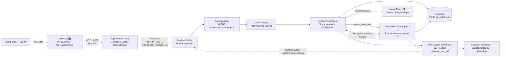

### 0.1 与需求描述存在偏差的事实（源码为准）

以下是扫描中发现"需求措辞与代码现实不一致"之处，正文各节均已按真实实现展开，这里集中列出，避免误读：

| 需求中的说法 | 源码真实情况 | 详见 |
|---|---|---|
| Fast / Plan / Code / Team 四种模式 | 真实模式为 `agent.work.normal/plan`、`agent.code.normal/plan`、`team.work.*`、`team.code.*`、`team.design`（`gateway/common/mode_matrix.py:33-42`）；`agent.fast` 仅为兼容别名映射到 `agent.work.normal`；Plan 与 Normal 共用同一 root Agent 缓存键 | §3 |
| Rails 洋葱模型 | **扁平优先级链**：priority 高者先执行，before/after 同序不反转；普通异常被记录后吞掉，仅 `AbortError` 穿透中断主循环 | §2 |
| `human()` 挂起并释放协程/进程资源 | `human()` 仅在内存 `asyncio.Future` 上 `wait_for`（默认 600s），协程保留、只释放 L2/L3 并发许可；真正释放资源的是 pause 三段式中止 + 以同 `run_id` 重启后 Journal 重放 | §4A |
| Token 预算精确计量 | `BudgetLedger` 为 `spent += n`，无锁，依赖单事件循环；两级熔断（`SwarmflowBudgetRail` + 引擎 `_check_budget` 抛 `BudgetExhausted`），允许少量超支。另：core 外循环 `LoopCoordinator.add_token_usage` 无调用点，外循环 token 预算实际未生效 | §2 / §4A |
| Journal Replay 快照比对 | 无整体快照 diff；命中依赖 `位置键 ks + SHA-256 内容签名 + run_id` 三元组；上游变化通过 prompt 级联改变签名实现失效；`_compute_structural_diff` 只打日志 | §4A |
| 五件套解析器 | 运行时**无**完整解析器，只读 SKILL.md frontmatter 的 `description`/`kind`；五件套完整解析只存在于创作期校验器 `validate_swarmskill.py:validate()` | §4B |
| Friction 信号 / CREATE·PATCH·SIMPLIFY | 无 "friction" 概念，真实信号为 `execution_failure`、`script_artifact`、`user_intent`、`conversation_review`、`trajectory_issue`、`review_feedback`；真实操作为 `append/merge/replace/skip`（经验补丁）、`DELETE/MERGE/REFINE/KEEP`（精简）、`evolve_rebuild`（重建），新团队技能由 `TeamSkillCreateRail` 提议 + swarmskill-creator 创建 | §4B |
| A2X 心跳保活 | 链路**无应用层心跳**：A2X 仅 HTTP 注册 + 30s 预留 TTL（`extend_reservation` 无调用方）；存活依赖 ZMQ ACK 超时与 registry status。进程内 Front⇄Worker IPC 才有 10s 心跳 / 30s 判死 | §3 |
| Checkpoint 半成品恢复 | SQLite(WAL) 单事务 upsert 保证写原子；但无版本链/校验和，反序列化失败仅记日志后静默以空状态重来 | §3 |

### 0.2 外部依赖说明

`AgentRequest`、`Message`、`E2AEnvelope`、`AgentResponseChunk`、`ReqMethod` 定义于外部 git 依赖 `openjiuwen-protocol`（`jiuwenswarm/pyproject.toml:27`），本仓库仅 re-export。其字段表由仓库内序列化代码（`server/ipc/protocol.py:68 dump_agent_request` / `:92 load_agent_request`）反推，正文已标注。

### 0.3 扫描中发现的潜在缺陷（供后续跟进）

1. **团队审批 JSON 兜底路径类型不匹配**：兜底路径向 `resume_interrupt` 传入 `dict`，而 `is_pending_interrupt_resume_valid` 要求 `InteractiveInput`，进程内成员上该兜底疑似无效（§4A）。
2. **外循环 Token 预算未接线**：`TokenBudgetEvaluator` 依赖的 `LoopCoordinator.add_token_usage` 无调用点（§2）。
3. **`db_journal_mode` 配置被忽略**：jiuwenswarm 传入，但 agent-core checkpointer provider 不读取（§3）。
4. **Checkpoint 反序列化失败静默清空**：无版本回退，可能丢失会话状态（§3）。
5. **PyZMQ `_seen_ids` 声明未使用**：无去重、无重试，通知语义为 at-most-once，依赖"先写 DB + 30s POLL 兜底"（§4A）。
6. **文档与代码不一致**：`agent_teams/workflow/AGENTS.md` 称 `run_background` 捕获 `BudgetExhausted`，代码刻意不捕获（§4A）。
7. **`qualified_edges()`（symphony distill）无调用方**（§4B）。


---

## 1. 全局端到端调用与数据契约全链路（End-to-End Execution Trace）

> 仓库：`/home/user/jiuwen-learn`（commit `cbbf8bc`）。本文所有类名 / 方法名 / 字段名均经 `grep -n` 在仓库中核实，行号即核实时的行号。
> 路径约定：`GW/` = `jiuwenswarm/gateway/`，`SW/` = `jiuwenswarm/jiuwenswarm/`，`CORE/` = `agent-core/openjiuwen/`，`BOX/` = `jiuwenswarm/jiuwenbox/src/jiuwenbox/`。

### 1.0 重要前提与范围说明

1. **协议包不在仓库内**：`Message`、`E2AEnvelope`、`AgentRequest`、`AgentResponse`、`AgentResponseChunk`、`ReqMethod`、`AgentRef`、`PermissionContext`、`encode_agent_chunk_for_wire` 等的真源在外部依赖 `openjiuwen-protocol`（`jiuwenswarm/pyproject.toml:27`，git 依赖 `agent-protocol@5201ca8…`）。仓库里只有转发别名：`SW/common/schema/agent.py`、`SW/common/e2a/models.py`、`SW/common/e2a/wire_codec.py`（都是 `from openjiuwen_protocol... import ...` 的 re-export）。所以这些类型的 **字段表是从仓库内的构造 / 序列化点反推的**（例如 `SW/server/ipc/protocol.py:68 dump_agent_request`，它逐字段序列化了 `AgentRequest`），文中会标明。
2. **"一次复杂 Team 任务"的场景**：Web 前端用 `chat.send` 发起 `params.mode = "team"`（或 `team.plan` 等 team 模式）的流式请求。Leader 规划、`build_team` / `spawn_teammate` / `create_task` 拉起 N 个 Teammate，Teammate `claim_task` 后执行 bash 工具，命令进 jiuwenbox 沙箱，结果流式回到浏览器。分支：Leader 也可以调用 `swarmflow` 工具，启动 SwarmFlow 工作流。
3. **进程拓扑**：AgentServer 有两种部署形态，代码都在：
   - **单进程**：Gateway 的 WS 直接连到 `AgentWebSocketServer._handle_message`（`SW/server/agent_ws_server.py:2667`）。
   - **Front + Worker 双进程**（"分配进程"的那一层）：Gateway 连 `AgentServerFront`（`SW/server/front/server.py:22`）。`ConnectionHandler._handle_raw` → `MethodRouter.dispatch` → `ExecutionAdmission.dispatch` → `RuntimeSupervisor.dispatch_parsed_request` 把请求经 IPC 帧（`KIND_REQUEST`）送进 Worker 进程。Worker 侧 `WorkerDispatcher._run_request` 再调用同一个 `AgentWebSocketServer.dispatch_parsed_request`，其中 `ws` 是 `WorkerGatewayBridge`。下面的时序图画的是双进程形态。单进程只是去掉 Front/Supervisor/Worker 三段。
4. `SW/server/dispatch.py` 中的 `HANDLERS` 表与 `try_dispatch(ctx: RequestContext)`（`:357`）**在 WS 主链路里没有被调用**：仓库内唯一引用是 `SW/extensions/runtime_management_extension/pod_rest_map.py:425` 导入 `HANDLERS`（HTTP/REST 映射）。WS 链路在 `dispatch_parsed_request` 里用显式 if 链分派，例如 `self._handle_team_session_bind(...)`。`chat.send` 最终进入 `_handle_stream`。

---

### 1.1 端到端主链路速览（文字版）

| # | 层 | 关键调用（file:line） |
|---|---|---|
| 1 | 浏览器 → Gateway Web 通道 | `WebChannel._handle_raw_message`（`GW/channel_manager/web/web_connect.py:2015`）构造 `Message(...)`（`:2162`），然后调用 `self._on_message_cb(user_message)` |
| 2 | Gateway 通道管理 | `ChannelManager._on_channel_message`（`GW/channel_manager/channel_manager.py:107`）→ `asyncio.create_task(self._message_handler.handle_message(msg))`（`:126`） |
| 3 | Gateway MessageHandler 入队 | `MessageHandler.handle_message`（`GW/message_handler/message_handler.py:558`），`_session_sharing.resolve_member_by_user` 命中时改写 `msg.session_id` 和 `msg.metadata["member_name"]`（`:572/:574`），然后执行 `_user_messages.put_nowait(msg)` |
| 4 | 转发循环 | `_forward_loop`（`:4931`）：`consume_user_messages` → `_handle_channel_control` → `_apply_channel_state`（`:2654`）→ `_ensure_inbound_session`（`:1012`，无 session 时 `_allocate_channel_session`（`:951`）发 `ReqMethod.SESSION_CREATE`）→ `_prepare_agent_dispatch_message`（`:2955`）→ `message_to_e2a`（`:3198`）→ `_start_stream_task`（`:5935`，调用点 `:5465`）→ `process_stream`（`:5522`） |
| 5 | Gateway → AgentServer 线 | `WebSocketAgentServerClient.send_request_stream`（`GW/routing/agent_client.py:626`）发出 `envelope.to_dict()`，接收方向用 `parse_agent_server_wire_chunk` 把帧解析成 `AgentResponseChunk` |
| 6 | Front 进程 | `ConnectionHandler._handle_raw`（`SW/server/front/connection.py:192`）→ `parse_raw_message`（`front/protocol.py:65`）→ `MethodRouter.dispatch`（`front/router.py:123`）→ `ExecutionAdmission.dispatch`（`front/admission.py:74`，`RequestRegistry.register`）→ `RuntimeSupervisor.dispatch_parsed_request`（`SW/server/supervisor/runtime_supervisor.py:343`）发送 IPC 帧 `{"kind": KIND_REQUEST, "payload": dump_agent_request(request)}` |
| 7 | Worker 进程 | `WorkerDispatcher.handle`（`SW/server/worker/dispatcher.py:151`）→ `load_agent_request`（`SW/server/ipc/protocol.py:92`）→ `_run_request`（`:379`）→ `runtime.dispatch_parsed_request(self._bridge, request, self._lock)`（`:443`） |
| 8 | AgentServer 分派 | `AgentWebSocketServer.dispatch_parsed_request`（`agent_ws_server.py:2752`）→ `_ensure_auto_team_binding_for_chat`（`:5694`）→ `_handle_stream`（`:4033`）→ `_handle_stream_impl`（`:4654`）→ `self._execution_runtime().stream(request, trigger_hook=False, on_control_event=...)` |
| 9 | Runtime / Session 分配 | `AgentRuntime.stream`（`SW/runtime/service.py:2183`）→ `_stream_under_tenant`（`:2209`）→ `normalize_request`（`:3790`）→ `session_work_kind`（`:3868`）判定为 `SessionWorkKind.TEAM_REQUEST` → `_ensure_session_registered` → `RuntimeSessionCoordinator.register_session`（`SW/runtime/session/coordinator.py:93`，分配 `generation`）→ `run_team_stream`（`coordinator.py:657`，调用点 `service.py:2399`）→ `_run_stream`（`:704`）→ `_new_execution`（`:1047`，new `SessionExecutionHandle`）→ `TeamExecutionContext` |
| 10 | Agent 选取 / 实例化 | `team_operation` → `_stream_started`（`service.py:2482`）→ `_prepare_chat_turn`（`:1266`）→ `prepare_chat_turn`（`SW/runtime/request.py:361`）→ `AgentManager.get_agent_for_request`（`SW/server/runtime/agent_manager.py:2050`）→ `get_agent`（`:1330`）→ `_create_agent`（`:650`）→ `JiuWenSwarm()` 与 `create_instance`（`SW/server/runtime/agent_adapter/interface.py:1758`） |
| 11 | Adapter → Team | `JiuWenSwarm.process_message_stream`（`interface.py:4147`）→ `adapter.process_message_stream_impl(request, inputs)`（`:4710`）→ `JiuWenSwarmDeepAdapter.process_message_stream_impl`（`interface_deep.py:18912`）→ `if is_team_mode(mode)`（`:19107`）→ `process_team_message_stream(request, inputs, self._instance)`（`:19211`） |
| 12 | Team 编排（jiuwenswarm 侧） | `process_team_message_stream`（`team_helpers.py:2868`）→ `_process_team_message_stream_locked`（`:2971`）→ `_process_team_message_stream`（`:3029`）→ `TeamManager.get_swarm_enriched_team_spec`（`SW/agents/harness/team/team_manager.py:1958`，内部调用 `enrich_team_spec_for_swarm`（`SW/agents/swarm/assembly.py:391`））→ `assign_shared_sandbox_sys_operation`（`assembly.py:618`，调用点 `team_helpers.py:3536`）→ `_start_team_stream_round`（`:2776`，调用点 `:4085`）→ `asyncio.create_task(_consume_stream_with_query(...))`（`:2858`） |
| 13 | Runner（agent-core） | `create_agent_team_session`（`CORE/core/session/agent_team.py:215`，调用点 `team_helpers.py:4562`）→ `Runner.run_agent_team_streaming`（`team_helpers.py:4625/4634`，`CORE/core/runner/team_runner.py:1087` 类方法 → `:256` 实例方法）→ `_resolve_team_agent_spec`（`:755`）→ `_stream_leader_lifecycle`（`:357`）→ `TeamRuntimeManager.activate`（`CORE/agent_teams/runtime/manager.py:151`）→ `_apply_action`（`:1307`）→ `spec.build()`（`:1365/:1381`） |
| 14 | 实例化 1 Leader | `TeamAgentSpec.build`（`CORE/agent_teams/schema/blueprint.py:849`）：`TeamSpec(...)`（`:887`）、`TeamRuntimeContext(...)`（`:931`）、`_TeamAgent(leader_card)`（`:943`）、`agent.configure(self, context)`（`:950`）→ `TeamAgent._setup_infra/_setup_agent`（`team_agent.py:719/:742`）→ `TeamAgentConfigurator.setup_agent`（`agent_configurator.py:540`）→ `TeamHarness.build`（`:982`，`team_harness.py:94`）→ `NativeHarness(agent_spec, build_context)`（`team_harness.py:114`，`class NativeHarness(DeepAgent)` 位于 `native_harness.py:134`） |
| 15 | Leader 流 | `_build_team_runtime_ready_chunk`（`team_runner.py:397`）→ `activation.agent.stream(stream_inputs, session=...)`（`:426`）→ `TeamAgent.stream`（`team_agent.py:958`）→ `CoordinationKernel.start`（`kernel.py:134`）→ `enqueue_user_input`（`:680`）生成 `InnerEventMessage(event_type=InnerEventType.USER_INPUT, payload={"content","run_context"})` → `AgentLifecycleHandler.on_user_input`（`handlers/agent_lifecycle.py:45`）→ `TeamAgent.deliver_input`（`team_agent.py:552`）→ `TeamHarness.send`（`team_harness.py:351`）→ `NativeHarness.send`（`native_harness.py:562`，`_CmdSend(msg=InboxMessage(...))`） |
| 16 | 外层循环 | `NativeHarness._on_send`（`:867`）→ `_start_round`（`:1287`）→ `_run_round`（`:1361`）→ `self.loop_controller.submit_round(...)`（`:1408`）→ `TaskLoopController.submit_round`（`CORE/harness/task_loop/task_loop_controller.py:47`，`InputEvent.from_user_input(query)` 加 `publish_event`）→ `TaskLoopEventExecutor` 中 `agent.react_agent.invoke(effective, session, _streaming=True)`（`task_loop_event_executor.py:252`）。单 Agent 路径的外层循环是 `DeepAgent._run_task_loop` 中的 `while coordinator.should_continue()`（`CORE/harness/deep_agent.py:2938`，`controller.submit_round` 位于 `:2986`） |
| 17 | 内层循环（ReAct） | `ReActAgent.invoke`（`CORE/core/single_agent/agents/react_agent.py:2811`）→ `_inner_invoke`（`:2867`）→ `for iteration in range(start_iteration, iteration_limit)`（`:3095`）→ `_call_model`（`:3125`）→ `_execute_tool_call`（`:3202`）→ `AbilityManager.execute`（`ability_manager.py:1112`，`:2397`）→ `_execute_single_tool_call`（`:1549`）→ `tool.invoke(tool_args, ...)`（`:1608`） |
| 18 | Teammate 拉起 | Leader 调用 `spawn_teammate`（`SpawnTeammateTool`，`CORE/agent_teams/tools/tool_member.py:669`）→ `register_teammate`（`:626/:838`）→ `team.spawn_member`（`TeamBackend.spawn_member`，`tools/team.py:800`）。之后 `send_message` / `create_task` / scheduler 等任一启动入口回调 `TeamAgent._start_teammate_runtime`（`team_agent.py:1904`）→ `_on_teammate_created`（`:1481`）→ `SpawnManager.build_context_from_db`（`spawn_manager.py:402`）→ `TeamAgent.spawn_teammate`（`:1864`）→ `SpawnManager.spawn_teammate`（`:89`）→ `_spawn_teammate_inner`（`:147`）：`inprocess_spawn`（`spawn_mode == "inprocess"`）或 `Runner.spawn_agent`（子进程），in-process 时 `_wire_inprocess_chunk_forward`（`:218`）把队友 chunk 转发到 leader 的 `stream_queue` |
| 19 | 任务看板 | `create_task`（`TaskCreateTool` `tool_task.py:673`，`task_manager.add_graph` `:737`）→ `TeamTaskManager.add_graph`（`task_manager.py:183`）→ `TaskDao.mutate_dependency_graph`（`task_dao.py:1513`）。`claim_task`（`ClaimTaskTool` `:2007`）→ `TeamTaskManager.claim`（`:557`）→ `TaskDao.claim_task`（`:906`）。`member_complete_task`（`:2124`）→ `TeamTaskManager.complete`（`:642`）→ `TaskDao.complete_task`（`:1741`） |
| 20 | 工具 / 沙箱 | `BashTool.invoke`（`CORE/harness/tools/shell/bash/_tool.py:184`）→ `self._operation.shell().execute_cmd(p.command, cwd=..., timeout=..., shell_type=...)`（`:227`）→ sandbox `ShellOperation.execute_cmd`（`CORE/core/sys_operation/sandbox/shell_operation.py:25`）→ `SandboxGatewayClientMixin.invoke`（`sandbox_mixin.py:49`）→ `SandboxGatewayClient.invoke`（`gateway/gateway_client.py:27`，`GatewayInvokeRequest(op_type, method, params, isolation_key)`）→ `SandboxGateway.handle_request`（`gateway/gateway.py:84`，`_get_or_create_provider` 后按 `getattr(provider, request.method)` 分派）→ `JiuwenBoxShellProvider.execute_cmd`（`CORE/extensions/sys_operation/sandbox/providers/jiuwenbox.py:2525`）→ `_execute_cmd_remote_pipeline`（`:2581`）→ `_run_exec_pipeline`（`:1001`）→ `_JiuwenBoxClient.exec`（`:458`）发出 HTTP `POST /api/v1/sandboxes/{sandbox_id}/exec`，body 字段为 `command, workdir, env, stdin, timeout_seconds` → jiuwenbox 服务端 `exec_in_sandbox`（`BOX/server/routes/sandbox.py:126`，`ExecRequest`）→ `SandboxManager.exec_in_sandbox`（`BOX/server/sandbox_manager.py:868`）→ `runtime.exec(...)` 返回 `ExecResult{exit_code, stdout, stderr}`（`BOX/models/sandbox.py:118`） |
| 21 | 回流（agent-core） | `NativeHarness._forward_outputs`（`native_harness.py:1658`，`session.stream_iterator()` → `output_queue`）→ `StreamController._forward_outputs`（`stream_controller.py:336`，`harness.outputs()` → `stream_queue.put`）→ `TeamAgent._consume_stream_queue`（`team_agent.py:1008`）→ `Runner._stream_leader_lifecycle` 逐条 `yield chunk` |
| 22 | 回流（jiuwenswarm Team 层） | `_consume_stream_with_query`：`parse_stream_chunk`（`SW/server/utils/stream_utils.py:143`，调用点 `team_helpers.py:4751`）→ `_tag_team_output_origin` / `_enrich_teammate_event` / `_attach_team_leader_identity` → `_deliver` → `_broadcast_event`（`:1988`，调用点 `:4488`）→ `TeamManager.broadcast_event`（`team_manager.py:676`）写入各 waiter 的 `asyncio.Queue` → `_process_team_message_stream` 中 `request_queue.get()` 加 `_build_team_event_chunk_meta`（`:737`），产出 `yield AgentResponseChunk(request_id, channel_id, payload=event, agent_ref, metadata={"fan_out_targets"}, is_complete=False)`（`:4189`） |
| 23 | 回流（Runtime → 线） | `AgentRuntime._stream_started` 执行 `RuntimeEvent.from_agent_message(chunk, ...)`（`service.py:2602`）→ `_stream_under_tenant` 补 `event.payload["execution_id"]`（`:2464`）→ `_run_stream` 的 `queue` → `_handle_stream_impl` 中 `async for event in runtime_stream` → `_send_runtime_event`（`agent_ws_server.py:5024`）构造 `AgentResponseChunk` → `encode_agent_chunk_for_wire(message, response_id, sequence)`（`:5090`）→ `send_wire_payload`（`SW/server/ws_send.py:96`） |
| 24 | 回流（Worker → Front → Gateway） | `WorkerGatewayBridge.send`（`SW/server/worker/gateway_bridge.py:79`，封装为 IPC `KIND_WIRE`）→ `RuntimeSupervisor._forward_wire`（`runtime_supervisor.py:952`）→ `EventForwarder.send`（`front/event_forwarder.py:54`）→ `send_wire_payload(target_ws, payload)` |
| 25 | 回流（Gateway → 浏览器） | `send_request_stream` 中 `parse_agent_server_wire_chunk(data)`，`yield chunk` → `process_stream` → `publish_stream_chunk`（`message_handler.py:4133`）→ `_chunk_to_message`（`:4054`）→ `publish_robot_messages`（`:2863`）→ `ChannelManager._dispatch_robot_messages`（`channel_manager.py:419`，`consume_robot_messages`）→ `channel.send(msg)` → `WebChannel.send`（`web_connect.py:1185`）→ `BaseWsChannel._enqueue_send`（`GW/routing/base_ws_channel.py:249`）→ `_writer_loop`（`:269`）→ `_safe_send`（`:415`） |

---

### 1.2 超详细时序图（Mermaid `sequenceDiagram`）

> 箭头上写的是：**真实方法名 (关键参数 / 字段)**。`par` 表示并行，`alt` 表示分支，`loop` 表示循环。所有名字都经 grep 核实。


#### 1.2.1 时序图要点解读

- **"分配进程 / 会话"发生在两处**：
  1. **进程**：`RuntimeSupervisor`（`supervisor/runtime_supervisor.py:85`）管理 Worker 子进程。`_bring_up`（`:645`）负责拉起，`_supervise`（`:471`）负责守护，`_watchdog`（`:1166`）检测卡死，`_schedule_restart`（`:1056`）负责重启。请求经 `dispatch_parsed_request` 以 `dispatch_id` 路由（`self._routes[dispatch_id] = (ws, send_lock)`）。
  2. **会话**：Gateway 在无 `session_id` 时通过 `ReqMethod.SESSION_CREATE` 请求 `AgentWebSocketServer._handle_session_create`（`agent_ws_server.py:13545`）→ `runtime.prepare_session_create(SessionCreateInput(...))`（`:13621`）→ `RuntimeSessionProvisioner.prepare_session_create`（`runtime/session_provisioner.py:595`）→ `commit_session_provision`（`:1418`）。进入执行时 `RuntimeSessionCoordinator.register_session`（`coordinator.py:93`）为该 session 分配单调递增的 `generation`，`_new_execution` 为本次请求分配 `execution_id = uuid.uuid4().hex`。
- **Team 生命周期桥接**：`AgentRuntime._team_lifecycle()`（`service.py:4022`）惰性创建 `TeamSessionLifecycleAdapter`（`runtime/team_session_lifecycle.py:91`）。构造时它调用 `team_manager.set_round_state_reporter(self._report_round_state)`，于是 TeamManager 的 round 运行/空闲状态会回写到 Coordinator 的 `resume_waiting_for_input` / `mark_session_waiting_for_input`（把 handle 的 `state` 在 `RUNNING` 与 `WAITING_FOR_INPUT` 之间切换）。`LazyTeamExecutionController`（`runtime/team_controller.py:9`）在 `_prepare_chat_turn` 遇到 team 模式时 `activate()`（`service.py:1290-1296`）。
- **1 Leader + N Teammates 的实例化**：Leader 在 `TeamAgentSpec.build()` 中同步构造（`TeamAgent` 加 `TeamHarness` 加 `NativeHarness(DeepAgent)`）。Teammate **不在 build 时创建**：先由 Leader 的 `spawn_teammate`/`build_team` 工具写入 DB 成员行（`TeamBackend.spawn_member`），再由 "startup funnel"（send_message、create_task、interact、scheduler、round-idle reconcile 都会经过 `_start_teammate_runtime` 回调，见 `team_agent.py:1904` 的 docstring）懒启动。`spawn_mode == "inprocess"` 时在同进程启动并转发 chunk，否则走 `Runner.spawn_agent` 子进程。
- **SwarmFlow 分支**：只有 `TeamAgentSpec.enable_swarmflow=True`（由 `get_swarm_enriched_team_spec` 在 `team_manager.py:2037` 设置）时，Leader 才挂载 `SwarmflowTool`（`workflow/tool_swarmflow.py:123`，工具名 `"swarmflow"`）。它是 `AsyncTool`：`run_background` → `run_swarmflow`（`workflow/runner.py:240`）→ 引擎 `run_workflow`（来自 `workflow/engine`）。worker 由 `TeamWorkerBackend` 驱动，worker 是 "teammate-equivalent harness"，执行一次 `TeamHarness.run_once`（`team_harness.py:183`，见其 docstring）。
- **外层 / 内层循环**：
  - 单 Agent（非 team）的外层是 `DeepAgent._run_task_loop`（`deep_agent.py:2905`），带 `max_outer_rounds` 保护（`:2940`）和 follow-up 合并（`_state.pending_follow_ups`）。
  - Team 成员的外层轮次由 `NativeHarness` 的 supervisor 直接驱动（`_run_round`，注释写明 "The supervisor drives outer rounds directly (bypassing DeepAgent.invoke)"，`native_harness.py:1391`）。两条路径都通过 `TaskLoopController.submit_round` → `TaskLoopEventExecutor` → `react_agent.invoke` 进入内层。
  - 内层是 `ReActAgent._inner_invoke` 的 `for iteration in range(...)`：每次迭代执行 `_call_model` → `_execute_tool_call`（并行工具）→ 写回 `context.add_messages(tool_message)`。

---

### 1.3 跨模块边界的 5 个核心数据结构

#### 1.3.1 请求信封：`AgentRequest`（以及上游 `Message` / `E2AEnvelope`）

**定义位置**：外部包 `openjiuwen_protocol.e2a.agent_models.AgentRequest`。仓库只 re-export：`SW/common/schema/agent.py:12-19`。字段表依据 `SW/server/ipc/protocol.py:68-88 dump_agent_request` 与 `:92-122 load_agent_request`，这两处逐字段序列化 / 反序列化，是仓库内最权威的字段清单。

| 字段 | 类型（按 load_agent_request 推断） | 说明 |
|---|---|---|
| `request_id` | `str` | 全链路请求 ID（Gateway `Message.id` → E2A `request_id`） |
| `channel_id` | `str` | 通道 ID，默认 `"web"`（`agent_ws_server.py:1029`） |
| `session_id` | `str \| None` | 产品会话 ID |
| `chat_id` | `str \| None` | IM 群聊等场景 |
| `req_method` | `ReqMethod \| None` | 如 `CHAT_SEND` / `SESSION_CREATE` / `CHAT_CANCEL` |
| `params` | `dict` | 业务参数：`query`、`mode`、`work_mode`、`project_dir`、`target_team_id`、`team_dispatch_mode`、`enable_swarmflow`… |
| `is_stream` | `bool` | 是否流式 |
| `timestamp` | `float` | |
| `metadata` | `dict \| None` | 过滤掉 `E2A_WIRE_INTERNAL_METADATA_KEYS` 后注入 `app_id`；运行期携带 `_team_execution_context` |
| `enable_memory` | `Any`（可选） | |
| `permission_context` | `PermissionContext \| None` | `PermissionContext.from_dict` |
| `agent_ref` | `AgentRef(mode, id) \| dict \| None` | `_load_agent_ref`（`ipc/protocol.py:157`） |
| `user_id` | `str` | |
| `trusted_session_message_route` | `dict \| None` | 跨会话消息的可信路由，入站时 `_strip_untrusted_session_message_context` 清洗 |

另外，`interface_deep.py` 用 `getattr(request, "trusted_runtime_binding", None)` 读取可选属性（`:18943`）。

上游 **Gateway `Message`**（`openjiuwen_protocol.message.Message`，`web_connect.py:25` 导入），在 `web_connect.py:2162-2177` 构造时用到的字段：`id, type, channel_id, session_id, params, timestamp, ok, req_method, mode, is_stream, app_id, agent_ref, user_id, metadata`，回流时还有 `payload`（`_chunk_to_message`）。**`E2AEnvelope`**（`openjiuwen_protocol.e2a.models`）在仓库内被读取的属性有：`request_id, channel, method, is_stream, params, channel_context`（`agent_ws_server.py:2692-2718`、`message_handler.py:5531-5532`），转换函数是 `e2a_to_agent_request`（`SW/common/e2a/agent_compat.py`）和 `message_to_e2a_or_fallback`。

**变更点（mutation points）**：

| 位置 | 变更内容 |
|---|---|
| `GW/message_handler/message_handler.py:572/574` | `handle_message`：命中共享会话成员时改写 `msg.session_id`，并写入 `msg.metadata["member_name"]` |
| `message_handler.py:2667` | `_apply_channel_state`：带 `member_name` 时强制 `msg.params["mode"] = "team"` |
| `message_handler.py:2679/2681/2683/2688/2694` | `_apply_channel_state`：用 `ChannelControlState.session_id` 回填或清空 `msg.session_id`，`params.setdefault("mode", state.mode.value)` |
| `message_handler.py:1023` | `_ensure_inbound_session`：`msg.session_id = await self._allocate_channel_session(...)` |
| `message_handler.py:1056`、`:2107`、`:5248` | 外部通道会话解析 / 新会话 / 队列化消息改 `mode` |
| `SW/server/agent_ws_server.py:1008-1037` | `_payload_to_request`：legacy 载荷转换为 `AgentRequest`，并 `metadata.setdefault("app_id")` |
| `agent_ws_server.py:2718` | `e2a_to_agent_request(env)` 构造 |
| `agent_ws_server.py:339` | `_strip_untrusted_session_message_context(request)` 剥离不可信跨会话字段 |
| `SW/server/ipc/protocol.py:68 / :92` | Front→Worker 的序列化 / 反序列化（Worker 内得到新对象） |
| `SW/runtime/service.py:3790-3840` | `normalize_request`：从会话元数据回填 `params["mode"]`、`params["work_mode"]`，并 `replace(request, params=normalized_params)`（不可变替换） |
| `SW/runtime/request.py:357` | `apply_resolved_mode_to_request`：`request.params["mode"] = resolved.canonical_mode` |
| `request.py:398/403/438` | `prepare_chat_turn`：`params[PREVIOUS_SESSION_MODE_KEY]`、继承锁定 `params["mode"]`、`params["work_mode"] = runtime_work_mode` |
| `request.py:502/514/516` | `params["project_id"]`、`params["project_dir"]`、`metadata["project_dir"]` |
| `request.py:573` | `params["eternal_conversation_enabled"] = effective_persist_session`（同时 pop `persist_session`） |
| `SW/runtime/service.py:2388-2389` | `team_operation`：`metadata[TEAM_EXECUTION_CONTEXT_METADATA_KEY] = context`，`contextual_request = replace(request, metadata=metadata)` |
| `interface_deep.py:19138/19164` | Team 分支把 `inputs["query"]` 改写为 `team_turn.text`（这里改的是 inputs，不是 request） |

#### 1.3.2 会话 / 运行上下文：`SessionExecutionHandle`（加 `TeamExecutionContext` / `TeamExecutionDetails` / `RunContext`）

**定义**：`SW/runtime/session/model.py`

- `SessionExecutionHandle`（`:171`，`@dataclass(slots=True)`，可变）

| 字段 | 类型 |
|---|---|
| `execution_id` | `str` |
| `session_id` | `str` |
| `request_id` | `str` |
| `generation` | `int` |
| `work_kind` | `SessionWorkKind`（`:64`，取值包括 `TEAM_REQUEST="team_request"`、`TEAM_CONTROL`、`TEAM_BACKGROUND`、`CHAT_STREAM`…） |
| `channel_id` | `str = "default"` |
| `team` | `TeamExecutionDetails \| None` |
| `parent_execution_id` | `str \| None` |
| `root_work_kind` | `SessionWorkKind \| None` |
| `root_request_id` | `str \| None` |
| `waiting_control_ids` | `frozenset[str]` |
| `state` | `SessionExecutionState = QUEUED`（`:94`：`QUEUED/RUNNING/WAITING_FOR_CONTROL/WAITING_FOR_INPUT/SUCCEEDED/FAILED/CANCELLED`） |
| `created_at` | `float`（`time.monotonic`） |
| `started_at` / `finished_at` | `float \| None` |
| `error` | `str \| None` |
| `cancellation_requested` | `bool` |
| `task` | `asyncio.Task \| None` |
| `agent` | `Any` |
| `terminal_event` | `asyncio.Event` |
| `retain_owner_task` | `bool` |

`snapshot()`（`:196`）生成不可变的 `SessionExecutionSnapshot`（`:219`）。

- `TeamExecutionDetails`（`:152`，frozen）：`control_id: str|None`、`background_trigger: str|None`、`session_message_id: str|None`、`waiter_kind: TeamWaiterKind = NONE`（`:123`：`NONE/PERSISTENT/REQUEST/EXCLUSIVE`）、`observation_only: bool`。
- `ExecutionLifecycleContext`（`:141`，frozen）：`session: SessionLifecycleContext{session_id, generation}`、`execution_id`、`request_id`、`work_kind`、`channel_id`。`TeamExecutionContext`（`:164`）在此基础上加 `details: TeamExecutionDetails`。它通过 `request.metadata["_team_execution_context"]` 跨模块传进 `team_helpers._process_team_message_stream`（`:3046-3058` 读取 `generation` / `waiter_kind`）。
- 附：`RunContext`（`SW/runtime/run_context.py:9`，frozen）：`request_id, session_id, max_turns, host_tools, max_budget_usd, tool_permissions, credential_context, supports_permission_approval`，经 ContextVar `CURRENT_RUN_CONTEXT` 传递。Team 侧由 `_team_input_run_context(request)`（`team_helpers.py:551`）组装后传给 `Runner.run_agent_team_streaming(run_context=...)`，最终进入 `InboxMessage.run_context`。

**变更点**：

| 位置 | 变更 |
|---|---|
| `SW/runtime/session/coordinator.py:1087` | `_new_execution` 构造：`execution_id=uuid.uuid4().hex`、`generation=record.generation`、`team=details` |
| `coordinator.py:1082` | 新执行顶替旧执行（latest-first）：`previous.cancellation_requested = True` |
| `SW/runtime/session/execution_registry.py:43-44` | `mark_running`：`state=RUNNING`、`started_at` |
| `execution_registry.py:51` | `mark_awaiting_control`：`waiting_control_ids \|= control_ids`（流中出现 ask_user / 审批时，由 `_run_stream.produce` 调用） |
| `execution_registry.py:57/59` | `mark_waiting`：`state=WAITING_FOR_CONTROL`、`task=None` |
| `execution_registry.py:64` | `resume_waiting`：回到 `RUNNING` |
| `execution_registry.py:78-85` | `mark_terminal`：`state`（SUCCEEDED/FAILED/CANCELLED）、清空 `waiting_control_ids`、`agent=None`、`finished_at`、`error`、`task=None` |
| `coordinator.py:323` | `bind_agent`：`handle.agent = agent`（`service.py:2568` 调用） |
| `coordinator.py:186/246/253/358/502/795` | `handle.task = ...`（调度后的任务） |
| `coordinator.py:261/845/916/1292` | `cancellation_requested = True`（取消、关闭、直接取消） |
| `coordinator.py:955/977/990` | `mark_waiting_for_input` / `mark_session_waiting_for_input` / `resume_waiting_for_input`：`WAITING_FOR_INPUT ↔ RUNNING`。Team round 空闲 / 运行由 `TeamSessionLifecycleAdapter._report_round_state`（`team_session_lifecycle.py:107`）经 `TeamManager.report_round_state`（`team_manager.py:453`）驱动 |
| `coordinator.py:675-689` | `run_team_stream.contextual_operation`：从 handle 派生 `TeamExecutionContext`（不可变，只创建不修改） |

#### 1.3.3 团队规格：`TeamAgentSpec`（以及 build 后的 `TeamSpec`）

**定义**：`CORE/agent_teams/schema/blueprint.py:198`（Pydantic `BaseModel`，`model_config = {"protected_namespaces": ()}`）。它是 jiuwenswarm 与 agent-core 之间的**核心跨层契约**：jiuwenswarm 组装它，`Runner` 消费它，`build()` 把它物化成 `TeamAgent`。

| 行 | 字段 | 类型 / 默认 |
|---|---|---|
| 207 | `agents` | `dict[str, DeepAgentSpec]`（键为 `"leader"` / `"teammate"`，`DeepAgentSpec` 定义于 `CORE/harness/schema/deep_agent_spec.py:433`） |
| 208 | `reviewer_agent` | `DeepAgentSpec \| None` |
| 222 | `team_name` | `str = "agent_team"` |
| 223 | `lifecycle` | `str = TeamLifecycle.TEMPORARY` |
| 224 | `evolution_enabled` | `bool = True` |
| 231 | `enable_team_plan` | `bool = False` |
| 238 | `teammate_mode` | `str = "build_mode"` |
| 240 | `spawn_mode` | `str = "process"` |
| 241 | `member_workspace_prefix` | `bool = True` |
| 251 | `leader` | `LeaderSpec`（`:159`，继承 `MemberSpecBase`（`schema/team.py:184`）：`member_name="team_leader"`、`display_name`、`desc`、`prompt`、`model_name`） |
| 252 | `predefined_members` | `list[PredefinedMemberSpec]`（按 `role_type` 判别的联合类型：`BridgeMemberSpec \| ExternalCliMemberSpec \| TeamMemberSpec`） |
| 253 | `agent_group_name` | `Optional[str]` |
| 262 | `external_cli_agents` | `list[ExternalCliAgentSpec]` |
| 273 | `tiny_agents` | `dict[str, TinyAgentSpec]` |
| 280 | `model_pool` | `list[ModelPoolEntry]` |
| 294 | `model_router` | `Optional[ModelRouterConfig]` |
| 310 | `model_intelli_router` | `Optional[IntelliRouterConfig]` |
| 330 | `model_pool_strategy` | `Literal["round_robin","by_model_name","router","intelli_router"]` |
| 340 | `team_mode` | `Literal["default","predefined","hybrid"] \| None` |
| 350 | `dispatch_mode` | `Literal["autonomous","scheduled"] = "autonomous"` |
| 364 | `enable_task_verification` | `bool = False` |
| 374 | `enable_member_messaging` | `bool = False` |
| 385 | `max_subtask_depth` | `int = Field(0, ge=0)` |
| 395 | `bootstrap_mode` | `Literal["leader","framework"] = "leader"` |
| 408/415 | `team_display_name` / `team_desc` | `str \| None` |
| 422/430/438/449/459 | `default_max_review_rounds=3` / `review_stall_timeout=2400` / `stale_claim_idle_timeout=600` / `stale_pending_idle_timeout=600` / `steer_batch_size=2` | `int` |
| 469/479 | `transport` / `external_transport` | `Optional[TransportSpec]`（`:100`：`type`、`params`） |
| 481 | `storage` | `Optional[StorageSpec]`（`:119`） |
| 482 | `worktree` | `Optional[WorktreeConfig]` |
| 484 | `workspace` | `Optional[TeamWorkspaceConfig]` |
| 486 | `metadata` | `dict[str, Any]` |
| 487/510/533/554 | `enable_hitt` / `expose_human_agents_to_teammates` / `enable_bridge` / `enable_fork` | `bool` |
| 577 | `enable_swarmflow` | `bool = False` |
| 593 | `swarmflow_concurrency` | `ConcurrencyLimits` |
| 596 | `swarmflow_budget` | `Optional[int]` |
| 612/623/626 | `progressive_tool` / `enable_permissions` / `enable_organization(=True)` | `bool` |
| 636 | `language` | `Optional[str]` |
| 645 | `build_context` | `Optional[Any]`（运行期 `BuildContext`） |
| 660 | `build_context_seed` | `Optional[dict[str, Any]]`（可序列化种子） |
| 670 | `memory` | `Optional[TeamMemoryConfig]` |
| 674 | `reliability` | `Optional[ReliabilityConfig]` |

校验器：`_validate_pool_router_exclusive`（`:702`）、`_validate_external_cli_unique`（`:726`）、`_validate_review_settings`（`:747`）、`_validate_stall_settings`（`:764`）、`_validate_bootstrap_mode`（`:781`）、`_validate_steer_batch_size`（`:798`）、`_default_transport_for_spawn_mode`（`:812`）。

**变更点**：

| 位置 | 变更 |
|---|---|
| `SW/agents/harness/team/team_manager.py:1806/1857` | `_load_team_spec`：`TeamAgentSpec.model_validate(spec_dict)` 构造 |
| `team_manager.py:1464` | `_apply_session_scoped_team_name`：`spec.team_name = build_session_scoped_team_name(...)` |
| `team_manager.py:1953` | `_load_session_team_spec`：`spec.team_name = team_name` |
| `team_manager.py:2082` | `apply_team_plan_mode`：`spec.enable_team_plan = True` |
| `SW/agents/swarm/assembly.py:526/528` | `enrich_team_spec_for_swarm`：`spec.agents[role] = member_spec`、`spec.reviewer_agent = build_reviewer_deep_agent_spec(...)` |
| `assembly.py:536/540` | `spec.build_context = base`、`spec.build_context_seed = base.to_seed()` |
| `team_manager.py:2037/2040/2042` | `spec.enable_swarmflow`、`spec.swarmflow_budget` |
| `team_manager.py:2050/2052/2054` | `spec.worktree`（新建 / `model_copy(enabled=True)` / None） |
| `team_manager.py:2056-2062` | `spec.dispatch_mode`。非 scheduled 时置 `enable_task_verification=False`、`enable_member_messaging=False`、`max_subtask_depth=0`。`spec.bootstrap_mode` |
| `assembly.py:635/638` | `assign_shared_sandbox_sys_operation`：`agents[name] = agent_spec.model_copy(update={"sys_operation": shared})`、`spec.reviewer_agent = ...model_copy(...)` |
| `blueprint.py:699` | `materialize_build_context`：`self.build_context = build_context_from_seed(self.build_context_seed)`（跨进程 / 恢复时由种子重建） |
| `blueprint.py:849-951` | `build()`：只读消费，派生 `TeamSpec(...)`（`:887`，`schema/team.py:549`）和 `TeamRuntimeContext`（`:931`），并 `agent.configure(self, context)` |
| `CORE/agent_teams/agent/agent_configurator.py`（`setup_agent` 内） | `build_spec = agent_spec.model_copy(...)`：成员级副本（不改原 spec） |

#### 1.3.4 任务模型：`TeamTaskBase`（SQLModel，Team 任务看板）

**定义**：`CORE/agent_teams/tools/models.py:109`（`class TeamTaskBase(SQLModel)`。实际表模型由 `_get_task_model()` 动态取得，`task_dao.py:591`）。状态枚举 `TaskStatus`（`CORE/agent_teams/schema/status.py:304`）：`PENDING="pending"`、`BLOCKED`、`PLANNING`、`IN_PROGRESS`、`IN_REVIEW`、`COMPLETED`、`CANCELLED`。

| 行 | 字段 | 类型 |
|---|---|---|
| 123 | `task_id` | `str`（PK） |
| 128 | `team_name` | `str`（FK `team_info.team_name`，CASCADE） |
| 129 | `title` | `str` |
| 130 | `content` | `str` |
| 137 | `status` | `str`（index） |
| 138 | `assignee` | `Optional[str]` |
| 145 | `reviewer` | `Optional[str]` |
| 150 | `review_round` | `int = 0` |
| 154 | `max_review_rounds` | `Optional[int]` |
| 159 | `summary` | `Optional[str]` |
| 164 | `note` | `Optional[str]` |
| 170 | `parent_task_id` | `Optional[str]` |
| 173 | `created_by` | `Optional[str]` |
| 177 | `resume_pending` | `bool = False` |
| 184 | `revision` | `int = 0` |
| 185 | `observed_revision` | `int = 0` |
| 186 | `parent_revision` | `int = 0` |
| 189 | `change_notes` | `Optional[str]` |
| 190 | `updated_at` | `Optional[int]`（BigInteger） |

关联表：`TeamTaskDependencyBase`（`:262`）、`TeamTaskReviewVoteBase`（`:272`）。

跨模块流转：Leader 的 `create_task` 工具 → `TeamTaskManager`（`tools/task_manager.py:98`）→ `TaskDao`（`tools/database/task_dao.py:452`）→ DB。DB 变化再以 `EventMessage`（`schema/events.py:807`）发布，驱动 Teammate 的 `CoordinationKernel` 事件（如 `POLL_TASK`），并经 team monitor 变成前端 `team.task` 事件（`_build_team_event_chunk_meta` 对 `ev_type in ("team.member","team.task")` 取 `inner.team_id` 作为 `agent_ref.id`，`team_helpers.py:754-757`）。

**变更点**：

| 位置 | 变更 |
|---|---|
| `task_dao.py:582-605` | `create_task(task_id, team_name, title, content, status)`：插入，`updated_at=get_current_time()` |
| `task_dao.py:1513` | `mutate_dependency_graph`：`TeamTaskManager.add_graph`（`task_manager.py:183`，`:251` 调用）的批量建图与依赖 |
| `task_dao.py:150/155` | 依赖解析：`status = BLOCKED` 或 `PENDING` |
| `task_dao.py:328` | 父任务挂起：`status=BLOCKED, resume_pending=True` |
| `task_dao.py:890` | `start_task`（scheduled 派发）：`status=to_status, resume_pending=False` |
| `task_dao.py:949-950` | `claim_task`：条件 UPDATE `WHERE assignee IS NULL AND status=pending`，置 `status=to_status(IN_PROGRESS/PLANNING)`、`assignee=member_name`（`TeamTaskManager.claim` `task_manager.py:619` 调用；`ClaimTaskTool` `tool_task.py:2061`） |
| `task_dao.py:1063-1071` | `reset_task`：`status=PENDING, assignee=None, summary=None, observed_revision=revision` |
| `task_dao.py:1111-1112` | `submit_for_review`：`status=IN_REVIEW, review_round+1` |
| `task_dao.py:1150` | `revise_task`：`IN_REVIEW → IN_PROGRESS` |
| `task_dao.py:1164/1184` | `set_reviewer` / `set_max_review_rounds` |
| `task_dao.py:1293` | `approve_plan_task`：`PLANNING → IN_PROGRESS` |
| `task_dao.py:1325` | `update_task_status`：`task.status = status` |
| `task_dao.py:1409` | `update_task`：`task.revision += 1`（内容修订） |
| `task_dao.py:1493` | `observe_revision`：`observed_revision` |
| `task_dao.py:1663/1679` | `cancel_task` / `cancel_all_tasks`：`CANCELLED` |
| `task_dao.py:1741/1766` | `complete_task`：`COMPLETED`、`task.summary = summary`（`TeamTaskManager.complete` `task_manager.py:693`；`MemberCompleteTaskTool` `tool_task.py:2199`） |

#### 1.3.5 流事件：`RuntimeEvent`（以及线上的 `AgentResponseChunk` / Team event dict）

**定义**：`SW/runtime/events.py:12`（`@dataclass(slots=True)`，可变）。它是 Runtime 内部 "传输无关" 的统一事件，向上被 AgentServer 渲染成 E2A 线帧，向下由 agent 的 `AgentResponseChunk` 转换而来。

| 字段 | 类型 |
|---|---|
| `request_id` | `str` |
| `channel_id` | `str` |
| `session_id` | `str \| None` |
| `payload` | `dict[str, Any] \| None`（必含 `event_type`。team 事件还带 `rid`、`role`、`member_name`、`team_id`/`team_name`、`execution_id`…） |
| `agent_ref` | `Any = None` |
| `metadata` | `dict[str, Any] \| None`（Team 场景为 `{"fan_out_targets": [...]}`） |
| `is_complete` | `bool = False` |
| `ok` | `bool = True` |
| `runtime_completion` | `str \| None`（`to_dict()` 会去掉它，不上线） |

辅助：`event_type` 属性（`:26`）、`from_agent_message`（`:38`）、`control`（`:79`）、`error`（`:95`，`payload={"event_type":"runtime.error"}, is_complete=True, ok=False`）。终止错误类型集合 `TERMINAL_ERROR_EVENT_TYPES`（`:124`）：`chat.error/runtime.error/execution.error/team.error/error`。

**上游 `AgentResponseChunk`**（外部协议类）在仓库中构造时使用的字段：`request_id, channel_id, payload, is_complete, agent_ref, metadata`（`team_helpers.py:4189-4196`、`agent_ws_server.py:5082-5089`）。代码注释写明 "AgentResponseChunk has no `ok` field"（`agent_ws_server.py:5074`）。

**变更 / 转换点**：

| 位置 | 变更 |
|---|---|
| `CORE/...` → `team_helpers.py:4751` | `parse_stream_chunk(chunk)` 把 agent-core 的 OutputSchema chunk 转成 event dict |
| `team_helpers.py:~4796-4808`（`_consume_stream_with_query` 内） | `parsed["rid"] = round_id`、`_tag_team_output_origin`、`_enrich_teammate_event`（覆盖 `member_name`）、`parsed["role"] = TeamRole.LEADER.value`、`_truncate_team_tool_result_event`、`_attach_team_leader_identity` |
| `team_helpers.py:1999-2000` | `_broadcast_event`：`team.error` 改写为 `event["event_type"] = "chat.error"` |
| `team_helpers.py:4189` | 封装为 `AgentResponseChunk(payload=event, agent_ref, metadata=fan_out_targets)` |
| `SW/runtime/service.py:2602` | `RuntimeEvent.from_agent_message(chunk, request_id, channel_id, session_id, default_agent_ref=request.agent_ref)`：`payload` 浅拷贝（非 dict 时包装成 `chat.final`） |
| `service.py:2615` | heartbeat 场景下 `event.payload["execution_id"] = execution.execution_id` |
| `service.py:2464`（另有 `:2090/:2828/:2884`） | `_stream_under_tenant` 等：`event.payload["execution_id"] = execution_id` |
| `service.py:2757` | 异常时 `yield RuntimeEvent.error(...)` |
| `SW/runtime/session/coordinator.py:747`（`produce`） | `interaction_ids(item)` 读取事件内的交互 ID 并 `mark_awaiting_control`（读取不改写） |
| `SW/server/agent_ws_server.py:5072-5081` | `_send_runtime_event`：`ok=False` 时 `payload["event_type"]="chat.error"`、`setdefault("error")`。`chat.error` 走 `_annotate_model_error(payload, session_id)` |
| `agent_ws_server.py:5082-5094` | 渲染为 `AgentResponseChunk` 再 `encode_agent_chunk_for_wire(..., sequence=chunk_count)` |
| `GW/message_handler/message_handler.py:5566-5573` | `process_stream`：`chat.processing_status` / `chat.error` 的 payload 注入 `request_id` 与 `stream_route`（`team_id`） |
| `message_handler.py:4054` | `_chunk_to_message`：chunk 转成 Gateway `Message`（提取 `group_digital_avatar`、`enable_memory`） |

---

### 1.4 附：关键类 / 文件索引（便于跳转）

| 层 | 类 / 函数 | file:line |
|---|---|---|
| Gateway | `WebChannel` / `_handle_raw_message` / `send` | `GW/channel_manager/web/web_connect.py:206/2015/1185` |
| Gateway | `ChannelManager._on_channel_message` / `_dispatch_robot_messages` | `GW/channel_manager/channel_manager.py:107/419` |
| Gateway | `MessageHandler` / `ChannelControlState` / `ChannelMode` | `GW/message_handler/message_handler.py:317/281/205` |
| Gateway | `WebSocketAgentServerClient.send_request_stream` | `GW/routing/agent_client.py:131/626` |
| Gateway | `BaseWsChannel._writer_loop` | `GW/routing/base_ws_channel.py:269` |
| Front | `AgentServerFront` / `ConnectionHandler` / `MethodRouter` / `ExecutionAdmission` / `RequestRegistry` | `SW/server/front/server.py:22`、`connection.py:69`、`router.py:111`、`admission.py:38`、`request_registry.py:41` |
| Supervisor | `RuntimeSupervisor` | `SW/server/supervisor/runtime_supervisor.py:85` |
| IPC | `dump_agent_request` / `load_agent_request` / `KIND_*` | `SW/server/ipc/protocol.py:68/92/24-38` |
| Worker | `WorkerDispatcher` / `WorkerGatewayBridge` | `SW/server/worker/dispatcher.py:60`、`gateway_bridge.py:57` |
| AgentServer | `AgentWebSocketServer` | `SW/server/agent_ws_server.py:1241` |
| AgentServer | `send_wire_payload` | `SW/server/ws_send.py:96` |
| AgentServer | `RequestContext` / `try_dispatch` / `HANDLERS` | `SW/server/context.py:264`、`SW/server/dispatch.py:357` |
| Runtime | `AgentRuntime` | `SW/runtime/service.py:350` |
| Runtime | `RuntimeSessionCoordinator` | `SW/runtime/session/coordinator.py:73` |
| Runtime | `SessionExecutionRegistry` | `SW/runtime/session/execution_registry.py:16` |
| Runtime | `RuntimeSessionProvisioner` / `SessionCreateInput` | `SW/runtime/session_provisioner.py:521/113` |
| Runtime | `TeamSessionLifecycleAdapter` / `LazyTeamExecutionController` | `SW/runtime/team_session_lifecycle.py:91`、`team_controller.py:9` |
| Runtime | `RuntimeEvent` / `RunContext` / `RuntimeExecutionContext` | `SW/runtime/events.py:12`、`run_context.py:9`、`context.py:17` |
| Manager | `AgentManager` | `SW/server/runtime/agent_manager.py:208` |
| Adapter | `JiuWenSwarm` / `JiuWenSwarmDeepAdapter` | `SW/server/runtime/agent_adapter/interface.py:1539`、`interface_deep.py:1881` |
| Team(swarm) | `TeamManager` / `get_team_manager` | `SW/agents/harness/team/team_manager.py:342/4166` |
| Team(swarm) | `enrich_team_spec_for_swarm` / `assign_shared_sandbox_sys_operation` | `SW/agents/swarm/assembly.py:391/618` |
| Runner | `Runner` / `_TeamRunnerMixin` / `_TeamRunnerClassMixin` | `CORE/core/runner/runner.py:696`、`team_runner.py:124/1043` |
| agent_teams | `TeamRuntimeManager` / `TeamRuntimeActivation` | `CORE/agent_teams/runtime/manager.py:109/93` |
| agent_teams | `TeamAgentSpec` / `LeaderSpec` / `TeamSpec` / `TeamMemberSpec` | `CORE/agent_teams/schema/blueprint.py:198/159`、`schema/team.py:549/221` |
| agent_teams | `TeamAgent` / `CoordinationKernel` / `EventBus` / `InnerEventMessage` | `agent/team_agent.py:173`、`agent/coordination/kernel.py:34`、`event_bus.py:64` |
| agent_teams | `SpawnManager` / `StreamController` | `agent/spawn_manager.py`（`spawn_teammate` `:89`）、`agent/stream_controller.py:112` |
| agent_teams | `TeamHarness` / `NativeHarness(DeepAgent)` / `InboxMessage` | `harness/team_harness.py:58`、`native_harness.py:134`、`harness/state.py:63` |
| agent_teams | `TeamTaskManager` / `TaskDao` / `TeamTaskBase` / `TaskStatus` | `tools/task_manager.py:98`、`tools/database/task_dao.py:452`、`tools/models.py:109`、`schema/status.py:304` |
| agent_teams | `SwarmflowTool` / `run_swarmflow` | `workflow/tool_swarmflow.py:123`、`workflow/runner.py:240` |
| harness | `DeepAgent` / `TaskLoopController` | `CORE/harness/deep_agent.py:313`、`harness/task_loop/task_loop_controller.py:22` |
| core | `ReActAgent` / `AbilityManager` | `CORE/core/single_agent/agents/react_agent.py:548`、`ability_manager.py:162` |
| tools | `BashTool` | `CORE/harness/tools/shell/bash/_tool.py:73` |
| sys_operation | `ShellOperation`(sandbox) / `SandboxGatewayClient` / `SandboxGateway` | `CORE/core/sys_operation/sandbox/shell_operation.py:18`、`gateway/gateway_client.py:11`、`gateway/gateway.py:53` |
| sandbox ext | `JiuwenBoxShellProvider` / `_JiuwenBoxClient` | `CORE/extensions/sys_operation/sandbox/providers/jiuwenbox.py:2520/392` |
| jiuwenbox | `exec_in_sandbox` route / `SandboxManager` / `ExecResult` | `BOX/server/routes/sandbox.py:126`、`BOX/server/sandbox_manager.py:153`、`BOX/models/sandbox.py:118` |


---

## 2. Core 模块：单智能体引擎、Rails 切面与 Harness 控制

> 分析范围：`agent-core/openjiuwen`（下文路径均相对此目录）。
> 所有 `文件:行号` 均通过 `grep -n` / `sed -n` 在当前工作树中逐一核对。仅引用源码中真实存在的类名、方法名。
> 关键结论先行：
> 1. **Inner Loop** = `ReActAgent._inner_invoke` 里的 `for iteration in range(...)`（`core/single_agent/agents/react_agent.py:3095`）；**Outer Loop** = `DeepAgent._run_task_loop` 里的 `while coordinator.should_continue()`（`harness/deep_agent.py:2938`），其上还有一层长连接 **Interaction Supervisor**（`DeepAgent._supervisor_loop`，`harness/deep_agent.py:4377`）负责 follow-up / Goal 续跑。
> 2. Rails 是 **按 priority 降序排列的扁平链（chain），不是洋葱模型**；`@rail` 装饰器只是在一个被包裹方法前后各触发一次链。rail 回调抛出的普通 `Exception` **被回调框架记录日志后吞掉**，只有 `AbortError`（及其 `cause`）会穿透并中断主循环。
> 3. 上下文管理由 `ContextProcessorRail` 在 `init` 时装配到 `ReActAgentConfig.context_processors`，实际在 `SessionModelContext.add_messages` / `get_context_window` 内被动触发；模型报“上下文超长”时由 `ContextEngine.recover_from_model_exception` 主动压缩后重试一次。Goal Mode 通过 `TaskCompletionRail` 改写 task-iteration 的 query（`<goal_task>`）+ 以 PromptAttachment 注入 `goal_protocol`。

---

### 2.0 关键类与文件索引

| 角色 | 类 / 函数 | 位置 |
|---|---|---|
| 外层 Agent | `DeepAgent(BaseAgent)` | `harness/deep_agent.py:313` |
| 入口 | `DeepAgent.invoke` / `DeepAgent.stream` / `_stream_with_context` | `harness/deep_agent.py:3341` / `3413` / `3424` |
| 单轮 | `DeepAgent._run_single_round_invoke` / `_run_single_round_stream` | `harness/deep_agent.py:2504` / `3232` |
| 外循环 | `DeepAgent._run_task_loop` | `harness/deep_agent.py:2905` |
| 外循环装配 | `DeepAgent._setup_task_loop` / `_build_task_loop_evaluators` | `harness/deep_agent.py:2591` / `2551` |
| 长连接交互 | `DeepAgent._supervisor_loop` / `_execute_round` / `run_one_round` / `_build_interaction_next_work` | `harness/deep_agent.py:4377` / `4497` / `3744` / `3844` |
| 取消 | `DeepAgent.abort` / `_cancel_active_round` / `_cancel_session_deep_tasks` | `harness/deep_agent.py:3690` / `4287` / `3648` |
| 停止判定 | `LoopCoordinator.should_continue` | `harness/task_loop/loop_coordinator.py:111` |
| 轮次提交/等待 | `TaskLoopController.submit_round` / `wait_round_completion` | `harness/task_loop/task_loop_controller.py:47` / `118` |
| 轮次执行器 | `TaskLoopEventExecutor.execute_ability` | `harness/task_loop/task_loop_event_executor.py:68`（BEFORE/AFTER_TASK_ITERATION 在 207/269/324） |
| 轮次 Future | `TaskLoopEventHandler.wait_completion` / `on_abort` | `harness/task_loop/task_loop_event_handler.py:144` / `754` |
| 内循环 | `ReActAgent._inner_invoke` | `core/single_agent/agents/react_agent.py:2867` |
| 模型调用 | `ReActAgent._call_model` → `@rail _railed_model_call` | `react_agent.py:1019` / `1720-1725` |
| 工具调用 | `ReActAgent._execute_tool_call` → `AbilityManager.execute` → `@rail _railed_execute_single_tool_call` | `react_agent.py:2373` / `core/single_agent/ability_manager.py:1112` / `1344-1349` |
| 迭代上限 | `ReActAgent._finish_max_iterations` | `react_agent.py:3314` |
| Rail 基类 | `AgentRail` / `DeepAgentRail` | `core/single_agent/rail/base.py:875` / `harness/rails/base.py:28` |
| 事件枚举 | `AgentCallbackEvent` | `core/single_agent/rail/base.py:479` |
| 回调上下文 | `AgentCallbackContext` | `core/single_agent/rail/base.py:544` |
| 回调执行 | `AgentCallbackManager.execute` → `AsyncCallbackFramework.trigger` | `core/single_agent/agent_callback_manager.py:116` / `core/runner/callback/framework.py:1050` |

---

### 2.1 DeepAgent 主执行：Inner Loop 与 Outer Loop

#### 2.1.1 入口分流：单轮 vs 任务外循环

`DeepAgent.invoke`（`harness/deep_agent.py:3341`）：

1. `await self._ensure_initialized()`（:3347 → 定义于 :1415）——延迟初始化：按 `priority` 降序 `sorted(self._pending_rails, key=lambda r: r.priority, reverse=True)` 逐个 `init_rail` + `_register_rail_selective`（:1490-1506）。
2. `task_loop_enabled = bool(deep_config.enable_task_loop and host_iteration_limit is None)`（:3359）。即 **配置了 `max_iterations_hard_limit` 时强制走单轮**。
3. 在 `ctx.lifecycle(BEFORE_INVOKE, AFTER_INVOKE)`（:3382）内：
   - `task_loop_enabled and not self._is_resume_input(...)` → `_run_task_loop_invoke`（:3391）→ `_run_task_loop`（外循环）；
   - 否则（含 HITL 恢复输入 `InteractiveInput`）→ `_run_single_round_invoke`（:3393）→ 直接 `self._react_agent.invoke(...)`（:2547）。

`DeepAgentConfig.enable_task_loop` 默认 `False`（`harness/schema/config.py:264`）；`completion_timeout` 默认 `600.0`（:280）；`max_iterations=None` → 内层 ReAct 上限为 `sys.maxsize`（`resolve_inner_react_max_iterations`，:174-182；绑定于 `deep_agent.py:250 _bind_inner_react_max_iterations`）。注意 `ReActAgentConfig.max_iterations` 自身默认是 `5`（`react_agent.py:289`），DeepAgent 会覆盖它。

#### 2.1.2 Outer Loop：`DeepAgent._run_task_loop`（`harness/deep_agent.py:2905`）

```
coordinator, controller = await self._setup_task_loop(session)   # :2923
while coordinator.should_continue():                              # :2938
    outer_round += 1; if outer_round > 50: yield error(MaxOuterRounds); break   # :2936-2951
    new_follow_ups = controller.drain_follow_up()  → state.pending_follow_ups  # 合并 follow-up
    current_query = pending_follow_ups.pop(0) (若有)
    await controller.submit_round(...)                            # :2986
    result = await controller.wait_round_completion(timeout)      # :2996
    yield result
    coordinator.increment_iteration(); coordinator.set_last_result(result)
    if result_type == "interrupt": break                          # :3013
    if coordinator.is_aborted: break                              # :3018
    if controller.has_follow_up() or pending_follow_ups: continue # :3022
    if not self._has_remaining_tasks(session): break              # :3026  （TaskPlan 无下一任务）
```

- 每个 round 由 `TaskLoopController.submit_round`（`task_loop_controller.py:47`）把 `InputEvent` 发布到事件队列，调度器执行 `TaskLoopEventExecutor.execute_ability`：
  - 构造 `TaskIterationInputs` → `ctx.fire(BEFORE_TASK_ITERATION)`（`task_loop_event_executor.py:207`，rail 可改写 `iter_inputs.query`）；
  - `await agent.react_agent.invoke(effective, session, _streaming=True)`（:252）**即进入 Inner Loop**；
  - 成功：`ctx.fire(AFTER_TASK_ITERATION)`（:269）并产出 `TASK_COMPLETION`；异常（:299）：`task_plan.mark_cancelled`，**以 error 结果再触发一次 AFTER_TASK_ITERATION**（:324，回调异常被 try/except 记录吞掉），产出 `TASK_FAILED`。
- `TaskLoopEventHandler.wait_completion`（`task_loop_event_handler.py:144`）：`anyio.fail_after(timeout)` 超时 → `_cancel_timed_out_round` + 返回 `completion_timeout` 错误结果（:167-179）；`CancelledError` → 记录后 re-raise（:180-183）。
- 停止条件：`LoopCoordinator.should_continue`（`loop_coordinator.py:111`）先看 `_aborted`，再以 OR 语义跑 evaluators，evaluator 抛错仅 `logger.warning` 跳过（:124-136）。evaluators 来自 `_build_task_loop_evaluators`（`deep_agent.py:2551`）：
  - `TaskCompletionRail.build_evaluators()`（`harness/rails/task_completion_rail.py:190`）：`MaxRoundsEvaluator` / `TimeoutEvaluator` / `CompletionPromiseEvaluator` + 自定义；
  - `NoProgressAnswerEvaluator`（`harness/schema/stop_condition.py:142`），默认 `TaskLoopNoProgressGuardConfig(enabled=True, max_consecutive_empty_answers=3, min_answer_chars=20)`（`schema/config.py:165-171`）。
  - `TokenBudgetEvaluator` 类存在（`stop_condition.py:112`），但 `LoopCoordinator.add_token_usage` 在 harness/core/agent_teams 中**没有任何调用点**（grep 为空），默认链也不实例化它——token 预算目前只在 Goal 层（`GoalEvaluator._apply_hard_limits`）真正生效。
- 取消：`except asyncio.CancelledError`（`deep_agent.py:3049`）→ `anyio.fail_after(1.5, shield=True)` 内 `_cancel_session_deep_tasks` → re-raise；`finally`（:3057）清空 `stop_condition_state`，若无挂起的 SESSION_SPAWN 则 `controller.unbind_session/stop` 并清空控制器引用。
- 流式版本 `_run_task_loop_stream`（:3109）把 `_run_task_loop` 放进后台 task，前台读 `session.stream_iterator()`；`CancelledError`（:3167）或 `aclose`（finally :3178）都会 `_cancel_session_deep_tasks` + `_release_session_subagent_controls` + `_cancel_stream_process_task`。

#### 2.1.3 Interaction Supervisor（长连接会话层，承载 Goal 续跑）

`start()` 之后，`_supervisor_loop`（`deep_agent.py:4377`）从 `EventManager.next_work()` 取工作项（**用户队列优先于 goal 队列**，`harness/task_loop/event_manager.py:50-57`），每项在 `_execute_round`（:4497）中：
- `work.kind == "goal"` → `goal_manager.begin_attempt(...)`（`harness/goal/manager.py:262`，`attempt_count += 1`）；
- `run_one_round`（:3744）：`ctx.lifecycle(BEFORE_INVOKE, AFTER_INVOKE)` 内 `controller.submit_round` + `wait_round_completion`（与外循环同一内核），goal 工作项会被写成 `inputs["run"] = {"kind": "goal", ...}`（:3772-3776）；
- `_build_interaction_next_work`（:3844）：interrupt / aborted / `not coordinator.should_continue()` / `work.kind == "goal"` → 不续；否则 pending follow-up → 新 `RoundWorkItem.user(is_follow_up=True)`；`_has_remaining_tasks` → 续跑同一输入。
- Goal 的续跑**不走** `_build_interaction_next_work`，而是 `GoalManager.apply_assessment`（`goal/manager.py:303`）在状态仍为 `ACTIVE` 时调用 `_ensure_goal_work_locked`（:345）→ `event_manager.push_goal(RoundWorkItem.goal(...))`；另外 `_should_keep_interaction_open_locked`（`deep_agent.py:4442`）在 ACTIVE goal 时也会 `ensure_active_goal_work_locked()`。
- 输入分流：`_send_user`（:4104）——`InputDispatchMode.STEER` 且有活动轮次 → `loop.enqueue_steer(...)`；否则 follow-up 入队或新 turn。
- `cancel_round` / `_cancel_active_round`（:4268 / :4287）：`abort()` → cancel `_interaction_round_task` → `scheduler.cancel_task` 限时 1.5s（shield）。

#### 2.1.4 Inner Loop：`ReActAgent._inner_invoke`（`core/single_agent/agents/react_agent.py:2867`）

```
async with ctx.lifecycle(BEFORE_INVOKE, AFTER_INVOKE):                       # :2985
    interruption_state = hitl_handler.load(session) or _load_interruption_state(session)
    context = await self._init_context(session)                              # :2801 (按 context_processors 创建)
    rendered_system_prompt → add_prompt_builder_section(_IDENTITY_SECTION)   # 系统提示 identity
    await _update_skill_prompt_builder_section(...)                          # skills section
    tools = await ability_manager.list_tool_info()
    if interruption_state: _handle_resume(...)  (Tool 中断 / Workflow 中断)
    elif not resume_continuation: _admit_user_message(source="query")      # 触发 ON_USER_MESSAGE :947
    for iteration in range(start_iteration, iteration_limit):                # :3095
        boundary_finish = ctx.consume_force_finish() → break                 # :3103
        steering = await _drain_steering_batch(ctx)  (BEFORE_STEERING_DRAIN :992) → _admit_user_message("[STEERING] ")
        ai_message = await self._call_model(ctx, context, tools)             # :3125
        finish = ctx.consume_force_finish() → break
        context.add_messages(AssistantMessage(...))
        if not ai_message.tool_calls:                                        # :3152
            model_continue / pending steering → continue
            _last_image_unsupported → continue
            空文本 → 至多 EMPTY_RESPONSE_MAX_RETRIES(=1, :126) 次注入 _EMPTY_RESPONSE_NOTICE 再 continue，否则 error 结果
            否则 result_type="answer" → break                                # 正常完成
        results = await self._execute_tool_call(...)                         # :3202
        finish → break
        hitl_interrupt → _commit_interrupt → break  (result_type="interrupt")  # :3212-3225
        workflow_interrupt → _commit_interrupt → break                       # :3227-3239
        await ctx.fire(AFTER_REACT_ITERATION)                                # :3241 仅完整成功的迭代
    else:  # 迭代耗尽
        boundary_finish or await self._finish_max_iterations(...)            # :3247-3254
except asyncio.CancelledError: _handle_context_abort("[Request cancelled by user]"); raise   # :3258
except Exception: _handle_context_abort("[Request interrupted by an unexpected error]"); raise # :3270
```

要点：
- `iteration_limit = min(config.max_iterations, hard_iteration_limit)`（:3090-3093），`hard_iteration_limit` 来自 `ReActAgentConfig.max_iterations_hard_limit` 与输入 `_host_max_iterations` 的最小值（:2869-2875）。
- `_finish_max_iterations`（:3314）按 `on_max_iterations ∈ {"error","final_answer","return_observations"}`（`react_agent.py:291`）：`error` 直接返回 `termination_reason="max_iterations"` 的错误结果；`return_observations` 附带工具观测；`final_answer` 追加 “The tool iteration limit has been reached…” 的 `UserMessage`，以 `tools=None`、`_rail_max_attempts=1` 再调一次模型（:3361-3364）。
- 模型返回 `finish_reason ∈ {length,max_tokens}` 且无答案无工具调用、或 provider error，会在 `_raise_for_model_response_error`（:2021）被转成异常，从而进入 `ON_MODEL_EXCEPTION` 重试通道。

#### 2.1.5 各类异常/中断的处理路径（逐一定位）

| 情形 | 发生位置 | 处理 | 结果 |
|---|---|---|---|
| **工具执行失败**（普通异常） | `AbilityManager._execute_single_tool_call` 包装成 `_build_execution_error`（`ability_manager.py:1625-1630`）；超时 `anyio.fail_after(call_timeout)` → `TimeoutError` → 执行错误（:1609-1614），全局上限 `MAX_TOOL_CALL_TIMEOUT_HARD_LIMIT` 默认 3600s（:157-158） | `@rail` 包装器触发 `ON_TOOL_EXCEPTION`；若 rail `ctx.request_retry()`（如 `ToolCallResilienceRail.on_tool_exception`，`harness/rails/tool_call_resilience_rail.py`，默认 3 次、非幂等工具不重试）则重试，且**重试前跳过 AFTER_TOOL_CALL**（`rail/base.py:1149`）；否则异常被 `execute` 捕获 → `ToolMessage("Ability execution error: ...")`（`ability_manager.py:1237`，并触发 `ToolCallEvents.TOOL_CALL_ERROR` 观测事件） | **不中断内循环**：错误作为 ToolMessage 回灌给 LLM，进入下一次迭代 |
| **工具被取消**（工具级 CancelledError） | `ability_manager.py:1616-1620` re-raise；`execute` 汇总时 `isinstance(result, asyncio.CancelledError)`（:1226） | 生成 `"[Interrupted] Tool '...' execution was cancelled by user."` ToolMessage | 内循环继续（`react_agent.py:3259` 注释说明工具级取消不会冒泡） |
| **上下文/Token 溢出**（provider 拒绝） | `_call_model` 捕获 `_railed_model_call` 的最终异常（`react_agent.py:1049-1050`） | `_recover_from_model_exception`（:1089）→ `ContextEngine.recover_from_model_exception`（`core/context_engine/context_engine.py:415`）：`is_context_overflow_error`（:472，短语表 :49-60）为真且（流式时）尚未输出 chunk → `compress_context(compression_trigger="model_context_overflow")`；返回 `"compressed"` 才重试一次（`_model_exception_recovery_attempted` 保证只一次，检查于 :1051、置位于 :1073） | 压缩成功：重新 `_railed_model_call`；否则原异常抛出 → `_inner_invoke` `except Exception` → `_handle_context_abort` → 上抛 |
| **被动溢出预防** | `SessionModelContext.get_context_window`（`core/context_engine/context/context.py:605`）中处理器 `trigger_get_context_window`；`add_messages`（:341）中 `trigger_add_messages` | 见 §3 | 在发送前压缩/卸载，主循环无感 |
| **模型瞬时故障/复读/流超时** | `ON_MODEL_EXCEPTION` | `ModelAnomalyDetectionRail.on_model_exception`（`harness/rails/model_anomaly_detection_rail.py:454`）`request_retry`；`ModelBackupRail`（`core/single_agent/rail/model_backup.py:9`）切换备用 LLM 并 `request_retry` | 重试；耗尽后抛出 |
| **工具死循环** | `ModelAnomalyDetectionRail._maybe_compact_or_bailout_tool_loop`（:647）在 BEFORE_MODEL_CALL | 折叠相同工具轮次；达 bailout 阈值 `raise AbortError(cause=build_error(...))`（:690） | 中断本轮 |
| **最大迭代** | `for ... else`（`react_agent.py:3242-3254`） | `_finish_max_iterations`（:3314） | `result_type="error"` 或 best-effort answer |
| **最大外轮次** | `deep_agent.py:2936-2951` | 硬编码 `max_outer_rounds = 50` | `stop_reason="MaxOuterRounds"` |
| **轮次超时** | `TaskLoopEventHandler.wait_completion`（`task_loop_event_handler.py:162-179`） | cancel 调度任务 | `completion_timeout` 错误结果 |
| **HITL / 中断 Rail** | `BaseInterruptRail.before_tool_call`（`harness/rails/interrupt/interrupt_base.py:102`）→ `_raise_interrupt`（:245）`raise AbortError(cause=ToolInterruptException(...), is_error=False)`（:252） | 回调框架 re-raise cause（`framework.py:1187`）；`@rail` 识别 `AgentInterrupt` 不走 on_exception/重试（`rail/base.py:1093`）；`execute` 收集为 `(ToolInterruptException, None)`（`ability_manager.py:1222`）；内循环 `_after_execute_tool_call_for_hitl` → `_commit_interrupt`（`react_agent.py:2633`） | `result_type="interrupt"`；外循环 `break`（`deep_agent.py:3013`）；下次以 `InteractiveInput` 进入单轮 `_handle_resume` |
| **Workflow 中断** | `_after_execute_tool_call`（`react_agent.py:2554`） | 写入 `"[INTERRUPTED - Waiting for user input]"` 占位 ToolMessage（:2652） | `result_type="interrupt"` |
| **外部取消**（asyncio.CancelledError） | `_inner_invoke` :3258、`_inner_stream` :3496、`_run_task_loop` :3049、`_run_task_loop_stream` :3167 | `_handle_context_abort`（:3593）在 `asyncio.shield` 下清理并持久化当前轮（标记 `[Request cancelled by user]`），re-raise；`@rail` 的 finally 检测到 CancelledError 时**跳过 after 回调**（`rail/base.py:1136-1150`） | 向上传播 |
| **用户主动中止** | `DeepAgent.abort`（`deep_agent.py:3690`） | `coordinator.request_abort()` + `handler.on_abort()`（以 `{"error":"aborted"}` 结算 Future）+ 取消流后台任务 + 释放子 agent | 外循环 `should_continue()` 返回 False（stop_reason `"Aborted"`） |
| **Rail 强制结束** | 任意 hook `ctx.request_force_finish(result)`（`rail/base.py:650`） | `@rail` before 阶段跳过方法体（:1086-1088）；内循环在 :3103/3132/3205/3247 消费 | 立即以 rail 给出的结果结束 |

#### 2.1.6 完整状态机（Mermaid `stateDiagram-v2`）

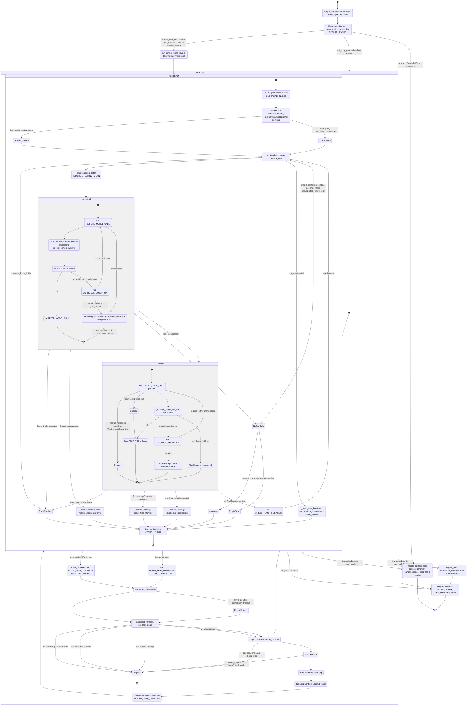

> 交互层（多轮、Goal 续跑）补充图：

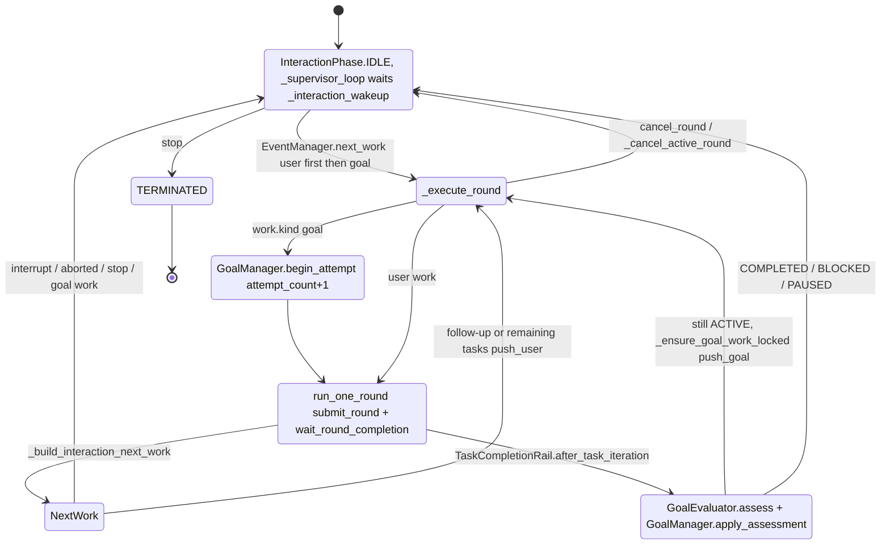

---

### 2.2 Rails 体系

#### 2.2.1 基类契约

**`AgentRail`（`core/single_agent/rail/base.py:875`）**：
- `priority: int = 50`（:904），注释明确“higher runs first”，同时决定 `init` 顺序与回调顺序；同优先级保持添加顺序（稳定排序）。
- `callback_priority(self, event) -> int`（:906）：默认返回 `self.priority`，子类可按事件单独调整（例：`EvolutionRail.callback_priority` 对 `AFTER_TOOL_CALL` 减去 `_AFTER_TOOL_CALL_READER_OFFSET = 1_000_000` 让自己最后读取，`harness/rails/evolution/evolution_rail.py:265-270`）。
- `init(self, agent)` / `uninit(self, agent)`（:922/:925）：同步，注册工具与 prompt section。经 `init_rail()`（:174）统一调用并计时。
- Hook（全部 `async def xxx(self, ctx: AgentCallbackContext) -> None`）：`before_invoke`(:930) `after_invoke`(:936) `on_user_message`(:942) `before_steering_drain`(:952) `before_model_call`(:962) `after_model_call`(:968) `on_model_exception`(:974) `before_tool_call`(:980) `after_tool_call`(:986) `on_tool_exception`(:992) `before_task_iteration`(:998) `after_task_iteration`(:1004)。`after_react_iteration` 不是基类方法，但在 `EVENT_METHOD_MAP` 中（:866），子类定义即生效。
- `get_callbacks()`（:1010）：遍历 `EVENT_METHOD_MAP`（:856-870），只收集**被子类覆盖**的方法（`_is_base_method`，:1031）。

**`DeepAgentRail(AgentRail)`（`harness/rails/base.py:28`）**：增加 `set_workspace` / `set_sys_operation`，并提供 `before_task_iteration` / `after_task_iteration`（`DEEP_EVENT_METHOD_MAP`，:22-25）。

**事件枚举 `AgentCallbackEvent`（`rail/base.py:479-522`）**（13 个）：

| 事件 | 触发点（已核实） | `ctx.inputs` 类型 |
|---|---|---|
| `BEFORE_INVOKE` / `AFTER_INVOKE` | `ctx.lifecycle(...)`：DeepAgent `deep_agent.py:3382/3470/3783`；ReActAgent `react_agent.py:2985` | `InvokeInputs`(:249) |
| `BEFORE_TASK_ITERATION` / `AFTER_TASK_ITERATION` | `task_loop_event_executor.py:207 / 269 / 324` | `TaskIterationInputs`(:343) |
| `ON_USER_MESSAGE` | `ReActAgent._admit_user_message` `react_agent.py:947` | `UserMessageInputs`(:378) |
| `BEFORE_STEERING_DRAIN` | `ReActAgent._drain_steering_batch` `react_agent.py:992`（仅有待处理 steering 时） | `SteeringDrainInputs`(:402) |
| `BEFORE/AFTER_MODEL_CALL`, `ON_MODEL_EXCEPTION` | `@rail` on `_railed_model_call` `react_agent.py:1720-1724` | `ModelCallInputs`(:298) |
| `BEFORE/AFTER_TOOL_CALL`, `ON_TOOL_EXCEPTION` | `@rail` on `_railed_execute_single_tool_call` `ability_manager.py:1344-1348`；客户端工具 `_finish_client_tool_call` :1458 | `ToolCallInputs`(:323) |
| `AFTER_REACT_ITERATION` | `react_agent.py:3241`（仅完全成功的迭代） | `ModelCallInputs`（沿用） |

**`AgentCallbackContext` 控制通道（`rail/base.py:544`）**：`request_retry(delay)`(:629) / `request_force_finish(result)`(:650) / `request_model_continue()`(:665) / `push_steering(msg)`(:714) / `extra` 跨 rail 字典；工具 rail 还可通过 `ctx.extra["_skip_tool"]` / `"_skip_tool_calls"` 跳过工具（`ability_manager.py:1357-1370`）。

#### 2.2.2 注册与排序

1. `DeepAgent.add_rail`（`deep_agent.py:2073`）只入 `_pending_rails`（TaskCompletionRail 唯一化）。`_queue_pending_rails`（:885）追加 `config.rails`、`MoARail`、`ProgressiveToolRail`、`enable_task_loop` 时默认 `TaskCompletionRail`、权限 `PermissionInterruptRail`。工厂 `harness/factory.py:393-410` 再按开关加默认 rails：`SecurityRail`(=`SafetyPromptRail`)、`ModelAnomalyDetectionRail`、`TaskPlanningRail`、`SkillUseRail`、`SubagentRail`、`ToolCallResilienceRail`（以及 `SysOperationRail`）。
2. `_ensure_initialized`（:1490-1506）：`sorted(..., key=priority, reverse=True)` → `init_rail` → `_register_rail_selective`。
3. `_register_rail_selective`（`deep_agent.py:2483`）**按事件路由**：
   - `_BRIDGE_EVENTS`（:159-178：MODEL/TOOL 六事件 + `AFTER_REACT_ITERATION` + `ON_USER_MESSAGE` + `BEFORE_STEERING_DRAIN`）→ 注册到**内层** `ReActAgent` 的回调管理器；
   - `_OUTER_ONLY_EVENTS`（BEFORE/AFTER_INVOKE，:181）与 `_DEEP_EVENTS`（TASK_ITERATION，:189）→ 注册到**外层** DeepAgent。
   - 推论：通过 DeepAgent 注册的 rail 的 `before_invoke/after_invoke` 每次 **DeepAgent.invoke / run_one_round 只触发一次**，不会在每个 task-loop 轮次里被内层 ReActAgent 的 lifecycle 再触发。
4. `AgentCallbackManager.register_rail`（`core/single_agent/agent_callback_manager.py:49`）→ `register_callback(event, cb, rail.callback_priority(event))`（:60）→ `Runner.callback_framework.register`；事件名加命名空间前缀 `f"{namespace}_{event}"`（:136-145）。
5. `AsyncCallbackFramework.register_sync`：`self._callbacks[event].append(...)` 后 `sort(key=priority, reverse=True)`（`core/runner/callback/framework.py:472-473`）。

#### 2.2.3 执行顺序模型：Chain，而非 Onion

- `ctx.fire(event)`（`rail/base.py:597`）→ `AgentCallbackManager.execute`（`agent_callback_manager.py:116`）→ `AsyncCallbackFramework.trigger`（`framework.py:1050`）：**按已排序列表顺序 `for callback_info in callbacks` 逐个 await**（:1085 起）。`before_*` 与 `after_*` 两条链都是“priority 高者先”，**after 链并不反转**，因此不是洋葱（中间件）模型。
- `@rail` 装饰器（`rail/base.py:1045`）把 before→方法体→after 套在一个被包裹方法外，并内嵌 **重试循环**（`while True`，:1075）：
  - before 中 `request_force_finish` → 跳过方法体直接返回（:1086-1088）；
  - 异常：`AgentInterrupt` 直接 raise（:1093，不触发 on_exception）；否则记录 `RetryRecord`、`fire(on_exception)`（on_exception 回调本身异常被 `logger.error` 记录、不覆盖原异常 :1110-1117）；然后 force_finish 优先（:1119）→ `consume_retry_request`（:1124）决定是否重试（可被 `_rail_max_attempts` 限制）；
  - finally：CancelledError 时跳过 after；工具调用即将重试时跳过 `AFTER_TOOL_CALL`；**模型调用即便重试也触发 `AFTER_MODEL_CALL`**（注释 :1137-1145）。
- `ctx.lifecycle(before, after)`（:799）：after 永远在 finally 执行；原异常存在时 after 回调异常只记录不覆盖（:826-836）。
- 每次 `fire` 超过 `SLOW_RAIL_CHAIN_SECONDS = 1.0`（:53）打印 info；单个回调慢也会记录 `[RailChain] slow callback`（`framework.py` trigger 内）。

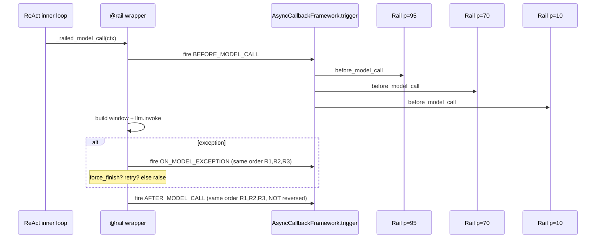

#### 2.2.4 Rail 抛异常 / 修改上下文时会怎样

| 行为 | 结果 | 依据 |
|---|---|---|
| hook 抛普通 `Exception` | **被吞掉**：`logger.error("Callback execution failed: ...")` 后继续执行链中下一个回调，主循环不受影响 | `framework.py:1190-1214`；`ModelAnomalyDetectionRail` docstring 亦明确 “plain exceptions raised inside a rail callback are swallowed by the callback framework”（`model_anomaly_detection_rail.py:656-659`） |
| hook 抛 `AbortError` | **中断链并穿透**：若带 `cause` 则 re-raise `cause`（:1187），否则 raise AbortError；`is_error=False` 时视为控制流（不计熔断、不触发 ERROR hook） | `framework.py:1165-1189`；`core/runner/callback/errors.py:16` |
| 在 before_tool_call 中断（HITL） | `AbortError(cause=ToolInterruptException, is_error=False)` → 工具暂停，内循环 `result_type=interrupt` | `interrupt_base.py:245-256` |
| 在 before_model_call 中 bailout | `AbortError(cause=build_error(...))` → 上抛到 `_inner_invoke` 的 `except Exception` → `_handle_context_abort` | `model_anomaly_detection_rail.py:690` |
| on_exception 回调自身抛错 | 记录 `masking original`，保留原异常 | `rail/base.py:1110-1117` |
| AFTER_TASK_ITERATION 在错误路径上抛错 | try/except 记录 | `task_loop_event_executor.py:319-331` |
| `init()` 抛错 | **不吞**：`init_rail` 只在 finally 计时（`rail/base.py:199-212`）；`_ensure_initialized` 在 `except BaseException` 中回滚 MoA 后 re-raise（`deep_agent.py:1510-1513`） | |
| 修改 `ctx.inputs.query`（BEFORE_TASK_ITERATION） | 生效：executor 读取 `iter_inputs.query`（`task_loop_event_executor.py:212`） | |
| 修改 `ctx.inputs.message.content`（ON_USER_MESSAGE） | 生效（就地改写） | `rail/base.py:942-950` |
| 修改 `ctx.inputs.tool_args` / `tool_name`（BEFORE_TOOL_CALL） | 生效：`_railed_execute_single_tool_call` 回写 tool_call（`ability_manager.py:1372-1377`） | |
| 修改 `tool_result` / `tool_msg`（AFTER_TOOL_CALL） | 生效：`execute` 优先取 `tool_ctx.inputs` 中的值（:1315-1328） | |
| 修改 `ctx.inputs.messages`（BEFORE_MODEL_CALL） | **会被覆盖**：`_build_model_context_window` 在 before 之后重新取窗并 `ctx.inputs.messages = context_window.get_messages()`（`react_agent.py:1233-1234`）。正确做法是改 `prompt_builder` section、PromptAttachment 或 `ctx.context`（ModelContext）本身 | |
| 并发工具的 `ctx.extra` | 每个工具拿到 `dict(shared_extra)` 的拷贝，互不影响（`ability_manager.py:1136-1160`）；force_finish 按工具顺序取第一个回传给主 ctx（:1332-1339） | |
| 监控类 rail 内部异常 | 如 `ReliabilityMonitor.feed` 中 detector 抛错仅日志跳过（`agent_teams/reliability/monitor.py:36-41`）；`EvolutionRail._safe_run_evolution` 捕获所有异常并发出 outcome 事件（`evolution_rail.py:1049-1087`） | |

#### 2.2.5 内置 Rails 全量清单

> 由 AST 脚本扫描所有继承自 `AgentRail`/`DeepAgentRail` 的类（排除测试），hook 列为**类体中直接定义**的方法；“继承”列标出从父类得到的 hook。priority 为类属性（未写即继承父类）。

##### 2.5.1 `harness/rails/`（DeepAgent 核心内置）

| Rail | 文件:行 | priority | Hook（自身 / 继承） | 作用 |
|---|---|---|---|---|
| `SysOperationRail` | `harness/rails/sys_operation_rail.py:25` | 100 | 仅 `init` | 注册文件系统/shell/code 工具 |
| `McpRail` | `harness/rails/mcp_rail.py:15` | 95 | 仅 `init` | 把 MCP resource list/read 暴露为工具 |
| `SkillUseRail` | `harness/rails/skills/skill_use_rail.py:51` | 95 | before_invoke, after_invoke, before_model_call | 技能 prompt 注入与工具注册 |
| `SubagentRail` | `harness/rails/subagent/subagent_rail.py:32` | 95 | before_invoke, before_model_call | 注册子 agent 委派工具 |
| `SessionRail`（已废弃） | `harness/rails/subagent/session_rail.py:12` | 继承95 | 继承 SubagentRail | 等价 `SubagentRail(enable_async_subagent=True)` |
| `BaseInterruptRail` | `harness/rails/interrupt/interrupt_base.py:46` | 90 | before_tool_call | 中断/恢复基类（approve/reject/interrupt 决策） |
| `ConfirmInterruptRail` | `harness/rails/interrupt/confirm_rail.py:39` | 继承90 | 继承 before_tool_call | 仅当 `ConfirmPayload.approved` 才执行 |
| `AskUserRail` | `harness/rails/interrupt/ask_user_rail.py:30` | 继承90 | 继承 before_tool_call | 向用户提问，不执行工具 |
| `PermissionInterruptRail` | `harness/rails/security/tool_security_rail.py:57` | 90 | before_tool_call | 工具权限分级策略 + 中断确认 |
| `BaseSecurityRail` | `harness/rails/security/base_security_rail.py:102` | 90 | before/after_invoke, before/after_tool_call, before/after_model_call | 安全检查基类 |
| `SafetyPromptRail`（别名 `SecurityRail`） | `harness/rails/security/prompt_security_rail.py:16`（别名 :49） | 85 | 继承 BaseSecurityRail | 注入安全提示 section |
| `ProgressiveToolRail` | `harness/rails/progressive_tool_rail.py:78` | 90 | before/after_invoke, before_model_call, before_tool_call | 渐进式工具发现（BM25 tool_search）与可调用工具过滤 |
| `TaskPlanningRail` | `harness/rails/task_planning_rail.py:31` | 90 | before_model_call, after_model_call, after_tool_call, after_invoke, after_task_iteration | todo 工具 + todo section + 每 N 次工具调用 push_steering 提醒 + 按 todo 选模型 |
| `VerificationRail` | `harness/rails/subagent/verification_rail.py:92` | 90 | before_model_call, before_tool_call | 约束 verification agent |
| `VerificationContractRail` | `harness/rails/subagent/verification_contract_rail.py:116` | 88 | before_model_call | 父 agent 注入验证门禁 |
| `AgentModeRail` | `harness/rails/agent_mode_rail.py:95` | 85 | before_invoke, before_model_call, before/after_tool_call | plan 模式只读约束 |
| `ContextAssembleRail` | `harness/rails/context_engineer/context_assemble_rail.py:42` | 85 | before_invoke, before_model_call | 把选中的上下文文件/工具 section 注入系统提示 |
| `ContextProcessorRail` | `harness/rails/context_engineer/context_processor_rail.py:52` | 85 | before_invoke, before/after_model_call, after_tool_call, on_model_exception | 装配上下文处理器链、修复不完整 tool 上下文、offload/recall section、session memory |
| `MultimodalContextSummarizerRail` | `harness/rails/multimodal_context_summarizer_rail.py:44` | 85 | before_model_call | 归档旧截图图像，控制多模态上下文 |
| `SkillCreateRail` | `harness/rails/skills/skill_create_rail.py:50` | 85 | before_model_call（+继承 EvolutionRail） | 1D 技能创建 |
| `TeamSkillCreateRail` | `harness/rails/skills/team_skill_create_rail.py:74` | 85 | before_model_call（+继承） | 团队技能创建 |
| `HeartbeatRail` | `harness/rails/heartbeat_rail.py:18` | 80 | before_model_call | 注入心跳 system prompt |
| `CodingMemoryRail` | `harness/rails/memory/coding_memory_rail.py:41` | 80 | before_invoke, before_model_call | Coding Agent 专用记忆 |
| `SkillEvolutionRail` | `harness/rails/evolution/skill_evolution_rail.py:141` | 80 | before_model_call（+继承 EvolutionRail 的 before_invoke/after_model_call/after_tool_call/after_task_iteration/after_invoke） | 在线技能自演进（信号检测→经验生成→审批/持久化） |
| `TeamSkillEvolutionRail` | `harness/rails/evolution/team_skill_evolution_rail.py:137` | 80 | before_model_call（+继承） | 团队版技能演进 |
| `MemberSkillEvolutionRail` | `harness/rails/evolution/member_skill_evolution_rail.py:18` | 继承80 | 继承 | 变更隔离到成员工作区 |
| `ExternalMemoryRail` | `harness/rails/memory/external_memory_rail.py:30` | 75 | before_invoke, before_model_call, after_invoke | 外部记忆适配 |
| `JiuwenMemoryRail` | `harness/rails/memory/jiuwen_memory_rail.py:64` | 75 | before_invoke, before_model_call, after_invoke | AgentMemory 外接记忆 |
| `ModelAnomalyDetectionRail` | `harness/rails/model_anomaly_detection_rail.py:317` | 70 | before/after_invoke, before_model_call, on_model_exception | 复读检测、流超时、瞬时故障重试、工具循环压缩/bailout |
| `ToolCallResilienceRail` | `harness/rails/tool_call_resilience_rail.py:24` | 70 | before_tool_call, on_tool_exception | 可重试工具错误的有界重试（默认 3） |
| `EvolutionRail` | `harness/rails/evolution/evolution_rail.py:241` | 60 | before_invoke, after_model_call, after_tool_call(priority−1e6), after_task_iteration, after_invoke | 演进基类：订阅 `TrajectorySpanProcessor` 收集轨迹，按 `EvolutionTriggerPoint` 触发 `run_evolution` |
| `LspRail` | `harness/rails/lsp_rail.py:20` | 60 | after_tool_call, before_model_call | LSP 子系统与 LspTool |
| `ContextEvolutionRail` | `harness/rails/evolution/context_evolution_rail.py:28` | 50 | before_task_iteration, after_task_iteration | 基于 `TaskMemoryService` 的任务记忆检索/总结 |
| `TeamContextEvolutionRail` | `harness/rails/evolution/team_context_evolution_rail.py:105` | 50 | before/after_task_iteration | 个人+共享双层记忆 |
| `ContextEvolveRail` | `harness/rails/evolution/context_evolve_rail.py:109` | 继承60 | before_task_iteration, before_model_call | 注入 retriever/store/optimizer 的在线读写模板 |
| `MetisContextEvolveRail` | `harness/rails/evolution/metis_context_evolve_rail.py:31` | 继承 | 继承 | Metis 工作区任务记忆 |
| `PersonalContextRail` | `harness/rails/personal_context.py:159` | 40 | before/after_invoke, before/after_model_call | 关键字检索 + 附加 description.md |
| `EvolutionInterruptRail` | `harness/rails/evolution/evolution_interrupt_rail.py:35` | 89 | 继承 before_tool_call | 技能演进变更工具的用户审批中断 |
| `TrajectoryRail` | `harness/rails/evolution/trajectory_rail.py:23` | 10 | before_invoke（+继承 EvolutionRail，`evolution_trigger=NONE`） | 每次 invoke 记录一份规范执行归档（`_on_after_invoke` 同步 `TrajectoryStore.save`，至多一次） |
| `TTSERail` | `harness/rails/evolution/ttse_rail.py:145` | 继承60 | before_model_call | FACT/TIP 双轨归纳与注入 |
| `SymphonyGraphEvolutionRail` | `harness/rails/evolution/symphony_graph_evolution_rail.py:423` | 5 | after_invoke | 每次有效 invoke 产出执行图提交 |
| `TeamSymphonyGraphEvolutionRail` | 同文件 :2223 | 继承5 | 继承 | 基于团队根 trace 产出执行图 |
| `TaskCompletionRail` | `harness/rails/task_completion_rail.py:75` | 10 | before_invoke, before_model_call, before_task_iteration, after_model_call, after_task_iteration | 外循环停止策略（promise/max_rounds/timeout）+ Goal 生命周期 |
| `MoARail` | `harness/rails/moa_rail.py:44` | 10 | before/after_invoke, before/after_task_iteration, before/after_model_call, on_user_message, before_tool_call, after_react_iteration | MoA 路由状态（失败时 `AbortError(cause=exc)`，:78） |
| `AgentObservabilityRail` | `harness/observability/rail.py:355` | 10 | before/after_task_iteration, before/after_invoke, before_model_call, after_react_iteration, before/after_tool_call, on_tool_exception | 每轮 AGENT span |
| `TokenTrackingRail` / `ToolTrackingRail` | `harness/cli/rails/token_tracker.py:15` / `tool_tracker.py:20` | 10 / 5 | after_model_call / before+after_tool_call | CLI token 统计 / 工具调用 UI 渲染 |

##### 2.5.2 `core` 与 `extensions`

| Rail | 文件:行 | priority | Hook | 作用 |
|---|---|---|---|---|
| `ModelBackupRail` | `core/single_agent/rail/model_backup.py:9` | 50 | on_model_exception | 依次切换备用模型并 `request_retry` |
| `MemoryRail` | `core/application/llm_agent/rails/memory_rail.py:27` | 50 | before/after_invoke | 长期记忆 |
| `InvokeResultAdapterRail` | `core/application/llm_agent/rails/invoke_result_adapter_rail.py:49` | 90 | after_invoke | ReAct 结果转旧 schema |
| `OtelRail` | `extensions/tracer_otel/otel_rail.py:31` | 0 | 8 个 invoke/model/tool hook | OTel root/LLM span |

##### 2.5.3 `agent_teams`（含可靠性）

| Rail | 文件:行 | priority | Hook | 作用 |
|---|---|---|---|---|
| **`ReliabilityRail`** | `agent_teams/reliability/rail.py:84` | 5 | on_user_message, before/after_tool_call, on_tool_exception, on_model_exception, before/after_model_call | 把每个 hook 转成 `Signal` 喂给 `ReliabilityMonitor.feed`；返回的 `Anomaly` 经 `LocalAutoRemediator.steer_message` 转为 `ctx.push_steering`（**只做可逆的 steering，不改参数/不中断循环**，模块 docstring :1-13）；leader 的路由通知在 `on_user_message` 插到 `parts` 前 |
| `PhaseSnapshotRail` | `agent_teams/harness/snapshot_rail.py:105` | 1000 | before/after_model_call, before_tool_call, after_react_iteration, after_task_iteration | 内循环相位跟踪与安全点快照 |
| `TeamToolRail` | `agent_teams/rails/team_tool_rail.py:61` | 90 | init | 团队协作工具 |
| `TeamPlanModeRail` | `agent_teams/rails/team_plan_mode_rail.py:25` | 84 | before_invoke, before_model_call | 团队 plan 模式指令 |
| `TeamPolicyRail` | `agent_teams/rails/team_policy_rail.py:88` | 12 | on_user_message, before_steering_drain, before_model_call | 团队静态 section + 动态团队状态 |
| `TeamObservabilityRail` | `agent_teams/observability/rail.py:61` | 12 | before_invoke, before/after_task_iteration | 团队身份写入 span |
| `TeamPermissionRail` / `TeamToolApprovalRail` / `TeamSkillUseRail` | `agent_teams/rails/team_permission_rail.py:109` / `tool_approval_rail.py:23` / `team_skill_use_rail.py:51` | 继承 | 继承 | 团队版权限/审批/技能 |
| `TeamWorkspaceRail` / `OrganizationWorkspaceRail` | `agent_teams/team_workspace/rails.py:34` / `agent_teams/organization/workspace_rail.py:18` | 50 | before/after_tool_call (+on_tool_exception) | 共享空间版本控制与锁 / 组织策略路由 |
| `StructuredOutputFinishRail` | `agent_teams/tools/structured_output_tool.py:113` | 900 | after_tool_call | 捕获 structured_output 后 force_finish |
| `SwarmflowBudgetRail` / `SwarmflowActivityRail` | `agent_teams/workflow/backends/budget_rail.py:27` / `team_worker_backend.py:120` | 950 / 500 | model / tool hooks | 双账本预算 / 活动流 |

`ReliabilityMonitor` 的检测器（`agent_teams/reliability/detectors/`）：`ToolErrorRateDetector`(tool_error.py:16)、`RepeatToolCallDetector`(repeat_tool.py:15)、`ModelStreamErrorDetector`(model_error.py:76)、`OutputLengthDetector`(output_length.py:12)、`FrequentCompactionDetector`(compaction.py:16)、`PingPongDetector`(pingpong.py:12)；路由策略 `RemediationPolicy`（remediation/policy.py:24）→ `REPORT_LEADER/ESCALATE_USER` 上报、`OBSERVE_ONLY` 记日志（monitor.py:46-57）。

##### 2.5.4 工具域 Rails（`harness/tools/**`）与 RSI

`BrowserWorkingContextRail`(p45)、`BrowserRuntimeRail`、`CuaRuntimeRail`/`CuaUserTakeoverRail`/`CuaScreenshotDownscaleRail`/`CuaRepeatFailureRail`/`CuaProgressRail`（`harness/tools/cua/rails.py:93/176/315/431/552`）、`DeviceLifecycleRail`(p95)、`GoalAnchorInjectorRail`(p80，移动端：当用户目标滑出窗口时重新注入，`harness/tools/mobile_gui/rails/goal_anchor_injector_rail.py:64`)、`MultimodalSkillBranchRail`/`MultimodalSkillReadRail`/`VlmGroundingPerceptionRail`、`WorktreeRail`(p100) 等。`rsi/` 下另有 `CancellationRail`、`BudgetRail`、`RSITrajectoryRail(TrajectoryRail)`（`rsi/harness_rsi/evaluator/runtime_adapters.py:46`）等实验 rails。

##### 2.5.5 指定三个 Rail 的结论

| 题目所问 | 实际名称 | 位置 | 机制要点 |
|---|---|---|---|
| TrajectoryRail | `TrajectoryRail(EvolutionRail)` | `harness/rails/evolution/trajectory_rail.py:23` | priority 10；`evolution_trigger=EvolutionTriggerPoint.NONE` 只记录不演进；`before_invoke` 清空本次累加器；继承的 `after_model_call/after_tool_call` 通过 `_drain_for_hook` 拉取 span 增量 → `_record_execution_increment` 去重合并；`_on_after_invoke` 同步 `TrajectoryStore.save` 一次，失败只 warning（:106-110） |
| SkillEvolutionRail | `SkillEvolutionRail(SkillEvolutionSharingMixin, EvolutionRail)` | `harness/rails/evolution/skill_evolution_rail.py:141` | priority 80；`before_model_call` 注入 `evolution_protocol` section（:732-739）；默认 `EvolutionTriggerPoint.AFTER_INVOKE`，`_allow_evolution_trigger`（:560）要求 `signal_trigger` 且非 heartbeat/cron；`run_evolution`（:834）跑 `SignalDetector` → 经验生成 → 审批（`EvolutionApprovalRuntime`）；`_on_after_task_iteration`（:579）每 `review_interval` 轮通过 `controller.enqueue_follow_up` **向外循环注入 review follow-up**；后台执行由 `EvolutionRail._trigger_evolution`（`evolution_rail.py:857`）`asyncio.create_task(_safe_run_evolution)`，信号量限并发 |
| ReliabilityRail | `ReliabilityRail(DeepAgentRail)` | `agent_teams/reliability/rail.py:84` | 见 2.5.3；priority 5（最后执行），只 `push_steering` |

---

### 2.3 Harness 动态控制：上下文管理与 Goal Mode

#### 2.3.1 上下文管理总体结构

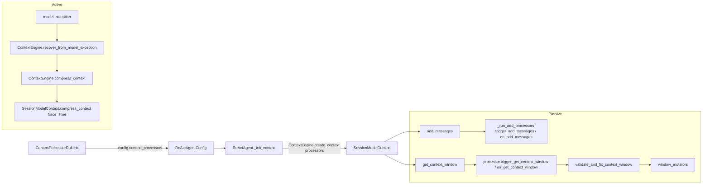

- **装配**：`ContextProcessorRail.init`（`context_processor_rail.py:274`）在 `preset=True` 时 `_build_preset_processors`（:204）调用 `forked.activate()`（`core/context_engine/processor/forked/__init__.py` 用同名覆盖注册表 `_PROCESSOR_MAP`），默认链**按顺序**：
  1. `MessageSummaryOffloader`
  2. `SessionMemoryCompressor`（`enabled=False`，需显式开启）
  3. `DialogueCompressor`
  4. `CurrentRoundCompressor`
  5. `RoundLevelCompressor`
  合并用户覆盖（`_merge_processors`，:159），并给 browser 子 agent 结果加入 `protected_tool_names`（:324-337），写回 `config.context_processors`（:350）。`ReActAgent._init_context`（`react_agent.py:2801`）按此列表 `create_context`，`ContextEngine.create_context` 依序实例化（`context_engine.py:249-251`）。
- **处理器契约**：`ContextProcessor`（`core/context_engine/processor/base.py:37`）两对钩子 `trigger_add_messages/on_add_messages`（:109/:72）与 `trigger_get_context_window/on_get_context_window`（:124/:89）。
- **被动触发点**：
  - `SessionModelContext.add_messages`（`context.py:341`）→ `_run_add_processors`（:1164）；处理器异常仅 `logger.warning` 并发出 `failed` 状态（:1270-1295），不阻断。
  - `SessionModelContext.get_context_window`（`context.py:605`）→ 依序 `for processor in self._processors`（:632），处理器异常同样只告警（:708-733）；之后 `validate_and_fix_context_window` + `window_mutators`（:736-745）。在 ReAct 中每次模型调用都会经 `_build_model_context_window`（`react_agent.py:1186`）走这里，且是在 **所有 BEFORE_MODEL_CALL rail 之后**（`_railed_model_call` 注释 :1727-1732），保证处理器看到最终系统提示的 token 预算。
- **主动触发点**：`ContextEngine.compress_context`（`context_engine.py:359`）→ `SessionModelContext.compress_context`（`context.py:405`；若处理器锁被占返回 `"busy"`）。由 `recover_from_model_exception`（`context_engine.py:415`）在溢出时调用（见 §1.5），也可被外部（如 `/compact`）调用。

#### 2.3.2 各策略、阈值与触发位置

`context_max` 解析：`ContextUtils.resolve_context_max`（`core/context_engine/context/context_utils.py:404`）——显式 `context_window_tokens` > `model_context_window_tokens[model]` > 内置表 > OpenRouter 缓存 > `DEFAULT_CONTEXT_MAX_TOKENS = 200000`（:20）。比例阈值 `resolve_ratio_token_threshold = max(int(context_max * ratio), 1)`（`forked/compressor/support/util.py:341`）。

| 处理器（forked 默认版） | 策略 | 触发时机 | 默认阈值 | 文件:行 |
|---|---|---|---|---|
| `MessageSummaryOffloader` | **卸载/规则压缩**：大 ToolMessage 先走 `RuleCompressionPipeline`（HTML/JSON 数组/日志/diff/搜索结果等压缩器），否则 head/tail 预览 + 原文卸载到 workspace 文件（可 reload）；`protected_tool_names` 默认 `["read_file"]` | ADD：单条 ToolMessage tokens > `add_message_threshold_ratio=0.1`×context_max；GET：TTL——距上次取窗 ≥ `ttl_seconds=300` 且占用 ≥ `ttl_context_occupancy_ratio=0.5`，再处理单条 > `ttl_message_threshold_ratio=0.05` 的消息 | 0.1 / 300s / 0.5 / 0.05 | `forked/offloader/message_offloader.py:33-63`（配置）、`:74`（trigger_add）、`:242-258`（TTL trigger_get）、`:260`（on_get） |
| `SessionMemoryCompressor` | **会话记忆替换**：把已提交的 session memory 物化为紧凑块替换旧前缀（配合异步 `SessionMemoryManager`） | GET：`enabled` 且占用达 `trigger_context_ratio=0.8` | 默认关闭 | `forked/compressor/session_memory_compressor.py:31-38`, `:50` |
| `DialogueCompressor` | **LLM 摘要**（历史对话 → handoff memory block） | GET：窗口 tokens ≥ 0.8×context_max，且待压缩跨度 ≥ `min_target_context_ratio=0.1` | 0.8 / 0.1 | `forked/compressor/dialogue_compressor.py:23-28` |
| `CurrentRoundCompressor` | **当前轮 LLM 摘要**（最新用户请求之后的工作进展） | 同上 | 0.8 / 0.1 / keep_recent=0 | `forked/compressor/current_round_compressor.py:23-29` |
| `RoundLevelCompressor` | **跨轮任务检查点摘要** | 同上 | 0.8 / keep_recent_messages=4 | `forked/compressor/round_level_compressor.py:22-27` |

三个 LLM 压缩器共享基类 `PrefixCompactProcessor`（`forked/compressor/base.py:143`；基类默认 `trigger_context_ratio=0.4`，子类覆盖为 0.8，:71-72）：`trigger_get_context_window`（:181）计算 tokens → 阈值 → `_build_span`（保留前缀 / 待压缩 / 受保护尾部，工具调用边界由 `adjust_keep_recent_for_tool_boundaries` 保证不拆对）→ `on_get_context_window`（:262）调用压缩模型（`_invoke_compression_with_retries`），并按 `reinject_builder_names`（如 `plan_mode, plan, task_status, todo, skills, read_file`）重注入关键状态。

另有非 forked 的旧实现仍注册在表中可按名启用：`MessageOffloader`、`ToolResultBudgetProcessor`、`ToolResultWindowProcessor`（`processor/offloader/*`）、`MicroCompactProcessor`、`FullCompactProcessor`（`processor/compressor/*`）等（均 `@ContextEngine.register_processor()`）。

**Token 计数**：
- 引擎侧 `ContextEngine._select_token_counter`（`context_engine.py:106`）用 `TokenizerSelector`（本地 native tokenizer / tiktoken，离线只读），失败回退 `StringLengthCounter`（:138-144）。
- 压缩器侧 `PrefixCompactProcessor._count_context_window_tokens`（`forked/compressor/base.py:803`）：**优先使用最后一条带 usage 的 AssistantMessage 的 `usage_metadata.total_tokens` + 其后消息 `len//3` 估算**（`count_usage_tokens_with_tail`，`support/util.py:302-329`），否则用 token_counter 逐条计数 + 工具 schema tokens。
- 统计侧 `SessionModelContext._stat_messages`（`context.py:858`）优先 `usage_metadata.input_tokens`（`_get_last_assistant_usage_tokens`，:841）。

**ContextProcessorRail 的 hook 级动作**（`context_processor_rail.py:482-507`）：`before_invoke` / `on_model_exception` → `fix_incomplete_tool_context`（补齐悬空 tool_call/ToolMessage 对，:565）；`before_model_call` → `_maybe_inject_offload_section`（`enable_reload` 时注入 reload 指引 section，:647）与 `_maybe_inject_compression_recall_section`（:684，并注册 `CompressionRecallTool`）；`after_model_call` → 调度 session memory 更新。

其它上下文相关 rail：`ModelAnomalyDetectionRail` 在 BEFORE_MODEL_CALL 直接改写 `ctx.context` 中重复工具轮次；`MultimodalContextSummarizerRail` 归档旧截图；`BrowserWorkingContextRail` 在步边界提交浏览器工作上下文。

#### 2.3.3 如何注入 LLM Prompt 组装

最终请求在 `ReActAgent._build_model_context_window`（`react_agent.py:1186`）组装：

1. `final_system = [SystemMessage(content=self.prompt_builder.build())]`（:1205）——`SystemPromptBuilder.build`（`core/single_agent/prompts/builder.py:219`）把所有 `PromptSection` **按 priority 升序排序**后 `"\n\n".join`（:226-228；有 priority registry 时以 section 名作稳定 tie-break，:176-186）。DeepAgent 版 `harness/prompts/builder.py:28` 增加 `PromptMode`：`MINIMAL` 只保留 `_MINIMAL_SECTIONS`（identity/safety/skills/tools/runtime/memory），`NONE` 只保留 identity（:48-67）。
   - 内循环开始时 `add_prompt_builder_section(_IDENTITY_SECTION, rendered_system_prompt)` 与 skills section（`react_agent.py:3018-3029`、`:891`）；
   - 各 rail 在 `before_model_call` 中 `builder.add_section(...)` / `remove_section(...)`（例：`TaskCompletionRail` completion_signal、`TaskPlanningRail` todo、`SkillEvolutionRail` evolution_protocol、`ContextProcessorRail` offload/compression_recall、`HeartbeatRail`）。DeepAgent 用 `_sync_prompt_builder_references`（`deep_agent.py:836`）保证 rails 与内层 ReActAgent 共享同一个 builder 对象。
2. `await self._sync_prompt_attachments(ctx, ctx.context)`（:1206 → :1148）：`PromptAttachmentManager.sync_to_context`（`harness/prompts/prompt_attachment_manager.py:538`）把**动态附件**（`PromptAttachmentKind.RUNTIME/MEMORY/FILE/TODO_REMINDER/...`，:21-33）以带元数据标记的 `UserMessage` 追加进对话历史：首次写快照，之后只写变化 delta / 删除——即**消息列表追加式改写**，从而保持系统提示稳定（利于 KV cache）。
3. `build_model_window_mutator`（:592）：对 DashScope/Bailian 的 OpenAI 兼容路由，在**最终窗口**里把这些标记的 `UserMessage` 就地替换为 `SystemMessage`（不改存储）；另追加 `_hide_answered_images_shown_once` mutator（追加于 `react_agent.py:1228`，定义 :1240）。
4. `ctx.context.get_context_window(system_messages=final_system, tools=..., window_mutators=...)`（:1230）→ 处理器链压缩/卸载 → mutators → 回写 `ctx.inputs.messages/tools`（:1233-1234）。
5. steering / follow-up：`_admit_user_message` 以 `ON_USER_MESSAGE` 可改写的方式把 steering 以 `"[STEERING] "` 前缀写入（`react_agent.py:3111-3119`）；空响应时追加 `_EMPTY_RESPONSE_NOTICE`；最大迭代 `final_answer` 时追加 iteration_limit 提示。

#### 2.3.4 Goal Mode

**数据模型**（`harness/goal/schema.py`）：`GoalStatus{ACTIVE,PAUSED,COMPLETED,BLOCKED}`(:14)、`GoalAssessmentStatus{CONTINUE,COMPLETE,BLOCKED}`(:21)、`GoalStopStrategy{AGENT_REPORT,TRANSCRIPT,HYBRID}`(:27)、`GoalStopConfig(strategy=HYBRID, transcript_window_attempts=8, verification_interval=None, max_attempts=None, token_budget=None)`(:302)。

**控制流**：
1. `GoalManager.set`（`harness/goal/manager.py:104`）创建 `GoalRecord`，有输出流时 `_ensure_goal_work_locked`（:345）→ `RoundWorkItem.goal(inputs={"query": build_goal_task_query(record)})` 入 goal 队列；覆盖旧目标时 `_cancel_active_round(expected_run_kind="goal")`。
2. Supervisor 取到 goal 工作 → `begin_attempt`（:262）→ `run_one_round` 以 `run.kind="goal"` 运行（`deep_agent.py:3772-3776`）。
3. `TaskCompletionRail`（`harness/rails/task_completion_rail.py:75`）：
   - `init`（:218）：goal 模式下注册 `SubmitGoalReportTool`（`submit_goal_report`）与 `GetCurrentGoalTool`（`get_current_goal`）。
   - `before_invoke` / `before_model_call` → `_sync_goal_protocol_prompt`（:325）：`run_kind == "goal"` 时把 `build_goal_protocol_section(language)`（`harness/prompts/sections/goal.py:84`，`SectionName.GOAL_PROTOCOL`，priority 88）通过 `PromptAttachmentContextWriter.add_from_prompt_section(kind=PromptAttachmentKind.RUNTIME, source="agent_core.task_completion_rail")` 作为**附件**注入；非 goal 轮 `clear_section(GOAL_PROTOCOL)`。
   - `before_task_iteration`（:378）→ `_do_goal_before_iteration`（:466）：校验 goal_id/revision，`GoalReportSink.begin_attempt`，**把本轮 query 替换为 `build_goal_task_query(record, language)`**（`goal.py:171`：`<goal_task>` 模板，含 objective、上一次评估、当前指令 `build_goal_current_instruction`（:199，优先上次 `next_instruction`）、预算提示）。非 goal 轮则按 `task_instruction.format(query=...)` 改写首轮 query。
   - `after_model_call`（:406）：goal 轮累计 token（`GoalManager.accumulate_usage`，:280）。
   - `after_task_iteration`（:425）→ `_do_goal_after_iteration`（:513）：interrupt 结果跳过评估；本轮异常 → 直接 `BLOCKED`；否则消费 agent report，必要时调用 transcript assessor（`_maybe_invoke_transcript_assessor`，:622）→ `GoalEvaluator.assess`（`harness/goal/evaluation.py:88`）→ `GoalManager.apply_assessment`（`manager.py:303`）。非 goal 轮则检测 `<promise>…</promise>` → `CompletionPromiseEvaluator.notify_fulfilled`，下一次 `should_continue()` 停止外循环。
4. `GoalEvaluator`：`HYBRID`（`_assess_hybrid`，:155）——agent 报 CONTINUE 直接信任（可按 `verification_interval` 抽查）；报 COMPLETE/BLOCKED 必须由 transcript 验证，冲突时 transcript 胜，缺失则回退 CONTINUE；`_apply_hard_limits`（:289）在 CONTINUE 时按 `max_attempts` / `token_budget` 强制转 BLOCKED。
5. `apply_assessment`：COMPLETE→`COMPLETED`，BLOCKED→`BLOCKED`，ACTIVE 保持并再次 `_ensure_goal_work_locked` 排下一次 attempt（:339-340）；PAUSED 时当前 attempt 允许收尾但不续排。

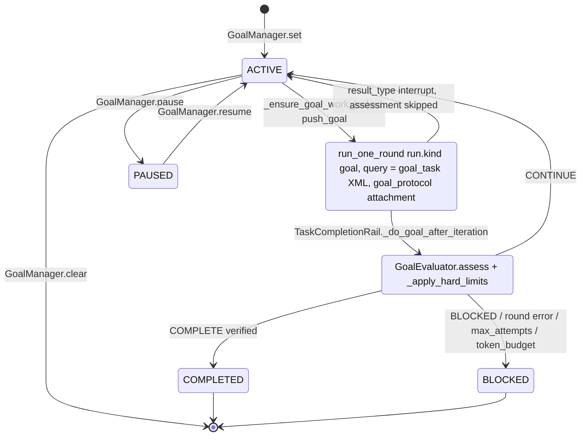

---

### 2.4 小结与值得注意的实现细节

1. **两层循环 + 一层会话**：ReAct 内循环（迭代/工具/中断）↔ TaskLoop 外循环（轮次/follow-up/TaskPlan/停止评估器）↔ Interaction Supervisor（多输入排队、Goal attempt 续排）。三者共享 `TaskLoopController` 内核。
2. **工具失败默认“软失败”**（ToolMessage 回灌），模型失败默认“硬失败”（重试耗尽后上抛），上下文溢出有一次“压缩后重试”的自愈。
3. **Rail 回调异常默认被吞**：要中断必须 `AbortError`，要结束必须 `request_force_finish`，要重试必须 `request_retry`，要插话必须 `push_steering`。这是 Rail 设计的核心控制协议。
4. **Rail 是扁平优先级链**：before/after 同序；需要“最后读取”语义的 rail 通过 `callback_priority` 按事件下调（`EvolutionRail`）。
5. **BEFORE_MODEL_CALL 不能改 messages**：消息窗口在 before 之后才由处理器链生成；修改 prompt 应通过 `SystemPromptBuilder` section 或 `PromptAttachmentManager`。
6. `max_outer_rounds = 50` 为硬编码；`TokenBudgetEvaluator` 未接线（`add_token_usage` 无调用），token 预算只在 Goal 层生效。
7. 通过 DeepAgent 注册的 rail 的 `before_invoke/after_invoke` 只在外层触发（`_OUTER_ONLY_EVENTS`），不会在每个 task-loop round 内的 `ReActAgent.invoke` 中触发。


---

## 3. Runtime 模块：进程分离、会话隔离与分布式底座

> 范围：`jiuwenswarm/gateway`、`jiuwenswarm/jiuwenswarm/server`、`jiuwenswarm/jiuwenswarm/runtime`、`agent-core/openjiuwen/core/session/checkpointer`、`agent-core/openjiuwen/extensions/checkpointer`、`agent-core/openjiuwen/agent_teams/messager`、`jiuwenswarm/jiuwenswarm/agents/harness/team/{distributed_runtime,remote_member_bootstrap,a2x}`、`gateway/extensions/agentos`、`agent-runtime/{server,foundation,management}`。
>
> 约定：路径前缀 `js/` = `jiuwenswarm/jiuwenswarm/`，`gw/` = `jiuwenswarm/gateway/`，`ac/` = `agent-core/openjiuwen/`，`ar/` = `agent-runtime/`。所有 `file:line` 均通过 `grep -n` / `sed -n` 核对。
>
> 重要说明：`AgentRequest / AgentResponse / AgentResponseChunk / E2AEnvelope` 及 wire 编解码（`encode_agent_chunk_for_wire` 等）的**实现不在本仓库**——`js/common/schema/agent.py` 与 `js/common/e2a/{models,wire_codec}.py` 只是 re-export `openjiuwen_protocol`（外部 git 依赖，`jiuwenswarm/pyproject.toml:27`），本环境中未安装该包，因此 E2A 信封的完整字段表**无法逐行核实**；下文只列出本仓库代码中**直接可见**的字段。

---

### 3.1 Split-Process：进程边界、启动方式与 IPC 协议

#### 3.1.1 实际是“三进程 + 一个守护者”，不是两进程

| 层 | 进程入口 | 启动者 | 职责 |
|---|---|---|---|
| 启动器 | `jiuwenswarm-start` → `js/start_services.py` | 用户 | 端口分配/冲突回退、PID 文件、拉起 `app` 与 `web` 子进程（`_build_commands` `js/start_services.py:526`，`-m jiuwenswarm.app` 在 `:543`，`-m jiuwenswarm.channels.web.app_web` 在 `:547`），`Popen` 在 `_start_process` `:585/616`；主循环 0.5s 轮询子进程，任一退出即整体退出 `:445-451`；`_terminate_processes` 先 terminate，8s 后 kill `:619-637` |
| 进程守护者 | `python -m jiuwenswarm.app`（`js/app.py`） | start_services | 把 AgentServer 与 Gateway 分别作为子进程拉起：`agent_cmd = [python, "-m", "jiuwenswarm.server.app_agentserver"]`、`gateway_cmd = [python, "-m", "gateway.app_gateway"]`（`js/app.py:92-93`），POSIX 下每个子进程 `start_new_session=True`（`:119`），最终 `supervise({...})`（`:121`） |
| **Gateway** | `gw/app_gateway.py` | `jiuwenswarm.app` | 渠道接入（web/tui/IM…），作为 **WebSocket 客户端** 连接 AgentServer Front（`WebSocketAgentServerClient` `gw/routing/agent_client.py:131`） |
| **AgentServer Front** | `js/server/app_agentserver.py` | `jiuwenswarm.app` | 监听 Gateway 面向的 WS 端口（`AgentServerFront` `js/server/front/server.py:22`，docstring：“Owns the Gateway-facing port. Does not construct Agent Runtime.”）；**不执行 Agent turn**（`js/server/supervisor/runtime_supervisor.py:3` “This process does not execute Agent turns.”） |
| **Runtime Worker** | `python -m jiuwenswarm.server.worker.main` | Front 内的 `RuntimeSupervisor` → `WorkerProcess.spawn` | 真正加载 openjiuwen Runner、`AgentWebSocketServer`、`AgentManager`、checkpointer，执行 Agent |

Worker 命令行由 `build_worker_command` 生成（`js/server/supervisor/worker_process.py:66-91`：`-m jiuwenswarm.server.worker.main --host --port [--socket]`），`WorkerProcess.spawn` 用 `subprocess.Popen(..., start_new_session=self._ipc_listener is None, stdin=PIPE, stderr=<file>)`（`worker_process.py:202-208`），并通过 stdin 写入 launch identity payload（`:213-214`）。**resident 模式下 Worker 独立 session、比 Front 活得久**（注释 `worker_process.py:199-200`；Front 退出时 `app_agentserver.py:177` “Detach only. The Worker keeps its loaded Runtime for the next Front.”）。

Worker 内的业务对象：`runtime_bootstrap.py:67-78` 中 `AgentWebSocketServer.get_instance(host, port)` 被构造（14805 行的 `js/server/agent_ws_server.py:1241` `class AgentWebSocketServer`），但在拆分布局里它不再自己对 Gateway 监听，而是把 `WorkerGatewayBridge`（有 `async def send(message)`，`js/server/worker/gateway_bridge.py:57/79`）当作“ws”使用，所有回包被包装为 IPC `wire` 帧。请求类型→业务函数的查表在 `js/server/dispatch.py:357 try_dispatch`（例如 `ReqMethod.CHAT_CANCEL: handle_chat_cancel` `:209`，`ReqMethod.TEAM_MQ_PUBLISH: handle_team_mq_publish` `:245`）。

#### 3.1.2 两级守护与崩溃重启策略

**(a) `jiuwenswarm.app` 守护 AgentServer/Gateway**（`js/common/process_supervision.py`）

| 常量 | 值 | 位置 |
|---|---|---|
| `GATEWAY_RESTART_EXIT_CODE` | 75（Gateway 主动请求重启，如配置重载失败） | `:36` |
| `CRASH_EXIT_CODE` | 70（debug_dump 捕获未处理异常） | `:42` |
| `_POLL_INTERVAL` / `_RESTART_BACKOFF` | 0.25s / 2.0s | `:47-48` |
| `_MIN_UPTIME_FOR_RESTART` | 30s（启动期失败不重启） | `:55` |
| `_RESTART_WINDOW` / `_MAX_CRASH_RESTARTS` / `_MAX_RESTART_REQUESTS` | 600s / 3 / 5 | `:56-58` |

`_Child.should_respawn`（`:188-221`）：退出码 75 → 在预算内重启；崩溃信号（SEGV/ABRT/BUS/ILL/FPE）或 **SIGKILL（OOM killer / 基础设施硬杀，issue #4946）** → 运行时间 ≥30s 且 600s 内 <3 次才重启；其他退出（SIGTERM 等 stop path）→ 整栈拆除。重启前 `_reap_lingering_tree` 用 `killpg` 清掉被硬杀子进程遗留的后代（`:238-268`）。`supervise` 主循环见 `:271-322`。

**(b) Front 内 `RuntimeSupervisor` 守护 Worker**（`js/server/supervisor/runtime_supervisor.py`）

| 常量 | 值 | 位置 |
|---|---|---|
| `_HEARTBEAT_INTERVAL` | 10s（Front→Worker 发 `heartbeat`） | `:60`，`_heartbeat` `:1155-1164` |
| `_HEARTBEAT_TIMEOUT` | 30s（超过未收到任何帧则关闭连接） | `:61`，`_watchdog` `:1166-1215` |
| `_HELLO_TIMEOUT` | 10s | `:62` |
| `_WATCHDOG_INTERVAL` | 5s | `:66` |
| `_FORWARD_QUEUE_SIZE` / `_FORWARD_TIMEOUT` | 256 / 10s | `:67-68` |
| `_WORKER_STALL_WARN` / `_WORKER_STALL_RESTART` | 30s / 180s（传输层活着但 Worker 业务 loop 卡死） | `:73-74` |
| `max_restarts` / `connect_timeout` | 3 / 30s（构造参数默认值） | `:104-105`（`__init__` `:93` 签名内） |

`_supervise`（`:471-545`）：`_bring_up` → `_pump`；连接断开后 `_fail_pending("runtime worker closed")`（`:1080-1086`）让所有挂起请求以 `{"ok": False, "delivered": False}` 结束，再 `_schedule_restart`（`:1056-1078`，退避 `min(2.0, 0.2*n)` 秒，超过 `max_restarts` 标记 FAILED）。`_watchdog` 有一个细节：若是 **Front 自己的事件循环卡顿**（`_event_loop_lag >= _WATCHDOG_INTERVAL`），则不判 Worker 死亡（`:1179-1192`）。

resident Worker 重连：`_connect_resident`（`:556-603`）用 `FileLock(<socket>.startup.lock)` 选举，先 `try_connect` 复用已有 Worker（“reattached to resident runtime worker”），否则 spawn 新 Worker。`_bring_up`（`:645`）校验 HELLO（`:653-670`）：`protocol == PROTOCOL_VERSION`、`data_scope`、`code_identity`、`stub` 一致。

#### 3.1.3 两段 IPC 协议

##### 段 A：Gateway ⇄ AgentServer Front —— WebSocket（JSON 文本帧）

- 服务端：`AgentServerFront.start` 使用 `websockets.legacy.server.serve`（回退 `websockets.serve`），`ping_interval=30.0`、`ping_timeout=300.0`、`max_size=AGENT_WS_MAX_MESSAGE_BYTES`，握手钩子 `process_handshake`（`js/server/front/server.py:25-33, 73-104`）。默认端口 18092（`front/server.py:28`；`BASE_PORTS` `js/instance_manager/config.py:43-48`：agent_server 18092 / web 19000 / gateway 19001 / frontend 5173）。
- 客户端：`WebSocketAgentServerClient(ping_interval=30.0, ping_timeout=300.0)`（`gw/routing/agent_client.py:141`）；连接时可带 `X-Jiuwen-Gateway-Internal` 头（`:267`）；Front 侧识别 `X-Jiuwen-Connection-Role: rpc`（`js/server/front/protocol.py:29-32`）。
- 连接建立后的首帧：`connection_ack_frame`（`front/protocol.py:144-166`）：

```json
{"type":"event","event":"connection.ack",
 "payload":{"status":"ready|failed|draining","readiness":"<state>",
            "heartbeat_job_owner":"agentserver","heartbeat_job_protocol":1,"heartbeat_job_ready":false}}
```

- 上行请求解析：`parse_raw_message`（`front/protocol.py:65-101`）先尝试 `E2AEnvelope.from_dict`，失败则走旧载荷 `payload_to_request`（字段：`request_id, channel_id(默认 web), session_id, req_method, params, is_stream, timestamp, metadata, app_id, user_id`，`:35-62`）。
- 下行：`encode_response(...)`（`:104`）与 `encode_chunk(chunk, response_id, sequence)`（`:108-116`）；Runtime 预热中会先发一个只含状态的 chunk：`payload={"event_type":"runtime.warming","readiness":...,"session_id":...}`（`runtime_warming_frame` `:119-141`）。
- 客户端分发：`_message_receiver_loop`（`agent_client.py:306-403`）按 `request_id` 把帧投递到 per-request `asyncio.Queue`；`metadata[E2A_WIRE_SERVER_PUSH_KEY]` 为真的帧走 server-push 回调；已取消 request_id 的迟到帧在墓碑窗口内丢弃。
- 流式：`send_request_stream`（`:626-700`）循环 `parse_agent_server_wire_chunk`，收到 `chunk.is_complete` 后再等 `_STREAM_TRAILING_MESSAGE_GRACE_SECONDS = 0.7`（`:34`）收尾迟到帧。非流式默认超时 `AGENT_REQUEST_TIMEOUT_SECONDS = 600.0`（`:35`）。
- 业务层保活：Worker 内的 `StreamKeepalive`（`js/server/agent_ws_server.py:699`）在流空闲 `_STREAM_KEEPALIVE_INTERVAL_SECONDS = 10.0`（`:548`）时发 `payload={"event_type":"keepalive"}` 的 chunk（`:760-765`）。
- Gateway 启动连接：`_connect_agent_server_with_retry` 风格逻辑（`gw/app_gateway.py:470-539`）：先 TCP 探测再 WS 握手，本地回环 0.05s 起步、上限 0.25s、最多 240 次；远程 0.2s 指数退避至 `interval=3.0`。

##### 段 B：Front ⇄ Runtime Worker —— Unix Domain Socket / Windows Named Pipe，长度前缀 JSON 帧

- 传输：`IpcServer`（`js/server/ipc/server.py:69`）`asyncio.start_unix_server`（`:115`），Windows 用命名管道 `\\.\pipe\jiuwenswarm-<digest>`（`ipc/stream.py:39-44`）；只接受同 uid 的对端（`_peer_uid_allowed` `server.py:43`）。socket 路径 `<workspace>/run/runtime-<scope>[-<instance>].sock`（`default_socket_path` `worker_process.py:43-63`，K8s 下用 `HOSTNAME` 哈希区分 Pod，`:23-40`）。HarmonyOS 可切 `front_loopback` 模式（`ipc/session.py:17-26`）。
- 帧格式（`js/server/ipc/protocol.py:1-8, 20-22, 47-64`）：**4 字节大端长度 + UTF-8 JSON**，`HEADER = struct.Struct("!I")`，`MAX_FRAME_BYTES = 32 MiB`，`PROTOCOL_VERSION = 2`。每帧以 `kind` 多路复用：

| kind 常量 | 值 | 方向 | 关键字段（代码中可见） |
|---|---|---|---|
| `KIND_HELLO` | `hello` | W→F | `protocol, pid, instance, stub, runtime_loaded, generation, data_scope, code_identity`（`worker/service.py:345-357`） |
| `KIND_REQUEST` | `request` | F→W | `generation, request_id, dispatch_id(uuid4 hex), session_id, worker_id, payload=dump_agent_request(...)`（`runtime_supervisor.py:370-380`） |
| `KIND_WIRE` | `wire` | W→F | 流式/推送：`request_id, dispatch_id, sequence, payload, wire_id, generation, requires_ack`（`gateway_bridge.py:96-117` + `event_store.py:192-197`）；重放时加 `replayed: true`（`gateway_bridge.py:157-158`） |
| `KIND_DELIVERY_ACK` | `wire.ack` | F→W | `wire_id, generation, delivered`（`runtime_supervisor.py:988-995`） |
| `KIND_REQUEST_DONE` | `request.done` | W→F | `request_id, generation, ok, error, delivered, dispatch_id`（`worker/dispatcher.py:561-571`） |
| `KIND_SUBSCRIBE` / `KIND_SNAPSHOT` | `execution.subscribe` / `execution.snapshot` | F→W / W→F | `query_id, subscribe, after(游标), payload`（`runtime_supervisor.py:177-181`；`dispatcher.py:741`） |
| `KIND_CANCEL` | `cancel` | F→W | `payload` 或 `request_id/session_id/params`（`cancel_request` `protocol.py:118-139`） |
| `KIND_HEARTBEAT` | `heartbeat` | 双向 | Worker 回 `{"kind":"heartbeat","pid":...}` + beat age（`worker/diagnostics.py:67`） |
| `KIND_READINESS` | `readiness` | W→F | `state ∈ {RUNTIME_WARMING, AGENT_READY, DEGRADED, FAILED}, reason`（`protocol.py:40-42`，`worker/signals.py:111`） |
| `KIND_GATEWAY_ATTACH/DETACH` | `gateway.attach/detach` | F→W | `remote`（`runtime_supervisor.py:1088-1098`） |
| `KIND_SHUTDOWN/SHUTDOWN_DONE` | `shutdown` / `shutdown.done` | 双向 | `ok`（`worker/service.py:135-144`） |
| `KIND_ERROR` | `error` | — | 定义于 `protocol.py:38` |

`dump_agent_request`（`protocol.py:67-87`）给出 IPC 里 `AgentRequest` 的 JSON 字段：`request_id, channel_id, session_id, chat_id, req_method, params, is_stream, timestamp, metadata, enable_memory, permission_context, agent_ref{mode,id}, user_id, trusted_session_message_route`。

**流式 chunk 的跨进程转发路径**（Worker → Front → Gateway）：
1. Worker 中业务代码调用 `WorkerGatewayBridge.send()`；流式或 server-push 帧先 `WorkerEventStore.append()`（`worker/event_store.py:168-232`），分配**进程内单调递增 `sequence`**，并写入 `metadata.runtime_event = {worker_instance, sequence, dispatch_id}`；环形缓冲上限 `max_events=2048`、`max_bytes=8MiB`（`:75`），被挤出的最小序号记为 `_expired_sequence`。
2. 非流式且有 dispatch_id 的帧是 `critical`（`gateway_bridge.py:93`），需等 Front 回 `wire.ack`，`_DELIVERY_TIMEOUT = 15.0`（`:30`）；流式帧发送失败只记录 “stream retained for Gateway reattachment”（`:122`）。
3. Front `_handle(KIND_WIRE)`（`runtime_supervisor.py:865-884`）：校验 generation → `_wire_route` 按 `dispatch_id` 查当时发起请求的 Gateway ws（`:921-950`），找不到但属于流/推送则改投当前已挂接的 Gateway 连接并打上 server-push 标记 → `_forward_wire`（10s 超时，`:952-986`）→ 回 `wire.ack`。
4. Gateway 端 `_message_receiver_loop` 按 request_id 入队，`send_request_stream` 逐个 `yield`。
5. Gateway/Front 重连后可发 `execution.subscribe{after=<last sequence>}`，Worker `_subscribe_locked`（`dispatcher.py:671`）调用 `events.snapshot(after)`（`history_required = after < _expired_sequence` `event_store.py:233-239`）与 `events.replay(after)`（`:258-261`）补发缺失帧。

#### 3.1.4 架构图

```mermaid
flowchart LR
  subgraph L["jiuwenswarm-start (start_services.py)"]
    SS["_run_instance_with_pid<br/>Popen app / web"]
  end
  subgraph A["python -m jiuwenswarm.app (process_supervision.supervise)"]
    SUP["_Child.should_respawn<br/>SIGKILL/崩溃: uptime≥30s, ≤3次/600s"]
  end
  subgraph GW["Gateway 进程 gateway.app_gateway"]
    CH["渠道: web / tui / IM / cron"]
    WSC["WebSocketAgentServerClient<br/>ping 30s / timeout 300s<br/>unary 600s"]
    AOS["agentos 扩展: AgentOSRouterClient<br/>RegistryWatcherService(etcd)"]
  end
  subgraph FR["AgentServer Front 进程 app_agentserver"]
    FWS["AgentServerFront<br/>websockets.serve :18092"]
    RS["RuntimeSupervisor<br/>heartbeat 10s / timeout 30s<br/>max_restarts 3"]
  end
  subgraph WK["Runtime Worker 进程 server.worker.main (resident, start_new_session)"]
    DSP["WorkerDispatcher.handle(kind)"]
    BR["WorkerGatewayBridge + WorkerEventStore<br/>(sequence, 2048帧/8MiB)"]
    AWS["AgentWebSocketServer + dispatch.try_dispatch"]
    AM["AgentManager / AgentWarmPool"]
    RT["AgentRuntime (runtime/service.py)"]
    CP[("SQLite checkpoint<br/>.checkpoint/checkpoint.db")]
  end
  SS --> A
  SUP -->|Popen| GW
  SUP -->|Popen| FR
  CH --> WSC
  WSC <-->|"WS JSON 文本帧<br/>E2A 信封 / connection.ack / chunk"| FWS
  FWS --> RS
  RS <-->|"UDS/NamedPipe<br/>4B 长度+JSON, kind 多路复用<br/>PROTOCOL_VERSION=2"| DSP
  RS -. spawn WorkerProcess .-> WK
  DSP --> AWS --> AM --> RT --> CP
  AWS --> BR --> DSP
```

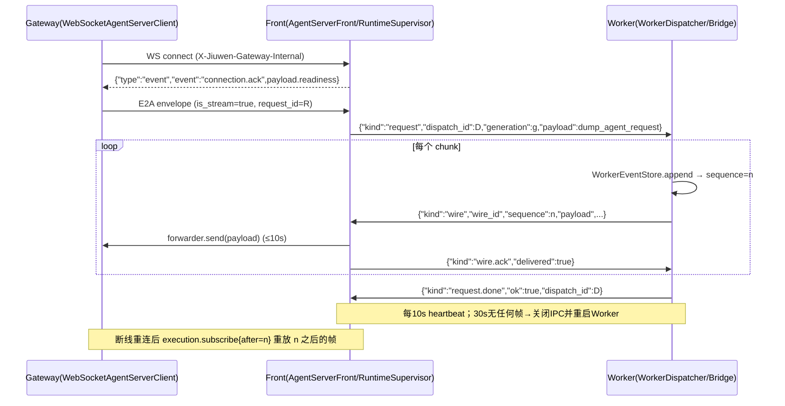

---

### 3.2 AgentManager：模式与会话生命周期

#### 3.2.1 真实的模式名（不存在名为 “Fast / Code / Team” 的 Python 类）

`gw/common/mode_matrix.py:33-42` 定义的新三段式 canonical 模式：

| 常量 | 值 | 说明 |
|---|---|---|
| `NEW_AGENT_WORK_NORMAL` | `agent.work.normal` | 单 Agent 普通（历史 `agent`、`agent.fast` 都映射到它） |
| `NEW_AGENT_WORK_PLAN` | `agent.work.plan` | 单 Agent Plan |
| `NEW_AGENT_CODE_NORMAL` | `agent.code.normal` | 单 Agent Code（历史 `code`/`code.normal`） |
| `NEW_AGENT_CODE_PLAN` | `agent.code.plan` | Code + Plan |
| `NEW_TEAM_WORK_NORMAL` / `NEW_TEAM_WORK_PLAN` | `team.work.normal` / `team.work.plan` | Team（历史 `team`、`team.plan.normal`） |
| `NEW_TEAM_CODE_NORMAL` / `NEW_TEAM_CODE_PLAN` | `team.code.normal` / `team.code.plan` | Team + Code |
| `NEW_TEAM_DESIGN` | `team.design` | Designer 画布团队 |

- 旧名→新名映射 `DEPRECATION_MAP`（`mode_matrix.py:94-105`），其中 `"agent.fast": NEW_AGENT_WORK_NORMAL  # 历史已归一 agent`（`:97`）——**“Fast 模式”已被并入普通 work 模式，不再有独立实现**；`deprecate_mode` 在 `:341`。
- `js/runtime/mode_catalog.py:59-84` 的 `_SINGLE_AGENT_MODES` 只对 SDK 暴露 4 个单 Agent 模式（`RuntimeModeDescriptor(mode, work_mode ∈ {work, code}, is_plan, supports_custom_agent_definitions)`），`resolve_mode_capability` 在 `:92`。Team 模式由 `TEAM_CANONICAL_MODES`（`mode_matrix.py:108-120`）判定，走 TeamManager 而非 mode_catalog。
- AgentManager 内部仍用“manager mode + sub_mode”二元组：manager mode ∈ `agent | code`（`_create_agent` 根据 `mode_key == "code"` 选择 `interface_code` 或 `interface_deep` 后端，`js/server/runtime/agent_manager.py:688-692`）；单 Agent 的 `plan` 子模式在缓存键层面被并轨：`_PLAN_SUB_MODE_ALIASES = {"agent": "", "code": "normal"}`（`:135-138`，`collapse_plan_sub_mode` `:141-154`）——即 **Plan 与 Normal 共享同一个 root Agent 实例**，Plan 是会话级状态（`PlanModeController`）。

#### 3.2.2 缓存与复用键

`AgentManager`（`agent_manager.py:208`）的核心数据结构（`__init__` `:216-251`）：

| 字段 | 含义 |
|---|---|
| `agents: dict[channel_id, dict[cache_key, JiuWenSwarm]]` | 两级 root Agent 缓存 |
| `_agent_create_locks: WeakValueDictionary[(channel, cache_key), Lock]` | 防并发重复创建 |
| `_agent_borrowers: dict[id(agent), set[Task]]` / `_agent_pins` | 借用/钉住计数，防止使用中被回收 |
| `_session_create_tokens` | `session.create` 幂等 token |
| `warm_pool: AgentWarmPool` | 预热池（`:249-251`） |

cache_key 生成：
- 默认：`f"{mode}:{sub_mode}:{project_key}"`（`_make_agent_cache_key` `:157-161`），`project_key` = `normcase(abspath(expanduser(dir))).casefold()`（`_normalize_project_dir` `:73-80`）；channel 默认 `"default"`（`:61-62`）。
- 带自定义 Agent 定义：再追加 `:agent:<64位sha256指纹>`（`_make_defined_agent_cache_key` `:174-186`）。
- 开启运行权限：追加 `:run-permissions`（`get_agent` `:1375-1376`）。
- `get_agent`（`:1330-1421`）：命中直接 `_borrow_agent`；未命中进 per-key 锁双检后 `_create_agent`。ACP 通道额外合并 `_build_acp_agent_config`（`:1397-1401`）。
- Auto 权限会话 pin 在第一个 owner：`get_agent_for_request` 用 `f"auto-session:{session_id}"` 锁（`:2050-2120`）。

**session 级**：root Agent 之下还有 session-scoped adapter 缓存：`JiuWenSwarmDeepAdapter._session_adapters[sid]`（写入点 `interface_deep.py:4260/4348/4407/4412`，`_get_or_create_session_adapter` `:3921`）。
**Team**：`get_team_manager()` 是**进程单例**（`js/agents/harness/team/team_manager.py:4166-4171`，channel_id 被忽略）；本地 leader 执行的 Team 实例由 core 的 `TeamRuntimePool`（`ac/agent_teams/runtime/pool.py:78`，按 `team_name` 键控，无 TTL）持有；`TeamManager._team_agents` 只用于分布式 teammate bootstrap（`team_manager.py:345-349`）。

#### 3.2.3 Session ID 与预热池（Warm Pool）

- `create_session`：显式 id 直接复用，否则 `f"{channel}_{ms:x}_{uuid12}"`（`agent_manager.py:1219-1242`）。
- `AgentWarmPool`（`js/server/runtime/agent_warm_pool.py:115`）：
  - 开关：环境变量 `JIUWENSWARM_AGENT_PREWARM`，**默认关闭**（`prewarm_enabled_by_env` `:38-54`）。
  - 排除通道 `EXCLUDED_CHANNELS = {"acp","a2a"}`（`:118`），Team(`is_swarm`) 一律 `bypassed`（`claim` `:637-639`；`AgentManager.claim_prewarmed_session` `:1291-1300`）。
  - `WarmKey(channel_id, project_id, project_dir, work_mode ∈ {work, code}, is_swarm)`（`:76-81`，`make_key` `:172-186`）；`WarmRevision(boot_id, config_fingerprint=sha256(config+env), sequence)`（`:93-96`，`:189-206`）。
  - 容量：`max_concurrency=1`、`max_ready_slots=1`、`max_foreground_concurrency=8`、`background_cooldown_seconds=0.25`（`:120-129`）；`_desired_keys` = 所有已启用通道 × 所有项目 + 两个默认项目（`:261-285`），优先 web/work/默认项目（`_key_priority` `:287-295`）。
  - `_prepare`（`:498-635`）：后台预热只调用 `prepare_kernel`，前台（被 claim 晋升）才调用 `prepare_session`；前台聊天期间后台预热让路（`_foreground_idle.wait()`），并以 `_initialization_lock` 串行化（OpenJiuwen 全局工具注册表非并发安全，注释 `:150-153`）。完成后若 revision 变化 / key 不再期望 / 池已关闭 → `stale` → `_dispose_runtime`（`:556-591`）。
  - `claim`（`:637-673`）：有 READY 槽 → 返回 `prewarm_hit=True`，并把 Agent pin 住 **300 秒**（`_release_claim_pin_after(..., 300)` `:647-652`）后自动 unpin；有在途任务 → 晋升为前台任务（`warming`）；都没有 → 新起前台 prepare。
  - 预热标记文件：`<agent_root>/sessions/.prewarm/<session_id>.json`（`_marker_path` `:212-230`），启动时 `_cleanup_stale_markers`（`:238-259`）删除**非本 boot_id** 且**没有 `metadata.json`** 的会话目录——这是对“预热到一半进程死掉”的显式清理。

#### 3.2.4 挂起 / 恢复、超时销毁与 GC

| 机制 | 实现 | 触发 | 参数 |
|---|---|---|---|
| 中断挂起（ask_user / 权限审批） | checkpointer `interrupt_agent_execute` 保存 agent state（`ac/core/session/checkpointer/persistence.py:771-780`）；下一次请求 `pre_agent_execute` 恢复（`:746-757`） | 需要人类交互 | — |
| Team 暂停 | `AgentRuntime.cancel_request` 中 `intent == "pause"` → `TeamSessionLifecycleAdapter.pause_session` → `TeamManager.pause_session_runtime`（`js/runtime/service.py:1417-1418`；`team_session_lifecycle.py:133-146`；`team_manager.py:3889`） | 用户暂停 | generation 校验 |
| session adapter **空闲 TTL 回收** | `JiuWenSwarmDeepAdapter._evict_idle_session_adapters`（`interface_deep.py:3591-3622`） | **惰性**：在 `process_interrupt`/`handle_user_answer`/`handle_swarmflow_reply` 等请求路径的 `finally` 中调用（`:16354, 16369, 16831, 16984, 17787, 18191, 18999, 21844, 21932, 22075, 22135, 22459`）；**没有独立的定时清扫协程** | `SESSION_ADAPTER_IDLE_TTL_SEC = 2*60*60`（2h，`:1882`），每次最多回收 `SESSION_ADAPTER_EVICT_BATCH_SIZE = 3`（`:1883`）；跳过：持锁/有等待者、存活 subagent（issue #3625）、Heartbeat 需要保留（`cleanup_session_adapter` `:3642-3656`） |
| root Agent 回收（TUI） | `_retire_tui_agent_if_idle_locked`（`agent_manager.py:533-599`） | `cleanup_session_runtime` 之后、或最后一个 borrower/pin 释放时（`_release_agent_borrower` → `_schedule_pending_tui_retirement` `:416-428`） | 仅 `tui` 通道；无 pin、无 borrower、`has_session_runtime()` 为假 |
| session 运行时释放 | `AgentManager.cleanup_session_runtime`（`:863-958`）遍历该通道所有 Agent 的 `cleanup_session_runtime(sid)` 并聚合失败 | 删除/关闭会话 | — |
| 永久删除 | `RuntimeSessionProvisioner.delete_session` → `_delete_session_locked`（`js/runtime/session_provisioner.py:1444/1467`）：participants `before_delete` → 释放资源 → `Runner.release(session_id)`（`:1657`，清 checkpoint 前缀）→ `shutil.rmtree(session_dir)`（`:1660`） | `session.delete` | 走持久化 lifecycle 日志（见 §3.4） |
| 离线删除 | `delete_offline_session`（`js/server/runtime/offline_session_cleanup.py:16-47`）临时构造 `AgentRuntime(participant_registry=RuntimeParticipantRegistry())` 执行 `delete_session` 后 `close()` | AgentServer 不在线时由 gateway session_adapter 调用（`session_adapter.py:461-481`） | 不做远端 KVC |
| 配置重载重建 | `reload_agents_config`（`:1749`）/ `recreate_agent`（`:1959`），`_reload_lock` 串行防内存爆炸（`:226-227`） | 配置变更 | 指纹 `_last_reload_fingerprint` |

会话生命周期事件模型（与传输无关）：`SessionKind{AGENT, TEAM}`、`SessionDescriptor(session_id, channel_id, mode, work_mode, project_id, project_dir, user_id)`、`SessionInputIntentEvent / SessionForegroundEvent / SessionExecutionEvent / SessionExecutionFinishedEvent / SessionInactiveEvent`（`js/runtime/session_lifecycle.py:17-81`），参与者协议 `SessionActivityParticipant` / `SessionDeleteParticipant`（`:88-128`），注册表 `RuntimeParticipantRegistry`（`:131`）。会话创建/切换/fork 采用两阶段：`SessionProvisionState{PREPARED, COMMITTING, ABORTING, COMMITTED, ABORTED}`（`session_provisioner.py:259-266`）+ `SessionProvisionCommitTiming{BEFORE/AFTER_RESULT_DELIVERY}`（`:273-277`）。

> 补充（不同子系统）：`agent-runtime/management` 的 `ServiceManager` 有显式 TTL 定时器：`SessionConfig.ttl = 300`（`ar/management/openjiuwen_runtime/management/session/models.py:34`）、`AccessConfig.service_ttl = 300`、`min_idle_services = 1`（`:52-60`），`_arm_session_timer`（`service_manager.py:686-697`）基于 `Timer.start_timer`（`timer.py:22-52`，`asyncio.sleep(ttl)`）。Gateway AgentOS 扩展的沙箱空闲回收：`sandbox_idle_timeout_seconds=600.0`、`sandbox_idle_check_interval_seconds=30.0`（`gw/extensions/agentos/agentos_router/router_client.py:535-541`）。这些与 jiuwenswarm 单机 AgentManager 是**不同层**的机制。

#### 3.2.5 状态图

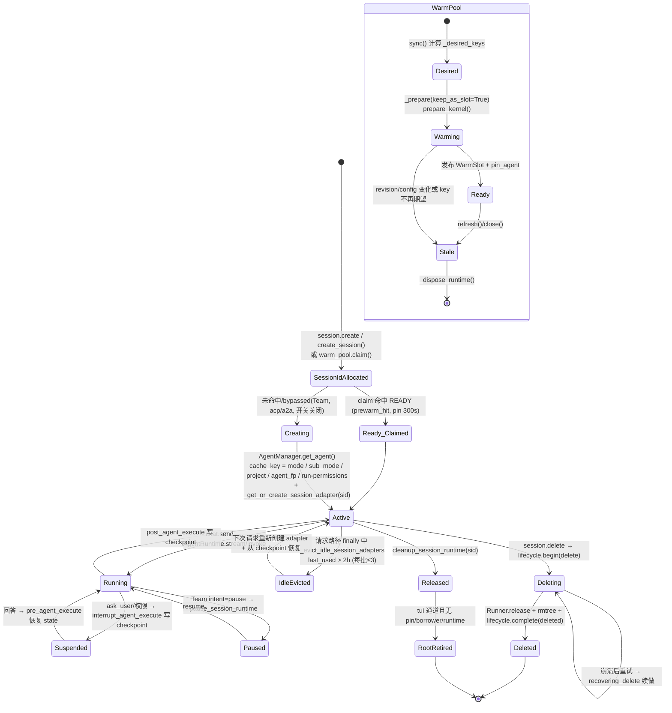

---

### 3.3 Checkpoint 与崩溃恢复

#### 3.3.1 后端选择与位置

`ensure_persistent_checkpointer`（`js/runtime/checkpointer.py:72-128`）在 Worker 启动时（`worker/runtime_backend.py:300` 导入）把进程级默认 checkpointer 设为：

```python
conf = {"db_type": "sqlite", "db_path": f"{checkpoint_path}/checkpoint"}   # checkpointer.py:100
CheckpointerFactory.create(CheckpointerConfig(type="persistence", conf=conf))
```

- 路径：`get_checkpoint_dir()` = `<agent_root>/.checkpoint`（`js/common/utils.py:2466-2468`），文件 `.checkpoint/checkpoint.db`（provider 自动补 `.db`，`ac/core/session/checkpointer/persistence.py:1020-1021`）。
- 引擎：`create_async_engine("sqlite+aiosqlite:///...", connect_args={"timeout": 30})`，默认 `db_enable_wal=True` 时每个连接执行 `PRAGMA journal_mode=WAL`（`_enable_sqlite_wal` `:968-980`，`create` `:997-1041`）。
- **注意一个不一致**：jiuwenswarm 会传 `conf["db_journal_mode"]`（`js/runtime/checkpointer.py:103-108`），但 agent-core 的 `PersistenceCheckpointerProvider.create` **从不读取 `db_journal_mode`**（全仓 grep 仅此一处出现），实际行为仍是“WAL 开/关”二选一。
- 其它后端：`shelve`（同 provider）、内存 `inmemory.py`、Redis 扩展 `RedisCheckpointerProvider`（`ac/extensions/checkpointer/redis/checkpointer.py:229`，可配 `RedisTTLConfig.default_ttl`（分钟）与 `refresh_on_read`，`:44-62`）。jiuwenswarm 默认只用 SQLite。

#### 3.3.2 序列化了什么（字段）

序列化器：`create_serializer("pickle")`（`BaseStorage.__init__` `persistence.py:69-78`；`ac/core/graph/store/serde.py:45-51`，json 未支持）。存储为 KV 表 `kv_store(key VARCHAR(255) PK, value TEXT)`（`ac/core/foundation/store/kv/db_based_kv_store.py:45-51`），bytes 以 `_BYTES_PREFIX + base64` 编码（`:87-98`）。键格式 `session:namespace:entity_id:suffix`（`build_key_with_namespace` `ac/core/session/checkpointer/base.py:178-186`）。

| Storage 类 | namespace（`base.py:156-162`） | 存的内存对象 | KV 键后缀 |
|---|---|---|---|
| `AgentStorage`（`persistence.py:288-303`） | `agent` | `session.state().get_state(copied=False)` → `StateCollection.get_state()` = `{GLOBAL_STATE_KEY: 全局状态, AGENT_STATE_KEY: agent 状态}`（`ac/core/session/state/agent_state.py:34-38`；`_trace_state` **不**持久化） | `agent_state_blobs` + `agent_state_blobs_dump_type` |
| `AgentTeamStorage`（`:306-321`） | `agent-team` | `session.state().get_global(None)` | `agent_team_state_blobs(_dump_type)` |
| `WorkflowStorage`（`:324-...`） | `workflow` | `get_state()` + `get_updates()` 两份 | `workflow_state_blobs(_dump_type)`、`workflow_update_blobs(_dump_type)` |
| `GraphStore`（`:554-...`） | `workflow-graph` | `GraphState`（Pregel 图快照） | `_DATA_TYPE` / `_DATA_VALUE` |

写入时机（`PersistenceCheckpointer` `:725-...`）：`pre_agent_execute` 恢复；`interrupt_agent_execute`（需要交互）与 `post_agent_execute`（执行完成）保存；team 对应 `pre/post_agent_team_execute`；workflow 在 `pre/post_workflow_execute`。**不是每个 token/每个工具调用写一次，而是在 turn 边界与中断点写。**

#### 3.3.3 写入机制（原子性）

| 数据 | 写法 | 原子性 | 证据 |
|---|---|---|---|
| Checkpoint（SQLite） | `pipeline()` 收集 set 操作，`execute` 在**同一个 `async with session.begin()` 事务**中 upsert 两个键（dump_type + blob） | **事务级原子**：两键要么都写入要么都不写；WAL 保证崩溃后回滚未提交事务 | `db_based_kv_store.py:276-308`；`BaseSingleStateStorage.save` `persistence.py:172-206` |
| Checkpoint（Redis） | `pipeline().set(...).set(...).execute()`（`ac/extensions/checkpointer/redis/storage.py:159-164`），`RedisStore.pipeline()` 直接返回 `self.redis.pipeline()`（`ac/extensions/store/kv/redis_store.py:507-525`） | redis-py 默认 `transaction=True` 即 MULTI/EXEC；cluster 模式下（注释 `:21`）不保证跨槽原子 —— 此为库语义推断，仓库内未显式设置 | — |
| Session lifecycle 资源/操作日志 | `atomic_json`：`.<name>.<uuid>.tmp` → `json.dump` → `flush` → **`os.fsync`** → `os.replace` | 原子替换 + 落盘 | `js/server/runtime/session/lifecycle.py:108-119` |
| `metadata.json` | `<name>.<pid>.tmp` `write_text` → `_atomic_replace`（`os.replace`，Windows 共享冲突最多重试 100 次） | 原子替换，但**无 fsync**（断电可能丢最近写） | `session_metadata.py:786-796, 180-185` |
| `history.jsonl` 全量重写 | `TemporaryDirectory` 内写临时文件 → `fsync` → `os.replace` | 原子 | `session_history.py:804-824` |
| `history.jsonl` 追加 | `open("a")` 写 `json + "\n"`，**无 fsync、无 tmp**；在 `lifecycle.resource_lock` + `write_guard` 下进行 | **非原子**，崩溃可能留下半行 | `session_history.py:827-841` |
| 元数据/历史写队列 | 后台线程队列 `queue.Queue(maxsize=5000)` / `maxsize=20000` | 进程被 kill -9 时**队列中未落盘的写会丢失**；正常关闭由 `WorkerRuntime._shutdown_owned_resources` 调 `flush_pending_writes`（`worker/runtime_host.py:80-81`，默认 10s 超时 `session_metadata.py:945`） | `session_metadata.py:70`、`session_history.py:32` |
| 预热标记 | `write_text` 直接写 | 非原子，但启动时 JSON 解析失败只告警并保留（`agent_warm_pool.py:258-259`） | `agent_warm_pool.py:215-230` |

#### 3.3.4 kill -9 / OOM 中途写入时会发生什么

逐对象说明（只陈述代码可证的行为）：

1. **SQLite checkpoint**：事务未提交即被杀 → WAL 回滚，读到的是**上一个已提交的 checkpoint**（上一 turn 末尾或上一次中断点）。本 turn 已执行但未到 `post_agent_execute` 的进展会**丢失**，下次 `pre_agent_execute` 从旧状态继续。
   - 恢复时容错：`recover` 中键数不为 2 → debug 日志后直接返回（`persistence.py:219-226`）；`_deserialize_state` 反序列化失败 → **记录 error 并返回 None**（`:90-111`），随后当作“无状态”从空状态开始（`:229-238`）——即 pickle 损坏时**静默降级为全新状态**，没有备份/回退到更早版本。
   - **无版本号/多版本保留**：每个 (session, agent) 只存一份最新 blob（upsert 覆盖），没有 checkpoint 版本链。
   - 唯一显式校验：Workflow 的交互恢复 `validate_interactive_resume`（`base.py:23-94`）要求 workflow checkpoint 存在且 `GraphState.is_resumable()`，否则抛 `CHECKPOINTER_PRE_WORKFLOW_EXECUTION_ERROR`，把“静默全新起跑”变为显式错误。Agent 层（DeepAgent）没有同等校验。
2. **Session lifecycle 日志**（`lifecycle.py` 模块 docstring `:1-6`：“The resource file is the commit point: it embeds the current operation so a crash between journal and pointer writes cannot expose an unfenced resource.”）：
   - `save_locked`（`:153-166`）先写 `lifecycle/operations/<operation_id>.json`，再写 `lifecycle/resources/<kind>_<id>.json`，并 `revision += 1`；`begin` 生成 `generation`、`blocked/write_blocked` 栅栏（`:169-215`）。
   - 操作带租约：`claim_operation` 设置 `owner_id` 与 `lease_expires_at = now + 30`，换 owner 时 `generation += 1`（`:218-230`），`renew_operation` 续约（`:233-253`）。
   - 删除可续做：`_delete_session_locked` 读出未完成的 `delete` 操作即进入 `recovering_delete`（`session_provisioner.py:1506-1510`），会话目录已不存在也视为已删除继续收尾（`:1621`），并补写 `delete_metadata`（`:1552-1553`）。**但这是“下次重试同一请求时续做”，代码中未发现启动时扫描 `operations/` 目录自动恢复的逻辑**（`"operations"` 仅出现在 `lifecycle.py:162/249` 两处写入）。
   - 读取损坏：`read_json` 对非 dict 抛 `LifecycleError("CONFLICT")`，对 JSON 语法错误**不捕获**（`:99-105`）——由于写入是 fsync+rename，半写 JSON 理论上不会出现在正式文件名上；被杀时 `finally: temporary.unlink` 不会执行，会**遗留 `.xxx.tmp` 孤儿文件**，仓库内未发现对这些 tmp 的启动清理。
3. **history.jsonl 追加半行**：读取端逐行 `json.loads`，失败的行**告警并跳过**（`session_history.py:738-747`），因此半写的最后一行会被丢弃而不会阻塞会话加载。
4. **metadata.json**：tmp+rename 保证不会出现截断文件（注释 `session_metadata.py:786-789` 说明该改动正是为了解决“截断导致会话身份丢失”）；但未 fsync，且后台队列中尚未处理的写在 kill -9 时丢失。
5. **预热会话**：启动时 `_cleanup_stale_markers` 清除旧 boot 的、没有 `metadata.json` 的预热目录（`agent_warm_pool.py:238-259`）。
6. **流事件**：`WorkerEventStore` 纯内存；Worker 被杀则所有未送达帧与重放能力丢失，Front 侧 `_fail_pending` 向 Gateway 回错误（`runtime_supervisor.py:1080-1086, 1100+ _emit_error`，错误码默认 `WORKER_CLOSED` `:404`）。**若只是 Front 进程被杀**：resident Worker 继续运行并保留 EventStore，新 Front 通过 `_connect_resident` 重新挂接，Gateway 重连后用 `execution.subscribe{after}` 重放；超出 2048 帧/8MiB 窗口时 `history_required=True` 提示客户端改读持久化历史。
7. **进程级重启**：SIGKILL 的 AgentServer/Gateway 在运行≥30s 时被 `jiuwenswarm.app` 重新拉起（§1.2），并在 `.exit_breadcrumb` 记录退出原因（`_record_exit_breadcrumb` `process_supervision.py:120`）。

**结论**：SQLite 事务 + WAL 保证了 checkpoint 写入的**原子性**；lifecycle 日志用 fsync+rename+generation/lease 实现了**删除/归档操作的可续做**。但 checkpoint 层**没有版本化、没有校验和、没有回退到旧版本**，反序列化失败时静默清空状态；流式中间状态与写队列在 kill -9 时会丢失。没有找到针对 checkpoint “半写”的额外显式处理——这完全依赖 SQLite 的事务语义。

---

### 3.4 A2X 与 PyZMQ / WebSocket 分布式路由

#### 3.4.1 拓扑与配置

`js/agents/harness/team/distributed_runtime.py`：
- 是否分布式：`team.runtime.mode == "distributed"` 或 `team.transport.type == "pyzmq"`（`is_distributed_mode` `:20-28`）；角色 `team.runtime.role ∈ {leader, teammate}`（`:31-35`）。
- 端口归一 `normalize_distributed_transport_fields`（`:74-151`）：

| 角色 | direct_addr（ROUTER bind） | pubsub | 默认端口 |
|---|---|---|---|
| leader | `tcp://0.0.0.0:<leader.direct_port>` | `pubsub_bind=True`：leader 自建 XSUB(bind pub_port)/XPUB(bind sub_port) 代理 | direct 18555 / pub 18556 / sub 18557 |
| teammate | `tcp://0.0.0.0:<teammate.direct_port>` | 连接 leader 的 pub/sub；`known_peers = bootstrap_peers = [{agent_id: leader_member_name, addrs:[tcp://leader_host:18555]}]` | direct 18600 |

- 依赖缺失（pyzmq、PostgreSQL 时 asyncpg）→ `fallback_distributed_to_local` 回退到 `inprocess` + sqlite `team.db`（`:160-220`）；leader 还会尝试拉起本地 PostgreSQL（`ensure_postgresql_for_leader` `:319`）。

#### 3.4.2 PyZMQ Messager（`ac/agent_teams/messager/pyzmq_backend.py`）

- **P2P 层 `_P2PLayer`**（`:38-187`）：本地 `ROUTER` bind `direct_addr`（`:68-70`）；发送时**每条消息临时建一个 `DEALER`**，`IDENTITY = node_id`，`connect(peer.addrs[0])` → `send` → `wait_for(recv(), timeout=request_timeout)` → close（`:89-112`）。接收端 `_handle_request` 按 JSON 中的 `_recipient_id` 找 handler，`EventMessage.model_validate` 后调用，**无论成功与否都回 `b"ok"`**（`:139-163`）。路由表 `_peer_book` 来自 `bootstrap_peers + known_peers`，可运行时 `register_peer`（`:50-59`）；未知 agent_id 抛 `RuntimeError("Unknown zmq route ...")`（`:165-175`）。
- **PubSub 层 `_PubSubLayer`**（`:190-369`）：`PUB.connect(pub_addr)` / `SUB.connect(sub_addr)`；`pubsub_bind` 时自建 `XPUB/XSUB` 代理，`_run_proxy` 每 100ms poll 双向转发（`:343-354`）；消息帧 `[topic, EventMessage.serialize()]`（`:262-272`）；topic 形如 `session:{sid}:team:{team}:{team|task|message}`（`TeamTopic.build` `ac/agent_teams/schema/events.py:42-59`）。
- `PyZmqMessager.send` 把 `EventMessage.model_dump()` 加 `_recipient_id` 后 JSON 编码（`:453-464`）；`publish` 自动补 `sender_id`（`:421-435`）。
- 超时：`MessagerTransportConfig.request_timeout = 10.0`（`ac/agent_teams/messager/base.py:45`）。
- **心跳**：pyzmq backend **没有任何应用层心跳/存活探测**，也未设置 ZMQ_HEARTBEAT_* 套接字选项；对端存活仅能通过 P2P 发送的 ACK 超时（10s）间接发现。

#### 3.4.3 A2X Registry（注册/发现/预留）

客户端 `AsyncA2XRegistryClient`（`js/agents/harness/team/a2x/client/async_client.py`），HTTP（httpx），REST 路径（`client/_internal.py:80-126`）：

| 操作 | HTTP | 路径 |
|---|---|---|
| 注册 Agent（含空白 Agent） | POST | `api/datasets/{ds}/services/a2a`（`register_agent` `:118-130`；`register_blank_agent` `:202-215`） |
| 更新/设状态 | PUT | `api/datasets/{ds}/services/{sid}`（`:132-164`） |
| 查询 | GET | `api/datasets/{ds}/services`（`list_agents` `:166-176`） |
| 注销 | DELETE | `api/datasets/{ds}/services/{sid}`（`:185-200`） |
| 预留空白 Agent | POST | `api/datasets/{ds}/reservations`，body `{filters:{description:"__BLANK__", status:"online"}, n, ttl_seconds[, holder_id]}`（`reserve_blank_agents` `:313-342`） |
| 释放预留 | DELETE | `.../reservations/{holder_id}[/{sid}]`（`:344-367`） |
| 续租预留 | POST | `.../reservations/{holder_id}/extend` → `expires_at_unix`（`:369-385`） |
| 释放租约 | DELETE | `.../services/{sid}/lease`（`:387+`） |

空白 Agent 卡片：`{"name": "_BlankAgent_<endpoint>", "description": "__BLANK__", "endpoint": <tcp addr>, "status": "online"}`（`build_blank_agent_card` `_internal.py:169-190`；常量 `BLANK_AGENT_NAME_PREFIX` `:51`、`BLANK_DESCRIPTION_SENTINEL` `:56`、`STATUS_ONLINE/BUSY/OFFLINE` `:40-42`、`DEFAULT_RESERVATION_TTL = 30` `:47`）。服务端按 name 确定性生成 service_id，重复注册同一 endpoint 时 sid 稳定（docstring `:172-175`）。

运行时封装 `js/agents/harness/team/a2x/a2x_registry_runtime.py`：
- 配置 `react.a2x_registry`：`base_url`（默认 `http://127.0.0.1:8000`）、`timeout=30.0`、`api_key`、`dataset`、`role ∈ {teammate, teamleader}`、`endpoint`（teammate 默认取 `team.transport.params.bootstrap_direct_addr`，`0.0.0.0` 被改写成 `127.0.0.1`）、`reservation_ttl_seconds=30`（`resolve_a2x_config` `:99-153`）。
- teammate 启动：`run_teammate_bootstrap_daemon`（`remote_member_bootstrap.py:2974`）bind 一个 **ROUTER**（`bootstrap_direct_addr`）后调用 `register_teammate_blank_agent_at_startup`（超时 5s，`a2x_registry_runtime.py:254-283`）→ `register_blank_agent_if_teammate`（进程内 `_REGISTERED_BLANK_ENDPOINTS` 去重，`:191-251`）。
- leader 发现：`reserve_blank_teammate_agent`（`:410-482`）向 registry 预留 1 个空白 teammate（TTL 30s），拿到 `service_id + endpoint`；调用点 `remote_member_bootstrap.py:505-507`（`precheck_and_reserve_remote_spawn`）与 `:858-860`（`_send_bootstrap_message`）。
- teammate 完成 bootstrap 后：`replace_teammate_agent_card_after_bootstrap` 把空白卡替换为 `{name: member_name, description: "Task Planner(team-1)", status: "busy", skills:[{plan}]}`（`:485-542`，卡片模板 `:24-26, 86-96`）；团队销毁时 `restore_teammate_blank_agent_on_destroy` 恢复为空白/online（`:286+`，调用 `remote_member_bootstrap.py:2940-2943`）。
- **心跳/保活**：A2X client 中**没有心跳调用**（grep `heartbeat|keepalive` 于 `a2x/client` 无结果）；存活依赖 registry 侧 `status` 字段与**预留 TTL（30s，可 `extend_reservation` 续租——但仓库中除 client 自身外无调用方）**。Gateway AgentOS 的 `RegistryConfig.node` 注释提到 `POST /api/nodes/{node}/heartbeat`（`gw/extensions/agentos/agentos_router/registry_client.py:41-48`），但本仓库**未实现该心跳请求**，只在注册实例时把该 IP 写入（`:710` 注释）。

#### 3.4.4 Bootstrap 控制面（raw ZMQ DEALER→ROUTER）

leader 构造信封 `build_bootstrap_envelope`（`remote_member_bootstrap.py:632-671`）：

```json
{"type":"jiuwen.remote_teammate_bootstrap","version":1,"bootstrap_id":"<uuid4>",
 "team_name":..., "session_id":..., "member_name":..., "leader_member_name":...,
 "leader_agent_id":..., "leader_direct_addr":..., "messager":{...transport 字段...}, "prompt":"",
 ...swarm_assembly_hint}
```

`_send_bootstrap_via_raw_zmq`（`:759-829`）：`zmq.DEALER` + `LINGER=0` → 发 `{"event_type": "jiuwen.remote_teammate_bootstrap.direct", "payload":{"envelope":...}, "sender_id": leader}` → `wait_for(recv_multipart, timeout=20.0)` 期待 `b"ok"`。teammate 守护循环每 `poll_interval=1.0`s 非阻塞取最多 64 条（`:3044-3052`），按 `event_type` 分派到 `apply_bootstrap_envelope_from_control_plane` / `apply_team_destroy_envelope_from_control_plane` / `apply_member_shutdown_envelope_from_control_plane`，`processed_ids` 按 `bootstrap_id` 去重，最后回 `[identity, b"ok"]`（`:3060-3113`）。teammate 应用完毕后经正常 team P2P 消息回 `{"type":"jiuwen.remote_bootstrap_ack","version":1,"member_name",...}`（`build_bootstrap_ack_envelope` `:547-570`，类型常量 `:56-59`）。成员关闭等待 `_REMOTE_SHUTDOWN_TIMEOUT_SEC = 20.0`、轮询 `0.25s`（`:52-53`）。

#### 3.4.5 跨进程/跨节点的流式事件转发

1. **teammate → leader**：teammate 的 TeamAgent 事件通过 PUB 发到 leader 的 XSUB/XPUB 代理，leader 订阅 `session:{sid}:team:{team}:*` topic；点对点消息用 DEALER→ROUTER（ACK `ok`）。
2. **外部进程 → AgentServer（WebSocket 混合模式）**：`HybridMessager` + `WebSocketEventPublisher`（`ac/agent_teams/messager/hybrid.py:31-169`）：aiohttp `ws_connect(url, heartbeat=30.0)`（`:57`），发送 `{"type":"req","id":"team-event-<uuid>","method":"team.mq.publish","params":{"session_id","payload": ExternalTeamEvent(...).to_wire()},"is_stream":false}`（`_build_request` `:67-83`），等待同 id 的 `{"type":"res","ok":true}`（`:86-96, 98-131`），只支持 publish（subscribe/send 抛 `NotImplementedError` `:153-166`）。AgentServer 侧 `_handle_team_mq_publish` 校验 `payload.type == "team.external_event"` 后 `get_team_manager(channel).interact(session_id, payload)`（`js/server/agent_ws_server.py:8046-8076`）。
3. **leader AgentServer → Gateway → 用户**：leader 的 Team 流在 Worker 内被编码为 chunk，经 §1.3 的 `wire` / `wire.ack` / `sequence` 链路转发到 Gateway；无路由的 Team 推送帧被打上 server-push 标记投到当前挂接的 Gateway（`runtime_supervisor.py:929-935`）。
4. **Gateway 云端多沙箱（AgentOS 扩展）**：`AgentOSRouterClient`（`gw/extensions/agentos/agentos_router/router_client.py:522`）为每个用户沙箱维护一个 `WebSocketAgentServerClient`（`_ws_clients` `:595-603`），URL 为 YuanRong frontend 代理 `ws://<frontend>:8888/serverless/v1/ws?instance=<id>&tenant_id=...&port=<port>`（`_agent_ws_url` `:1415-1430`）；北向端口由 `RegistryWatcherService` 从 etcd 前缀 `{a2x-registry}/images/` 拉取 `{agent_type: port}` 全量映射（`registry_watcher/__init__.py:39-48`；`client.py:79-109` range + watch，断线指数退避 2s→60s `:22-23`，重连后整前缀重读对账）。

#### 3.4.6 时序图

**(a) 注册与发现（A2X）+ Bootstrap**

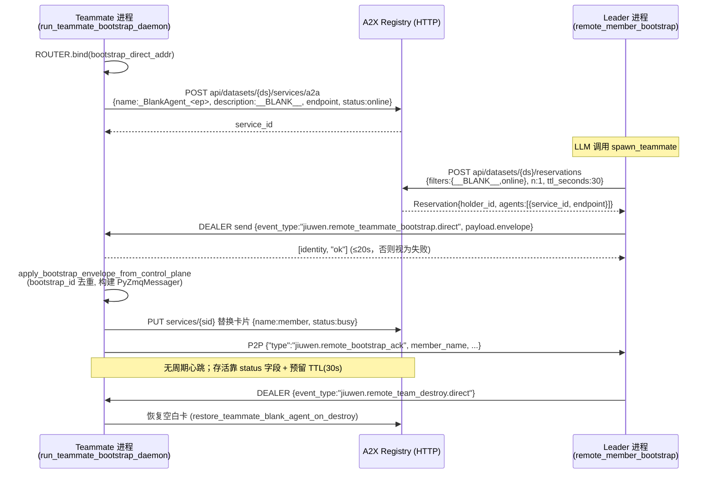

**(b) 团队运行期消息与流转发**

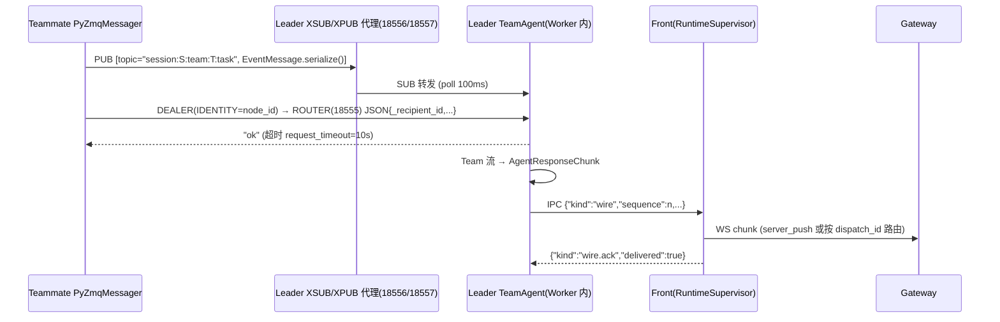

**(c) 心跳/超时总表**

| 链路 | 机制 | 间隔 | 超时/判死 | 位置 |
|---|---|---|---|---|
| Gateway ⇄ Front | WebSocket ping/pong | 30s | 300s | `front/server.py:31-32`；`gw/routing/agent_client.py:141` |
| Worker → Gateway 流 | `keepalive` chunk（仅流空闲时） | 10s | — | `agent_ws_server.py:548` |
| Front ⇄ Worker | IPC `heartbeat` | 10s | 30s 无任何帧；业务 loop 停滞 >180s 替换 Worker | `runtime_supervisor.py:60-74` |
| jiuwenswarm.app ⇄ 子进程 | `poll()` | 0.25s | 崩溃/SIGKILL 且 uptime≥30s 重启，≤3 次/600s | `process_supervision.py:47-58` |
| Leader ⇄ Teammate P2P | 每消息 ACK | — | 10s | `messager/base.py:45` |
| Leader → Teammate bootstrap | DEALER/ROUTER ACK | — | 20s | `remote_member_bootstrap.py:765` |
| Teammate bootstrap 守护 | 轮询 ROUTER | 1.0s | — | `remote_member_bootstrap.py:2977` |
| Hybrid WS publisher | aiohttp heartbeat | 30s | `request_timeout` | `hybrid.py:57` |
| A2X 预留 | TTL 租约 | — | 30s（可 extend，未被调用） | `_internal.py:47`；`a2x_registry_runtime.py:135-140` |
| etcd registry watcher | watch 流 + 退避重连 | 2s→60s | 抓取超时 10s | `registry_watcher/client.py:22-24` |
| AgentOS 沙箱空闲 | 定期检查 | 30s | 600s 空闲回收 | `router_client.py:535-541` |
| Session lifecycle 操作租约 | `lease_expires_at` | renew | 30s | `lifecycle.py:228, 244` |

---

### 3.5 附：agent-runtime（openjiuwen_runtime）定位

`agent-runtime` 是独立的“Agent 部署与托管”系统，与 jiuwenswarm 单机运行时**不共享进程模型**：
- `ar/server/openjiuwen_runtime/server/main.py`：FastAPI REST，`GET /health`（`:84`）、`POST /api/v1/agents/deploy`（`:169`）、`GET /api/v1/agents`（`:249`）、`GET/DELETE /api/v1/agents/{deployment_id}`（`:290/326`），部署策略 subprocess / docker / k8s（README）。
- `ar/foundation/openjiuwen_runtime/foundation/db/`：sqlite / mysql / postgresql / gaussdb / redis handler；`messaging/amqp_json.py`。
- `ar/management/.../session/service_manager.py`：会话亲和 TTL、实例池 `min_idle_services` / `max_services` / `service_ttl`（见 §2.4 补充）。

---

### 3.6 关键发现摘要

1. 拆分布局实为 **Gateway / AgentServer Front / Runtime Worker** 三进程；Gateway↔Front 走 **WebSocket JSON（E2A 信封）**，Front↔Worker 走 **UDS/命名管道上的 4 字节长度前缀 JSON 帧（PROTOCOL_VERSION=2，13 种 kind）**；Worker 默认 resident，Front 重启不丢已加载 Runtime 与内存事件窗口。
2. 流式 chunk 在 Worker 内被赋予单调 `sequence` 并缓存于 2048 帧/8MiB 环形窗口，支持 `execution.subscribe{after}` 断点重放；非流式响应需 `wire.ack`（15s）。
3. “Fast 模式”已并入 `agent.work.normal`；Plan 与 Normal 共享 root Agent 缓存键；AgentManager 两级缓存 `channel → mode:sub_mode:project[:agent:fp][:run-permissions]`；预热池默认关闭、单槽、Team 绕过。
4. 空闲回收是**惰性**的（请求路径 finally 中，2h TTL、每批 3 个），没有后台定时 GC；TUI root Agent 在无 pin/borrower 时退休。
5. Checkpoint：pickle → SQLite（WAL）KV 表，双键 upsert 在**单事务**内完成；按 turn/中断点写入，无版本链、无校验和，反序列化失败静默清空状态。lifecycle 日志使用 fsync+rename+generation+30s 租约，删除可续做；history.jsonl 追加非原子但读端跳过坏行；元数据/历史写队列在 kill -9 时丢失。`db_journal_mode` 配置未被 agent-core 消费。
6. 分布式 Team：PyZMQ ROUTER/DEALER（P2P, ACK 10s）+ PUB/SUB 经 leader XSUB/XPUB 代理；A2X 仅做 HTTP 注册/预留（空白卡 `__BLANK__`、TTL 30s），**全链路无应用层心跳**，存活依赖 ACK 超时、registry status 字段和预留 TTL。


---

## 4. Swarm 模块：组织协同、确定性编排与自演进闭环

> 本部分分为 4A（`agent_teams` 动态蜂群 + `SwarmFlow` 确定性工作流）与 4B（`Swarm Skills` 五件套 + 自演进闭环）。


---

### 4A. 动态蜂群（agent_teams）与确定性工作流（SwarmFlow）

> 本文所有符号名与 `file:line` 均经 `grep -n` 核对。路径前缀缩写如下：
>
> | 缩写 | 实际路径 |
> |---|---|
> | `AT/` | `agent-core/openjiuwen/agent_teams/` |
> | `HS/` | `agent-core/openjiuwen/harness/` |
> | `JS/` | `jiuwenswarm/jiuwenswarm/` |
>
> 模块自带的约定文档：`AT/AGENTS.md`（`AT/CLAUDE.md` 指向它）、`AT/workflow/AGENTS.md`、`AT/runtime/AGENTS.md`、`AT/agent/AGENTS.md`。下文会标出文档说法与代码不一致的地方。

---

#### 4A.0 总览

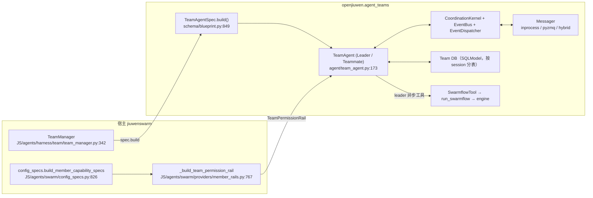

核心设计：**DB 是唯一事实来源，Messager 只发“有东西变了”的通知**。消息与任务先落库，再 `publish` 一个只带 id 的轻量事件；收方收到事件（或 30 秒轮询兜底）后自己去 DB 拉未读消息或任务看板。整个协作的可靠性就靠这一点。

---

#### 4A.1 agent_teams

##### 4A.1.1 Spec 加载与构建：`TeamAgentSpec`

代码里的类名是 **`TeamAgentSpec`**（`AT/schema/blueprint.py:198`），没有 `TeamAgentSpec` 之外的工厂函数。`AT/AGENTS.md` 写明 `create_agent_team` 这类工厂已经删除，`spec.build()` 是唯一的组装入口。

| 层级 | 类 / 函数 | 位置 | 作用 |
|---|---|---|---|
| 蓝图 | `TeamAgentSpec(BaseModel)` | `AT/schema/blueprint.py:198` | 可 JSON 序列化；`agents: dict[str, DeepAgentSpec]`，`"leader"` 必填，`"teammate"` 可选 |
| 传输 | `TransportSpec.build()` | `AT/schema/blueprint.py:100/110` | 经注册表生成 `MessagerTransportConfig`（`inprocess`/`pyzmq`） |
| 存储 | `StorageSpec.build()` | `AT/schema/blueprint.py:119/129` | sqlite / memory / pg 的 DB config |
| 默认值 | `_default_transport_for_spawn_mode` | `AT/schema/blueprint.py:812` | `spawn_mode="inprocess"` 且没写 transport 时，补一个 `TransportSpec(type="inprocess")` |
| 宿主加载 | `TeamManager._load_team_spec` → `TeamAgentSpec.model_validate` | `JS/agents/harness/team/team_manager.py:1729/1806/1857` | 从 YAML/模板编译出 spec dict |
| 宿主增强 | `enrich_team_spec_for_swarm` | `JS/agents/swarm/assembly.py:391` | 注入 provider 声明式 rail/tool 以及 `build_context_seed` |
| 宿主权限开关 | `_resolve_enable_permissions` | `JS/agents/harness/team/config_loader.py:525/619` | `spec_dict["enable_permissions"] = config.permissions.enabled` |

`TeamAgentSpec.build()`（`blueprint.py:849-951`）的步骤：

1. 取 `agents["leader"]`，没有就抛 `ValueError`（:854-856）。
2. 校验：`_validate_reserved_names` / `_validate_hitt_consistency` / `_validate_bridge_consistency`。开启 swarmflow 时再跑 `validate_swarmflow_concurrency` 和 `_validate_swarmflow_budget`（:858-863）。
3. 解析语言；把 `model_router` / `model_intelli_router` 展开成扁平的 `model_pool`（:875-884）。
4. 组装 `TeamSpec`（team 级静态数据），以及 `messager_config = self.transport.build()` 和 `db_config = self.resolve_db_config()`（:886-906）。
5. `build_model_allocator` 预先给 leader 分配模型，并校验 leader 模型已解析（:922-929）。
6. 生成 `TeamRuntimeContext(role=TeamRole.LEADER, …)`，这是 Spec 到 Runtime 的边界（:931-941）。
7. `agent = TeamAgent(leader_card)` → `attach_model_allocator` → `agent.configure(self, context)`（:943-951）。

宿主侧调用点是 `TeamManager.create_team`，它会执行 `team_agent = spec.build()`（`team_manager.py:2446`）。本地 leader 一般走 `Runner.run_agent_team_streaming(agent_team=spec, …)`，由 `AT/runtime/dispatch.py:69 decide_run_action` 在 `CREATE / NEW_TEAM_IN_SESSION / COLD_RECOVER / RESUME_FROM_PAUSE / REJECT_*` 之间选路径（枚举在 `dispatch.py:48`）。

##### 4A.1.2 Leader 与 Teammate 的实例化

Leader 和 Teammate **用同一个类 `TeamAgent`**（`AT/agent/team_agent.py:173`），靠 `TeamRuntimeContext.role` 切换角色。字段按“四象限”拆分：`blueprint` / `state` / `resources` / `infra`（:225-245）。

**`TeamAgent.configure`**（`team_agent.py:704`）分两段：

- `_setup_infra`（:719）→ `AgentConfigurator.setup_infra`（`AT/agent/agent_configurator.py:370`）
  - 把 `messager_config.node_id` 改写成 `member_name`，然后 `self.messager = create_messager(messager_config)`（:395-400）
  - 只有 leader 才建 `model_allocator` 和 `worktree_manager`
  - `setup_team_backend(...)`（:1108）构造 **`TeamBackend`**（`AT/tools/team.py`）。DB、message_manager、task_manager 都挂在它上面
  - leader 额外注册 `on_teammate_created=self._start_teammate_runtime` 等回调（`team_agent.py:722-728`）
- `_setup_agent`（:742）→ `AgentConfigurator.setup_agent`（:540）
  - 用 manifest/`RailSpec` 装配 DeepAgent。team rail 走 `@harness_element` provider（`AT/rails/elements.py`）
  - `create_member_handle(...)`；leader 另建 `MemberActivityRegistry`
  - `self._coordination.setup(role=ctx.role)` 构造 EventBus 和 Dispatcher（见 1.5）

**Teammate 的“注册”和“拉起”是两件分开的事**（`AT/AGENTS.md` spawn 节）：

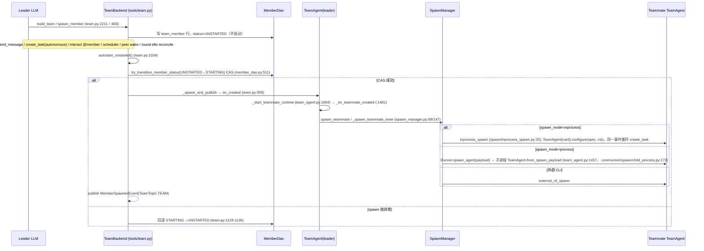

- `TeamBackend.startup_member`（`AT/tools/team.py:1097`）：这条链上**唯一的并发闸**是 DB 层 CAS `UNSTARTED→STARTING`。
- inprocess 模式下，leader 和 teammate 共享 workspace cache、checkpoints、swarmflow infra（`share_workspace_cache_with` / `share_swarmflow_with` / `share_checkpoints_with`，`inprocess_spawn.py:69/74/93`）。teammate 的流 chunk 经 `_wire_inprocess_chunk_forward`（`spawn_manager.py:218`）fan-out 到 leader 的流。
- process 模式下，spec 和 context 用 `model_dump` 序列化成 payload，子进程里 `TeamAgent.from_spawn_payload` 重建（`team_agent.py:1457-1479`）。重建时要调用 `spec.materialize_build_context()`，把 provider 装配的能力恢复回来。

##### 4A.1.3 Messager 消息总线

**抽象**：`Messager(ABC)`（`AT/messager/messager.py:20`）有 8 个方法：`start / stop / publish(topic_id, EventMessage) / subscribe / unsubscribe / send(agent_id, msg) / register_direct_message_handler / unregister_direct_message_handler`。`MessagerHandler = Callable[[EventMessage], Awaitable[None]]`（:17）。
**工厂**：`create_messager(config)`（`AT/messager/base.py:61`）只接受 `inprocess` 和 `pyzmq` 两种 backend，其他值抛 `ValueError`。另有 `HybridMessager`（`AT/messager/hybrid.py:135`，经 WebSocket 对外发布事件），不走这个工厂。

**消息 schema**（`AT/schema/events.py`）：

| 结构 | 位置 | 字段 |
|---|---|---|
| `EventMessage` | :807 | `event_type: str`、`payload: dict`、`sender_id: str`（用于过滤自己发出的事件）；`serialize()` 输出 JSON bytes（:843） |
| `BaseEventMessage` | :193 | `team_name`、`member_name?` |
| `MessageEvent` | :300 | `message_id`、`from_member_name`、`to_member_name`（**不带正文**） |
| `ToolApprovalResultEvent` | :279 | `tool_call_id / approved / feedback / auto_confirm` |
| `TeamTopic` | :42 / `build` :47 | `session:{sid}:team:{team}:{team\|task\|message}` |
| `swarmflow_human_reply_topic` | :60 | 按 run 隔离的人类回复专用 topic |

**两种后端**：

| 维度 | `InProcessMessager`（`inprocess.py:101`） | `PyZmqMessager`（`pyzmq_backend.py:372`） |
|---|---|---|
| 拓扑 | 进程级单例 `_Bus`（:21，`_get_bus` :83），里面是 `_topic_subs: topic→{agent_id→handler}` 和 `_p2p: agent_id→handler` | `_PubSubLayer`（:190）：PUB/SUB，可选在本进程跑 XPUB/XSUB 代理（`metadata.pubsub_bind`，:216-224，`_run_proxy` :343）；`_P2PLayer`（:38）：ROUTER 收、临时 DEALER 发 |
| publish | `_Bus.publish`（:46）**在发布者的 task 里依次 `await` 每个订阅者 handler**；单个 handler 抛异常只记日志，不影响其他订阅者 | `send_multipart([topic, payload])`，SUB 端 `_recv_loop`（:318）反序列化后调 handler，异常被 `suppress` |
| 点对点 send | `_Bus.send`（:64）：找不到 handler 只打 warning，然后**丢弃** | `PyZmqMessager.send`（:453）在 JSON 里加 `_recipient_id`；`_P2PLayer.send`（:89）发完**等待 ACK**（`request_timeout` 默认 10s，`base.py:44`）；接收端 `_handle_request`（:139）**不管是否处理成功都回 `b"ok"`** |
| 投递语义 | 同步、至多一次、不持久化 | PUB/SUB 至多一次（ZMQ 慢订阅者问题、没有重放）；P2P 只确认“到达对端进程”，**没有重试**。`_seen_ids` 在 :207 声明了，但**没有任何地方使用**（去重没实现） |

**可靠性的真正来源**：`TeamMessageManager.send_message`（`AT/tools/message_manager.py:60`）**先** `db.message.create_message(...)` 写入 `team_message_{session}` 表，**再** publish `MessageEvent`（:84-113）。publish 失败只记日志。收方的 `EventBus` 有周期轮询 `POLL_MAILBOX` / `POLL_TASK`，默认各 30 秒（`event_bus.py:95-96`，`_poll_loop` :297），能把丢掉的通知补回来。总结：**通知是至多一次，但内容由 DB 提供至少一次的语义，靠 `is_read` 和广播水位线 `MessageReadStatus` 去重**。

**订阅与自过滤**：`CoordinationKernel.subscribe_transport`（`AT/agent/coordination/kernel.py:603`）为每个 `TeamTopic` 订阅 `_filter_self`。它会绑定 session contextvar，然后：
- 先分发给 `event_listeners`；
- 再判断是不是自己发的（`sender_id == local_member_name`）。是的话丢弃，例外是需要唤醒邮箱的情况（leader 收到任意 MESSAGE，或者组聊广播）。在 scheduled 模式下，被丢弃的 `task_*` 回声会降级为 `SCHEDULER_SCAN` 事件（:640-655）；
- 其余事件 `enqueue` 进 EventBus。
- 同时调用 `register_direct_message_handler(self._event_bus.enqueue)`，P2P 直投也进同一个队列（:658）。

##### 4A.1.4 Team DB 与共享任务状态

**表模型**（SQLModel，`AT/tools/models.py`）：

| 表 | 类 / 位置 | 说明 |
|---|---|---|
| `team_info` | `Team` :39 | team_name 主键、leader、dispatch_mode 等 |
| `team_member` | `TeamMember` :63 | (member_name, team_name) 复合主键，`status`、`execution_status`、`mode`、`role`、`options` |
| `team_task_{session}` | `TeamTaskBase` :109；动态表 `_get_task_model` :387 | **每个 session 一张物理表**。字段：`status`（带索引）、`assignee`、`(assignee,status)` 复合索引、`reviewer`(JSON)、`review_round`、`summary/note`、`parent_task_id`、`revision/observed_revision/parent_revision`（F_129）、`updated_at` |
| `team_task_dependency_{session}` | `TeamTaskDependencyBase` :262 | 任务 DAG 依赖 |
| `team_review_vote_{session}` | `TeamTaskReviewVoteBase` :272 | 评审投票，按 `review_round` 隔离 |
| `team_message_{session}` | `TeamMessageBase` :296 | `from/to_member_name`、`content`、`broadcast`、`protocol(plain/json)`、`is_read`、`meta`（模板消息） |
| `message_read_status_{session}` | `MessageReadStatusBase` :348 | 广播已读水位线 |

**写串行化**：`DbSessions`（`AT/tools/database/engine.py:81`）用一把进程级 `asyncio.Lock`（:109，`write()` 在 :149 持锁），把所有写操作汇到一个逻辑写者。文件型 SQLite 的读写走两个独立引擎，并开启 `PRAGMA journal_mode=WAL`（:712）。

**任务状态机**：`TaskStatus`（`AT/schema/status.py:304`）+ `TASK_TRANSITIONS`（:348），由 `is_valid_transition`（:408）校验。

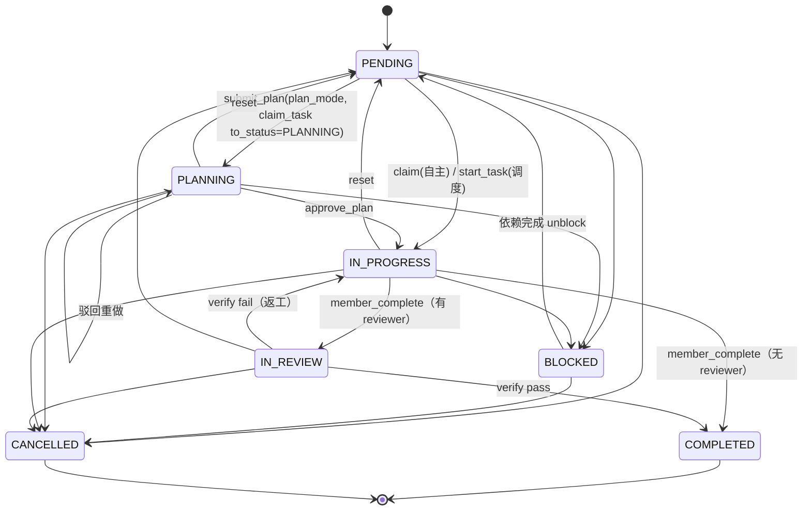

`TASK_REASSIGNABLE_STATUSES = {PENDING, BLOCKED, IN_PROGRESS}`（`status.py:399`）：处于这几种状态的任务可以原地换 owner，状态保持不变。

**claim（CAS）**：
- `TeamTaskManager.claim`（`AT/tools/task_manager.py:557`）先在锁外做读校验：任务存在、成员存在、PLAN_MODE 成员必须走 `submit_plan`、自己已持有就幂等返回成功、`assignee` 冲突、`is_valid_transition`。
- 然后调 `TaskDao.claim_task`（`AT/tools/database/task_dao.py:906`），它是**一条带条件的 `UPDATE … WHERE task_id=? AND assignee IS NULL AND status='pending'`**，`rowcount==1` 才算抢到（:940-960），并发时只有一个调用方能赢。
- 成功后 publish `TaskClaimedEvent`（TASK topic）。

**complete**：
- `TeamTaskManager.complete`（`task_manager.py:642`）校验 `assignee == self`；任务带 reviewer 时转去 `_submit_for_review`（IN_PROGRESS→IN_REVIEW，同时 `review_round+1`）。
- 否则调 `TaskDao.complete_task`（`task_dao.py:1741`），在**同一个写事务里**执行 `_terminate_task_in_session`：状态改为 COMPLETED、解锁依赖它的 BLOCKED 任务、写入 summary/note。
- 最后 publish `TaskCompletedEvent`。
- 调度模式下还有 `start_task`（`task_dao.py:855` / `task_manager.py:1791`），把“已指派未开始”的任务转为 IN_PROGRESS。

##### 4A.1.5 异步协调循环

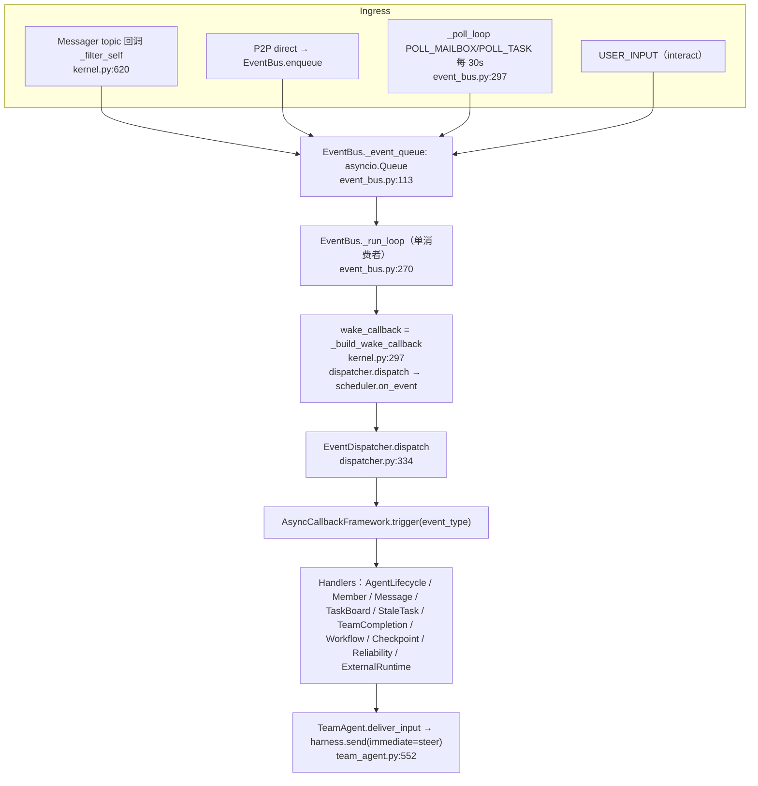

- `CoordinationKernel.setup`（`kernel.py:64`）为每个角色创建 `EventBus(role)` 和 `EventDispatcher(...)`。只有 **leader 且 `dispatch_mode=="scheduled"`** 时才创建 `TeamScheduler`（:94-102，`AT/agent/scheduling/scheduler.py:107`）。
- `EventBus._run_loop`（`event_bus.py:270`）：单协程 `wait_for(queue.get(), 1.0)` 循环取事件，收到 `SHUTDOWN` 退出；每个事件串行交给 `wake_callback`，异常吞掉，循环不退。
- `EventDispatcher.__init__`（`dispatcher.py:222`）按 `dispatch_mode` 选 `task_board` / `stale_task` 的具体实现。handler 的**注册顺序就是 fan-out 顺序**（`team_completion` 必须排在 `stale_task` 后面）。`dispatch`（:334）在 agent 没就绪时直接丢弃；`HUMAN_AGENT` 角色只放行白名单事件（:385-399）。
- **把消息喂进 LLM**：`MessageHandler._process_unread_messages`（`handlers/message.py:211`）循环 `_read_all_unread`，渲染成 `<team-inbound>` 后逐条调用 `deliver_input`，再批量 `mark_messages_read`（:306-307）。`deliver_input` 统一走 `harness.send(content, immediate=use_steer)`：空闲时开新一轮，运行中则 steer 或排队（`team_agent.py:552-572`）。

##### 4A.1.6 PermissionEngine：越权工具调用的闭环

###### 1.6.1 组件

| 组件 | 位置 | 角色 |
|---|---|---|
| `PermissionEngine.check_permission` | `HS/security/permission_engine/core.py:134/266` | 三条管线取最严格结果：A 工具级 + 参数规则 + 默认（无规则时默认 **ASK**，:322-325）、B `file_guard`、C `net_guard`（`tiered_policy_strictest`） |
| `ToolPermissionHost` | `HS/security/permission_engine/host.py:66` | 宿主注入钩子：`request_permission_confirmation`、`get_permissions_snapshot`、`persist_*` 等 |
| `PermissionInterruptRail` | `HS/rails/security/tool_security_rail.py:57` | 在 `before_tool_call`（:187）里调用 `resolve_interrupt`（:405） |
| `BaseInterruptRail._apply_decision / _raise_interrupt` | `HS/rails/interrupt/interrupt_base.py:225/245` | 中断时抛 `AbortError(cause=ToolInterruptException)`，结束本轮 |
| `TeamPermissionRail` | `AT/rails/team_permission_rail.py:109` | 覆写 `_persist_allow_always → False`（:120，只在 session 内生效）和 `parse_confirm_payload`（:129，打上 `decided_by="leader"`） |
| `TeamApprovalOrchestrator.handle_approval_request` | 同文件 :43/:64 | 给 leader 发审批请求消息，返回 `"interrupt"`（:106） |
| 挂载 | `JS/agents/swarm/config_specs.py:724`（teammate 挂 `TEAM_PERMISSION`）、:732（leader 挂 `TEAM_PERMISSION_POLICY`）；工厂 `_build_team_permission_rail`（`JS/agents/swarm/providers/member_rails.py:767`） | 用 `narrow_permissions`（`AT/security/narrowing.py:22`）合并 leader 给成员定的 override，只能收紧不能放宽。`ToolPermissionHost(request_permission_confirmation=orchestrator.handle_approval_request)` |
| Leader 侧策略说明 | `TeamPermissionPolicyRail`（`JS/agents/harness/team/rails/team_permission_policy_rail.py`） | 把基础权限写进 leader 的 system prompt，帮助它决定怎么收窄 |
| 互斥 | `AT/agent/agent_configurator.py:771-785` | `enable_permissions=True` 时**不挂** `TeamToolApprovalRail`（`AT/rails/tool_approval_rail.py:23`，那是旧的按工具名单审批路径） |
| Leader 审批工具 | `ApproveToolCallTool`（`AT/tools/tool_member.py:1446`）→ `TeamBackend.approve_tool`（`AT/tools/team.py:1270`） | 写一条 json 协议的 DB 消息，同时 publish `ToolApprovalResultEvent` |
| Teammate 恢复 | `AgentLifecycleHandler.on_tool_approval_result`（`AT/agent/coordination/handlers/agent_lifecycle.py:90`）→ `TeamAgent.resume_interrupt`（`team_agent.py:681`） | 构造以 `tool_call_id` 为键的 `InteractiveInput`，然后 `harness.send` |
| 挂起状态 | `TeamHarness.has_pending_interrupt / is_pending_interrupt_resume_valid`（`AT/harness/team_harness.py:432/439`） | 判断 session state 里有没有 `INTERRUPTION_KEY`；只有能和待决中断精确匹配的 `InteractiveInput` 才被接受 |

###### 1.6.2 闭环时序图

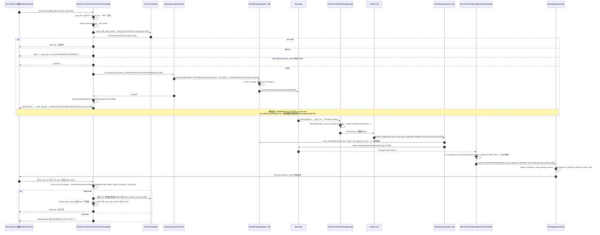

**要点与实际差异**：

1. “挂起”不是让某个协程停在那里等，而是**结束当前轮**：抛 `AbortError` 后，中断请求留在 session checkpoint（`INTERRUPTION_KEY`）里。恢复靠一个新的 `harness.send(InteractiveInput)` 重新开一轮，工具调用再走一遍 `before_tool_call`，这次拿到的是 answer。
2. Leader 拿到的审批请求就是一条**普通文本消息**，内容里有 `Tool call ID`，LLM 读到后调用 `approve_tool`。“路由给 leader”这一步没有专门的结构化事件。
3. **兜底通道的实际效果存疑**：`approve_tool` 的注释说 json DB 消息是“pub-sub 丢失时的兜底”（`team.py:1283-1286`）。`MessageHandler` 在 `has_pending_interrupt()` 时确实会挑出这类消息，并调用 `resume_interrupt(approval_data)`（`message.py:262-266`）。但 `approval_data` 是一个 **dict**，而 `TeamHarness.is_pending_interrupt_resume_valid` 要求 `isinstance(user_input, InteractiveInput)`（`team_harness.py:441`），否则返回 False，`TeamAgent.resume_interrupt` 会把它当作“过期输入”丢掉（`team_agent.py:687-689`）。按现在的代码，这条兜底路径对进程内的 `TeamHarness` 成员看起来**不起作用**；外部 runtime 的实现（`AT/external/runtime.py:630`）没有逐一核对。
4. auto_confirm 只在 session 内有效：`TeamPermissionRail._persist_allow_always` 永远返回 False。swarm 宿主也没有注入 `persist_session_allow_rule`，所以 `_persist_session_allow` 只改内存配置，最后通过 `_store_auto_confirm` 写入 session state 的 `INTERRUPT_AUTO_CONFIRM_KEY`。

---

#### 4A.2 SwarmFlow

##### 4A.2.1 脚本如何确定性地编排多个 agent

**脚本形态**：普通 Python 模块，包含 `META={...}` 和 `async def run(args)`，通过 `from swarmflow import agent, parallel, pipeline, phase, human, verify, ...` 使用原语。`facade._register_aliases`（`AT/workflow/engine/facade.py:306`）在 import 时执行 `sys.modules.setdefault("swarmflow", ...)`。facade 再经 `seam.current_provider()`（`seam.py:143`，ContextVar `_provider` :140）转发给 `EngineProvider`，最终落到 `primitives.py`。

**调用链**：

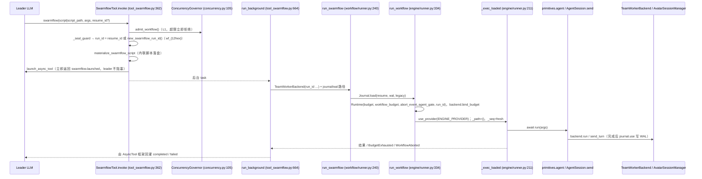

**确定性的来源**：

| 机制 | 代码 | 说明 |
|---|---|---|
| 结构化调用路径键 | `_next_ordinal`（`primitives.py:152`）+ `_path` / `_seq` ContextVar（:58-59） | 每个作用域一个计数器，按程序顺序递增。`parallel` 分支键为 `("par",k,i)`（:1963），`pipeline` 为 `("pipe",k,i,s)`（:2014），普通调用为 `("call",n)`（:636）。键只取决于脚本结构，与执行时延无关 |
| 并发作用域检测 | `_fresh_holder` 的 owner 标记 + `_warn_concurrent_scope`（:133/:138） | 有人绕过 DSL 直接用 `asyncio.gather` 时告警，否则 resume 键会乱 |
| 确定性 lint | `loader._lint`（`engine/loader.py:165`） | AST 检查 `time.*`、`random.*`、`uuid.*`、`*.now/today/utcnow`，以及推导式里的 `lambda: agent()` 延迟绑定问题 |
| fan-out 上限 | `_MAX_FANOUT=4096`（:82） | 超过直接抛错，不截断 |
| 嵌套上限 | `_MAX_WORKFLOW_DEPTH=1`（:69） | 防止 `workflow()` 递归 |
| worker 命名确定 | `call_key=ks` 透传给 backend（:690-697） | 同一 run 恢复时铸出同名 worker，worktree slug 稳定 |
| 并发闸 | `RunAgentAdmission.acquire`（`concurrency.py:91`）：L2 per-run `Semaphore` 外层，L3 global `Semaphore` 内层 | **只包住 backend 调用**（`primitives.py:679`），编排协程不占 permit，嵌套 `parallel` 不会死锁 |

worker 的隔离（铁律 3）：每个 `agent()` 对应一个 `TeamRole.WORKER` 的 `TeamHarness`，调用 `run_once`（`AT/harness/team_harness.py:183`，`team_worker_backend.py:840/889`）。worker 没有团队工具，不进 coordination，用完即弃。

##### 4A.2.2 如何抑制误差累积

“误差累积”在代码里没有一个统一的名字，而是分层的防线：

| 层 | 机制 | 位置 |
|---|---|---|
| ① 结构化输出 | 带 `schema=` 的 worker 只装 `StructuredOutputTool`，结果必须通过这个工具提交；没调用就抛 `BackendError("did not submit a structured result…")` | `team_worker_backend.py:375-391`，铁律 2 |
| ② Schema 校验 | `resolve_schema`（`engine/schema.py:55`）接受 pydantic / dict / None；`coerce`（:74）调 `model.model_validate` 或 `jsonschema.validate`，失败抛异常 | — |
| ③ 带反馈重试 | `_attempt_calls`（`primitives.py:806`）：`attempts = rt.retries + 1`（默认 `retries=2`，`runtime.py:62`）。backend 或超时错误直接重试；**schema 校验失败时把校验器的报错拼进下一次 prompt**（`_validation_retry_feedback` :783、`_with_retry_feedback` :801）；`BackendError.retryable=False` 不重试；账本已耗尽时也不重试（:866-880）；`skipped` 直接短路 | — |
| ④ 失败隔离 | `agent()` 失败返回 `None`，不抛异常；`parallel` 的分支异常映射为 `None`（:1968-1971）；`pipeline` 只丢弃出错的那个 item（:2018-2021）；有 `compact()` / `flatten_filter()` 辅助过滤 | — |
| ⑤ 评审 | `verify(reviewers, threshold=0.85)`（`primitives.py:1246`）：reviewer 通过 `parallel` 并发执行，每个都是带 `VERDICT_SCHEMA` / `SCORE_SCHEMA` 的结构化 `agent()`；`settle_verify_tally`（`engine/verify.py:94`）判定：verdict 池一票否决，score 池取平均分对比阈值，**有人没投票就返回 `None`（未决），不会默认通过**。业务侧 `build_reviewers`（`AT/workflow/review.py:58`）把 verifier/challenger 映射到 verdict，把 inspector 映射到 score | — |
| ⑥ 单轮、无返工循环 | `verify` 文档写明是 single-shot，返工循环由脚本作者用 Python 的 `while` 自己写 | `primitives.py:1262` |
| ⑦ 改脚本防护 | `_check_rerun` / `_lint_rerun`：禁止修改 `META.name`（否则 journal 会孤立）；`_compute_structural_diff` 只**记日志**，比较 AST 中的 await-call 名，**不比较 prompt** | `tool_swarmflow.py:559/312/330` |

##### 4A.2.3 (a) `human()` 检查点：挂起、释放与恢复

**真实实现**：`human(prompt, schema=…)`（`primitives.py:1930`）是语法糖，内部创建一个临时 `AgentSession(_human=True)`，`send` 一次后 `aclose`。

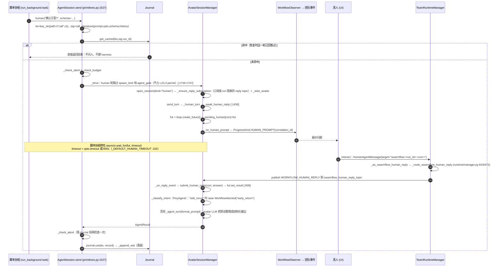

**和题目描述的区别**：代码里**没有**“挂起时释放协程或进程资源”的机制。

- 正常等待时，脚本协程、avatar harness、`TeamWorkerBackend` 都**留在内存里**，协程停在 `asyncio.wait_for(fut, timeout)` 上（`avatar_session_backend.py:1478`）。唯一“释放”的是**并发许可**：human 轮刻意不获取 L2/L3 semaphore（`primitives.py:1741-1747`，注释写着 *waiting on a person must not hold a concurrency permit*）。
- 超时（默认 600 秒）或用户点了跳过（`HUMAN_REPLY_SKIP="__swarmflow_skip__"`，:107）时返回 `AgentResult(skipped=True)`。这一轮得到 `None`，**不重试**（`_attempt_calls` 遇到 skipped 直接短路，并且对 human 不加 attempt 级别的 timeout，:839-845）。
- **真正释放资源的路径是 pause**：`BackgroundTaskController._abort_one`（`AT/runtime/background_task_controller.py:116`）有严格的三步顺序：① `abort_event.set("pause")`；② `backend.abort_sessions()` → `AvatarSessionManager.abort_all`（:802），**cancel 所有 `_pending_human` future**，abort avatar harness；③ `async_tool_runtime.cancel(task_id)`，协程被销毁。`_exec_loaded` 捕获 `WorkflowAborted("pause")` 后写 `pause` 运行级记录（`engine/runner.py:130/300-303`）。
- **恢复**：`BackgroundTaskController.resume`（:172）调用 `launcher.relaunch(h.inputs, h.session_id)`（`tool_swarmflow.py:912`），用同样的 inputs 和同一个 run_id 重新启动。已完成的前缀全部命中 journal；被打断的那一轮 human 重新执行。`correlation_id` 的格式是 `{phase}[#disambig]:{label}:{turn}`（`_correlation_id` :1774），恢复前后保持不变，所以旧问题的回复依然能匹配上。
- 注意：`submit_human_reply` 在没有活跃 future 时会把回复写入 `_pending_reply_buffer`（:849-857）。但 `abort_all` 会清空这个 buffer（:825），relaunch 又会新建一个 backend 实例。所以**暂停期间发来的回复在跨 relaunch 后不会保留**，用户需要在问题重新推送后再答一次。这一点是根据代码推断的。
- early_return 是另一种“检查点”：真人回复被分类成“改脚本重跑”时，抛 `WorkflowAborted(reason="early_return")`，写 pause 记录，leader 收到 `_format_early_return` 生成的改脚本指令（`tool_swarmflow.py:288/849-858`），之后可以用同一个 run_id 重跑。

##### 4A.2.4 (b) Token 预算：跨并发步骤的记账与熔断

**数据结构**：`BudgetLedger`（`AT/workflow/engine/budget.py:22`）是一个普通 dataclass，字段为 `total / spent / phase_tokens`。`add()` 就是 `self.spent += tokens`（:42-45），**没有锁，也没有原子计数器**。

- 安全性来自运行模型：所有进程内 worker 和 avatar 的 harness 都跑在 leader 的**同一个 asyncio 事件循环**里，`+=` 中间没有 `await`，不会被别的协程打断，所以在单线程协作调度下是原子的。账本**以引用方式共享**（`AgentBackend.bind_budget`，`engine/backends/base.py:96`），并发 worker 能看到彼此的消耗。
- 它**不跨进程**：外部 CLI 成员在一轮结束后才通过 `SwarmflowBudgetRail.bill()`（`budget_rail.py:85`）事后补记。
- 唯一用到锁的地方是 Journal 的 WAL 追加（`Journal._wal_lock`，`journal.py:138`），以及 `ConcurrencyGovernor._lock`（L1 ticket 集合，`concurrency.py:111`）。两者都与 token 计数无关。

**两本账**：

| 账本 | 来源 | 范围 | 耗尽语义 |
|---|---|---|---|
| `Runtime.budget` | `TeamAgentSpec.swarmflow_budget`，经 `inject_team_handles(SWARMFLOW_BUDGET)` → `SwarmflowTool` → `run_swarmflow(budget=)` | leader 级，跨 run 共享，不重置 | `scope="session"`，终态：`WORKFLOW_STOPPED` + seal |
| `Runtime.workflow_budget` | `_resolve_workflow_budget`（`engine/runner.py:159`）读 `META["workflow_token_limit"]`，不得超过 session 上限 | 每个 run 一本，从 `spent=0` 开始 | `scope="workflow"`，可重试：`WORKFLOW_FAILED` + pause 记录 |

**两级熔断**：

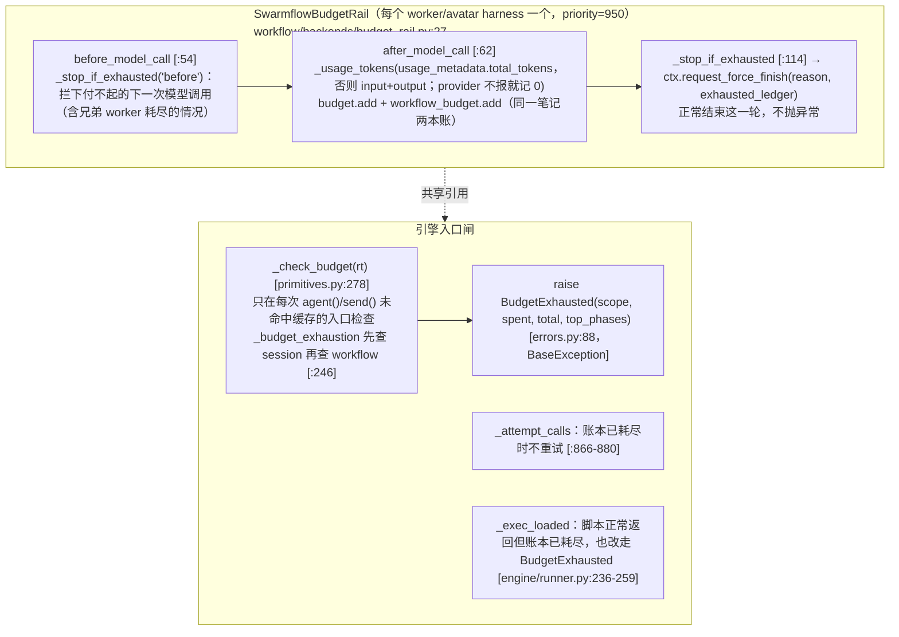

- **允许小幅超出**：一次调用返回后才入账；多个并发 worker 可能同时通过 `before_model_call` 检查，于是一起超出。`remaining()` 会被 clamp 到 0（`budget.py:55-63`）。
- **不在落 journal 前检查预算**：已经付过钱的调用必须写入 journal，否则恢复时会重跑并再付一次（`_check_budget` 文档，:278-288）。
- **恢复时的计费**：per-run 账本**不从快照恢复**，而是在缓存命中时用记录里的 `tokens` 字段重新累加（`rt.workflow_budget.add(cached_tokens)`，`primitives.py:654`；session 的 `send` 在 :1584-1586）。
- `BudgetExhausted` 是 `BaseException`，能穿透 `parallel` 和 `pipeline` 的 `except Exception`。`run_background` **故意不捕获**它（`tool_swarmflow.py:845-847`），让 async-tool 运行时直接从它的结构化字段渲染给 leader 的失败信息。`AT/workflow/AGENTS.md` 里写的“run_background 捕获并转为 BackendError”与当前代码不符。
- `phase_tokens` 记录各 phase 的消耗，失败信息会带上耗 token 最多的 3 个 phase（`_top_phases`，:232），供 leader 重新设计流程。

##### 4A.2.5 (c) Journal Replay：键、指纹、快照与幂等跳过

**存储布局**（`AT/paths.py:379/402`）：
`{team_home}/sessions/{session_id}/workflows/{META.name}/journal-{run_id}.jsonl`，以及 `wal/{run_id}.wal`。没有 run_id 时退回到共享的 `journal.jsonl` 和 `journal.jsonl.wal`，旧版文件作为只读种子（`_resolve_legacy_resume`，`workflow/runner.py:140`）。

**三重键**：

| 维度 | 实现 | 回答的问题 |
|---|---|---|
| 位置键 `ks` | `key_str(_path + (("call", ordinal),))`，对路径元组做 `json.dumps`（`journal.py:31`） | 这个调用在编排树里的**位置**有没有变？ |
| 内容指纹 `sig` | `call_signature`（`journal.py:61`）：SHA-256，输入为 `prompt` ⊕ `identity{label,phase,model, +isolation/agent_type/builtin_model/effort/agent_template（仅在设置时加入）}` ⊕ `json_schema` ⊕ `history`（仅非空时加入），用 `\x00` 拼接 | 这个调用的**内容**有没有变？ |
| 运行隔离 `run_id` | `get_cached(ks, sig, run_id)`（`journal.py:201`）：run_id 不参与哈希，单独比较；旧记录没有 run_id 时自然未命中 | 是不是同一次 run？ |

**记录结构**：`_make_record`（`primitives.py:969`）生成 `{key, sig, run_id, tokens, cache_tokens, token_input, token_output, label, phase, kind(null|model|str|dict), result, raw_text}`；`_rehydrate`（:944）按 `kind` 把结果还原回 pydantic 实例。

**运行级记录**：`write_run_record`（`journal.py:250`）的合成键是 `[["__run__", sys.maxsize, type, run_id]]`，有三种类型：
- `args`：首次运行时持久化启动参数，冷启动恢复时读回（`engine/runner.py:374-381`）；
- `pause`：记录 pause / early_return / workflow 预算耗尽，以及在途 agent 已消耗的 token（`_write_pause_record` :130）；
- `seal`：记录 completed / stopped 终态（`_write_seal_record` :112）。

**加载与落盘**：

```mermaid
flowchart LR
  A["Journal.load (journal.py:169)<br/>依次读：legacy.jsonl → legacy.wal → journal-{run}.jsonl → wal/{run}.wal<br/>prior[key]=rec，后读到的覆盖先读到的（WAL 最新）<br/>_parse_records 容忍末行写坏"] --> B["运行中：未命中 → journal.use → _append_wal<br/>（aiofiles 追加 + flush，_wal_lock 串行化）"]
  B --> C["命中 → journal.use(ks, prior 对象本身)<br/>用 is 判断为同一对象，不重复写 WAL"]
  C --> D["正常完成 → finalize → save：<br/>按 _program_order 排序后写 tmp，再 os.replace 原子替换<br/>WAL 永不主动删除"]
```

**幂等跳过与“快照比较”**：

- 判定命中的条件只有三条：`prior[ks]` 存在、`sig` 相同、`run_id` 相同（`journal.py:201-221`）。**没有全局的“已进入实时执行”开关**。级联失效是自动发生的：上游重跑后结果变了，下游 prompt 里嵌着这个结果，于是下游的 `sig` 也变了，跟着未命中（模块文档 :12-17）。对 `AgentSession`，`history` 被折进 `sig`，所以前面某一轮变了，后续轮次都会重跑。
- 命中时**不获取 semaphore、不调 backend、不建 harness、不问人**，只重发 started/completed 进度事件，并重新计费 per-run 账本（`primitives.py:640-660`）。
- 两个 `_check_abort` 检查点（入口一次、落 journal 前一次，`primitives.py:666/711`）保证暂停窗口内完成的调用**不写 WAL**，恢复时会重跑它，于是 WAL 里只会有暂停前已经确认的结果。
- **seal 防护**：`SwarmflowTool._seal_guard`（`tool_swarmflow.py:577`）加载该 run 的 journal 和 WAL，执行 `find_run_record(resume_id, "seal")`；如果已经封存，就清空 resume_id，强制生成新 run_id，避免重放一个已结束 run 的缓存。stop 打断在 LLM 调用中途时，`CancelledError` 分支会先 `task.uncancel()` 再补写 seal（`engine/runner.py:316-325`）。
- 关于“快照比较”：代码里**没有**把 journal 快照和当前脚本做整体 diff 的逻辑。“快照”指的是 `save()` 写出的按程序顺序排列的 canonical 快照，不参与命中判断。和比较沾边的只有：`_compute_structural_diff`，它对比新旧脚本 AST 中的 await-call 名，**只记日志**；以及 `_lint_rerun`，它禁止修改 `META.name`。真正决定是否跳过的是每次调用各自的 `(ks, sig, run_id)` 判断。

---

#### 4A.3 关键结论速览

| 题目问的机制 | 代码中的实际情况 |
|---|---|
| Spec 构建 | `TeamAgentSpec.build()` 是唯一入口；Leader 和 Teammate 都是 `TeamAgent`，按 role 区分；teammate 先注册（DB 写 UNSTARTED），之后经 CAS 拉起，有 inprocess / process / 外部 CLI 三种模式 |
| Messager | `inprocess` 是进程内单例总线，同步 await handler；`pyzmq` 是 PUB/SUB 加 ROUTER/DEALER+ACK；两者都是至多一次、无持久化、无重试。可靠性来自“先写 DB、再发通知”加 30 秒轮询兜底 |
| Team DB | SQLModel，按 session 动态分表，一把进程级写锁串行化写入；claim 是单条带条件的 UPDATE（CAS）；complete 在一个事务里完成状态切换和依赖解锁 |
| 协调循环 | 每个成员一个 `EventBus`（asyncio.Queue 单消费者），`EventDispatcher` 用 `AsyncCallbackFramework` fan-out 给各 handler，最终调 `harness.send` |
| 权限闭环 | ASK → orchestrator 给 leader 发文本消息 → 抛 AbortError 结束本轮（中断存进 session）→ leader 调 `approve_tool` → `ToolApprovalResultEvent` → `resume_interrupt(InteractiveInput)` → 新一轮里重新检查（等待期间新增的 DENY 优先）；json DB 兜底路径因类型不匹配看起来不生效 |
| human() | 用 `asyncio.Future` 加 600 秒超时**在内存中等待**，不释放协程和进程，只是不占并发 permit；真正释放资源的是 pause 的三步中止，之后靠 journal 重放恢复 |
| Token 预算 | 共享引用的 `BudgetLedger`，**没有锁或原子计数器**（依赖单事件循环）；rail 在模型调用前后检查并 force-finish，引擎在入口闸抛 `BudgetExhausted`；session 和 workflow 两层，scope 决定是终态还是可重试 |
| Journal Replay | 结构化位置键 + SHA-256 内容指纹 + run_id 三重匹配；WAL 追加写，journal 原子快照；没有整体快照比较，靠级联失效和 seal 记录保证正确性 |


---

### 4B. 群体技能与自演进（Swarm Skills）

> 仓库：`/home/user/jiuwen-learn`（`agent-core/openjiuwen` + `jiuwenswarm/jiuwenswarm`）
> 所有行号均已用 `grep -n` / `sed -n` 核对（截至本次分析时的工作区）。
> 路径缩写：`AC = agent-core/openjiuwen`，`JS = jiuwenswarm/jiuwenswarm`，`SC = JS/resources/agent/workspace/skills/swarmskill-creator`。

---

#### 4B.0 先给结论（与任务描述的差异）

| 任务描述中的假设 | 源码中实际存在的东西 |
|---|---|
| 有一个"五件套解析器"，把 SKILL.md / workflow.md / roles/ / bind.md / dependencies.yaml 解析成数据模型并把角色绑定到团队成员 | **运行时没有这样的结构化解析器/数据模型**。唯一完整处理五件套的是**创作期合规校验脚本** `SC/scripts/validate_swarmskill.py`（只产出 `Report` 错误/警告，不产出领域对象）。运行时只读 SKILL.md **frontmatter 的少数字段**（`description`/`description_<lang>`/`kind`）。角色 → 成员的绑定由 **Leader LLM 按文档约定完成**（把 `roles/<id>.md` 的 `## Inline Persona for Teammate` 原样内联进派发提示），或在 SwarmFlow 脚本模式下由 `agent(..., options={"agent_template": ...})` 绑定到 AgentGroup 成员。 |
| `agent_teams/skill` 是 Swarm Skill 解析 | `AC/agent_teams/skill/` 实际是**团队技能可见性**（`rail_spec.py`、`visibility.py`、`file_lock.py`）以及团队 CLI 的两个 SKILL（`SKILL_operator.md`/`SKILL_member.md`），与五件套解析无关。 |
| "friction（摩擦）信号" | 全仓库无 `friction` 概念（唯一命中是 `JS/agents/harness/code/prompt/code_prompt_builder.py:189` 的一句提示文案）。实际的"执行摩擦"信号是 **`execution_failure`**（工具输出正则命中失败关键字）与 **`script_artifact`**（代码执行成功的脚本），另有 `user_intent`、`conversation_review`、`trajectory_issue`、`review_feedback` 等。 |
| 决策 CREATE / PATCH / SIMPLIFY | 代码中没有名为 `CREATE/PATCH/SIMPLIFY` 的枚举。实际有三类操作：①**经验追加**（patch action：`append / merge / replace / skip`，`AC/agent_evolving/protocols.py:33`；LLM 只允许输出 `append|skip` + `merge_target`）；②**精简 simplify**（`DELETE / MERGE / REFINE / KEEP`，`protocols.py:32`）；③**重建 rebuild**（`evolve_rebuild`，归档后交 `swarmskill-creator` 重写 SKILL 正文）；另外 ④**新建团队 Skill**（`TeamSkillCreateRail` → `swarmskill-creator` 的 *CREATE* 工作流——"CREATE/CONVERT/MODIFY" 只是 `swarmskill-creator/SKILL.md` 里的**创作模式名**，`SC/SKILL.md:64`）。 |
| "重写" SKILL.md 本体 | 自演进**默认不改 SKILL.md 正文**：经验写入 `evolutions.json`，再投影为 `evolution/<section>.md`、`evolution/scripts/*`，并只在 SKILL.md 末尾维护一个 `<!-- evolution-index-start --> … <!-- evolution-index-end -->` 索引块。只有 rebuild / rollback 才会替换 SKILL.md 正文。 |

---

#### 4B.1 五件套（Swarm Skill v0.1）：结构、字段、校验规则

##### 4B.1.1 文件布局与两种形态

`SC/scripts/validate_swarmskill.py` 文件头（1–45 行）声明了规范：

```
<swarmskill-name>/
├── SKILL.md              # frontmatter: kind=swarm-skill + roles[]
├── skill_display.md      # (软检查) UI 中英文名称/描述
├── roles/<role-id>.md    # 每个角色 5 个必备小节
├── workflow.md           # Overview / Detailed Steps / Acceptance Criteria + mermaid
├── bind.md               # Resource / Behavioral Constraints / Failure Handling
├── dependencies.yaml     # skills: [] / tools: []
└── scripts/workflow.py   # (可选) 可执行 SwarmFlow
```

`detect_structure()`（`validate_swarmskill.py:1916`）判定三种形态：

| 形态 | 判定 | 结果 |
|---|---|---|
| Markdown 规范（默认） | 无 `scripts/workflow.py` | 校验完整五件套 |
| **Script-only SwarmFlow** | 有 `scripts/workflow.py` 且四个 Markdown 件（roles/、workflow.md、bind.md、dependencies.yaml）**全部不存在** | `(True, True)`；此时若存在 `prompts/` 目录报错（prompt 必须内联） |
| Markdown + SwarmFlow | 有脚本且四件**全部存在** | 两者都校验 |
| 非法：部分 | 有脚本但四件只存在一部分 | 报 `partial Markdown spec with SwarmFlow script` 错误 |

##### 4B.1.2 主流程 `validate(root)`（`validate_swarmskill.py:1955`）

```mermaid
flowchart TD
    A[validate root] --> B[detect_structure :1916]
    B --> C[validate_skill_md :156<br/>返回 frontmatter, role_ids]
    C --> D[check_skill_display_md :1883 仅 warn]
    D --> E{has_swarmflow_script?}
    E -- 是 --> F[validate_swarmflow_script :1699<br/>AST 安全信封]
    E -- 否 --> G
    F --> G{is_script_only?}
    G -- 是 --> Z[report.emit, 退出码 0/1]
    G -- 否 --> H[roles/ 存在? 逐个 validate_role_file :298]
    H --> I[check_orphan_role_files :1870]
    I --> J[validate_workflow_md :378]
    J --> K[validate_bind_md :399]
    K --> L[validate_dependencies_yaml :423]
    L --> M[cross_check_skills_tools :1854]
    M --> Z
```

退出码：`0`=PASS，`1`=FAIL，`2`=用法错误（`main()` :2004）。结果容器是 `class Report`（:71，`err()`/`warn()`/`passed()`/`emit()`）——**这就是它"产出的数据模型"**：只有错误/警告列表，加上中间返回值 `(frontmatter: dict, role_ids: list[str])` 与 `declared: {"skills":[names], "tools":[names]}`。

##### 4B.1.3 SKILL.md frontmatter 字段与规则（`validate_skill_md`, :156）

frontmatter 用正则 `FRONTMATTER_RE = ^---\s*\n(.*?)\n---\s*\n(.*)$`（:109）切分，`yaml.safe_load` 解析（`split_frontmatter` :112）。

| 字段 | 规则 | 行号 | 级别 |
|---|---|---|---|
| `name` / `description` / `version` / `kind` | 必填；非 script-only 还必须有 `roles` | :176 | error |
| `kind` | 必须 == `swarm-skill` | :183 | error |
| `name` | 必须 == 目录名 | :189 | error |
| `description` | > 500 字符 | :196 | warn（HARD CAP 500，平台上限 1024） |
| `description` | 非空行 > 4 | :203 | warn（推荐 WHAT/WHEN/NOT 三行） |
| `description` | 含 `Triggers:` 行 | ~:209 | warn（已废弃） |
| `roles` | 非空列表（script-only 必须省略或 `[]`） | ~:220–228 | error |
| `roles[].id` | 必填 | ~:232 | error |
| `roles[].kind` | 必填，∈ {`ai_agent`, `human_agent`} | :236 | error |
| `roles[].purpose` | 必填；> 150 字符 | :247 | error / warn |
| `roles[].skills` / `roles[].tools` | 所有 AI 角色都为空 → 提示未做 Stage-2 自动匹配 | ~:255–268 | warn |
| 正文小节 | 必须有 `## Workflow` / `## Roles` / `## Files`（script-only 只需 Workflow+Files） | :272 | error |
| 冗余小节 | `When to Use` / `Anti-Patterns` / `Output Format` | ~:278 | warn |
| SKILL.md 正文含 mermaid | 应只放 workflow.md | ~:288 | warn |

模板见 `SC/templates/SKILL.md.template`（`kind: swarm-skill`、`roles[].{id,kind,purpose,skills,tools}`）。

##### 4B.1.4 roles/&lt;id&gt;.md（`validate_role_file`, :298）

| 规则 | 行号 |
|---|---|
| `roles[].id` 声明的每个角色必须有 `roles/<id>.md` | ~:304 |
| 5 个必备小节：`Identity` / `Success Criteria` / `Boundary` / `Output Schema` / `Inline Persona for Teammate` | ~:312–321 |
| `## Identity` 首个非空行必须匹配格言正则 `^>\s*\*["\'].+["\']\*\s*$`（`> *"..."*`） | :328 |
| `## Boundary` 必须同时含 `**Forbidden**`/`**禁止**` 与 `**Mandatory**`/`**必须**`/`**必做**` | :340–345 |
| `## Inline Persona for Teammate` 长度 < 100 字符 → warn | :350 |
| 旧标题 `Inline Persona for Sub-Agent` → error；`Mindset`/`Priorities`/… → warn | ~:358–375 |
| 孤儿角色文件（未在 frontmatter 声明）→ warn | `check_orphan_role_files` :1870 |

##### 4B.1.5 workflow.md / bind.md / dependencies.yaml

| 文件 | 规则 | 行号 |
|---|---|---|
| workflow.md | 必须有 `## Overview` / `## Detailed Steps` / `## Acceptance Criteria`；至少一个 ```` ```mermaid ```` 块 | :386, ~:391 |
| bind.md | 必须有 `## Resource Constraints` / `## Behavioral Constraints` / `## Failure Handling`；Resource 段未提到 `max_parallel_teammates` / `total_wall_clock_budget` / `total_token_budget` → warn | :407, :414 |
| dependencies.yaml | 根必须是 mapping；`skills:` 与 `tools:` 都必须存在（可 `[]`）；`skills[]` 需 `name/source/required/purpose`；`tools[]` 需 `name/required/purpose` | :459–461 |
| 跨文件 | SKILL.md 中每个 `roles[].skills/tools` 必须出现在 dependencies.yaml 对应段 | `cross_check_skills_tools` :1854 |

##### 4B.1.6 SwarmFlow 脚本（`validate_swarmflow_script`, :1699）

用 `ast` 静态检查 `scripts/workflow.py`：允许的算子集合 `SUPPORTED_SWARMFLOW_OPERATORS`（:485，`agent / agent_session / budget / compact / flatten_filter / human / human_session / log / map_parallel / parallel / phase / pipeline / pmap / workflow / verify`），允许的 options 键 `SUPPORTED_AGENT_OPTIONS`（~:512，含 `agent_template`），禁用 `random/time/datetime`（`NON_DETERMINISTIC_IMPORTS`）、`open`/`Path.read_text` 等文件 IO、`asyncio.gather/create_task`；检查 `META["phases"]` 与 `phase("...")` 一一对应（`_phase_coverage_issues` :728、`_agent_phase_mismatches` :673）等。

##### 4B.1.7 运行时到底读了什么？

| 位置 | 读什么 | 行号 |
|---|---|---|
| `SkillUseRail._load_skill` / `_load_description` | 仅 frontmatter 的 `description_<lang>` 或 `description`，构造 `Skill(name=目录名, description, directory)` | `AC/harness/rails/skills/skill_use_rail.py:262`, `:991` 附近；前 64 行探测 `_FRONT_MATTER_PROBE_LINES` :35 |
| `detect_skill_type` | `kind ∈ {swarm-skill, team-skill}` → `swarm_skill` | `JS/server/runtime/skill/skill_type.py:27,47` |
| `TeamSkillCreateRail._known_team_skill_names` | `kind ∈ _TEAM_SKILL_KINDS` | `AC/harness/rails/skills/team_skill_create_rail.py:477` |
| `SkillEvolutionRail._is_regular_skill` | `kind ∉ {team-skill, swarm-skill}` 才走 1D 演进 | `AC/harness/rails/evolution/skill_evolution_rail.py:1319`，常量 `:91` |
| 市场发布 `_skill()` | `kind == team-skill` 或 `skill_type == teamskills` 时要求 **≥2 个角色、id 非空且唯一** | `JS/server/runtime/marketplace/asset_publish_adapters.py:235,250–263` |
| Symphony Flow 渲染 | 反向**生成** SKILL.md + `swarmflow/run.py` + `dependencies.yaml`（不是解析） | `AC/symphony/flow/render.py:34 SkillAdapter.render` |

##### 4B.1.8 角色如何绑定到团队成员

```mermaid
sequenceDiagram
    participant L as Leader Agent (LLM)
    participant ST as skill_tool / read_file
    participant SK as Swarm Skill 目录
    participant TM as spawn_member / create_task
    participant M as Teammate
    L->>ST: 读取 SKILL.md（description 命中触发）
    ST->>SK: SKILL.md 正文 (Workflow Step0 = 依赖预检)
    L->>ST: 读 dependencies.yaml → 向用户报告缺失项
    L->>ST: 读 roles/<id>.md
    Note over L: 取 "## Inline Persona for Teammate"<br/>原样内联 + 填 {PLACEHOLDER}
    L->>TM: spawn_member(persona=Inline Persona, ...)
    TM->>M: 以该 persona 运行
    L->>ST: 读 bind.md（并行数/预算/失败处理）
    M-->>L: 按 Output Schema 返回
    L->>L: 汇总；矛盾原样呈现（bind.md 行为约束）
```

依据：`SC/SKILL.md:130`（"most adopting agents do NOT auto-load role files; the Leader must inline this into the dispatch prompt"）、`SC/reference/role-design.md:182`、模板 `SC/templates/role.md.template:53,97`。
**脚本模式**下绑定是显式的：`agent(..., options={"agent_template": "<AgentGroup 成员名>"})`，后端在派发前拒绝未知/未绑定成员（`SC/templates/scripts/workflow.py.template:362–372`；运行时 `AC/agent_teams/workflow/engine/primitives.py:392 _display_agent_template`）。
`AC/agent_teams/skill/rail_spec.py` 只负责给成员装配 **Skill 可见性 rail**（`_IDENTITY_PARAM_NAMES` :44：`team_name/skills_dir/member_visibility_path/team_visibility_path/bootstrap_allow`），决定"哪个成员能看到哪些 Skill"，并不解析角色。

---

#### 4B.2 自演进管线

##### 4B.2.1 参与组件总览

| 组件 | 类 / 函数 | 文件:行 |
|---|---|---|
| 演进 rail 基类（轨迹采集 + 触发点） | `EvolutionRail`、`EvolutionTriggerPoint` | `AC/harness/rails/evolution/evolution_rail.py:241, :231` |
| 普通 Skill 演进 | `SkillEvolutionRail` | `skill_evolution_rail.py:141` |
| 团队/Swarm Skill 演进 | `TeamSkillEvolutionRail(_TeamTrajectoryCaptureMixin, SkillEvolutionRail)` | `team_skill_evolution_rail.py:137` |
| 成员私有副本演进 | `MemberSkillEvolutionRail`（先 `ensure_member_skill_copy`） | `member_skill_evolution_rail.py:46`, `member_skill_workspace.py` |
| 新建团队 Skill 提议 | `TeamSkillCreateRail` | `AC/harness/rails/skills/team_skill_create_rail.py:74` |
| 信号检测 | `ConversationSignalDetector`（别名 `SignalDetector`） | `AC/agent_evolving/signal/from_conv.py:237, :611` |
| 信号数据模型 | `EvolutionSignal`、`make_signal_fingerprint` | `signal/base.py:27, :88` |
| 团队信号 | `TeamSignalType`、`build_team_trajectory_summary` | `signal/team.py:22, :51` |
| 在线编排 | `OnlineEvolutionOrchestrator.evolve` | `experience/online_orchestrator.py:29, :54` |
| 更新器 | `SingleDimUpdater.process` | `updater/single_dim.py:34` |
| LLM 生成经验 | `SkillExperienceOptimizer` | `optimizer/skill_call/experience_optimizer.py:313` |
| 打分 / 精简 | `ExperienceScorer`、`calc_score` 等 | `experience/scorer.py:293, :249` |
| 使用跟踪 | `ExperienceTracker` | `experience/tracker.py:16` |
| 审批/持久化生命周期 | `ExperienceManager`、`commit_pending_change`、`execute_simplify_actions` | `experience/skill_experience_manager.py:52`、`experience/common.py:51, :122` |
| 存储 | `EvolutionStore`、`StoreRecordsHelper`、`StoreProjectionHelper`、`StoreArchiveHelper` | `checkpointing/evolution_store.py:41`、`store_records.py:48`、`store_projection.py:22`、`store_archive.py:18` |
| 主动审批中断 | `EvolutionInterruptRail` | `harness/rails/evolution/evolution_interrupt_rail.py:35` |
| 审查子 agent | `evolution_reviewer`、`EvolutionReviewRuntime` | `review/subagent.py:16`、`review/runtime.py:75` |
| jiuwenswarm 装配 | `build_team_skill_evolution_rail` / `build_member_skill_evolution_rail` / `_build_evolution_approval_stack` | `JS/agents/swarm/providers/evolution_rails.py:553, :779, :488` |
| 审批载荷判定 | `is_evolution_approval_payload` 等 | `JS/runtime/evolution.py`（前缀 `skill_evolve_` / `team_skill_evolve_`，schema `openjiuwen.skill_evolution_approval.v1`） |

##### 4B.2.2 两条触发路线 + jiuwenswarm 默认配置

源码中存在**被动信号路线**（`signal_trigger=True`，规则检测 → LLM 生成）与**主动审查路线**（`review_trigger=True`，插入 follow-up 让主 agent 自检 → 用户确认 → 审查子 agent → 工具提交）。jiuwenswarm 的默认装配：

| 成员 | rail | signal_trigger | review_trigger | auto_save | 行号 |
|---|---|---|---|---|---|
| Leader | `SwarmTeamSkillEvolutionRail` | **False** | **True** | 配置项（默认 False） | `evolution_rails.py:596–603` |
| Teammate | `SwarmMemberSkillEvolutionRail` | **True** | False | **True** | `evolution_rails.py:816–824` |

二者都与 `EvolutionInterruptRail` 一起注册（`_build_evolution_approval_stack` :488–504）。

##### 4B.2.3 信号捕获：Hook 与事件

`EvolutionRail` 在每次 invoke 中订阅 `TrajectorySpanProcessor`，按 hook drain 增量轨迹：

| Hook（基类） | 行号 | 用途 | 子类扩展点 |
|---|---|---|---|
| `before_invoke` | `evolution_rail.py:362` | 建立 per-invoke 订阅 `_InvokeCapture` | `_on_before_invoke` |
| `after_model_call` | :393 | drain llm span，补 RL 字段 | `_on_after_model_call` |
| `after_tool_call` | :414（读者优先级偏移 `_AFTER_TOOL_CALL_READER_OFFSET=1_000_000`） | drain tool span | `_on_after_tool_call` |
| `after_task_iteration` | :424 | | `_on_after_task_iteration` |
| `after_invoke` | :435 | **最终 drain**；若 `evolution_trigger==AFTER_INVOKE` 且 `_allow_evolution_trigger` → `_trigger_evolution` | `_on_after_invoke` / `_on_after_evolution_triggered` |

`_trigger_evolution`（:857）：`_prepare_evolution_input`（在 ctx 存活时同步深拷贝 messages）→ `async_evolution` 时 `asyncio.create_task(self._safe_run_evolution(...))`（:867）。`_safe_run_evolution`（:1049）用 `asyncio.timeout(total_timeout)`（:1071，普通 600s `_DEFAULT_EVOLUTION_TOTAL_TIMEOUT_SECS`、团队 720s）+ 信号量 `_evolution_sem`（`max_concurrent_evolution=1`），并抑制演进自身 LLM 调用的 span。

**各 rail 的具体捕获点：**

- `SkillEvolutionRail`
  - `_allow_evolution_trigger`（:560）：`signal_trigger` 关闭、心跳/cron 后台运行、或本轮已有主动演进活动 → 不触发。
  - `_on_after_tool_call`（:769）→ `_track_presented_from_tool_call`（:786）：读取 `evolution/*.md` 详情（匹配 `#+\s*\[ev_...]`）或 SKILL.md 索引（`(?:#|/)(ev_...)`，:155–158）时登记"已展示经验"，供后续打分。
  - `_on_after_task_iteration`（:579）：`review_trigger` 时每 `review_interval`（默认 5）次非 follow-up 迭代插入一次 `<auto_skill_evolution_review_followup>` 自检提示。
  - `before_model_call`（:732）：注入稳定的演进协议 prompt section（`build_evolution_protocol_section`，`AC/agent_evolving/prompts/sections/evolution.py:193`）。
- `TeamSkillEvolutionRail`
  - `_on_after_tool_call`（:581）：拦截 **`view_task`** 工具结果，`is_completed_team_task_view`（:101）判断"含 completed 且无 pending/claimed/in_progress/blocked"→ `_mark_team_completion_pending`（:820）。
  - `notify_team_completed`（:670）：外部（协调器 `team_completion` handler）也可标记完成。
  - `_allow_evolution_trigger`（:616）：仅当本轮观察到团队完成 **且** `review_trigger` 关闭时才走被动路线；`review_trigger` 开启时改在 `_on_after_task_iteration`（:632）插入 `<auto_team_skill_evolution_review_followup>`（提示文本 :84–98）。
- `TeamSkillCreateRail`：完成后统计 `spawn_member` 调用数 ≥ `min_team_members_for_create`（默认 2，:91）且轨迹中**未使用已有团队 Skill**（`_can_enqueue_creation_follow_up` :379）→ 插入创建自检 follow-up。
- 评审反馈：`ReviewFeedbackEvolutionCoordinator`（`AC/agent_teams/agent/scheduling/review_feedback_evolution.py:70`，`min_confidence=0.7` :87）把调度器 reviewer 反馈经 `ReviewFeedbackAttributor` 分类为 `evolve_existing_skill / suggest_new_skill / record_task_failure / skip_unattributed`（`signal/review_feedback.py:43`），在团队完成时聚合（`on_team_completed` :242）。

##### 4B.2.4 信号类型

| signal_type | 产生位置 | section 默认 | 初始分 `INITIAL_SCORE_BY_SIGNAL`（`experience_optimizer.py:47`） |
|---|---|---|---|
| `execution_failure` | 工具输出命中 `_FAILURE_KEYWORDS`（`from_conv.py:54`：error/exception/traceback/failed/timeout/错误/异常/失败/超时/permission denied/command not found/ENOENT/npm ERR! …）；排除 `_DATA_FETCH_TOOLS`（:126，read_file/web_search/curl/ttse_consult 等）与 tool schema dump（:88）；`is_tool_execution_failure` :174 | Troubleshooting | 0.65 |
| `script_artifact` | `_CODE_EXEC_TOOLS`（:148：code/bash/execute_python_code…）的 tool call，其结果**不**含失败关键字 → 截取脚本前 600 字符（`_detect_from_messages` :441） | Scripts | 0.60 |
| `user_intent` | 显式 `/evolve` 请求（`make_team_user_intent_signal`，`team.py:114`），或 `detect_user_intent`（LLM / `_CORRECTION_PATTERNS` :66 正则回退：不对/错了/应该是/that's wrong/actually…） | Instructions | 0.70 |
| `conversation_review` | 主动审查 | — | 0.50 |
| `trajectory_issue` | `make_team_trajectory_signal`（`team.py:136`） | — | 默认 0.6 |
| `review_feedback` | `signal/review_feedback.py:39` | — | — |
| Skill 创建信号 `prompt_eligible` / `skill_tool_cover` | `SkillCreationSignalDetector.detect`（`signal/skill_creation.py:124`）：首次 ≥6 次有效工具迭代或 ≥10 次有效工具调用；再次提示需新增 ≥2 迭代或 ≥4 调用（:24–27） | — | — |

> 被动路线只启用 `{"execution_failure", "script_artifact"}`：`skill_evolution_rail.py:884`、`team_skill_evolution_rail.py:1115`（`_detect_rule_signals` :1112）、`ConversationSignalDetector._detect_message_signals` 默认集合。

**归因（attribution）**：`_resolve_active_skill` 依据此前最近一次读取 `<skill>/SKILL.md`（`_SKILL_MD_PATTERN` :87）或 `skill_tool` 调用；团队路线用 `infer_team_skill_from_trajectory`（`team_skill_evolution_rail.py:109`）在 tool span 中找已知团队 Skill。若只有一个 Skill 被归因，未归因信号回填给它（`skill_evolution_rail.py:898`）。

**去重**：`make_signal_fingerprint` = `(signal_type, tool_name, skill_name, excerpt[:200])`（`base.py:88`），已处理集合上限 `_MAX_PROCESSED_SIGNAL_KEYS = 500`（`skill_evolution_rail.py:89`），超过即清空。

##### 4B.2.5 打分算法（`AC/agent_evolving/experience/scorer.py`）

记录统计 `UsageStats{times_presented, times_used, times_positive, times_negative, last_*}`（`checkpointing/types.py:18`）。

$$
\text{score} = W_E\cdot E + W_U\cdot U + W_F\cdot F,\quad W_E=0.5,\ W_U=0.3,\ W_F=0.2 \quad(\text{:23–25, calc\_score :249})
$$

| 分量 | 公式 | 无数据时 | 行号 |
|---|---|---|---|
| E 有效性 | 贝叶斯 Beta(1,1) 平滑：$(\text{pos}+1)/(\text{pos}+\text{neg}+2)$ | 0.5 | `calc_effectiveness` :198 |
| U 利用率 | $\text{used}/\text{presented}$ | 0.5 | `calc_utilization` :211 |
| F 新鲜度 | $0.5 + 0.5\cdot 2^{-\text{days}/90}$（范围 0.5–1.0）；记录的 `skill_version` ≠ 当前版本时 ×0.7；clip 到 [0,1] | 0.5 | `calc_freshness` :219；`FRESHNESS_HALF_LIFE_DAYS=90`、`STALE_VERSION_PENALTY=0.7` :27–28 |

**更新流程**：
1. 展示：`_track_presented_from_tool_call` → `ExperienceTracker.record_presented_records`（`tracker.py:114`，累加 `times_presented`）。
2. 节流：`consume_eval_state`（`tracker.py:183`）每个 session 计数到 `eval_interval`（默认 5）才取出待评估集合。
3. LLM 评估：`ExperienceScorer.evaluate`（:325）用 `EXPERIENCE_EVAL_PROMPT`（:43）+ 截断 4000 字符的对话片段，输出 `[{record_id, used, positive, negative, reason}]`；策略 `EVALUATE_LLM_POLICY`（单次 120s、总 200s、2 次，:30）。
4. `update_score`（:260）累加计数并重算；`EvolutionStore.update_record_scores` 落盘。

**与分数挂钩的阈值**：

| 阈值 | 用途 | 位置 |
|---|---|---|
| 新记录初始分 0.50–0.70 | 见 2.4 表 | `experience_optimizer.py:47` |
| `< 0.4 且 使用率 0` → DELETE | 写在 SIMPLIFY prompt 规则中（由 LLM 执行判断，非硬编码） | `scorer.py:112` 起 `SIMPLIFY_PROMPT_CN` |
| `min_score = 0.5` | rebuild 时过滤低分记录（`_filter_rebuild_records`） | `skill_experience_manager.py:594`、`experience/rebuild.py:74` |
| 条目数 ≥ 30 | 写入时日志提示 "consider /evolve_simplify" | `evolution_store.py:33 _TOTAL_WARNING_THRESHOLD`，`append_record` :435 |
| 条目数 ≥ 10 | `should_hint_simplify_or_rebuild` 返回 True | `skill_evolution_rail.py:1850` |
| `MAX_EVOLUTION_REVIEW_PROPOSALS = 3` | 审查子 agent 每次最多 3 条 proposal | `draft_schema.py:21` |
| 单轮生成上限：文本 ≤2、脚本 ≤1 | 代码硬截断 | `experience_optimizer.py:752–754` |

##### 4B.2.6 决策：实际的操作名

**(a) 经验生成（append / merge_target / skip）** —— `SkillExperienceOptimizer._generate_regular_records`（:589）/ `_generate_team_records`（:665）

LLM prompt `SKILL_EXPERIENCE_GENERATE_PROMPT_CN`（`optimizer/skill_call/templates.py:7`）规定的决策流程：
1. **相关性**：由外部环境/权限/网络/误报导致 → `{"action":"skip","skip_reason":"irrelevant"}`；
2. **去重**：实质重复 → `skip/duplicate`；有增量或"旧经验在却仍出错" → 输出完整改写内容 + `merge_target: ev_xxx`；
3. **优先级**：只保留前 2 条文本 + 1 条脚本，其余 `skip/low_priority`；
4. **target**：`description`（选中/误选问题）/ `body`（步骤、工具调用、排障）/ `script`（可复用脚本）；
5. **section**：Instructions / Examples / Troubleshooting / Scripts / Collaboration（团队 prompt 另加 Roles / Workflow / Constraints，`templates.py:602`）。

团队 prompt `TEAM_EXPERIENCE_GENERATE_PROMPT_CN`（`templates.py:602`）额外输入 `build_team_trajectory_summary`（`signal/team.py:51`：对 `spawn_member/create_task/build_team/view_task/send_message` 关键工具保留 500 字符，工具段预算 20000、LLM 段 10000 字符）。

可选两阶段（`two_stage=True`）：`_run_analyzer`（:507，产出 root_causes/candidates）→ `_run_formatter`（:551）。LLM 调用策略 `GENERATE_RECORDS_LLM_POLICY`（150s/300s/2 次，:54），JSON 解析失败走 `JSON_FIX_PROMPT` / `retry_parse_drafts`（:819）。

`_build_records_from_drafts`（:726）把 `ParsedExperienceDraft.patch` 转成 `EvolutionRecord.make(...)`（id = `ev_<8hex>`），`skip` 与空内容丢弃。

持久化时 `StoreRecordsHelper._append_or_merge_record`（`store_records.py:188`）：无 `merge_target` → 追加；有 → **原位替换**同 id 记录（找不到则追加）。合法 patch action 集合 `VALID_PATCH_ACTIONS = {append, merge, replace, skip}`（`protocols.py:33`，`EvolutionPatch` 在 `checkpointing/types.py:54/72` 校验）。

**(b) 精简（SIMPLIFY 的实际实现）**：`DELETE / MERGE / REFINE / KEEP`（`protocols.py:32`）
- 校验：`normalize_simplify_draft`（`draft_schema.py:166`）——REFINE 必须有 `new_content`；MERGE 必须有 `new_content` 与 `merge_remove_ids`，且 remove_ids 不得含 `record_id`、不得重复（:258）；`validate_simplify_record_refs`（:202）确认 id 存在。
- 生成：被动/命令式 `ExperienceManager.request_simplify`（`skill_experience_manager.py:511`）→ `ExperienceScorer.simplify`（`scorer.py:377`，`SIMPLIFY_PROMPT`，策略 150s/300s/2 次 :35）→ 暂存到 `_pending_governance["evolve_simplify_<8hex>"]`；或 rail 的 `request_simplify`（`skill_evolution_rail.py:1100`）返回 `build_simplify_command_prompt`（`commands.py:67`）让主 agent 调 `simplify_skill_experiences` 工具。
- 执行：`execute_simplify_actions`（`experience/common.py:122`）→ `store.delete_records / merge_records / update_record_content`，返回 `{deleted, merged, refined, kept, errors}`。

**(c) 重建（rebuild）**：`request_rebuild`（`skill_experience_manager.py:594`）→ `ExperienceRebuildService.prepare_rebuild_context`（过滤 `score < min_score`、带 skip_reason 的记录，最多 40 条/20000 字符）→ `build_rebuild_command_prompt`（`commands.py:129`）：对 `swarm-skill` 指定使用 **`swarmskill-creator`**，否则 `skill-creator`，并要求把 `evolutions.json` 重置为空。

**(d) 新建团队 Skill（"CREATE"）**：`TeamSkillCreateRail` → 用户在审批卡接受后 `_build_approved_creation_prompt`（`team_skill_create_rail.py:350`）："Use the swarmskill-creator CREATE workflow … Check for duplicates before creation"。指导原则在 `TEAM_SKILL_CREATION_GUIDANCE`（`AC/agent_evolving/prompts/sections/skill_creation.py:98–167`，强调"创建确认不等于 Swarm Skill 演进确认"）。

**(e) 主动审查结论**：`EvolutionReviewResult.outcome ∈ {"recommend_evolve", "no_evolution"}`（`review/result_schema.py:29`）。

##### 4B.2.7 写入本地文件：原子性、备份、审批

###### 写入了哪些文件

```
<skill_dir>/
├── SKILL.md                    # 仅替换 <!-- evolution-index-start/end --> 块
├── evolutions.json             # 权威数据：EvolutionLog{skill_id, version, updated_at, entries[]}
├── evolution/
│   ├── troubleshooting.md      # 按 section 渲染（_section_filename: lower + 空格→_ + .md）
│   ├── collaboration.md / roles.md / workflow.md ...
│   └── scripts/
│       ├── <script_filename>   # persist_script 写出脚本源码
│       └── _index.md
└── archive/
    ├── SKILL.v<YYYYmmddTHHMMSS>.md
    └── evolutions.v<ts>.json
```

注意：团队经验的 `section=Roles/Workflow` 只会渲染成 `evolution/roles.md`、`evolution/workflow.md`，**不会修改五件套的 `roles/*.md` 或 `workflow.md`**。

###### 原子写 + 回滚（`StoreRecordsHelper`, `checkpointing/store_records.py`）

| 机制 | 实现 | 行号 |
|---|---|---|
| 每 Skill 异步锁 | `EvolutionStore._get_skill_lock(name)`，`append_record` 内 `async with` | `evolution_store.py:54, :435` |
| 原子写 evolutions.json | 写 `.<name>.<uuid>.tmp` → `tmp_path.replace(path)`；失败删 tmp | `_write_file_text_atomic` :124 |
| 写后回读校验 | 重新读取并 `json.loads` 与期望 dict 全等比较，不一致抛 `TOOLCHAIN_EVOLVING_SKILL_STORE_EXECUTION_ERROR` | `save_evolution_log` :91 |
| 事务式追加 | 先快照 `evolution/**` 全部文件 + `SKILL.md` 字节（`_snapshot_projection_files` :206），旧 evolutions.json 文本；任一步失败 → `_restore_projection_files`（删除新增文件、恢复字节、清空目录）+ `_restore_text_file` | `append_record_transactional` :138–186 |
| 批量部分失败可重试 | `commit_pending_change` 逐条 `store.append_record`；失败时保留未写尾部于 pending，返回 `pending_count`，可 `retry_request` | `experience/common.py:51`、`skill_experience_manager.py:362` |
| 路径沙箱 | `_validate_file_path` 要求在配置的 skills 根目录内；`_SKILL_NAME_PATTERN = ^[a-zA-Z0-9_-]+$` | `evolution_store.py:330, :34` |
| 成员写时复制 | `ensure_member_skill_copy`：portalocker 锁 → `copytree` 到临时目录 → `os.replace`，替换指向全局库的软链，防止成员演进污染全局 Skill | `member_skill_workspace.py`；调用于 `member_skill_evolution_rail.py:46` |
| 版本备份 | `archive_skill_body` / `archive_evolutions` 写 `archive/SKILL.v<ts>.md`、`archive/evolutions.v<ts>.json` | `store_archive.py:92, :107` |
| 回滚 | `rollback_skill`：先归档当前状态，再用归档版本覆盖 SKILL.md 与 evolutions.json（无归档 json 则清空），重新渲染；**无需审批** | `skill_evolution_rail.py:1803` |
| 服务端 UI 保存 | `SkillManager.handle_skills_evolution_save`：内置 Skill 只读；写 workspace 与默认版本副本前各自保存 backup 文本，失败回滚 | `JS/server/runtime/skill/skill_manager.py:2440` |

> 注意：`write_skill_content` / `update_skill_md_index` 走 `write_file_text`（直接写，非 tmp+replace），其一致性靠 `append_record_transactional` 的字节快照回滚兜底；rollback 路径则无事务保护。

###### 审批闸门

| 路线 | 闸门 | 行号 |
|---|---|---|
| 被动（`signal_trigger`） | `requires_approval = not self._auto_save`（`skill_evolution_rail.py:952`）。`OnlineEvolutionOrchestrator.evolve`：`requires_approval` → 状态 `staged`；否则立即 `approve_request` → `auto_approved` / `persistence_failed`（`online_orchestrator.py:116–148`） |
| 被动审批事件 | `EvolutionApprovalRuntime.finalize_staged_evolution_request`（`approval_runtime.py`）→ `_emit_generated_records`（`skill_evolution_rail.py:1219`）把 `build_skill_approval_event`（`approval_events.py:72`，`type="chat.ask_user_question"`，每条记录一个"接收/拒绝"问题，带 `record_id`）放入 host 事件缓冲（after_invoke 时流已关闭，由宿主 `drain_pending_approval_events` 取走） |
| 被动审批结果 | `approve_record` / `reject_record`（:1447/:1500）→ `ExperienceManager.approve_request(request_id, approved_record_ids=...)`，支持**按条接收** | `skill_experience_manager.py:345` |
| 主动（工具） | `EvolutionInterruptRail.resolve_interrupt`（`evolution_interrupt_rail.py:78`）拦截 `evolve_skill_experiences` / `simplify_skill_experiences`：先 `_preflight` 校验；`auto_save` → 直接放行；用户输入 `allow_once` / `allow_always`（写入 auto-confirm 键）/ `reject`；否则抛 `InterruptRequest`（`InterruptKind.SKILL_EVOLUTION_APPROVAL`） |
| 主动前置确认 | `prepare_skill_evolution` 要求 `user_confirmed is True`（`AC/agent_evolving/tools/skill.py:160`） |
| 精简 | `build_simplify_approval_event`（`approval_events.py:144`，"执行/取消"）→ `on_approve_simplify` / `on_reject_simplify`（`skill_evolution_rail.py:1766/1773`） |
| 新建团队 Skill | `_build_external_approval_event`（`team_skill_create_rail.py:292`）审批卡 → 接受后才执行 CREATE 续执行 prompt |

---

#### 4B.3 完整代码链

##### 4B.3.1 被动信号路线（Teammate 默认：`signal_trigger=True, auto_save=True`；团队 rail 的被动模式同构）

```mermaid
sequenceDiagram
    autonumber
    participant AG as DeepAgent 任务循环
    participant ER as EvolutionRail (基类)
    participant SR as SkillEvolutionRail / TeamSkillEvolutionRail
    participant SD as ConversationSignalDetector
    participant OO as OnlineEvolutionOrchestrator
    participant UP as SingleDimUpdater
    participant OPTZ as SkillExperienceOptimizer
    participant LLM as Evolution LLM
    participant EM as ExperienceManager
    participant ST as EvolutionStore/StoreRecordsHelper
    participant FS as 本地文件
    participant H as Host/用户

    AG->>ER: before_invoke (:362) 订阅 span
    AG->>ER: after_tool_call (:414)
    ER->>SR: _on_after_tool_call
    Note over SR: 普通: 记录已展示经验 (:786)<br/>团队: view_task 全部完成 → _mark_team_completion_pending (:820)
    AG->>ER: after_invoke (:435) 最终 drain
    ER->>SR: _allow_evolution_trigger (:560 / 团队 :616)
    ER->>SR: _prepare_evolution_input (:1735) 深拷贝 messages + consume_eval_state
    ER->>ER: _trigger_evolution (:857) → create_task(_safe_run_evolution) (:1049, timeout 600/720s)
    ER->>SR: run_evolution (普通 :834 / 团队 :737)
    SR->>SD: detect_trajectory_signals({execution_failure, script_artifact})
    SD-->>SR: EvolutionSignal[] (正则 + 归因)
    SR->>SR: 指纹去重 make_signal_fingerprint / 按 skill 分组
    SR->>SR: _evolve_skill_with_sharing (sharing :205) [成员: 先 ensure_member_skill_copy]
    SR->>SR: _handle_evolution_from_signals (:1371)
    SR->>OO: evolve(skill, signals, requires_approval = not auto_save) (:54)
    OO->>ST: read_skill_content + get_pending_records(desc/body/script) (_build_context :154)
    OO->>UP: process(trajectories, signals) (:34)
    UP->>OPTZ: backward → _backward (:382) → generate_records (:428)
    OPTZ->>LLM: SKILL_/TEAM_EXPERIENCE_GENERATE_PROMPT
    LLM-->>OPTZ: JSON [{action: append|skip, target, section, content, merge_target...}]
    OPTZ-->>UP: EvolutionRecord[] (≤2 文本 + ≤1 脚本, 初始分 0.5~0.7)
    UP-->>OO: updates
    OO->>OO: execute_updates → build_local_apply_preview
    OO->>EM: stage_apply_results → PendingChange (request_id)
    alt requires_approval
        OO-->>SR: status=staged
        SR->>H: build_skill_approval_event (chat.ask_user_question)
        H-->>SR: approve_record(request_id, approved_record_ids)
        SR->>EM: approve_request
    else auto_save
        OO->>EM: approve_request (auto_approved)
    end
    EM->>ST: commit_pending_change → append_record (逐条, 每 skill 锁)
    ST->>FS: 快照 evolution/** + SKILL.md
    ST->>FS: [script] persist_script → evolution/scripts/<file>
    ST->>FS: evolutions.json  (tmp + replace + 回读校验)
    ST->>FS: render_evolution_markdown → evolution/<section>.md + SKILL.md 索引块
    Note over ST,FS: 任一步异常 → 恢复快照字节/旧 json
    SR->>SR: _evaluate_presented_entries → ExperienceScorer.evaluate → update_score
```

##### 4B.3.2 主动审查路线（Leader 默认：`review_trigger=True`）

```mermaid
sequenceDiagram
    autonumber
    participant TR as TeamSkillEvolutionRail
    participant LA as Leader 主 Agent
    participant U as 用户
    participant RT as EvolutionReviewRuntime
    participant RV as evolution_reviewer 子 agent
    participant IR as EvolutionInterruptRail
    participant SS as ExperienceSubmissionService
    participant ST as EvolutionStore

    TR->>TR: view_task 全完成 → _completion_followup_pending_session_id
    TR->>LA: _on_after_task_iteration (:632) enqueue <auto_team_skill_evolution_review_followup>
    LA->>U: 最终回复末尾 1~2 句：建议的可复用团队更新 + 是否发起演进?
    U-->>LA: 确认 (或 /evolve 命令 → build_evolve_review_command_prompt commands.py:89)
    LA->>RT: prepare_skill_evolution(subject, user_confirmed=true) (tools/skill.py:160)
    RT-->>LA: evolution_review_ref
    LA->>RV: evolve_review_task(evolution_review_ref) (tools/skill.py:204)
    RV->>RV: list/read_skill_experiences, list/read_trajectory_spans (只读)
    RV->>RT: submit_evolution_review {outcome, proposals≤3} (tools/review.py:222)
    RV-->>LA: 原样 JSON
    LA->>IR: evolve_skill_experiences(ref, selected_proposal_ids)
    IR->>SS: _preflight → prepare_evolve_submission (校验 draft)
    alt auto_save / allow_always 已记忆
        IR-->>LA: approve
    else
        IR->>U: InterruptRequest (SKILL_EVOLUTION_APPROVAL)
        U-->>IR: allow_once / allow_always / reject
    end
    LA->>SS: EvolveSkillExperiencesTool.invoke (tools/skill.py:343)
    SS->>ST: apply_prepared_evolve_submission → commit_pending_change (submission.py:162)
```

##### 4B.3.3 治理：精简 / 重建 / 回滚 / 新建

```mermaid
flowchart LR
    subgraph Simplify["精简 (DELETE/MERGE/REFINE/KEEP)"]
      S1[request_simplify<br/>manager :511] --> S2[ExperienceScorer.simplify<br/>scorer :377 LLM]
      S2 --> S3[_pending_governance<br/>evolve_simplify_xxxx]
      S3 --> S4{build_simplify_approval_event<br/>执行/取消}
      S4 -- 执行 --> S5[execute_simplify_actions<br/>common :122]
      S5 --> S6[delete_records / merge_records / update_record_content]
      R0[rail.request_simplify :1100<br/>agent_prompt 模式] --> R1[主 agent 调 simplify_skill_experiences] --> IR[EvolutionInterruptRail] --> S6
    end
    subgraph Rebuild["重建"]
      B1[request_rebuild :594] --> B2[prepare_rebuild_context<br/>score ≥ 0.5, ≤40 条/20k 字符]
      B2 --> B3[build_rebuild_command_prompt commands :129]
      B3 --> B4[主 agent 使用 swarmskill-creator<br/>重写 SKILL 正文 + 清空 evolutions.json]
    end
    subgraph Rollback["回滚 (无需审批)"]
      K1[rollback_skill :1803] --> K2[archive 当前 SKILL.md/evolutions.json] --> K3[恢复 archive/SKILL.v*.md] --> K4[render_evolution_markdown]
    end
    subgraph Create["新建团队 Skill"]
      C1[TeamSkillCreateRail<br/>spawn_member ≥ 2 且未用已有团队 Skill] --> C2[follow-up 自检 / 外部 review_feedback 提案]
      C2 --> C3{审批卡}
      C3 -- 接收 --> C4[swarmskill-creator CREATE<br/>→ validate_swarmskill.py]
    end
```

---

#### 4B.4 Symphony Flow：基于成功轨迹的"组合 Skill"蒸馏（相关但独立的自演进支路）

`AC/symphony/flow/distill.py`（"确定性结构蒸馏"）+ `engine.py` 不做经验 patch，而是从执行图证据中**蒸馏出能力组合包**并渲染为 Skill：

| 步骤 | 函数 | 行号 | 说明 |
|---|---|---|---|
| 过滤证据 | `SymphonyFlowEngine.distill` | `engine.py:229` | 只取 `outcome == success` 且成员受支持的记录 |
| 分组 | `group_by_structure` | `distill.py:218` | 签名 = 轨迹自身**全部成功边**（排序后 sha256 前 12 位，`structure_signature` :190），并 `break_cycles` |
| 边统计 | `aggregate_edges` / `EdgeStats.success_rate = success/support` | :255 / :147 | 全局统计（含失败边） |
| 质量 | `compute_quality` | :394 | `execution_count / success_count / pack_success_rate / qualified_edge_count / last_success_at` |
| 判级 | `resolve_status_grade` | :415 | `success_count ≥ min_successes(默认 1)` 且 `pack_success_rate ≥ 0.8` → `active/verified`，否则 `draft/candidate`（默认值 `AC/symphony/orchestration/config.py:7–10`） |
| 增量 | `structure_unchanged` | :432 | 结构与计数均未变 → 零写入；结构未变仅计数变 → 只刷新状态；首次 verified 才调用 LLM 叙事并升版本 |
| 渲染 | `SkillAdapter.render` | `render.py:34` | 产出 `SKILL.md` + `swarmflow/run.py` + `dependencies.yaml`（注意是 `swarmflow/run.py`，非五件套的 `scripts/workflow.py`） |

> `qualified_edges()`（`distill.py:197`，带 `min_edge_support/min_edge_success_rate`）在仓库中**没有调用方**；`SymphonyFlowConfig` 的 docstring 明确说明已不再需要边级阈值（`orchestration/config.py:41–46`）。

---

#### 4B.5 关键数据模型速查

```text
EvolutionSignal          (signal/base.py:27)   signal_type, section, excerpt, skill_name, context{source, tool_name, ...}
EvolutionPatch           (checkpointing/types.py:54)
                         section, action∈{append,merge,replace,skip}, content, target∈{description,body,script},
                         skip_reason, merge_target, script_filename/language/purpose, keywords, summary
EvolutionRecord          (types.py:115)  id=ev_xxxxxxxx, source, timestamp, context, change, applied, score=0.6,
                         usage_stats, skill_version, summary
EvolutionLog             (types.py:193)  skill_id, version="1.0.0", updated_at, entries[]   → evolutions.json
UsageStats               (types.py:18)   times_presented/used/positive/negative, last_presented_at/evaluated_at
EvolutionSubject         (draft_schema.py:36)  kind∈{skill, swarm-skill}(team-skill 归一化为 swarm-skill :51), name, scope
EvolveDraft/SimplifyDraft(draft_schema.py:94/114)  approval_view / persistence_view(去掉 source_refs)
VALID_SECTIONS           (protocols.py:34) Instructions, Examples, Troubleshooting, Scripts, Collaboration, Roles, Constraints, Workflow
OnlineEvolutionResult.status: skipped_no_input | skipped_skill_not_found | skipped_skill_definition_not_found |
                         generation_failed | no_evolution_no_records | staged | auto_approved | persistence_failed
```

经验 draft 校验（`normalize_evolve_draft`, `draft_schema.py:128`）：`content` 必填、`summary` 必填且 ≤160 字符（`_SUMMARY_LIMIT` :20）、`target` ∈ 三值、`section` ∈ `VALID_SECTIONS`（script 强制 `Scripts`，description 默认 `Instructions`，body 默认 `Troubleshooting`）、`script_filename` 只能是纯文件名（禁止绝对路径/路径分隔/`..`）。

---

#### 4B.6 小结

1. **五件套**是一套"写给 LLM 读的"规范：创作期由 `validate_swarmskill.py` 做确定性合规检查（字段、小节、格言、Forbidden/Mandatory、mermaid、依赖交叉一致、SwarmFlow AST 安全信封），运行时框架只解析 frontmatter 的 `description`/`kind`；角色到成员的绑定靠 Leader 内联 `Inline Persona for Teammate`，或脚本模式的 `agent_template`。
2. **自演进**以"经验层"为核心而不是直接改写 Skill：信号（execution_failure / script_artifact / user_intent …）→ LLM 生成 `append|skip(+merge_target)` 经验 → 审批（按条接收 / 中断审批 / auto_save）→ 原子事务写 `evolutions.json` 并投影到 `evolution/*.md` 与 SKILL.md 索引块 → 通过 E/U/F 加权分（0.5/0.3/0.2，Beta 平滑、90 天半衰期、版本陈旧 ×0.7）持续评估 → 必要时 SIMPLIFY（DELETE/MERGE/REFINE/KEEP）或 REBUILD（归档后由 swarmskill-creator 重写），并可 rollback。
3. Swarm/团队 Skill 与普通 Skill 用**同一套管线**，区别在：触发条件（`view_task` 全部完成）、归因方式（团队 Skill 名称 + 轨迹）、生成 prompt（TEAM profile，含 Roles/Collaboration/Workflow/Constraints section 与协作工具摘要）、request_id 前缀（团队 `team_skill_evolve`，`team_skill_evolution_rail.py:357`；普通默认 `skill_evolve_<8hex>`，`experience/types.py:49`），以及 jiuwenswarm 中 Leader 默认走"主动审查 + 用户确认"、成员默认走"被动 + 自动保存到私有副本"。
