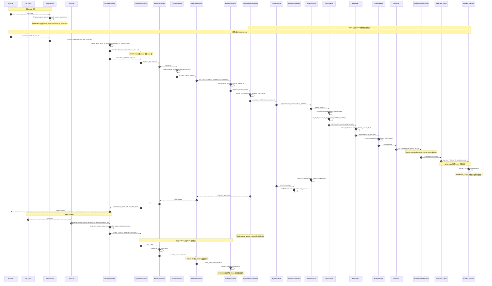
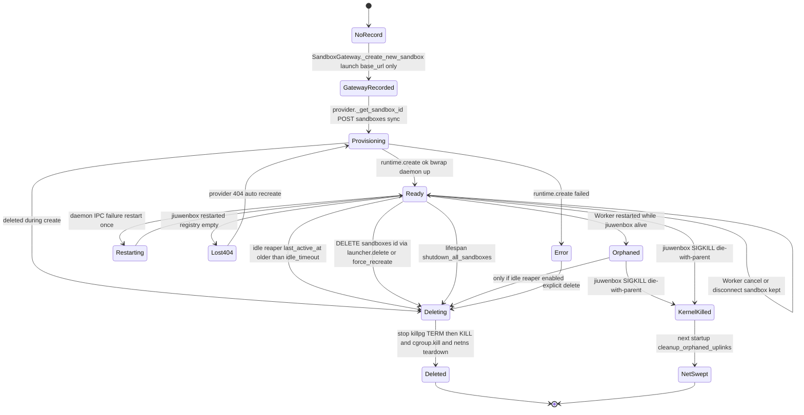
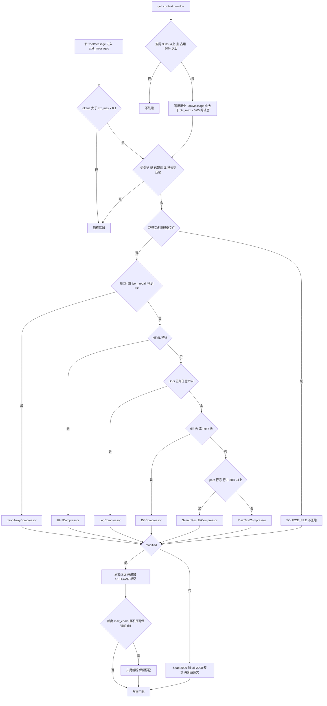
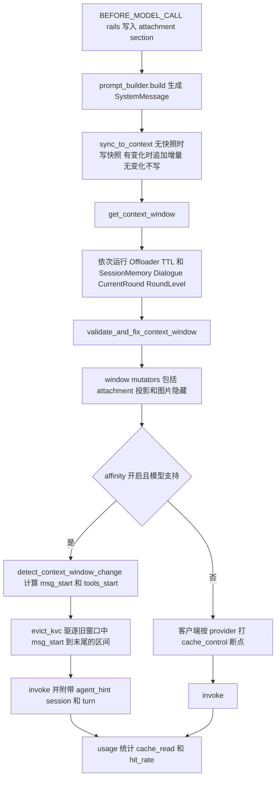
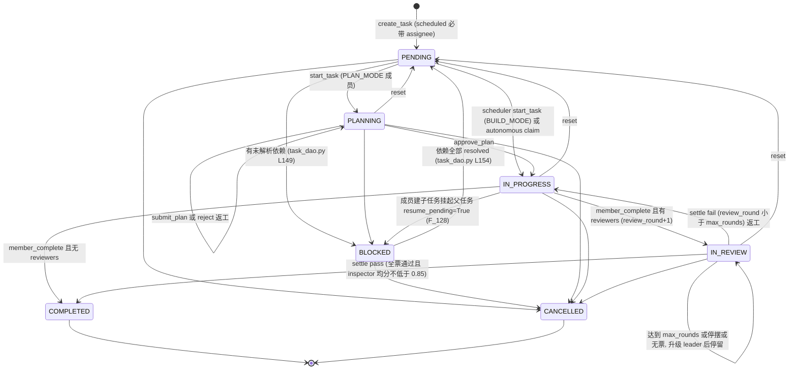
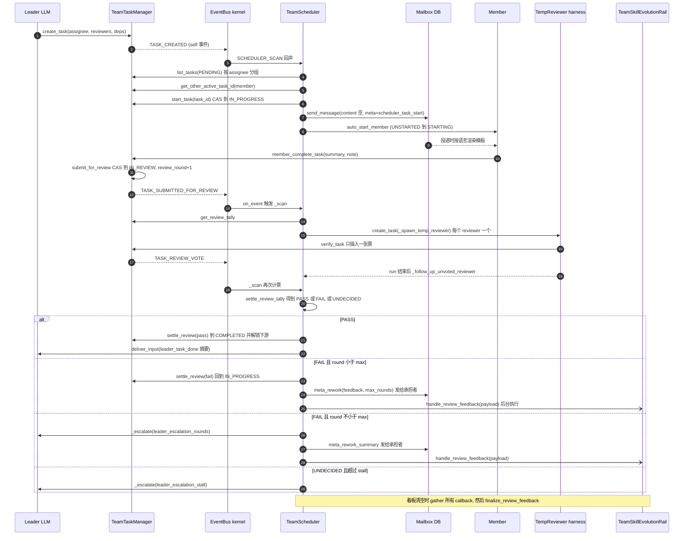
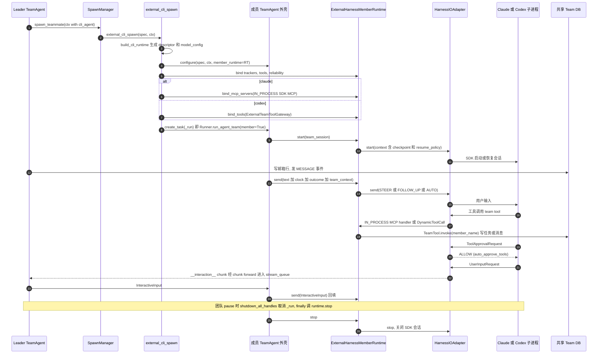
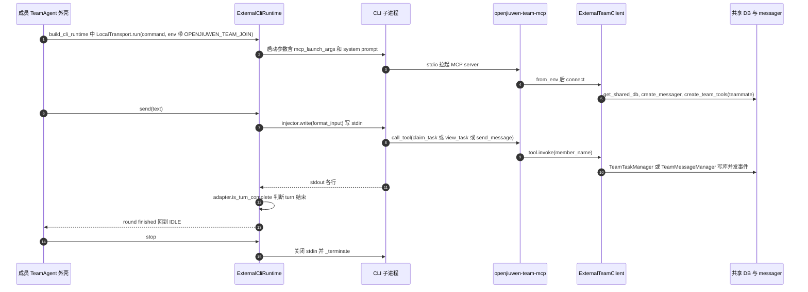

# 04 · 深水区子系统与技术债（Deep Subsystems & Debt）

> 第二轮专项源码扫描，补齐 `01_ARCHITECTURE_BIBLE.md` / `02_PRODUCTION_TROUBLESHOOTING_RUNBOOK.md` 留下的盲区。4 个并发 Sub-agent 分区扫描，主会话对高影响结论逐条 `grep -n` / `sed -n` 复核。
> 路径约定：`AC/`=`agent-core/openjiuwen/`，`AT/`=`agent-core/openjiuwen/agent_teams/`，`JS/`=`jiuwenswarm/jiuwenswarm/`，`GW/`=`jiuwenswarm/gateway/`。
> 证据等级：**[实锤]** 代码事实已核对；**[实测]** 用仓库代码跑了最小复现；**[推断]** 由代码路径推出、未运行；**[未证]** 依赖仓库外代码（如 `openjiuwen-protocol`）。

## 目录

1. [端到端取消传播与 jiuwenbox 沙箱生命周期](#1-端到端取消传播与-jiuwenbox-沙箱生命周期)
2. [Context Engineering：规则压缩管线与 KV-Cache 命中率保护](#2-context-engineering规则压缩管线与-kv-cache-命中率保护)
3. [Team 强调度模式与异构外部 CLI 纳管](#3-team-强调度模式teamscheduler与异构外部-cli-纳管)
4. [全仓未接线代码与半成品设计大起底](#4-全仓未接线代码与半成品设计大起底unwired--dead-mechanisms)

## 0. 本轮结论速览

### 0.1 对 02 文档开放项的最终裁定

02 文档留下的开放项是"客户端断开后 `CancelledError` 能否逐跳传到 DeepAgent、jiuwenbox 沙箱是否释放"。本轮结论：**显式取消可以闭环，但闭环靠的是消息而不是 `CancelledError` 传播；断连在多数路径上不等于取消；沙箱 lease 在生产代码里从不释放。**

| 场景 | 能否传到正在执行的工具 | 断在哪一跳 | 证据 |
|---|---|---|---|
| Web / TUI 显式中断（`chat.interrupt`） | **能**（本地 shell 进程组被 kill + `DeepAgent.abort()` + handle `task.cancel()`） | 沙箱内 exec 除外：同步 httpx 跑在 `asyncio.to_thread` 里，协程取消后请求仍在线程中阻塞；jiuwenbox 无取消前台 exec 的接口 | `GW/message_handler/message_handler.py:1395` → `JS/runtime/service.py:1299` → `interface_deep.py:15320`；沙箱 `AC/extensions/sys_operation/sandbox/providers/jiuwenbox.py:1052`、`:458-483` |
| Web 浏览器关 tab / WS 断开 | **不能**（有意设计："ws 断开不等价于 agent 已停止"） | Gateway WebChannel 不发取消 | `GW/channel_manager/web/web_connect.py:1880-1917` |
| TUI 断连 | **能**（意外断连宽限 60s，显式退出 1s，宽限内重连可撤销） | — | 见 §1 |
| Gateway 本地取消 / unary 超时 | **不能** | 只清本地队列，不通知 AgentServer | `GW/…/agent_client.py:692-700`；`GW/routing/agent_request_timeout.py:144-167` |
| AgentServer Front 断连 | **不能** | Supervisor 被取消，但不向 Worker 发任何帧 | `JS/server/supervisor/runtime_supervisor.py:343-406` |
| `GATEWAY_DETACH` | **不能**（只断开投递，执行继续） | Worker | `JS/server/worker/dispatcher.py:289-295` |
| IPC `KIND_CANCEL` | **死代码** | 仅有消费端，生产代码中**没有任何发送方** | 定义 `JS/server/ipc/protocol.py:33`，唯一消费 `JS/server/worker/dispatcher.py:188` |
| 沙箱 daemon exec 超时 | 只杀 leader 进程 | `proc.kill()` 而非 `killpg`，孙进程残留到沙箱删除 | `sandbox_daemon.py:332-336` |
| 沙箱 lease | **从不释放** | `SandboxGatewayClient.release` 生产代码无调用方；`on_stop`（delete/pause/keep）从未生效；idle 回收两层默认都关闭 | `AC/core/sys_operation/sandbox/gateway/gateway_client.py:60-63` |

### 0.2 本轮新增的高危发现（Top 10）

| # | 子系统 | 发现 | 证据 | 等级 |
|---|---|---|---|---|
| 1 | Memory / 安全 | **长期记忆加密实际未生效**：`SqlMessageStore` 先以无 key 构造，`AesStorageCodec(crypto_key)` 在 `__init__` 中固定为无 key；之后只改写 `crypto_key` 属性，codec 不重建 → 消息明文落库 | `AC/core/memory/long_term_memory.py:203`、`:316-317`；`SqlMessageStore.__init__` 中 `self._codec = AesStorageCodec(crypto_key)`（构造时固化） | [实锤] |
| 2 | 外部 CLI / 权限 | **外部 CLI Teammate 工具审批被硬编码为自动通过**，审批永远到不了 Leader | `AT/external/member_runtime.py:256`（`auto_approve_tools=True`） | [实锤] |
| 3 | Runtime / 取消 | IPC `KIND_CANCEL` 只有消费端没有发送端；Front 断连、Gateway 超时都不会停止 Worker 上的执行 | 见 0.1 | [实锤] |
| 4 | 沙箱 | lease 从不释放 + idle 回收默认关闭；Worker 重启后内存里的沙箱 id 缓存为空，同一 project 新建沙箱，旧沙箱留在 READY 无人回收 | `gateway_client.py:60`；§1.2 | 前半 [实锤]，孤儿 [推断] |
| 5 | Context / 压缩 | 以 `[INFO]` / `[ERROR]` 开头的日志会被 `json_repair` 修成列表、误判为 JSON_ARRAY；实测 13KB 日志被压成 `["ERROR"]`，且被标为无损 | `router.py:96-101`；`json_array_compressor.py:78-80` | [实测] |
| 6 | Context / 压缩 | 路由检测顺序中 LOG 先于 diff 和搜索结果；diff 中的 `File "x", line n` 或 grep 结果的 `path:12: error:` 会让整段被当成 LOG | `router.py:85-117` | [实测] |
| 7 | Scheduler | Reviewer 任务 `create_task` 不保留引用，`deactivate()` 不取消，Leader 暂停后 reviewer 仍在运行并投票 | `AT/agent/scheduling/scheduler.py:766` | [实锤] |
| 8 | Scheduler | 无失败重派：成员崩溃后任务一直停在 `IN_PROGRESS`；`TaskDao.verify_and_fix_task_consistency` 恢复扫描无调用方，BLOCKED 任务可能永久卡住 | §3、§4 | [实锤] |
| 9 | 护栏 | `LLMPromptInjectionBackend` 永远回退到规则检测，endpoint / key / model / timeout 从未被读；`GuardrailResult.modified_data` 无消费方 | §4 | [实锤] |
| 10 | 外部 CLI | Bridge 协议仅有形状：`set_bridge_adapter` / `connect` / `close` 框架从不调用，bridge 成员总是拿到"remote unavailable"占位 | §3 | [实锤] |

### 0.3 架构治理 KPI 弹药（汇总）

- **未接线 / 半成品机制**：已知 6 项复核全部成立 + 新增 23 项 + 低优先级预留 7 项（明细见 §4）。
- **压缩管线缺陷**：D1–D12（§2），其中 2 项实测复现。
- **调度 / 外部 CLI 缺陷**：18 项（§3）。
- **取消链断点**：B0–B7 共 8 处（§1）。
- **文档与代码漂移**：`AT/agent/scheduling/AGENTS.md` 写 stall 超时 1800s（代码 2400s），引用不存在的 `_REVIEW_RENUDGE_SECONDS`；`scheduler.py` docstring 引用不存在的 `verdict.judge`。

> 建议把 0.2 的 #1（记忆加密）和 #2（外部 CLI 自动审批）作为安全类问题优先单独立项，而不是混在技术债清单里处理。

---

## 1. 端到端取消传播与 jiuwenbox 沙箱生命周期

> 范围：只读分析 `/home/user/jiuwen-learn`。用于关闭 `02_PRODUCTION_TROUBLESHOOTING_RUNBOOK.md` §F8 的开放项（"Gateway→Front→Worker→DeepAgent 逐跳 CancelledError 与 jiuwenbox lease 是否 release 未验证"）。
>
> 路径缩写：
> - `GW/` = `jiuwenswarm/gateway/`
> - `S/` = `jiuwenswarm/jiuwenswarm/server/`
> - `R/` = `jiuwenswarm/jiuwenswarm/runtime/`
> - `AC/` = `agent-core/openjiuwen/`
> - `JB/` = `jiuwenswarm/jiuwenbox/src/jiuwenbox/`
>
> 标注：**[实锤]** 表示读代码直接确认；**[推断]** 表示由代码静态推出、没有运行验证；**[未证]** 表示没找到证据，或者依赖仓库外代码。

---

### 1.0 结论速览

| # | 结论 | 级别 |
|---|---|---|
| C1 | **浏览器（Web）断开不等于取消。** WebChannel 断连 finally 只清订阅和 expert 状态，注释明确写了"ws 断开不等价于 agent 已停止"，不发 `CHAT_CANCEL`。Agent、工具和沙箱 exec 会一直跑到自然结束 | [实锤] `GW/channel_manager/web/web_connect.py:1880-1917`、`GW/channel_manager/web/app_web_handlers.py:2251-2260` |
| C2 | **TUI 断开等于延迟取消。** 意外断连时宽限 60s，显式 `tui.disconnect` 时宽限 1s；期间重连可撤销。到时调用 `_cancel_agent_work_for_session`，发 `CHAT_CANCEL`，并带上 `cancel_source=client_disconnect` | [实锤] `GW/channel_manager/tui/tui_connect.py:2550-2585`、`:27`；`GW/message_handler/message_handler.py:117,1678-1716,1844-1860` |
| C3 | **Gateway 本地 `task.cancel()` 不会传到 AgentServer。** `send_request_stream` 被 cancel 时只丢弃本地队列，不发任何 wire 帧；unary 超时（`send_agent_request_with_timeout`）也只在本地抛错。真正的停止只能靠 Gateway 显式再发一条 `CHAT_CANCEL` | [实锤] `GW/routing/agent_client.py:692-700`、`GW/routing/agent_request_timeout.py:144-167` |
| C4 | **Gateway↔Front 连接断开不取消 Worker 内的执行。** Front 会 cancel 自己的连接任务，但 `RuntimeSupervisor.dispatch_parsed_request` 被 cancel 后只清理 `_pending`，不给 Worker 发帧；最多发一个 `KIND_GATEWAY_DETACH`，Worker 侧 `detach_gateway()` 的文档字符串写明"Execution remains Worker-owned" | [实锤] `S/front/connection.py:183-190`、`S/supervisor/runtime_supervisor.py:253-257,343-406`、`S/worker/dispatcher.py:289-295` |
| C5 | `KIND_CANCEL` IPC 帧**只有消费端，生产代码里没有发送端**（只有测试会发）。`CHAT_CANCEL` 实际作为普通 `KIND_REQUEST` 转发给 Worker | [实锤] grep：`S/ipc/protocol.py:33`、`S/worker/dispatcher.py:188`；生产代码中无发送点 |
| C6 | Worker 内的取消链本身是闭合的：`AgentWebSocketServer` 先 cancel 流任务，然后 `AgentRuntime.cancel_request` → adapter `_process_interrupt` → DeepAdapter 依次执行 rail.abort、cancel session agent task、`kill_shell_processes_for_session_tree`（killpg）、`DeepAgent.abort()`，最后 `RuntimeSessionCoordinator.cancel_execution` 对 handle 调 `task.cancel()` | [实锤] 各跳行号见 §1 |
| C7 | **沙箱模式下，shell 的取消在 agent-core 这一层断开。** `JiuwenBoxShellProvider` 用 `asyncio.to_thread(sync httpx.post /exec)`。协程被 cancel 后，线程里的 HTTP 请求仍然阻塞到服务端返回；jiuwenbox 服务端没有"取消前台 exec"的 API；沙箱 exec 进程也不在 `SHELL_PROCESS_REGISTRY` 中，所以 killpg 够不到它。命令会一直执行到 `timeout_seconds` | [实锤] `AC/extensions/sys_operation/sandbox/providers/jiuwenbox.py:458-483,1052`；`AC/core/sys_operation/shell_process_registry.py` 只有 local 路径注册（`AC/core/sys_operation/local/shell_operation.py:77`） |
| C8 | 沙箱守护进程超时处理用 `proc.kill()`，只杀 leader，**不是 killpg**（虽然设了 `start_new_session=True`）。孙进程会留到沙箱被删除（PID namespace 销毁）或 cgroup.kill 时 | [实锤] `JB/supervisor/sandbox_daemon.py:300,332-336` |
| C9 | **SandboxGateway 的 lease 没有 release 调用方。** `SandboxGatewayClient.release()` 和 `SandboxGateway.release_sandbox()` 在生产代码中都没有调用者。沙箱按 project（`ContainerScope.CUSTOM`，`project_<sha16>`）共享，session 结束、断连、cancel 都不会删沙箱 | [实锤] grep 结果为空；`S/runtime/agent_adapter/sysop_builder.py:267-273,857-866` |
| C10 | 沙箱回收只有三条路：①jiuwenbox 服务端 idle reaper（默认关闭，`idle_ttl_seconds` 默认 None）；②jiuwenbox 进程 lifespan shutdown 时 `shutdown_all_sandboxes`；③agent-core 网关在创建新 isolation key 时顺带 `_evict_idle`（同样需要 idle_ttl） | [实锤] `S/../common/config.py:3760`、`JB/server/sandbox_manager.py:345-381,300-337`、`AC/core/sys_operation/sandbox/gateway/gateway.py:278-289` |
| C11 | Worker 崩溃时：internal 模式下 jiuwenbox 是 Worker 的子进程，带 `PR_SET_PDEATHSIG=SIGTERM`，会触发 lifespan shutdown，沙箱随之被清掉；bwrap 带 `--die-with-parent`，即使 jiuwenbox 被 SIGKILL 也能级联清理。**external 模式**以及"jiuwenbox 存活但 Worker 重启"的情况下，Worker 内存里的 `_shared_sandbox_ids` 丢失，新 Worker 会**为同一 project 新建沙箱，旧沙箱成为孤儿**，没有任何按注册表扫描孤儿的逻辑（启动时只扫网络 veth/netns） | [实锤]+[推断] `S/sandbox/jiuwenbox_runner.py:57-68,349-360`；`JB/supervisor/bwrap.py:95-111,369-373`；`JB/server/app.py:308-316`；`JB/server/sandbox_manager.py:190-200` |

---

### 1.1 Task A：取消传播逐跳核验

#### 1.1.1 入口：两类触发

| 触发 | 实际 method / 函数 | 是否发 CHAT_CANCEL | 证据 |
|---|---|---|---|
| Web 点击停止 | WS RPC `chat.interrupt`（REST `POST /chat/{session_id}/actions/interrupt`）。本地 handler `_chat_interrupt` 只回 ack，真正的转发走三层路由进入 MessageHandler 的 `ReqMethod.CHAT_CANCEL` 分支 | 是 | `GW/channel_manager/web/app_web_handlers.py:4144-4149,5816`；`GW/channel_manager/web/http_routes/mapped.py:881`；`GW/message_handler/message_handler.py:5058-5070,5230-5237` |
| TUI ESC | `chat.interrupt`（`GW/channel_manager/tui/tui_connect.py:1244-1249,1713`），后续同上 | 是 | 同上 |
| TUI 显式退出 | `tui.disconnect`，经 `schedule_cancel_agent_sessions_on_disconnect` 延迟 1s | 是（延迟） | `GW/channel_manager/tui/tui_connect.py:1251-1300`、`:27` |
| TUI 传输层断开 | `disconnect_handler=_tui_disconnect`，经 `schedule_cancel_agent_sessions_on_disconnect` 延迟 60s | 是（延迟，重连可撤销） | `GW/channel_manager/tui/tui_connect.py:2550-2596`；`GW/app_gateway.py:1495-1505`；`GW/message_handler/message_handler.py:117,1716-1733` |
| **Web 传输层断开** | `WebChannel` finally：`unregister_ws`、`reconcile_expert_processing`，再跑 `_disconnect_hooks`。web 注册的 hook 只做 `unregister_ws_subscriptions` | **否** | `GW/channel_manager/web/web_connect.py:1880-1917`（注释 1903-1907：`ws 断开不等价于 agent 已停止`）；`GW/channel_manager/web/app_web_handlers.py:2251-2260` |
| Gateway unary 超时 | `send_agent_request_with_timeout` → `asyncio.wait_for`，超时后抛 `AgentRequestTimeoutError` | **否**（只停止本地等待） | `GW/routing/agent_request_timeout.py:144-167` |
| Gateway 关停 | `_interrupt_one` → `_cancel_agent_work_for_session(..., agent_notify="await")`，timeout 5s | 是（不带 CLIENT_DISCONNECT，按硬取消处理） | `GW/message_handler/message_handler.py:6249-6265` |

> 说明：`ReqMethod` 定义在外部包 `openjiuwen-protocol`（git 依赖，`jiuwenswarm/pyproject.toml:27`），仓库内没有源码。"`chat.interrupt` 的值等于 `ReqMethod.CHAT_CANCEL.value`"这一点是从 `router_client.py:3511`、`message_handler.py:3261` 的字符串比较，以及 web handler 注册名推断出来的 **[推断]**。

#### 1.1.2 逐跳表

| 跳 | 位置 | 载体 | 是否 `task.cancel()` | 是否吞掉 CancelledError | 断点 / 备注 |
|---|---|---|---|---|---|
| G1 | `MessageHandler._cancel_agent_work_for_session` `GW/message_handler/message_handler.py:1395-1627` | 构造 `Message(req_method=CHAT_CANCEL, params={"intent":"cancel","session_id"...})`（:1503-1516）；断连时在 `channel_context` 写入 `E2A_INTERNAL_CANCEL_SOURCE_KEY` | 是：`_cancel_tasks` 对 `_stream_tasks` 中该 session 的 Task 执行 `task.cancel()`，然后 `gather(return_exceptions=True)`（:1426-1431,1534-1536） | 不吞，只在 gather 里收集 | 注释 :1458-1459："即使网关侧已无活跃流式拉取任务……也必须通知 AgentServer" |
| G2 | `WebSocketAgentServerClient.send_request_stream` `GW/routing/agent_client.py:626-700` | Gateway 本地流 Task | 被 G1 cancel | `except CancelledError: log; raise`（:692-694），不吞 | **断点 B1**：cancel 只调用 `_drain_and_remove_queue`（:700），**不向 AgentServer 发任何帧**。必须靠 G1 再发 CHAT_CANCEL |
| G3 | `WebChannel` 断连 `GW/channel_manager/web/web_connect.py:1849-1917` | 无 | 只 cancel 超过 5s 宽限、仍在处理的 `_handle_raw_message` 调度任务（:1855-1861），这些任务不是 agent 流 | — | **断点 B0**：Web 断连不触发 G1 |
| F1 | Front `FrontConnection.__call__` `S/front/connection.py:143-190` | Gateway→Front WS | 断连 finally 中对本连接所有 `_handle_raw` 任务执行 `task.cancel()`（:183-187） | `gather(return_exceptions=True)` | 最后一个 push 连接释放后调用 `backend.on_gateway_disconnect`（:111-141） |
| F2 | `FrontAdmission.dispatch` → `_dispatch_cancel` `S/front/admission.py:80-81,159-203` | CHAT_CANCEL | 不 cancel Task；对 Front 里仍在排队（warming）的请求设置 `tracked.cancelled` Event（`S/front/request_registry.py:76-100`） | — | 后端已挂接时直接 `backend.dispatch_parsed_request` 转发 |
| F3 | `RuntimeSupervisor.dispatch_parsed_request` `S/supervisor/runtime_supervisor.py:343-406` | IPC `{"kind": KIND_REQUEST, payload=CHAT_CANCEL}` | 否 | `except Exception`（:384）不捕获 CancelledError；`finally` 弹出 `_pending` | **断点 B2**：F1 cancel 掉正在 `await future` 的任务后，**不会给 Worker 发 cancel 帧**，Worker 继续执行 |
| F4 | `on_gateway_disconnect` → `_notify_gateway` `S/supervisor/runtime_supervisor.py:253-257,1088-1098` | `KIND_GATEWAY_DETACH` | 否 | — | Worker 侧 `detach_gateway` 只 `self._bridge.detach(generation)`，把 ack future 置为 False（`S/worker/dispatcher.py:289-295`；`S/worker/gateway_bridge.py:141-147`）。**断点 B3**：host 断开时 Worker 不取消执行 |
| F5 | `KIND_CANCEL` | — | — | — | **B4（死代码）**：`S/worker/dispatcher.py:188-199` 能消费，但生产代码中没有任何 `send({"kind": KIND_CANCEL})` |
| W1 | `WorkerDispatcher.handle` / `_run_request` `S/worker/dispatcher.py:229-247,379-449` | KIND_REQUEST(CHAT_CANCEL) | 有 `target_request_id` 时 `_cancel_target_dispatch` 对目标 dispatch 的 Task 执行 `task.cancel()` 并 gather（:490-514）；Worker 未就绪时 `_drop_queued_cancel`（:239-241） | `except CancelledError: cancelled=True; raise`（:444-446），不吞 | 无 target 时进入 AgentWebSocketServer |
| W2 | `AgentWebSocketServer._handle_message` CHAT_CANCEL 分支 `S/agent_ws_server.py:3252-3358` | 同上 | intent 为 cancel/supplement 时：`stream_stop_event.set(); stream_task.cancel()`（:3293-3305），作用于 `_session_stream_tasks[sid]` | finally 中 `gather(return_exceptions=True)`，非 CancelledError 才记 warning | client_disconnect 来源会额外执行 `_cleanup_client_disconnect_session_runtime`（:3326-3332,3516-3543）。⚠ 外层 `except asyncio.CancelledError: logger.info(...)` 没有 re-raise（:3360-3365），**吞掉**请求处理任务自身的取消 [实锤]，影响仅限这个请求任务 |
| W3 | `_handle_cancel` → `AgentRuntime.cancel_request` `S/agent_ws_server.py:3560-3608`；`R/service.py:1299-1491` | AgentRequest | team 请求调 `_team_lifecycle().stop_session`（:1424）；再经 `R/request.py:578-638 cancel_request` 找已有 agent（`allow_create=False`，找不到直接回 success）→ `agent.process_message(request)`；最后 `_session_coordinator.cancel_execution`（:1465） | `except (Exception, CancelledError): ...; raise`（`S/agent_ws_server.py:3595-3598`），不吞 | — |
| W4 | `RuntimeSessionCoordinator.cancel_execution` `R/session/coordinator.py:819-866`；`_cancel_direct_handles` :1110-1130 | `SessionExecutionHandle` | 是：对 `handle.task` 执行 `task.cancel()`，然后 `asyncio.wait(timeout)`；超时的执行记入 `timed_out`（handle 不标 CANCELLED） | `tracked()` 中 `except CancelledError: mark_terminal; raise`（:206-217），`run` 中 `except CancelledError: ...; raise`（:260-279），不吞 | 超时执行仍在运行，只在响应里体现为 `success=False/stop_confirmed=False` |
| A1 | Facade `JiuWenSwarm._process_message` → `_process_interrupt` `S/runtime/agent_adapter/interface.py:3391-3392,3162-3233` | `intent` | `adapter.process_interrupt` →`_cancel_team_work_for_session`→`_session_manager.cancel_session_task(wait_timeout=5.0)`（:3228）；SessionManager 中 `task.cancel()`（`S/runtime/session/session_manager.py:64`） | `except (CancelledError, Exception)` 只作用于等待被取消的 Task（:69,77），属于良性吞 | 顺序注释 :3216-3218：先 process_interrupt，再 cancel_session_task |
| A2 | Team 路径 `_process_team_interrupt` `interface.py:3255-3320` | | `team_manager.cancel_session_runtime(workflow_disposition="pause"\|"stop")`：断连来源走 pause，用户主动走 stop | — | ⚠ runbook 指出的 fire-and-forget 仍存在：`team_helpers.py:1967,1977` 的 `asyncio.create_task` 不持有引用 [实锤]；没有核验 team 侧 stop 能否触达成员 agent 的工具执行 [未证] |
| A3 | DeepAdapter `process_interrupt` `S/runtime/agent_adapter/interface_deep.py:16313-16560` | | `_stop_session_interrupt_work`（:15301-15340）：`_cancel_session_agent_tasks` 中 `task.cancel()`+gather（:4910-4933）、`rail.abort(sid)`、**`kill_shell_processes_for_session_tree(sid)`**（:15320）；然后 `_abort_shared_agent_if_safe` → `_halt_deep_agent_execution`：`_cancel_scheduler_running_tasks()` → `shield(DeepAgent.abort())` →再 cancel 一次（:4821-4867） | :4848 `except CancelledError` 是有意为之（shield 已保证 abort 完成），不 re-raise | ⚠ 同一 DeepAgent 上还有其他活跃 session，或存在 goal round 时，**跳过** `instance.abort()`（:16288-16310），只依赖 per-session teardown |
| D1 | `DeepAgent.abort` `AC/harness/deep_agent.py:3690-3726` | | `coordinator.request_abort()` + `handler.on_abort()` + `_cancel_stream_process_task`（`task.cancel(); await task`，:3596-3626）+ 释放子 agent controls | :3615 `except CancelledError: pass`，**吞**；在 abort 自身被二次 cancel 时会丢失外层取消，但外层已经包了 shield | ReAct 循环靠 abort 标志加上 `_stream_process` 任务取消退出 |
| D2 | `AbilityManager.execute` `AC/core/single_agent/ability_manager.py:1112-1260` | 工具调用批 | finally 中对残留的 `scheduled_tasks` 执行 `task.cancel()`，然后 `shield(gather)`（:1203-1213） | 并行 lane 里 `_await_tool_task` 用 `except BaseException: return exc`（:409）把 CancelledError 当成值；若外层被 cancel，`gather` 仍按 asyncio 语义抛出 CancelledError [推断]。没有 abort 时，CancelledError 结果会被转成 `"[Interrupted] ... cancelled by user"` 的 ToolMessage（:1226-1235）。单工具层 `fail_after` + `except CancelledError: raise`（:1607-1620），不吞 | 顺序路径用 `except Exception`（:1199），不吞 |
| T1 | `BashTool.invoke` `AC/harness/tools/shell/bash/_tool.py:184-240` | `self._operation.shell().execute_cmd(...)` | — | 无 try/except，不吞 | 后台命令 `execute_cmd_background`：local 模式会 `_track_shell_process`（`local/shell_operation.py:832-835`），可被 killpg；**jiuwenbox provider 没有实现 `execute_cmd_background`**，Gateway 返回 "Method not found" [实锤] `gateway.py:94-97` |
| T2a | Local `ShellOperation.execute_cmd` `AC/core/sys_operation/local/shell_operation.py:517-560` | `asyncio.create_subprocess_*`，`start_new_session=True`（:385-392） | `AsyncProcessHandler.invoke`：CancelledError 时 `_kill_process_tree`（`os.killpg(SIGKILL)`）再 re-raise（`local/utils.py:164-175`）；超时同样 killpg（:176-190）；另由 registry 支持 `kill_session_tree` | 不吞（`except Exception` :560） | ✅ 本地路径闭合 |
| T2b | Sandbox `ShellOperation.execute_cmd` `AC/core/sys_operation/sandbox/shell_operation.py:25-39` → `SandboxGatewayClient.invoke` → `SandboxGateway.handle_request` `gateway.py:84-101` | `GatewayInvokeRequest` | 否 | `except Exception`（:100），不吞 CancelledError | — |
| T3 | `JiuwenBoxShellProvider._execute_cmd_remote_pipeline` → `_run_exec_pipeline` `jiuwenbox.py:2581-2630,1001-1078` | **`await asyncio.to_thread(sandbox_op, sandbox_id)`**（:1052），`sandbox_op` 是同步 `httpx.Client.post(/exec, timeout=max(t,30))`（:458-483） | 否 | `except Exception`（:1072），不吞 | **断点 B5**：cancel 只取消 await，**线程里的 HTTP 请求继续阻塞**，服务端 exec 继续执行。⚠ 首次 `_get_sandbox_id()` 在事件循环线程里同步调用 `create_sandbox` HTTP（:887-890），会阻塞 loop，取消在此期间无法投递 [实锤] |
| T4 | jiuwenbox 服务端 `POST /sandboxes/{id}/exec` `JB/server/routes/sandbox.py:125-137` → `SandboxManager.exec_in_sandbox` `JB/server/sandbox_manager.py:868-929` → `ProcessRuntime._exec_via_daemon` `JB/server/runtime/process.py:3571-3585`（`run_in_executor` 阻塞 socket） | 守护进程 IPC | 否 | — | **断点 B6**：HTTP 客户端断开不会中断 executor 线程，也没有前台 exec 的 kill API（只有 background job 有 `kill_background_job_in_sandbox` :1019） |
| T5 | `sandbox_daemon._handle_exec` `JB/supervisor/sandbox_daemon.py:251-352` | `subprocess.Popen(start_new_session=True)` | 超时时 `proc.kill()`（:332-336），**不是 killpg** | — | **断点 B7**：孙进程存活，直到 sandbox 删除（daemon 是 PID ns 的 init）或 cgroup.kill（`JB/supervisor/cgroup.py:488-578`）。fork-server 快路径用 `os.kill(pid, SIGKILL)`，子进程先 `setsid`（:1081,1198） |
| T6 | jiuwenbox 本地回退 `_run_local_subprocess` `jiuwenbox.py:1437-1481` | `asyncio.to_thread(subprocess.run(timeout))` | 否 | — | 超时由 `subprocess.run` 只 kill 直接子进程，**不是进程组**；cancel 无法中止线程。另有 `_run_local_subprocess_process_group`（:1513-1575）会 killpg，但只用于 hybrid 路径 [推断] |

#### 1.1.3 后台任务（runbook F4 复核）

| 位置 | 现状 | 取消能否触达 |
|---|---|---|
| `S/runtime/agent_adapter/code_agent_rail.py:320` | `asyncio.create_task(self._run_async(...))`，不持有引用；`_run_async` 只 `except Exception`（:353-363） | 否 [实锤]。子 agent 在另一个 Task 中运行，不在 `_session_agent_tasks` 里。如果走 local shell，registry 的 `kill_session_tree(sid)` 会按 `sid_` 前缀命中子 session 的 shell [推断，取决于 sub_session_id 命名]；但 LLM 调用和沙箱 exec 不受影响 |
| `S/runtime/agent_adapter/team_helpers.py:1967,1977` | 同上，fire-and-forget | 否 [实锤] |
| `GW/message_handler/message_handler.py:1540-1548` | `_fire_and_forget_tasks` **持有引用**，并在 done 时 discard | 已修复（正例） |

#### 1.1.4 时序图（Web 断开 / 显式取消 / TUI 断开）

#### 1.1.5 断点汇总与修复建议

| 断点 | 影响 | 建议 |
|---|---|---|
| B0 Web 断连不取消 | 用户关闭 tab 后，LLM 配额、沙箱 CPU 继续消耗，直到本轮结束 | 设计上有意为之（为了支持刷新后续看）。建议参考 TUI 加一个**可配置宽限期**的 `schedule_cancel_agent_sessions_on_disconnect`，或用 run 心跳 TTL 兜底 |
| B1/B2/B3 本地 cancel 不跨进程 | 任何"只 cancel 本地 Task"的路径（Gateway unary 超时、Front 断连）都会在 Worker 留下孤儿执行 | Supervisor `dispatch_parsed_request` 在 `except CancelledError` 中发送 `KIND_CANCEL{dispatch_id}`（Worker 已经能消费）；Gateway 超时路径补发 CHAT_CANCEL(target_request_id) |
| B4 KIND_CANCEL 无发送端 | 死代码，容易被误认为已经实现 | 接入 B2 修复，或删除 |
| B5 to_thread + 同步 httpx | 取消后 HTTP 线程最多阻塞 `max(timeout,30)` 秒，占用默认 executor 线程 | 改用 `httpx.AsyncClient`，cancel 时关闭连接；同时服务端增加 `DELETE /sandboxes/{id}/exec/{exec_id}` |
| B6 服务端无 exec 取消 | 只能等 timeout | daemon 侧按 exec_id 记录 pgid，提供 kill 接口；或监听 HTTP disconnect（`request.is_disconnected()`）后发 kill |
| B7 daemon 超时只 kill leader | `bash -lc 'sleep 999 & ...'` 这类孙进程泄漏到沙箱生命周期结束 | `os.killpg(proc.pid, SIGKILL)`（已经是 `start_new_session=True`，改动成本低） |
| 共享 DeepAgent 跳过 abort | 多 session 并发时，被取消的 session 只靠 per-session teardown，LLM in-flight 请求不会被 cancel [推断] | 把 LLM 调用纳入 `_session_agent_tasks` |

---

### 1.2 Task B：jiuwenbox 沙箱生命周期

#### 1.2.1 组件分层

| 层 | 组件 | 位置 | 职责 |
|---|---|---|---|
| Swarm 配置 | `create_sandbox_sysop_card` | `S/runtime/agent_adapter/sysop_builder.py:725-900` | 生成 `SandboxGatewayConfig`：`ContainerScope.CUSTOM`，`custom_id=project_<sha256(project_dir)[:16]>`（:267-273,857-860），`PreDeployLauncherConfig(base_url, sandbox_type="jiuwenbox", idle_ttl_seconds)` |
| Swarm 进程管理 | `JiuwenBoxRunner` | `S/sandbox/jiuwenbox_runner.py` | `/sandbox enable` 时 `ensure_running`；internal 模式 spawn `uvicorn jiuwenbox.server.app:app`，带 `preexec_fn=PR_SET_PDEATHSIG(SIGTERM)`（:57-68,349-353）和 `atexit` 兜底（:441-484）；`stop()` 的流程是 terminate、等 60s、再 kill（:486-544）；external 模式只做健康检查（:221） |
| agent-core 网关 | `SandboxGateway`（进程级单例）+ `InMemorySandboxStore` | `AC/core/sys_operation/sandbox/gateway/gateway.py`、`sandbox_store.py` | 按 isolation_key 记录 SandboxRecord（**纯内存**）；provider 按 `isolation_key:op_type` 缓存 |
| Launcher | `PreDeploymentLauncher` | `AC/core/sys_operation/sandbox/launchers/pre_deployment_launcher.py:8-12` | `launch` 只返回 `base_url`（**不创建远端沙箱**）；`delete` 调 `delete_jiuwenbox_sandbox(shared_key)` |
| Provider | `_JiuwenBoxProviderMixin` / `JiuwenBoxShellProvider` / FS / Code | `AC/extensions/sys_operation/sandbox/providers/jiuwenbox.py` | 首次操作时懒创建远端沙箱（`_get_sandbox_id` :863-913），类级 `_shared_sandbox_ids[base_url\|isolation_key]` 在 fs/shell/code 间共享；404 时自动重建（:924-999） |
| jiuwenbox 服务 | `SandboxManager` + `ProcessRuntime` + `sandbox_daemon` | `JB/server/sandbox_manager.py`、`JB/server/runtime/process.py`、`JB/supervisor/sandbox_daemon.py` | 注册表（内存，状态文件只写不读）、bwrap 守护进程、cgroup、netns、idle reaper、warm pool |

#### 1.2.2 创建

1. `SandboxGateway._get_endpoint` 未命中时调用 `_create_new_sandbox`：先 `_evict_idle`，再 `PreDeploymentLauncher.launch`（只拿到 base_url），写入 `SandboxRecord(status=RUNNING)`（`gateway.py:192-276`）。
2. 第一次 exec/fs 调用时，Provider 执行 `_get_sandbox_id()`：在 `_shared_lock`（threading.Lock）内触发 `before_create` hook，`PUT /api/v1/timeout`（把 idle 策略写入服务端根策略），然后 **同步** `POST /api/v1/sandboxes`（body 只有 policy/policy_mode/runtime，**sandbox_id 由服务端生成**），再上传 preserve_files，触发 `after_create`（`jiuwenbox.py:405-424,863-913`）。
3. 服务端 `SandboxManager.create_sandbox`：`PROVISIONING` 后写状态文件和 policy，在锁外调用 `runtime.create`，成功后转 `READY`，并设置 `last_active_at=now`；失败转 `ERROR`；若创建期间被删除，则 `cleanup_after_create`（`JB/server/sandbox_manager.py:589-694`）。
4. `ProcessRuntime.create`：先尝试 warm pool adopt（`_try_warm_adopt` :2728）；冷路径依次做 netns/uplink、host firewall、cgroup，然后 `subprocess.Popen(bwrap ... sandbox-daemon.py, start_new_session=True, preexec_fn=_child_preexec)`（`JB/server/runtime/process.py:2711-2925`）。

#### 1.2.3 池化 / 复用

| 层 | 复用单位 | 证据 |
|---|---|---|
| Swarm | **按 project 共享**，同一 project_dir 的所有 session 用同一个 isolation key | `sysop_builder.py:267-273` |
| agent-core | `_shared_sandbox_ids[base_url\|isolation_key]` 进程内共享；Gateway `_provider_cache` | `jiuwenbox.py:617-620,692-703`；`gateway.py:124-136` |
| jiuwenbox | `WarmPool`：默认深度 4（`JIUWENBOX_WARM_POOL`，0 表示关闭），后台线程补充预停放的沙箱，checkout 时检查策略兼容性 | `JB/server/runtime/warm_pool.py:39-48,166-200` |

#### 1.2.4 隔离机制（ProcessRuntime 默认）

- **bubblewrap**：`--unshare-user/pid/net(isolated 模式)/ipc/cgroup/uts`，`--die-with-parent`（默认 True）（`JB/supervisor/bwrap.py:86-111,351-373`）。
- **seccomp**（`supervisor/seccomp.py`）、**Landlock**（`supervisor/landlock*.py`）、**cgroup v1/v2**：`memory.max`、`pids.max`，teardown 时通过 `cgroup.kill` 清理残留进程（`supervisor/cgroup.py:205-290,488-578`）。
- **网络**：isolated 模式用命名 netns `jbx-*` 加 veth `jwbH*/jwbS*`（`supervisor/network.py`）。
- **进程组**：每个沙箱守护进程 `start_new_session=True`；每次 exec 在守护进程内 `start_new_session=True`（`sandbox_daemon.py:300`），快路径子进程 `os.setsid()`（:1081）。
- 另有 `conch` 运行时（`JB/server/runtime/conch.py`，`sandbox_runtime=conch`），本次未展开 [未证]。

#### 1.2.5 lease / 续租 / TTL

| 机制 | 默认 | 续租点 | 证据 |
|---|---|---|---|
| Swarm `sandbox.idle_ttl_seconds` | **None（不驱逐）** | — | `common/config.py:3741,3760` |
| agent-core Gateway `_evict_idle` | 仅在 `idle_ttl_seconds` 非空时生效，**只在新建另一个 isolation key 时顺带触发**（惰性） | `last_used_ts` 只在 `_get_endpoint` 中更新（:203-204,226,237）。但 provider 被缓存后同一 key 不再进入 `_get_endpoint` | `gateway.py:124-136,253-289`。⚠ [推断] 导致 last_used_ts 实际约等于首次使用时间；一旦开启 TTL，可能误驱逐**仍在使用**的 project 沙箱（随后 provider 会 404 并自动重建，丢失沙箱内状态） |
| jiuwenbox 服务端 idle reaper | `timeout.idle_timeout=None`（关闭），`idle_check_interval=60` | `_mark_active` **只在 exec/fs 调用进入时**打点（:579-587,876） | `JB/models/policy.py:705-713`；`JB/server/sandbox_manager.py:345-509`。⚠ [推断] 单次 exec 时长超过 idle_timeout 时，reaper 可能在 exec 中途删除沙箱（reaper 只判断 phase==READY 和 last_active_at） |
| 显式 lease release | `SandboxGatewayClient.release(isolation_key)` 存在 | **无调用方** | `gateway_client.py:59-64`；grep 结果为空 |

结论：**没有真正意义上的 lease/心跳续租**，只有"最后活跃时间加轮询 reaper"，而且两层默认都关闭。

#### 1.2.6 异常断开 / Worker 崩溃时由谁回收

| 场景 | 沙箱结局 | 回收者 | 证据 / 级别 |
|---|---|---|---|
| 用户 cancel、断连、session cleanup | **保留**（project 级共享） | 无 | `cleanup_session_runtime` 中没有沙箱释放逻辑（`S/runtime/agent_adapter/interface.py:6176-6260` 中 grep 无 sandbox/release）[实锤] |
| Worker 正常关闭（internal） | 删除 | `AgentWebSocketServer` 关闭 → `_jiuwenbox_runner.stop()` → uvicorn lifespan finally：`drop_all_host_uplinks` → `stop_idle_reaper` → **`shutdown_all_sandboxes`** → `clear_persistent_state` | `S/agent_ws_server.py:2406-2409`；`JB/server/app.py:370-440` [实锤] |
| Worker 被 SIGKILL 或崩溃（internal） | 大概率删除 | jiuwenbox 收到 PDEATHSIG=SIGTERM，触发 uvicorn 优雅退出和 lifespan 清理 | `jiuwenbox_runner.py:57-68,351-353` [推断]：PDEATHSIG 在 fork 线程退出时触发；如果 lifespan 清理超过外部 kill 宽限，则走下一行 |
| jiuwenbox 自身被 SIGKILL | 守护进程被内核级联杀掉 | bwrap `--die-with-parent`（PDEATHSIG=SIGKILL）；网络 veth/netns 在下次启动时由 `cleanup_orphaned_uplinks("startup")` 清除 | `JB/supervisor/bwrap.py:95-111`；`JB/server/app.py:308-316`；`JB/supervisor/network.py:1146-1176` [实锤]。cgroup 目录残留情况未核验 [未证] |
| jiuwenbox 重启 | 注册表清空（状态文件**只写不读**，`_load_state` 没有在 `__init__` 中调用） | — | `JB/server/sandbox_manager.py:190-200,224-239` [实锤] |
| **external 模式，或 jiuwenbox 存活而 Worker 重启** | **孤儿**：新 Worker 的 `_shared_sandbox_ids` 是空的，会 `POST /sandboxes` 新建；旧沙箱在 jiuwenbox 注册表中保持 READY，没有任何人删除 | 只能靠服务端 idle reaper（默认关闭）或 jiuwenbox 重启 | `jiuwenbox.py:617-620,876-893`；`jiuwenbox_runner.py:221` [推断，逻辑闭合，未实测] |
| 启动时孤儿扫描 | **只扫网络**（veth/netns），不扫进程、cgroup 或注册表 | `_cleanup_orphaned_sandbox_network` | `JB/server/app.py:67-77,316` [实锤] |
| 僵尸进程 | `PR_SET_CHILD_SUBREAPER` 加 SIGCHLD 驱动的 zombie reaper | `JB/server/app.py:308,321-330`；`process.py:590-626,1962-2020` [实锤] |

#### 1.2.7 超时时 exec 进程是否被杀

| 路径 | 超时行为 | killpg? |
|---|---|---|
| 沙箱 daemon 普通路径 | `communicate(timeout)` 超时后 `proc.kill()`，返回 124 | **否**，只杀 leader（`sandbox_daemon.py:332-352`） |
| 沙箱 daemon fork-server 快路径 | deadline 到后 `os.kill(pid, SIGKILL)`；子进程已 `setsid` | **否**（kill pid，不是 -pgid）（:1081,1195-1201） |
| 服务端 IPC 读超时 | `sock.settimeout(timeout+5)`；未给 timeout 时为 305s | 只断开 IPC（`process.py:375-378,3428-3434`） |
| 客户端 HTTP | `timeout=max(timeout_seconds or 30, 30)` | —（`jiuwenbox.py:478-482`） |
| 沙箱删除 / stop | `_send_daemon_shutdown`，然后 `killpg(SIGTERM)`，等 10s，再 `killpg(SIGKILL)`，最后 cgroup teardown（`cgroup.kill`） | **是**（`process.py:3161-3212`；`cgroup.py:552-578`） |
| Local shell（非沙箱） | 超时和 cancel 都执行 `os.killpg(pid, SIGKILL)` | **是**（`local/utils.py:95-113,164-190`） |
| jiuwenbox 本地回退 `_run_local_subprocess` | `subprocess.run(timeout)` 只 kill 子进程 | **否**（`jiuwenbox.py:1437-1481`） |

#### 1.2.8 沙箱生命周期状态图

> 说明：`GatewayRecorded` 是 agent-core 内存态，不对应远端对象；`Orphaned` 表示远端沙箱存活，但没有客户端再持有它的 id。

---

### 1.3 对 runbook 开放项的回填

| runbook 原文 | 本次结论 |
|---|---|
| "客户端断开 → Gateway → Front → Worker → DeepAgent 的逐跳 CancelledError 传播未闭环证实"（`02_...md:40,276-279`） | **部分证实，部分证伪**。①TUI 和显式 interrupt：通过**显式 CHAT_CANCEL 消息**（而不是 CancelledError 传播）闭环到 DeepAgent.abort 和 local killpg。②Web 断连：**不取消**（B0）。③跨进程的 CancelledError **从不**传播（B1/B2/B3），全靠消息语义 |
| "jiuwenbox 沙箱 lease 是否 release" | **从不 release**。没有 lease 概念，`release()` 没有调用方，沙箱按 project 常驻，回收只靠默认关闭的 idle reaper 或 jiuwenbox 退出 |
| F4 后台 task | `code_agent_rail.py:320`、`team_helpers.py:1967/1977` 仍然 fire-and-forget [实锤]；Gateway `_fire_and_forget_tasks` 已正确持有引用 |

### 1.4 建议的验证探针（未执行）

1. 沙箱模式下执行 `sleep 120 & sleep 600`，然后 ESC：观察 `ps -ef | grep sleep`（宿主机 bwrap 子树）、Worker 线程数（`py-spy dump`，确认有 `to_thread` 阻塞），以及 jiuwenbox 审计日志中 EXEC_COMMAND 的 duration_ms 是否约等于 timeout。
2. Web 关闭 tab 后观察 `RuntimeSessionCoordinator` snapshot 中执行的状态是否仍为 RUNNING，以及 LLM 调用日志是否继续输出。
3. 在 jiuwenbox 存活时 `kill -9 <worker pid>`，重启后执行 `GET /api/v1/sandboxes`，确认是否出现两个 READY 沙箱（孤儿）。
4. 配置 `idle_ttl_seconds=60`，执行一条 `sleep 120`，观察沙箱是否在 exec 中途被 reaper 删除。

---

## 2. Context Engineering：规则压缩管线与 KV-Cache 命中率保护

> 范围：`agent-core/openjiuwen` 下 `core/context_engine/processor/forked/**`、`core/kv_cache`、`core/single_agent/kv_cache`、`harness/kv_cache`、`agent_teams/kv_cache`、`harness/prompts/prompt_attachment_manager.py`、`SystemPromptBuilder`、`ReActAgent._build_model_context_window`、`harness/rails/context_engineer/*`，以及与前缀缓存相关的 `openai_model_client.py` / `anthropic_model_client.py`。
> 背景对照：`01_ARCHITECTURE_BIBLE.md` §2.3（处理器链顺序和阈值与本文一致）。
> 文中路径默认相对 `agent-core/openjiuwen/`。`RC/` 表示 `core/context_engine/processor/forked/offloader/rule_compression/`，`FC/` 表示 `core/context_engine/processor/forked/compressor/`。行号均用 `grep -n` 或 `cat -n` 核对过。标了"实测"的结论，是在本地用仓库代码跑最小复现得到的（只读执行，没有改仓库）。

---

### 2.0 名称对照（需求里的叫法和源码实际名称）

| 需求里的叫法 | 源码实际名称 | 位置 |
|---|---|---|
| RuleCompressionPipeline | `RuleCompressionPipeline`（名称一致） | `RC/pipeline.py:29` |
| 内容检测器 | `RuleContentRouter`（别名 `ContentRouter`） | `RC/router.py:37`，`RC/router.py:161` |
| 各类型压缩器 | `JsonArrayCompressor` / `DiffCompressor` / `HtmlCompressor` / `SearchResultsCompressor` / `LogCompressor` / `PlainTextCompressor` / `SourceFileCompressor` | `RC/compressors/*.py`，注册表在 `RC/router.py:75-83` |
| 调用方（offloader） | `MessageSummaryOffloader`（forked 版） | `core/context_engine/processor/forked/offloader/message_offloader.py:66` |
| PrefixCompactProcessor | `PrefixCompactProcessor`（名称一致），子类为 `DialogueCompressor` / `CurrentRoundCompressor` / `RoundLevelCompressor` | `FC/base.py:143` |
| PromptAttachmentManager | `PromptAttachmentManager`（名称一致） | `harness/prompts/prompt_attachment_manager.py:267` |
| "kv_cache 测量命中率" | 分两部分：`core/kv_cache` 负责 Ascend Affinity 的 KVC 生命周期，即 prefetch / offload / evict。命中率由 `core/context_engine/usage/*` 统计 | 见 §2.5 |

---

### 2.1 RuleCompressionPipeline：确定性规则压缩

#### 2.1.1 入口、预算与触发

- **调用方**：只有 `MessageSummaryOffloader` 一个，在 `message_offloader.py:69` 构造。触发分两条路径：
  - **ADD 路径**（新加入的 ToolMessage）：`_process_added_message` 在 `message_offloader.py:145-205`。条件是 token 数大于 `context_max × add_message_threshold_ratio`，默认值 `0.1`（`message_offloader.py:38`）。调用时不带 `force`（`:169-175`）。
  - **TTL 路径**（历史中的 ToolMessage）：`trigger_get_context_window` 在 `:242-258`。条件是距上次取窗口已经过了 `ttl_seconds`（默认 300，`:41`），并且上下文占用 ≥ `ttl_context_occupancy_ratio`（默认 0.5，`:44-47`）。之后对单条 token 数超过 `ttl_message_threshold_ratio`（默认 0.05，`:50-53`）的消息调用 `compress(force=True)`（`:334-341`）。
  - 默认保护 `read_file`，不压缩（`:56`）。`OffloadMixin`（已卸载的消息）和已经规则压缩过的消息（`rule_compressed_at`，`:323-324`、`:430-431`）都会跳过。
- **字符预算**：`max_chars = context_max × 3 × ratio`（`message_offloader.py:486-489`）。注释说明这里乘 3 是为了和 `len//3` 的 token 估算互逆。
- **Pipeline 主体**（`RC/pipeline.py:52-120`）：
  1. 不是 `ToolMessage`，或 content 不是 str：原样返回（`:62-63`）。
  2. 没有 `force` 且长度不超过 `max_chars`：原样返回（`:64-65`）。
  3. 从上下文反查 tool_call，得到 `tool_name` 和 `tool_arguments`（`:68-71`、`:242-253`）。query_terms 取自最近一条 `UserMessage` 文本、工具名和参数（`:225-240`）。`query_terms.py:42-54` 的抽取规则是：正则 `[A-Za-z0-9_]{3,}` 并转小写（`:9`），不展开 path 类参数的值（`:10-19`、`:74-75`），也不展开 timezone、offset 这类非用户输入键（`:20-39`）。
  4. 构造 `RuleContext`：`max_tokens = max_chars//3`，`count_tokens = len//3`（`:77-85`）。
  5. `router.compress` 返回结果（`:86`）。`modified=False` 时直接返回原消息（`:88-89`）。修改过的消息会在 metadata 写入 `rule_compressed_at`、`rule_compression_type`、`rule_compression_pass`、`rule_compression_details`（`:91-100`），然后用 `model_copy` 生成**新消息**，不修改原对象（`:120`）。
  6. 可选 dump：开启 `enable_dump` 后写入 `{workspace}/context/{session}_context/rule_compression_logs/*.json`（`:122-188`）。
- **通用门槛**（`RC/common.py`）：
  - `meets_savings_ratio`：节省比例 ≥ `min_savings_ratio`，默认 0.1（`common.py:81-86`，`types.py:29`）。
  - `fits_budget_and_saves`：在上一条基础上还要求 token ≤ `max_tokens`（`common.py:89-92`）。**只有 JSON 压缩器调用了这个函数**。
  - `strip_display_line_prefixes`：去掉 `read_file` 或 grep 输出里的行号前缀。只有当带前缀的行占非空行 ≥ 30% 时才去除（`common.py:150-161`）。diff 走专门的"保留正文缩进"版本（`router.py:121-122`）。

#### 2.1.2 检测顺序（Router.detect，第一个命中就返回）

`RC/router.py:85-117`：

| 顺序 | 判定 | 代码 |
|---|---|---|
| 0 | tool 参数里的 `file_path`/`path` 等字段（`common.py:13`）指向源码、标记、配置或文档扩展名（`common.py:22-43`，例如 .py/.html/.yaml/.md）：判为 `SOURCE_FILE` | `router.py:89-90` |
| 1 | 文本为空：判为 `PLAIN_TEXT` | `router.py:91-93` |
| 2 | `json.loads` 解析成功，或以 `[` 开头且 `json_repair` 能修复成 list：判为 `JSON_ARRAY` | `router.py:95-101`、`:143-149` |
| 3 | 以 `<!doctype html`/`<html`/`<head`/`<body` 开头，或前 20000 字符里结构标签 ≥ 2 个：判为 `HTML` | `router.py:102-105`、`:156-158`，标签表 `:40-44` |
| 4 | `_LOG_RE` 任意一行命中（pytest、npm、cargo、jest、make、Traceback、`File "x", line n`、`at f(x:1:2)`、`-->` 等）：判为 `LOG` | `router.py:106-107`，正则 `:47-72` |
| 5 | 存在 `^diff --git ` 或 `^@@ .+ @@`：判为 `GIT_DIFF` | `router.py:108-109` |
| 6 | 形如 `path:行号:内容` 的行占非空行 ≥ 30%，且不是时间戳日志行：判为 `SEARCH_RESULTS` | `router.py:110-116`，正则 `:45-46` |
| 7 | 其余：判为 `PLAIN_TEXT` | `router.py:117` |

`compress()` 会先按类型做前缀清理，再分派给对应压缩器（`router.py:119-135`）。

#### 2.1.3 各内容类型的压缩规则

所有压缩器都是**纯确定性**的：只用正则、排序和计数，不调用 LLM。下表的"有损"指 `RuleCompressionResult.lossy`。

| 类型 | 压缩器（文件:行） | 前置门槛 | 规则与保留策略 | 有损/无损 | 是否检查 `max_tokens` |
|---|---|---|---|---|---|
| **JSON_ARRAY**（对象数组） | `json_array_compressor.py:46-70` | 能解析或修复成非空 list（`:32-44`、`:248-259`） | ① 字段**稠密度**（实际字段数 / 行数×字段并集）≥ 0.8（`types.py:30`，`:205-209`）时转 **CSV**（列为排序后的 key 并集，嵌套值序列化为 JSON），否则转 **JSONL**（`:55-58`、`:211-229`），前面加标记 `[JSON_ARRAY compressed to CSV/JSONL]`。② 仍然放不下时选**显著行**：行数 ≤ 12 则全部保留，否则头 5 行和尾 5 行各加 10 分，命中 `ERROR_RE` 的行加 20 分，取前 12 名后按原顺序排列（`:231-245`）。末尾追加 `{"_omitted":N,"_summary":{total_rows, value_counts}}`，`value_counts` 只统计覆盖率 ≥ 80% 且基数 ≤ 10 的标量字段（`:169-203`）。这一步相当于 schema 采样 | ① 无损（`:60`） ② 有损（`:69`） | 是（`fits_budget_and_saves`，`:59`、`:68`） |
| JSON_ARRAY（字符串数组） | `:72-91` | — | 先紧凑序列化（`:78-80`）。不满足且长度 > 6 时，保留首、尾、命中 ERROR 的元素和最长元素（`:84-87`），并追加 `_omitted` | 紧凑序列化无损，采样有损 | 是 |
| JSON_ARRAY（数字数组） | `:93-120` | — | 先紧凑序列化。否则保留首、尾、最小值、最大值，以及相邻差值最大的那一对（`:105-115`） | 同上 | 是 |
| JSON_ARRAY（混合数组） | `:122-147` | — | 先紧凑序列化。否则保留首、尾、每种 JSON 类型的首个元素和命中 ERROR 的元素（`:134-142`） | 同上 | 是 |
| **GIT_DIFF** | `diff_compressor.py:70-176` | 行数 ≥ `diff_min_lines=50`（`types.py:38`，`:72-74`） | 解析 preamble、文件和 hunk（`:217-254`）。**文件**：超过 20 个时按变更行数降序取前 20（`:178-188`）。**hunk**：每个文件最多 10 个，强制保留首尾 hunk，其余按评分排序（`:190-214`）。评分 = min(0.3, 变更数×0.03) + 每个 query_term 命中 0.2 + 命中 `_PRIORITY_RE`（error/fix/security/token 等，`:59-66`）加 0.3（`:297-302`）。**hunk 内部**：变更行每 hunk ≤ 8 且全局 ≤ 200，优先保留命中 PRIORITY 的行；上下文行只保留距已选变更行 ≤ 2 行的部分（`:257-294`）。保留文件头和 hunk 头，插入 `[N unchanged/context diff lines omitted]` / `[N changed diff lines omitted]`，末尾追加 `[F files changed, +A -D lines, H hunks omitted, X files omitted]`（`:115-135`）。details 里有 `should_offload_original`（压缩后行数 < 原行数×0.8，`:67`、`:154`） | 只有发生省略**且**节省 ≥10% 时才输出，标记为有损（`:156-169`） | **否**，只检查 savings（`:162`） |
| **HTML** | `html_compressor.py:163-283` | 至少 `html_min_content_chars=100` 字符正文（`types.py:44`） | **报告页**（含 `pytest-html`/`results-table`，或 ≥2 个 `<table` 且命中 ≥2 个报告标记，`:292-304`）走 BeautifulSoup 报告模式：去掉噪声标签（`:131`），只保留 fail/error/skipped 等行，删除 passed/ok 行（`:376-401`）。**普通页**：先剥离开头的 CSS 片段和噪声标签（`:307-333`），再调用 **trafilatura** 抽正文，输出 markdown，保留链接和表格、不含图片和评论，`favor_recall=True`（`:20-29`、`:54-66`）。缺少 trafilatura 时回退到 BS4（`:177-178`）：先用 `_MAIN_SELECTORS` 定位正文（`:120-130`），找不到时按密度评分选正文（文本长度 − 2×链接长度 + 30×结构块数，`:408-432`）。删除 hidden 元素和 class/id 命中广告、导航等的元素（`:132-137`、`:346-365`）。渲染成 Markdown（标题、列表、代码块、表格，`:439-530`），并去重块（`:533-546`）。保留 title、author、date 等元数据（`:72-86`） | 有损（`:209-216`、`:269-276`） | **否** |
| **SEARCH_RESULTS** | `search_results_compressor.py:46-198` | 至少能解析出一条 `path:行号:内容`（`:201-217`） | 按文件分组。每条匹配打分：query 命中内容 +0.25（上限 0.6），命中路径 +0.15（上限 0.3），error 类 +0.5，或 warn 类 +0.35，或 todo/important 类 +0.25（`:28-43`、`:156-181`）。文件按总分排序，最多 15 个（`types.py:37`，`:84-91`）。**自适应总上限**：`base = min(5, total)`，再按内容去重后的多样性比例分配 `(min(total,30) − base)` 个名额，同时不低于 `base + 高分条数`（`:134-149`）。每个文件最多 5 条，强制保留首尾条目，其余按分数选（`:183-198`）。无法解析的行全部保留（`:69-71`、`:95`），并插入 `[... and N more matches in f]` / `[... and N more files omitted]` | 有损（`:130-131`） | **否** |
| **LOG** | `log_compressor.py:58-131` | 行数 ≥ `log_min_lines=50`（`types.py:45`） | 逐行分级为 error/fail/warn/info/debug/trace，并给基础分（`:173-186`）。识别 python/js/java/rust/go 栈帧，每段最多 20 行（`:147-219`）。**选行**：error 和 fail 各最多 10 行，强制保留首末条（`:253-261`）；warn 归一化掉地址、数字、路径后去重，最多 5 条（`:264-278`）；栈最多 3 段；summary 行（`===`、`N passed`、`Total` 等，`:44-48`）全部保留（`:116-131`）。一行都没选中时退化为首 10 行加尾 10 行（`:66-67`、`:295-302`）。再给每条选中行补 ±3 行上下文（`:281-285`），最后按分数截到 100 行并恢复原顺序（`:288-292`）。头部加 `[LOG compressed: format=..., kept=a/b, omitted=c]`，尾部加 `[LOG omitted: ... N ERROR, M WARN]`（`:74-84`）。会识别 pytest/npm/cargo/jest/make 格式（`:49-55`、`:229-236`） | 有损（`:100-107`） | **否**（只限制行数，不看字符预算） |
| **PLAIN_TEXT** | `plain_text_compressor.py:11-34` | — | 每行内空白归一化，**全局去掉重复行**，连续空行合并成一行 | 结果标为 `lossy=False`（默认值），但去掉重复行实际上丢失了信息 | 否 |
| **SOURCE_FILE** | `source_file_compressor.py:13-38` | 路径是源码类扩展名 | **不压缩**，返回 `modified=False`，交给 offloader 生成 head/tail 预览并卸载原文（docstring `:14-20`） | — | — |

#### 2.1.4 压缩之后：offloader 的收尾（无论有损无损，原文都会落盘）

- 规则压缩成功后调用 `_finalize_rule_compressed_message(offload_original=True)`（`message_offloader.py:188-196`、`:354-362`）。函数内部**一定**执行 `_offload_message`（`:221-226`），原文写入 `{workspace}/context/{session}_context/offload/*.json`（`:646-661`）。消息末尾追加 `[[OFFLOAD: handle=..., type=..., path=...]]`（模板在 `forked/base.py:19-20`）。
- 策略常量 `_OFFLOAD_STRATEGY = "rule_then_truncate"`（`:29`）。卸载后如果仍超过 `max_chars`，会做头尾截断并保留 OFFLOAD 标记（`:233-240`、`:434-453`）。**例外**：GIT_DIFF 且 `should_offload_original=True` 时保留完整预览、不截断（`:229-230`、`:456-466`），并追加 `[Original content offloaded.]`（`:388-389`）。
- 规则压缩没有改动内容时，回退为 head/tail 各 2000 字符的预览加卸载（`:30`、`:198-204`、`:383-387`、`:508-514`）。

#### 2.1.5 流程图（ADD 和 TTL 两条路径）

---

### 2.2 KV-Cache 前缀稳定性：Attachment 增量、PrefixCompact、kv_cache 模块

#### 2.2.1 System Prompt：每次重建，靠"段内容不变"保持稳定

- `ReActAgent._build_model_context_window`（`core/single_agent/agents/react_agent.py:1186-1237`）每次模型调用都会重建 system prompt：`final_system = [SystemMessage(content=self.prompt_builder.build())]`（`:1205`）。
- `SystemPromptBuilder.build`（`core/single_agent/prompts/builder.py:219-228`）按 `get_section_sort_key` 排序后用 `\n\n` 连接。没有 priority registry 时排序键只有 `(priority,)`，依赖 Python 稳定排序；有 registry 时加上 section 名作为第二排序键（`:176-186`）。Harness 子类 `harness/prompts/builder.py:28-67` 只按 FULL/MINIMAL/NONE 模式过滤段。
- 稳定性靠两条约定来保证：
  1. 会变化的内容不写进 system prompt。例如 `ContextAssembleRail` 把 `context.heartbeat` 放进 **attachment**（`harness/rails/context_engineer/context_assemble_rail.py:31-33`、`:158-169`），而 AGENT/SOUL/IDENTITY/USER 这几类文件直接不注入（`:24-29`、`:155-156`）。
  2. 留在 system 里的段是静态文本。例如 `tools` 段是固定的"工具使用规则"，内容只取决于"是否有工具"（`harness/prompts/sections/context.py:332-367`），真正的 tool schema 放在 `ContextWindow.tools`（`:393-394` 的注释）。
- 源码里**没有**对 system prompt 做哈希或快照比对。如果 rail 在 `before_model_call` 里增删段（例如 `_maybe_inject_offload_section` 增删 `offload` 段，`context_processor_rail.py:647-657`），只要开关不变，每次的结果就相同。

#### 2.2.2 PromptAttachmentManager：快照 + 增量，只往尾部追加 UserMessage

**数据模型**：会话 → section → `PromptAttachment`，存放在内存（`prompt_attachment_manager.py:270-274`）。同一 section 写入时**覆盖**旧值（`_add`，`:817-835`）。排序键是 `(priority, source, section)`（`:858-867`）。

**变化检测**：`hash_prompt_attachment` 只对模型可见的字段 `{section, kind, content, content_kind}` 做 canonical JSON 后取 sha256（`:107-123`）。docstring 明确写了：时间戳、id、source、priority 等内部字段的变化**不会**产生新的历史消息（`:110-115`）。

**sync_to_context**（`:538-589`）：
1. 在 `_history_lock` 内调用 `collect_for_session`，顺带清理过期项（`:502-520`），得到 `current_state = {section: hash}`（`:650-651`）。
2. `_read_history_state`（`:654-672`）倒推上次的状态：遍历 `context.get_messages(with_history=True)` 中所有带 `_openjiuwen_prompt_attachment_history` 标记（`:70`）且属于本 session 的 UserMessage，**以最后一条的 metadata.state 为准**，同时检查是否存在 `mode == "snapshot"` 的消息。状态因此**持久化在消息 metadata 里**，manager 重建后仍能恢复（docstring `:546-549`）。
3. 历史里没有 snapshot 时，渲染**全量快照**（`render_history_snapshot`，`:690-704`），`mode="snapshot"`（`:556-560`）。
4. 已有 snapshot 时，只取 hash 变化的 section（`changed`）和已删除的 section（`removed`）。两者都为空就**什么都不写**（`:561-569`）；否则渲染**增量**（`render_delta`，`:706-722`），`mode="delta"`。
5. 新建 `UserMessage`，metadata 写入 `{标记, mode, session_id, state: 全量 hash 映射}`，调用 `context.add_messages(message)` **追加到历史末尾**（`:573-582`）。

**渲染格式**（`_render_history_payload`，`:724-815`）：外层包 `<system-reminder>` 并带一段免责声明（`:788-808`），文字说明"这是系统附加的动态上下文，不是用户意图"。快照和增量的引导语不同（`:746-755`、`:762-766`）。被删除的 section 列成"不再生效"清单（`:784-785`）。单个 section 上限 12000 字符，整体上限 48000 字符，超出就截断并输出告警（`:67-68`、`:771-806`）。

**为什么能保护 KV 前缀**：
- system prompt 中**没有**任何 attachment 内容。动态内容全部以 UserMessage 的形式按时间顺序追加到对话流（`react_agent.py:1136-1142` docstring）。已经发送过的 snapshot 或 delta 消息不会被改写，所以前缀只会越来越长。
- 两个同步时机：
  - 用户消息入栈之前（`react_agent.py:952`）。保证第一份快照位于第一条用户消息**之前**。
  - 每次模型调用前（`:1206`）。工具循环中如果有变化，就作为 delta 追加到尾部。
- **防止孤立 delta**：`has_history_snapshot`（`:522-536`）。压缩器用 `set_messages` 整体替换历史后，如果 snapshot 已被压掉，下一次 sync 会重新发全量快照（docstring `:530-533`）。`ProgressiveToolRail`（`harness/rails/progressive_tool_rail.py:1029-1034`）和 `TeamPolicyRail`（`agent_teams/rails/team_policy_rail.py:419-429`）也据此决定发快照文本还是增量文本。
- **两阶段提交**：rail 把"已投递"回调放进 `ctx.extra[PROMPT_ATTACHMENT_COMMIT_CALLBACKS_KEY]`（`team_policy_rail.py:448-451`）。`sync_to_context` 成功后才执行这些回调（`react_agent.py:1169-1184`）。sync 失败时直接 return（`:1161-1167`），回调保留到下次再执行。
- **按 provider 投影**：`build_model_window_mutator`（`:592-647`）只在 DashScope/Bailian 路线（`:77-78`、`:172-188`）把带标记的 UserMessage **原地**换成 `SystemMessage`，位置不变（`:614-636`），没有变化时返回原 window（`:638-639`）。Anthropic 路线保持 UserMessage（`:182-183`），因为 Anthropic 客户端会把 SystemMessage 提到顶层 system 字段，导致整段前缀失效（docstring `:603-605`，对照 `anthropic_model_client.py:388-420` 的 `_partition_system_messages` 注释）。这个 mutator 作为 call 级 window mutator 注入（`react_agent.py:1212-1227`）。由于它对每条消息的转换是确定的，前后两次调用得到的投影一致，不破坏前缀。

#### 2.2.3 PrefixCompactProcessor（3 个 LLM 压缩器）以及各处理器的 KV 失效边界

**共同骨架**（`FC/base.py`）：
- 触发条件（`:181-260`）：窗口 token（优先用 usage 基线，`:803-813`）≥ `trigger_context_ratio × ctx_max`（子类设为 0.8），**并且**待压缩跨度 ≥ `min_target_context_ratio × ctx_max`（`:219-240`）。
- `_build_span` 把消息切成三段 `PrefixCompactSpan(preserved_prefix, messages_to_compress, protected_tail)`（`:60-68`）。
- 工具边界保护：`adjust_keep_recent_for_tool_boundaries`（`:101-123`）。如果 tail 中某条 ToolMessage 对应的 tool_call 位于 tail 之外，就把切分点前移，避免拆开 tool_call 和 tool_result。
- 识别"真实用户消息"时跳过 `<system-reminder>` 和各种 `<memory_block_*>` 前缀（`:126-140`，`support/util.py:38-46`）。**attachment 消息不会被当作轮次起点**。
- 生成结果：`[*preserved_prefix, memory_message(UserMessage <memory_block_x>), (可选 reinjected_state), *protected_tail]`（`:696-714`、`:306-308`）。memory block 中带 `<meaning>`、`<conflict_policy>` 和可选的 `[[COMPRESSION_RECALL: id=...]]`（`:766-780`）。压缩后 token 没有减少就回滚（`:315-318`、`:793-801`）。确认有收益后，同时写回 `context_window.context_messages` 和 `context.set_messages`（`:320-321`）。
- **压缩调用本身复用主 agent 的前缀**：`CompressionRequest.from_context_window` 原样带上 system、context 和 tools（`support/compression_executor.py:81-97`），`build_messages` 去掉最近 `exclude_recent_messages=len(protected_tail)` 条后，在末尾追加压缩 prompt（`:150-173`）。因此压缩请求的前缀（system + tools + 历史前段）与主 agent 最近一次请求一致，可以命中前缀缓存。类 docstring 也写明 "compaction calls using main-agent prefix context"（`:117`）。开启 affinity 时，压缩器使用子身份 `{owner}:compressor:{dialogue|current-round|round-level}`，父身份为 owner（`core/kv_cache/kv_cache_metadata.py:16-38`，`FC/base.py:494-522`），调用结束后 `evict_kvc(target="session")` 清理子身份（`FC/base.py:484-492`、`:524-543`）。affinity 开关由 rail 与 owner agent 保持一致（`context_processor_rail.py:339-346`、`:391-408`）。
- 上下文溢出时按 `(0.85, 0.65, 0.5)` 逐步缩小预算重试，把 compress 段的尾部挪进 tail（`FC/base.py:49`、`:545-593`）。瞬时错误最多重试 2 次，指数退避（`:50-57`、`:436-461`）。

**KV 失效边界**（下标指 `ContextWindow.get_messages()` 的下标，它等于 `system_messages + context_messages`，见 `core/context_engine/base.py:343-344`。设 `S = len(system_messages)`，ReAct 中 S=1，见 `react_agent.py:1205`）：

| 处理器 | 改写范围 | 失效起点（第一个变化的 message 下标） | 依据 |
|---|---|---|---|
| `PromptAttachmentManager.sync_to_context` | 只往尾部追加 | **无前缀失效**（追加不算变化） | `prompt_attachment_manager.py:582`，`kv_cache_metadata.py:88-95` |
| `MessageSummaryOffloader`（ADD） | 只改**本次新加入**的消息 | **无前缀失效**。改动的是尚未发送的新尾部，`messages_to_modify = context_size + index` | `message_offloader.py:125-139` |
| `MessageSummaryOffloader`（TTL） | 原地替换历史中的大 ToolMessage | `S + min(被替换的 index)` | `message_offloader.py:272-291`。只在空闲 ≥300s 后触发（`:252-258`）。推断：这和 Anthropic `ephemeral` 默认 5 分钟 TTL（`anthropic_model_client.py:549`、`:597` 使用 `"5m"`）相近，provider 缓存大概率已经过期，此时改写前缀的代价最低。源码没有写出这一意图，属于推断 |
| `DialogueCompressor` | `preserved_prefix=[]`，压缩最后一条真实用户消息之前的全部内容 | **`S`**（system 之后的所有消息） | `FC/dialogue_compressor.py:51-62` |
| `RoundLevelCompressor` | `preserved_prefix=[]`，只保留最近 4 条及受工具边界保护的消息 | **`S`** | `FC/round_level_compressor.py:22-23`、`:50-57` |
| `CurrentRoundCompressor` | 保留 `messages[:last_user+1]`，压缩 `last_user+1 .. split` 之间的消息 | **`S + last_user_index + 1`**（本轮用户消息及之前的历史都保持不变，这是三个压缩器中唯一能保住历史前缀的） | `FC/current_round_compressor.py:52-65` |
| `SessionMemoryCompressor` | `[memory, *anchor 之后的消息]` | **`S`** | `FC/session_memory_compressor.py:74-89`、`:169-186` |
| `_hide_answered_images_shown_once`（window mutator） | 在已有回答之前、标记为只显示一次的图片，在**下一次调用**时替换成文本说明 | 该图片消息的下标（只发生一次，之后稳定） | `react_agent.py:1239-1268` |

注意：`ContextEvent.messages_to_modify` 在 PrefixCompact 和 SessionMemory 中一律写成 `range(len(original))`（`FC/base.py:338`，`session_memory_compressor.py:93`）。这个字段**不能**用来表示真实的失效边界，真实边界由下面 §2.4 的 diff 计算。

#### 2.2.4 core/kv_cache 与 single_agent/kv_cache：窗口 diff 加 Ascend Affinity 驱逐

- **diff 原语**：`SessionModelContext.detect_context_window_change`（`core/context_engine/context/context.py:543-591`）。它把每次发给 LLM 的窗口深拷贝保存为 `_last_llm_bound_context_window`（`:554`），和下一次的窗口逐项比较：
  - `first_changed_index(old, new)`（`kv_cache_metadata.py:88-95`）返回第一个不相等的下标。如果 new 只是在 old 后面追加，返回 `None`；如果 new 比 old 短，返回 `len(new)`。
  - tools **追加**也算失效：tool 定义序列化在 system 之后，追加一个 tool 会让后面所有对话 token 的位置后移。所以此时把 `msg_start` 设为 `len(old.system_messages)`（`context.py:565-579`）。
  - 结果是半开区间：`msg_start..msg_end=len(old_messages)`，`tools_start..tools_end`（`:584-591`，结构定义见 `core/context_engine/base.py:14-31`）。
- **驱逐**：`KVCacheModelCallHook._evict_changed_window`（`core/single_agent/kv_cache/kv_cache_react_model_call_hook.py:142-209`）在每次 ReAct 模型调用前执行（`react_agent.py:1815-1824`），把旧窗口和范围交给 `llm.evict_kvc`（`:180-181`）。在 OpenAI 兼容客户端中，这会变成带 `agent_hint.context_management.edits` 的管理请求（`openai_model_client.py:766-820`、`:850-940`）。普通推理只带 `session_id`、`parent_session_id`、`turn_num`（`:822-848`，`react_agent.py:1825-1832`）。轮次号优先取 `_turn_number`，否则使用 session 内自增的回退值（`kv_cache_react_model_call_hook.py:32-60`）。
- **会话级生命周期**：`KVCacheRuntime`（`core/kv_cache/kv_cache_runtime.py:32`）。`begin_inference` / `end_inference` 维护推理计数和 residency（`:113-178`）。`suspend` 发起 OFFLOAD 并阻止新推理进入（`:188-216`），`prepare` 执行 PREFETCH（`:180-186`），`release` 执行 EVICT 并转为 TERMINAL（`:218-243`）。provider 调用统一为 `{kind}_kvc(target="session")`（`:490-515`）。整个动作的超时预算定义在 `kv_cache_config.py:9-28`。`KVCacheModelHook` 在 affinity 调用前后做计数，失败时 fail-open，不阻断推理（`kv_cache_model_hook.py:18-84`）。
- **子会话和团队**：
  - `harness/kv_cache/kv_cache_subagent_lifecycle.py`：子 agent 共享父 runtime（`:70-83`）。只有 `verification_agent` 是 sticky 的，成功后 suspend，其余 release（`:21-25`、`:86-101`）。当父 cache_id 与运行时 session id 不同时，子 id 加哈希后缀（`:44-54`）。
  - `core/single_agent/kv_cache/kv_cache_child_session.py:15-38`：子 session 继承父 lineage 环境变量和 runtime。
  - `agent_teams/kv_cache/kv_cache_harness_session_lifecycle_hook.py:24-71`：独立 worker 绑定产品级父 id，一次性 worker 结束时 `release_kvc`。
  - `agent_teams/kv_cache/kv_cache_cleanup.py:16-81`：先 release 再 dispose，放在 shield 里执行，保证取消安全。

#### 2.2.5 cache_control 断点（provider 相关）和命中率统计

| Provider | 断点位置 | 代码 |
|---|---|---|
| Anthropic 原生 | ① `tools[-1]`；② system 最后一个 block（5m）；③ **最后一条稳定消息**：尾部消息带 `metadata.transient` 时前移一条；纯文本的中途 system 消息没有 block，就继续向前找 | `anthropic_model_client.py:542-549`、`:552-597`、`:875-879`。中途 system 消息在模型支持时**原地保留**，不提到顶层（`:388-420`） |
| OpenRouter（OpenAI 兼容） | ① `tools[-1]`；② `messages[0]`；③ 与上次请求的**最长公共前缀**末条（比较时先去掉 cache_control）；④ `messages[-1]`。可选 1h TTL，provider 白名单可配置 | `openai_model_client.py:248-284`、`:1087-1130`，配置项 `:434-455` |
| Ascend Affinity（`kv_cache.mode == "affinity"`） | 不用 cache_control，改用 `agent_hint` 会话身份，并显式驱逐变化区间 | `openai_model_client.py:536-542`、`:766-820`，以及 §2.4 |
| DashScope/Bailian | attachment 原地投影为 SystemMessage（§2.2） | `prompt_attachment_manager.py:592-647` |

**命中率测量**：
- 单次请求：`hit_rate = cache_read_tokens / input_tokens`。如果 read 加 miss 不等于 input，或其他校验失败，记为无效（`core/context_engine/usage/provider_usage.py:50-89`）。
- 会话：按 token 加权，`weighted_hit_rate = cache_read_total / input_total`（`core/context_engine/usage/session_aggregator.py:115-140`）。
- 报告：`session_kv_cache_hit_rate`（`core/context_engine/usage/models.py:136-139`，`analyzer.py:219`、`:352`、`:498-504`）。

#### 2.2.6 消息窗口布局（稳定前缀区与可变尾部）

```mermaid
flowchart LR
    subgraph ZONEA [稳定前缀区 理想情况下只追加]
        SYS[idx 0 SystemMessage 由 SystemPromptBuilder 构建 只含静态段]
        TLS[tools 定义 追加会使 S 之后全部失效]
        SNAP[attachment 快照 UserMessage system-reminder]
        HIST[历史轮次 user assistant tool]
        DLT[attachment 增量 UserMessage 按时间追加]
    end
    subgraph ZONEB [压缩改写区]
        MEM[memory_block UserMessage 由压缩器生成]
        REI[reinjected state 可选]
    end
    subgraph ZONEC [可变尾部]
        CUR[本轮 user 及工具循环]
        NEWT[新 ToolMessage 可在 ADD 阶段规则压缩]
        TRANS[transient 提醒 放在断点之后]
    end
    SYS --> TLS --> SNAP --> HIST --> DLT --> MEM --> REI --> CUR --> NEWT --> TRANS
```

不同压缩器失效起点不同：Dialogue、RoundLevel、SessionMemory 从 `SNAP` 开始（下标 S）整体被替换，CurrentRound 从本轮用户消息之后开始，TTL offloader 从第一条被替换的历史 ToolMessage 开始。

#### 2.2.7 单次模型调用的组装与 KV 处理流水线

依据：`react_agent.py:1186-1237`、`:1802-1832`，`context.py:605-747`（处理器循环在 `:632`，mutator 在 `:737-744`）。

---

### 2.3 缺陷与未接线部分（均已核实）

| # | 严重度 | 问题 | 证据 |
|---|---|---|---|
| D1 | **高** | **方括号开头的日志被误判为 JSON 数组，压缩成几乎为空**。`router.detect` 对以 `[` 开头的文本调用 `json_repair`，只要修复结果是 list 就判为 JSON_ARRAY。`[INFO] ...` / `[ERROR] ...` 这类日志会被修复成 `['ERROR']` 一类的短列表，再经 `_compress_string_array` 紧凑序列化，**且标记为 lossy=False**。实测：200 行 `[INFO] ...` 加 1 行 `[ERROR] boom failed`，共 12999 字符，压缩输出为 `["ERROR"]`。原文仍然被卸载到磁盘（§1.4），可以 reload 找回，但上下文里只剩一个无意义的片段 | `RC/router.py:96-101`、`:143-149`，`RC/compressors/json_array_compressor.py:248-259`、`:78-80` |
| D2 | 中 | **LOG 检测排在 GIT_DIFF 和 SEARCH 之前，任意一行命中就判 LOG**。diff 的上下文行如果是 `  File "x.py", line 3`，整个 diff 会被判为 LOG。grep 结果里出现 `path:12: error: ...` 时也会整体判为 LOG。实测两种情况都返回 `ContentType.LOG` | `RC/router.py:106-109`，`_LOG_RE` 的 `:68`、`:65` 两个分支 |
| D3 | 中 | **只有 JSON 压缩器检查 `max_tokens`**。HTML、LOG、DIFF、SEARCH 只检查 10% 节省率，输出可能仍超过预算。其中 GIT_DIFF 满足 `should_offload_original` 时 offloader 会**跳过截断**，可能留下超预算的预览 | `RC/common.py:89-92`（只在 `json_array_compressor.py` 中被调用），`diff_compressor.py:162`，`message_offloader.py:229-230`、`:456-466` |
| D4 | 低 | `RuleContext.head_tokens` / `tail_tokens` 由 pipeline 计算并传入，但没有任何压缩器读取。`RuleCompressionResult.lossy` 也没有被 pipeline 或 offloader 读取，有损结果和无损结果走同一条流程 | `RC/pipeline.py:79-80`，`RC/types.py:26-27`、`:59`（`grep -rn "head_tokens\|\.lossy\b"` 在 core 和 harness 下没有读取点） |
| D5 | 低 | 死代码：`RuleCompressionPipeline.context_character_capacity` 无人调用。`diff_compressor._file_text` 无人调用。`HtmlCompressor.compress` 中 `:196` 的 report 分支不可达，因为 `:168` 已经提前返回 | `RC/pipeline.py:48-50`，`RC/compressors/diff_compressor.py:305-309`，`RC/compressors/html_compressor.py:168-173`、`:196-201` |
| D6 | 低 | `PlainTextCompressor` 会全局去掉重复行，这是有损操作，但结果没有设置 `lossy=True` | `RC/compressors/plain_text_compressor.py:14-34` |
| D7 | 低 | `PROMPT_ATTACHMENT_PRESERVE_TAIL_METADATA_KEY` 未接线：浏览器状态消息写了这个 metadata，但全仓库**没有读取方** | 定义在 `harness/prompts/prompt_attachment_manager.py:69`，写入在 `harness/tools/browser_move/playwright_runtime/browser_state_context_processor.py:561`（`grep -rn "PRESERVE_TAIL\|preserve_tail"` 只有这两处和 `__all__`） |
| D8 | 低（潜在） | **KV diff 用 pydantic 全字段相等比较，包括 metadata**。`detect_context_window_change` 深拷贝旧窗口后用 `!=` 比较，而 `pop_messages` / `set_messages` 会**原地**给带 usage 的 AssistantMessage 设置 `context_usage_stale`（`set_messages` 还会补 `context_message_id`）。这类只改 metadata 的变化会让 `msg_start` 提前到第一条带 usage 的 assistant 消息，导致**过度驱逐**。这只影响性能，不影响正确性。实测 `UserMessage(content='x') == UserMessage(content='x', metadata={'k':1})` 为 False | `kv_cache_metadata.py:88-95`，`context.py:554`、`:524`、`:538-540`，`context_utils.py:363-372`，`core/foundation/llm/schema/message.py:54-58`（没有自定义 `__eq__`） |
| D9 | 低 | `ContextEvent.messages_to_modify` 对 CurrentRound 夸大了范围：preserved_prefix 没有变化，但被一并记为已修改 | `FC/base.py:338`，`FC/current_round_compressor.py:52-65` |
| D10 | 低 | offloader 配置默认值和 `getattr` 回退值不一致：`add_message_threshold_ratio` 默认 0.1，回退 0.2；`ttl_message_threshold_ratio` 默认 0.05，回退 0.1。字段由 pydantic 定义时回退值不会生效，但容易误导读者 | `message_offloader.py:38`、`:50-53` 与 `:528-535` |
| D11 | 信息 | `_build_context_overflow_retry_span` 中 `:572` 的条件被 `:574` 完全覆盖，属于冗余判断 | `FC/base.py:570-577` |
| D12 | 信息 | 前缀稳定依赖约定，没有校验：system prompt 每次调用都重新 `build()`，但没有哈希监控。任何 rail 往 builder 写入动态段都会让下标 0 失效，且不会有告警（affinity 模式下 diff 会正确驱逐，只是命中率下降） | `react_agent.py:1205`，`core/single_agent/prompts/builder.py:219-228` |

---

### 2.4 一句话结论

- 规则压缩是**确定性**的：按"源码路径 → JSON → HTML → LOG → DIFF → SEARCH → 纯文本"的顺序路由，每种类型有专门的保留策略（CSV/JSONL 和显著行采样、hunk 与上下文裁剪、trafilatura 正文抽取、错误/栈/汇总选行、自适应匹配上限）。原文**总会落盘**，并带 `[[OFFLOAD:]]` 句柄。
- KV 前缀保护有三层：① system prompt 只放静态段；② 动态内容通过 attachment 以"快照 + 增量"UserMessage 只往尾部追加，增量只包含 hash 变化的 section；③ 压缩器失效边界分别为：Dialogue、RoundLevel、SessionMemory 从下标 S 开始，CurrentRound 从本轮用户消息之后开始，TTL 卸载只在空闲 300 秒后改写历史。Ascend Affinity 用窗口 diff 精确驱逐 `[msg_start, end)`。Anthropic 和 OpenRouter 用 cache_control 断点（tools、system、最后一条稳定消息或最长公共前缀）。命中率按 `cache_read/input` 做 token 加权统计。

---

## 3. Team 强调度模式（TeamScheduler）与异构外部 CLI 纳管

> 范围：`agent-core/openjiuwen/agent_teams`（下文路径相对此目录，另注明的除外）。背景见 `01_ARCHITECTURE_BIBLE.md` §4A。
> 下面的 `file:line` 都用 `grep -n` 或 `sed -n` 核对过。标「推断」的是根据代码路径推出来的行为风险，没有跑过运行时复现。

---

### 3.1 调度模式：`TeamScheduler`（agent/scheduling/scheduler.py）

#### 3.1.1 模式开关与构造

| 事实 | 位置 |
|---|---|
| `dispatch_mode: Literal["autonomous","scheduled"] = "autonomous"`，静态配置，运行期不变 | `schema/blueprint.py:350` |
| 只有在 `role == LEADER` 且 `dispatch_mode == "scheduled"` 时才构造 `TeamScheduler`，其他 kernel 不构造 | `agent/coordination/kernel.py:94-101` |
| 激活点一：`notify_team_built()`，即 build_team 成功后、任何 spawn 或 create_task 之前 | `agent/coordination/kernel.py:315-326` |
| 激活点二：`kernel.start()` 时 team 行已存在（热恢复或冷恢复） | `agent/coordination/kernel.py:283-284` |
| wake 回调的组合顺序：先 `dispatcher.dispatch`，再 `scheduler.on_event` | `agent/coordination/kernel.py:297-313` |
| leader 自己发出的 `task_*` 事件会被 `_filter_self` 丢掉，改投一个 `SCHEDULER_SCAN` 内部事件作为扫描提示 | `agent/coordination/kernel.py:640-655` |
| `pause()` 调用 `deactivate()` | `agent/coordination/kernel.py:337-338`，`scheduler.py:192-194` |

两种模式的差别：

- **autonomous**：任务放在共享看板上，成员用 `claim_task` 自领（`tools/tool_permissions.py:58-65`）。`verify_task` 第一票就定结果：pass 走 `_verify_pass`，fail 走 `_verify_fail`（`tools/task_manager.py:836-838`）。
- **scheduled**：leader 的 `create_task` 必须带 `assignee`（`tools/tool_task.py:840` 起的 `ScheduledTaskCreateTool` 文档）。成员没有 `claim_task`，拿到的是 `member_complete_task`，另有可选的 `create_task`/`update_task` 子任务工具（`tools/tool_permissions.py:91-97`）。`verify_task` 只追加一张票（`tools/task_manager.py:833-834`，转入 `_record_review_vote`，`tools/task_manager.py:840-872`）。

#### 3.1.2 "不理解事件，只理解看板"：一次扫描跑五个幂等 pass

`on_event`（`scheduler.py:196-226`）：

- `POLL_TASK` 和 `SCHEDULER_SCAN` 两种事件直接触发 `_scan()`。
- `TASK_COMPLETED` 和 `TASK_VERIFIED` 先走 `_digest_completion` 发终态摘要。`TASK_LIST_DRAINED` 先走 `_announce_all_done`。
- 凡是以 `task_*` 或 `member_*` 开头的事件，最后都会触发 `_scan()`。
- 所有异常都被吞掉，只记日志（`scheduler.py:221-226`），保证 bus loop 不会挂。

`_scan()`（`scheduler.py:231-252`）：

- 每次先 `_rearm_all_done`，再读一次退役名单（`list_retired_members`）。
- 然后最多跑 `_MAX_SCAN_PASSES = 4` 遍（`scheduler.py:78`），每遍依次执行：
  1. `_reconcile_starts`（开工，`:405`）
  2. `_reconcile_handoffs`（交接补发，`:446`）
  3. `_reconcile_reviews`（验票、结算、升级，`:527`）
  4. `_reconcile_retirements`（退场，`:299`）
  5. `_reconcile_revisions`（推送任务修改，`:270`）
- 某一遍五个 pass 都没有动作就停，即达到不动点（`:244-251`）。

#### 3.1.3 DAG 依赖解析、就绪集与分配策略

- **依赖解析不在调度器里，在 DAO 层。** `_refresh_status_in_session` 按 `resolved=False` 的依赖边计数（`tools/database/task_dao.py:112-158`）：
  - 计数大于 0 时，`PENDING` 变 `BLOCKED`（`:149-153`）。
  - 计数等于 0 时，`BLOCKED` 变 `PENDING`（`:154-158`）。
- 任务进入终态时由 `_terminate_task_in_session` 做 CAS（`:162-200`）。允许的前驱状态见 `_TERMINABLE_PREDECESSORS`（`:90-103`）：`COMPLETED` 只能来自 `IN_PROGRESS` 或 `IN_REVIEW`。
- 终态 CAS 成功后，依赖边被标记为 resolved，下游任务被刷新为 `PENDING`。
- 调度器的**就绪集**就是 `list_tasks(status=PENDING)` 中带 `assignee` 的任务，按成员分组（`scheduler.py:411-416`）。

**分配策略**（`scheduler.py:418-424`）：

- 负责人在建任务时由 leader 固定，调度器不做负载均衡，也不做改派。
- 每个成员的候选任务：先挑 `resume_pending` 的父任务（F_128，从子任务返回的父任务）。没有的话，取 `(updated_at, task_id)` 最小的一条，即 FIFO。

**并发限制**：

- 唯一的并发约束是"每个成员同时只有一个活跃任务"。`get_other_active_task_id` 把 `PLANNING`、`IN_PROGRESS`、`IN_REVIEW` 都算作活跃（`tools/task_manager.py:1768-1789`）。
- 调度器先查一次（`scheduler.py:425-427`），`start_task` 内部再查一次（`tools/task_manager.py:1834-1839`）。
- 最后由 DAO 的 `WHERE assignee=? AND status='pending'` 做 CAS（`tools/database/task_dao.py:855-896`）。
- **全局层面没有并发上限**：不限制同时开工的成员数，也不限制同时跑的临时 reviewer harness 数。
- 开工时的入口状态：`PLAN_MODE` 成员进入 `PLANNING`，其他成员进入 `IN_PROGRESS`（`tools/task_manager.py:1823-1826`）。

**交接**：`_send_as_leader`（`scheduler.py:1085-1118`）：

1. 先写一条邮箱行。`content=""`，`meta` 里是模板 key 加 refs（F_63，投递时才渲染）。
2. 再 best-effort 调用 `host.auto_start_member` 懒启动成员。
3. 返回值只反映邮箱行是否写入成功。

**执行失败时会不会重派**：

- 调度器**没有"任务执行失败"的状态**，也不会自动重派。
- `_reconcile_handoffs` 只检查当前 owner 的邮箱里有没有开工交接，没有才补发（`scheduler.py:446-500`）。这一步是为改派（B_06）兜底，不处理崩溃。
- 外部 CLI 成员崩溃后被标成 `ERROR`（`spawn/external_cli_spawn.py:777-792`），要等下一条消息经 auto-start 漏斗才会重启。
- 负责人已退役（`SHUTDOWN`）时跳过该任务；如果是按策略退场的成员，还会向 leader 升级一次（`scheduler.py:368-403`）。

#### 3.1.4 验收门：IN_REVIEW、投票与结算

**进入 `IN_REVIEW`**：

- 成员调用 `complete()`。如果任务带 reviewers，就转去 `_submit_for_review`（`tools/task_manager.py:679-684`）。
- DAO 的 `submit_for_review` 用一条 CAS 语句把 `IN_PROGRESS` 改成 `IN_REVIEW`，同时 `review_round + 1`（`tools/database/task_dao.py:1078-1115`，`:1112`）。
- 因为改状态和开新一轮是原子的，旧轮次的票不会和新一轮混在一起。

**票据表 `TeamTaskReviewVoteBase`**（`tools/models.py:272-293`）：

- 只追加，不更新。字段有 `task_id`、`review_round`、`reviewer`、`decision`、`feedback`、`created_at`。
- 改票就是再 INSERT 一行。`get_review_votes` 按 `id ASC` 排序（`tools/database/task_dao.py:1247-1263`），计票时每个 reviewer 取最新一行。

**计票 `get_review_tally`**（`tools/task_manager.py:908-993`）：

- 只计当前 `task.reviewers()` 名单里的人。不在名单里的票直接忽略（`:930-931`）。
- 二元池：verifier 和 challenger 的 pass/fail 票，统计 `verdict_total`、`verdict_voted`、`verdict_fail_count`。
- 分数池：inspector 的 0 到 1 浮点分，统计 `inspector_count`、`inspector_voted`、`inspector_avg`。
- inspector 投票时会校验分数在 `[0,1]` 之间，并规范为两位小数（`tools/task_manager.py:812-827`）。

**判定 `settle_review_tally`**（`agent/scheduling/verdict.py:18-46`，纯函数）：

| 池 | 法定数（quorum） | 规则 |
|---|---|---|
| 二元池（verifier + challenger） | 全员投完；`voted < total` 时返回 `UNDECIDED` | 有任意一张 fail 就是 `FAIL`（一票否决） |
| 分数池（inspector） | 全员投完 | `avg < 0.85` 或 `avg` 为 None 时是 `FAIL` |
| 两池都没有判 fail 且都已完成 | 无 | `PASS` |

**结算 `settle_review`**（`tools/task_manager.py:995-1019`）：

- 先校验当前状态是 `IN_REVIEW`。
- pass 走 `_verify_pass`：调用 `complete_task`，即 `IN_REVIEW` 变 `COMPLETED`，同时解锁下游，发出 `TASK_VERIFIED`（`:1021-1046`）。
- fail 走 `_verify_fail`：DAO 的 `revise_task` 用 `WHERE status='in_review'` CAS 把状态改回 `IN_PROGRESS`，发出 `TASK_REVISION_REQUESTED`（`:1048-1063`，`tools/database/task_dao.py:1130-1162`）。

**返工循环与轮数上限**（`scheduler.py:603-625`）：

- 上限 `max_rounds = task.max_review_rounds or spec.default_max_review_rounds`，默认值为 3（`schema/blueprint.py:422`，`>=1` 校验在 `:753-755`）。
- 当 `review_round >= max_rounds` 时，**不结算 fail**，任务停在 `IN_REVIEW`。接着：
  - 向 leader `_escalate`（`kind="verdict"`）。
  - 给承担者发一次 `meta_rework_summary`，按 `(task_id, round)` 去重。
  - 触发 review feedback 旁路。
- 轮数未到上限时：`settle_review(fail)`，然后给承担者发 `meta_rework`（带聚合后的 fail feedback 和 inspector 均分），再触发 feedback 旁路。

**临时 reviewer**（`scheduler.py:756-987`）：

- 每个 `(task, round, reviewer)` 都用 `asyncio.create_task` 起一个一次性的 `TeamHarness`（`:765-766`）。
- 基础 spec 优先用 `spec.reviewer_agent`，没有时回退到 `build_reviewer_agent_spec(teammate spec)`（`:799-807`）。
- 额外挂载 `VerifyTaskTool` 和 `ViewTaskToolV2`。
- `verify_task` 的身份守卫要求 `member_name in task.reviewers()`，为此给 reviewer 单独构造一个 `TeamTaskManager(member_name=reviewer)`（`:818-824`）。
- 提示词模板按 reviewer 类型选择：verifier、inspector 或 challenger（`:81-85`，`:840-856`）。

reviewer 的超时与重试：

| 机制 | 行为 | 位置 |
|---|---|---|
| 单次运行时间上限 | `completion_timeout = 1200s` | `agent/scheduling/reviewer_spec.py:25,68` |
| 投票提醒 | 运行到 600s 时如果还没投票，往 run 里 steer 一次提醒（reviewer 没有邮箱） | `scheduler.py:72`，`:989-1023` |
| 模型调用瞬时失败 | 输出里含 `"181001"` 时最多重试 3 次，每次都新建 harness 和新的 card id | `scheduler.py:899-958` |
| 无票重跑 | 一次 run 结束仍没投票时，释放派发标记并重扫。每轮每个 reviewer 最多 `_MAX_REVIEW_RUNS_PER_ROUND = 2` 次，超过后按 `kind="no_vote:<reviewer>"` 升级给 leader | `scheduler.py:66`，`:1025-1083` |
| 停摆升级 | 判定为 UNDECIDED 且 `now - task.updated_at >= review_stall_timeout`（默认 2400s）时升级 | `scheduler.py:730-754`，`schema/blueprint.py:430` |
| 升级去重 | 按 `(task_id, review_round, kind)` 去重。轮数上限和停摆共用 `verdict` 这个 kind。升级后迟到的决定性票仍然可以正常结算 | `scheduler.py:1120-1145` |

#### 3.1.5 ReviewFeedbackEvolutionCoordinator（F_73 旁路）

- 调度器侧，每次失败结算后调用 `_dispatch_review_feedback`（`scheduler.py:627-658`）：
  - 按 `(task_id, round)` 去重。
  - 用 `asyncio.create_task` 在后台调用 Rail 的 `handle_review_feedback(payload)`，不阻塞返工。
- Rail 的查找方式是 `host.harness.find_rails(TeamSkillEvolutionRail)`，取 `review_feedback_evolution_enabled` 为真的那一个，同时绑定 `TeamSkillCreateRail`（`scheduler.py:707-728`）。
- 看板清空时，`_digest_task_done` 和 `_announce_all_done` 会调用 `_dispatch_team_review_feedback`（`scheduler.py:673-705`）。它先 `gather` 所有已启动的 callback，再调用 `finalize_review_feedback`。这个调用每次激活只执行一次（`_team_review_feedback_dispatched`）。
- Rail 侧（`openjiuwen/harness/rails/evolution/team_skill_evolution_rail.py:246-292`）由 `configure_review_feedback_evolution` 创建 Coordinator。**agent-core 内没有生产代码调用这个方法**，唯一的调用方在产品层 `jiuwenswarm/jiuwenswarm/agents/swarm/providers/evolution_rails.py:611`。所以在纯 agent-core 下，这条旁路默认不生效。
- Coordinator（`agent/scheduling/review_feedback_evolution.py`）的处理流程：
  - `__call__`（`:105-240`）按 `(task_id, round, feedback)` 去重。
  - 用 `_task_attribution_lock` 串行执行 LLM 归因（`ReviewFeedbackAttributor`），结果分两类：
    - `EVOLVE_EXISTING_SKILL` 且置信度达到 `min_confidence`（默认 0.7）时，存入 `_observations`。
    - `NEW_SKILL_PATTERN` 时存入 `_new_skill_patterns`。只有在其他任务里出现过同类模式时，才会升级为 `SUGGEST_NEW_SKILL`。
  - `on_team_completed`（`:242-276`）按 skill 分组调用 `_evolve_team_groups`，再调用 `_route_new_skill_patterns`。用游标保证每条观测只处理一次。

#### 3.1.6 任务状态机（TASK_TRANSITIONS，`schema/status.py:348-381`）

注意：`IN_REVIEW --> IN_REVIEW` 是调度器层面的"停留"，不是 `TASK_TRANSITIONS` 里的一条自环边，表中 `IN_REVIEW` 没有自环（`schema/status.py:373-378`）。另外，`TASK_TRANSITIONS` 只在 `claim`（`tools/task_manager.py:609-612`）和 `reset`（`tools/database/task_dao.py:1049-1052`）中被显式查表。其他迁移靠各自的 CAS `WHERE status=...` 保证合法。

#### 3.1.7 调用序列（scheduled 模式，一个带 reviewer 的任务）

---

### 3.2 外部 CLI 成员：spawn、桥接、任务看板与生命周期

#### 3.2.1 总体结构

外部成员在进程内仍有一个**完整的 `TeamAgent` 外壳**，负责 coordination、邮箱、member handle。真正干活的是第三方 CLI，它是唯一的独立进程。见 `spawn/external_cli_spawn.py:1-12`。

入口链：

1. `SpawnManager.spawn_teammate`：`ctx.cli_agent` 非空时转到 `external_cli_spawn`（`agent/spawn_manager.py:161-180`）。
2. `external_cli_spawn` 调用 `build_cli_runtime`（`spawn/external_cli_spawn.py:629-669`）。
3. `teammate.configure(spec, ctx, member_runtime=runtime)`（`:682`）。configurator 看到 `member_runtime` 后直接采用它，跳过 DeepAgent、rail 和 memory 的装配（`agent/agent_configurator.py:555-557`）。

后端注册表 `backend_for` 的查找顺序是 SDK、adapter、第三方 provider（`external/cli_agent/backends.py:72-101`）：

| CLI | kind | runtime 类 | 团队工具通道 | 协议 |
|---|---|---|---|---|
| `claude` | sdk（`claude_agent_sdk`） | `ExternalHarnessMemberRuntime` + `ClaudeCodeHarness` | **进程内 SDK MCP server**：`build_claude_sdk_mcp_tool_set`，`McpTransport.IN_PROCESS`（`spawn/external_cli_spawn.py:399-422`，`external/cli_agent/claude/sdk_mcp.py:38-120`） | Claude Agent SDK 与子进程 CLI 之间走 stdio JSON 流（SDK 内部实现）。可选 ssh transport（`external/cli_agent/spawn.py:791-801`） |
| `codex` | sdk（`openai_codex`） | `ExternalHarnessMemberRuntime` + `CodexHarness` | **原生 ToolGateway / DynamicToolCall**：`build_external_team_tool_gateway` 加 `runtime.bind_tools`（`spawn/external_cli_spawn.py:429-450`，`external/tool_gateway.py`） | Codex app-server SDK |
| 第三方 harness provider | provider | `ExternalHarnessMemberRuntime` + `resolve_provider(name).create` | **stdio MCP**：`openjiuwen-team-mcp`，`McpTransport.STDIO`。前提是 card 声明了 `MCP_TOOLS`，否则只打 warning（`external/cli_agent/spawn.py:968-984`） | harness_protocol |
| `generic` 等流式 adapter | adapter | `ExternalCliRuntime`：一个长驻子进程，通过 stdin 注入，读 stdout 直到 adapter 判定 turn 结束 | stdio MCP，通过启动参数注入（`external/cli_agent/spawn.py:484-537`） | stdin/stdout 行协议 |
| `gemini` / `hermes` / `openclaw` / `codex-exec` | adapter（one-shot） | `ReinvokeCliRuntime`：每个 turn 启动一个新子进程 | stdio MCP。gemini 和 hermes 走带外 `mcp add` 注册（`external/cli_agent/spawn.py:151-197`） | argv 传 prompt，读 stdout 到 EOF |

**加入团队的描述符 `TeamJoinDescriptor`**（`external/cli_agent/spawn.py:79-139`）：

- 内容包括 session_id、team_name、member_name、role、`scope="member"`、dispatch_mode、teammate_mode、db_config、transport_config、workspace。
- 序列化后放进环境变量 `OPENJIUWEN_TEAM_JOIN`（`external/descriptor.py:29,125-127`）。
- 白名单 `MCP_SERVER_ENV_VARS = [OPENJIUWEN_TEAM_JOIN, OPENJIUWEN_HOME]`（`external/descriptor.py:42`），让 CLI 再拉起的 MCP server 也能继承。

#### 3.2.2 外部成员如何读写共享任务看板

**路线 A：Claude、Codex 的 SDK 路径。**

- 团队工具在**父进程内**执行，直接绑定在外部成员 `TeamAgent` 外壳的 `TeamBackend` 上（`teammate.team_backend`）。
- 这条路线不用 `ExternalTeamClient`，也不起 stdio MCP 子进程。
- Claude：SDK MCP 包装器在 `_handler` 里调用 `tool.invoke(arguments, member_name=team_backend.member_name)`，再用 `render_for_llm` 渲染结果（`external/cli_agent/claude/sdk_mcp.py:123-153`）。
- Codex：`ExternalTeamToolGateway.invoke` 先 `set_session_id`，再调用 `tool.invoke`（`external/tool_gateway.py`）。调用由 `HarnessIOAdapter.handle` 的 `DynamicToolCallRequest` 分支转发（`openjiuwen/harness_providers/io_adapter.py:362-391`）。

**路线 B：adapter CLI 和第三方 provider 的 stdio MCP 路径。**

1. CLI 拉起 `openjiuwen-team-mcp`，入口在 `pyproject.toml:206`，指向 `mcp/server.py:main`。
2. server 用 `TeamJoinDescriptor.from_env()` 构造 `ExternalTeamClient` 并 `connect()`（`mcp/server.py:66-70`）。
3. `connect()` 做三件事：
   - 打开共享 DB（`get_shared_db(db_config)`）。
   - 建 messager（pyzmq 或 hybrid WebSocket publisher）。
   - 组装一个最小 `TeamBackend`。`scope == "member"` 时调用 `create_team_tools(role="teammate", dispatch_mode=...)`，生成与进程内 teammate 相同的 `TeamTool` 实例（`external/client.py:184-271`）。
4. `list_tools` 和 `call_tool` 在 member scope 下暴露的是这些真实工具，并直接执行 `tool.invoke` 加 `render_for_llm`。operator scope 下暴露的是显式 op 集合（`read_inbox`、`create_task`、`claim_task` 等）（`mcp/server.py:243-291`）。
5. 写操作走同一套 `TeamTaskManager` 和 `TeamMessageManager`，所以发出的事件、话题和进程内成员一样（`external/client.py:1-15`）。
6. op 方法对应关系：
   - `claim_task` 调用 `TeamTaskManager.claim`（`external/client.py:387-391`，`tools/task_manager.py:557`）。
   - `complete_task` 调用 `complete`（`:393-396`）。
   - 读收件箱用 `fetch_inbox` 和 `read_inbox`，会展开 F_63 模板，并在这里推进 `observe_revision`（`:418-525`）。

**入站消息推送**：

- member scope **没有** `read_inbox` 工具（`mcp/server.py:248-251`）。
- 父进程中外部成员外壳的 coordination 把消息经 `runtime.send()` 推给 CLI。
- 发送前在消息前面拼上 `<team-clock>`、`TaskOutcomeTracker` 的待告知结果，以及 `TeamContextTracker` 的团队状态。见 `external/member_runtime.py:564-602` 和 `external/runtime.py:294-329`。

#### 3.2.3 权限审批如何传到父端

- `ExternalHarnessMemberRuntime` 构造 `HarnessIOAdapter` 时固定传入 `auto_approve_tools=True`（`external/member_runtime.py:253-259`）。
- 于是 CLI 发起的 `ToolApprovalRequest`，只要 `provider_data` 里没有 `interrupt_id`，就直接返回 `ALLOW`（`openjiuwen/harness_providers/io_adapter.py:353-358`）。adapter 也不会声明 `HostCapability.TOOL_APPROVAL`（`:204-207`）。
- `McpElicitationRequest` 一律 `DECLINED`（`io_adapter.py:360-361`）。
- `ProviderInteractionRequest` 只处理 `auth_fallback`，也就是持久化回退模型（`external/member_runtime.py:835-841`）。其余请求都是 DECLINED。
- `UserInputRequest`（例如 AskUserQuestion）会变成 `__interaction__` chunk。外部成员外壳的 `StreamController` 通过 `_wire_inprocess_chunk_forward` 把 chunk 放进 leader 的 `stream_queue`（`agent/spawn_manager.py:218-243`）。之后用 `InteractiveInput` 经 `runtime.send` 回填（`external/member_runtime.py:568-569`）。
- **结论**：外部 CLI 成员的原生工具审批不会上交给 leader，而是被自动放行。Codex 还默认 `bypass_approvals_and_sandbox=True`（`external/cli_agent/spawn.py:212`）。team permission 的 `approve_tool` 机制（`tools/tool_factory.py:426-429`）只在 `create_team_tools` 层面传了 `team_permissions_enabled`，在外部 CLI 侧没有对应的拦截点。

#### 3.2.4 暂停、恢复、生命周期与清理

**启动**：

- `external_cli_spawn` 在 `contextvars.copy_context()` 里创建任务 `_run()`（`spawn/external_cli_spawn.py:746-767`），其中调用 `Runner.run_agent_team(teammate, ..., member=True)`，返回一个 `InProcessSpawnHandle`。
- 启动前依次绑定：`TeamContextTracker`（`:689-697`）、任务事件 tracker（`:700-702`）、轨迹记录器（`:705-711`）、团队工具（`:712-722`）、可靠性上下文（`:726-732`，失败时写 leader 邮箱，并通过 `update_status_cb` 把成员置为 ERROR）。

**结束**：

- `_run` 的 finally 里调用 `await runtime.stop()`（`:761`）。如果是崩溃退出，再执行 `_mark_crashed_member_error`，把成员置为 `MemberStatus.ERROR`（`:762-765`，`:777-792`）。

**暂停**：

- 团队 pause 由 leader 的 `kernel.pause` 发起：标记 `PAUSED`，然后调用 `spawn_manager.shutdown_all_handles()`（`agent/coordination/kernel.py:352-358`）。
- 这会逐个 `cleanup_teammate`，handle 的 `shutdown` 会 cancel 任务（`spawn/inprocess_handle.py:66-74`），从而触发 `_run` 的 finally 去 stop runtime。
- 所以外部成员的"暂停"其实是把子进程或 SDK 会话停掉。

各 runtime 自己的 pause 和 resume：

- `CliRuntimeBase.pause` 是 no-op。warm resume 也是 no-op，只有 cold resume 的 query 会被当成新输入发出去（`external/runtime.py:421-435`）。
- `ExternalHarnessMemberRuntime.pause` 和 `resume` 委托给 `HarnessIOAdapter`。当状态为 RUNNING 且 card 没有声明 `PAUSE_RESUME` 时会抛 `UnsupportedHarnessCapabilityError`（`io_adapter.py:330-346`）。ClaudeCode 和 Codex 的 card 都没有声明 `PAUSE_RESUME`（`openjiuwen/harness_providers/claudecode/harness.py:115-126`，`codex/harness.py:119-131`）。

**恢复**：

- `restart_teammate` 调用 `spawn_teammate(..., resume_external_backend=True)`（`agent/spawn_manager.py:335-342`）。
- runtime 的 `_host_context` 从成员 `AgentSession` 读出 checkpoint 指针（Claude 的 session id 或 Codex 的 thread id）：
  - 读到了，就设置 `ResumePolicy.REQUIRE_RESUME`。
  - 读不到，就 warning 后以新会话启动；如果设置了 `require_checkpoint`，则直接报错（`external/member_runtime.py:462-508`）。

**中断**：

- `abort` 优先走 GRACEFUL 或 FORCE，再回退到另一种（`io_adapter.py:310-328`）。
- `ExternalCliRuntime._abort_turn` 只设置一个标志位，等下一行 stdout 到来时才返回（`external/runtime.py:722-727`，`:786-788`）。

**清理**：

- `ExternalCliRuntime.aclose` 关闭 stdin、`_terminate` 进程、收取 stderr 尾部（`external/runtime.py:790-813`）。
- 会话持久化清理 `cleanup_external_cli_backend_session` **只处理 claude**，其他 CLI 直接 return（`external/cli_agent/session_cleanup.py:63-65`）。调用方在 `runtime/manager.py:1059,1152`。

#### 3.2.5 序列图：Claude/Codex SDK 成员

#### 3.2.6 序列图：adapter CLI 与 stdio MCP

---

### 3.3 缺陷与未接线部分（均已核对源码）

#### 3.3.1 调度与评审

1. **临时 reviewer 任务是 fire-and-forget，没有保存引用。** `asyncio.create_task(self._spawn_temp_reviewer(...))` 的返回值被丢弃（`scheduler.py:766`）。
   - Python 官方文档提示，没有强引用的 task 可能被 GC 回收。
   - `deactivate()` 只设置 `_active=False`（`:192-194`），**不会 cancel** 正在跑的 reviewer。leader pause 之后，reviewer 仍然在跑，仍然在投票。
   - `_spawn_temp_reviewer` 里处理 CancelledError、释放派发标记的分支（`:970-974`）在 pause 时实际上走不到。（推断）
2. **日志参数丢失。** `team_logger.info("[scheduler] spawning temp harness", reviewer)`（`scheduler.py:765`）没有占位符。`_auto_format_message` 在 `%` 格式化失败时返回原串（`openjiuwen/core/common/logging/base_impl.py:129-132`），所以 reviewer 名不会出现在日志里，但不会报错。
3. **重试判定靠字符串匹配。** `"181001" not in str(result)`（`scheduler.py:946-947`）。错误码文本只要变化，重试就失效。另外，如果模型输出正文里恰好有这个数字，会被误判为需要重试。
4. **inspector 阈值硬编码两处。** `verdict.settle_review_tally(..., inspector_threshold=0.85)`（`verdict.py:18`）和 `scheduler.py:608` 的 `inspector_avg >= 0.85` 是两份独立的常量。调用方没有把阈值从 spec 传进来，所以无法配置。
5. **停摆升级和无票升级可能撞在同一时刻。** reviewer 单次 run 上限 1200s 乘以每轮最多 2 次 run，正好等于 `review_stall_timeout` 的默认值 2400s（`reviewer_spec.py:25`，`scheduler.py:66`，`blueprint.py:430`）。两者的升级 kind 不同（`verdict` 和 `no_vote:<r>`），去重拦不住，同一轮可能给 leader 发两条升级。（推断）
6. **到达轮数上限后，承担者被卡住。** 任务停在 `IN_REVIEW`（`scheduler.py:610-617`），而 `IN_REVIEW` 算作活跃任务（`tools/task_manager.py:1774-1776`）。在 leader 手动处置之前，承担者名下的其他 PENDING 任务都不会开工。（这是设计取舍，但没有超时兜底。）
7. **调度器不处理执行崩溃。** `_reconcile_handoffs` 只判断邮箱里有没有交接（已读也算），所以成员崩溃后任务一直停在 `IN_PROGRESS`。scheduler 不会重派，只能靠成员重启或 leader 介入（`scheduler.py:446-500`）。
8. **开工前的检查与 CAS 不是原子的。** `get_other_active_task_id` 检查和 `start_task` CAS 分属两个事务（`tools/task_manager.py:1834-1841`）。调度器只在 leader 一个进程内串行执行，所以实际风险低，但 DB 层没有保证。
9. **文档和代码不一致：**
   - `agent/scheduling/AGENTS.md:47` 写着 `review_stall_timeout（默认 1800s）`，代码是 2400（`schema/blueprint.py:430`）。
   - 同一行提到的 `_REVIEW_RENUDGE_SECONDS` 在代码里不存在，实际常量是 `_REVIEW_NUDGE_SECONDS`（`scheduler.py:72`），而且行为是 steer 而不是邮件催办。
   - `scheduler.py:21` 的 docstring 提到 `verdict.judge`，但 `verdict.py` 里没有这个函数，实际是 `settle_review_tally`。
   - `scheduler.py:9` 写"scan pair"，实际有五个 pass。
10. **评审反馈演进旁路在 agent-core 内没有接线。** `configure_review_feedback_evolution` 只被 `jiuwenswarm/.../evolution_rails.py:611` 调用。在纯 agent-core 下，`_review_feedback_rail()` 永远返回 None（`scheduler.py:719-722`），整条 F_73 旁路静默失效。

#### 3.3.2 外部 CLI 与桥接

11. **外部成员的工具审批全部自动放行，不上交 leader。** `auto_approve_tools=True` 是硬编码的（`external/member_runtime.py:256`），没有配置开关。team permission（`approve_tool`）对外部 CLI 成员无效。Codex 还默认关闭了沙箱（`external/cli_agent/spawn.py:212`）。
12. **SDK 外部成员的 pause 可能抛异常。** Claude 和 Codex 的 card 都没有声明 `PAUSE_RESUME`，`HarnessIOAdapter.pause` 在 RUNNING 状态下会抛 `UnsupportedHarnessCapabilityError`（`io_adapter.py:330-337`）。`StreamController.pause_agent` 没有捕获这个异常（`agent/stream_controller.py:711-720`）。leader 的团队 pause 走的是 `shutdown_all_handles`，不经过这里。但只要有路径对外部成员 kernel 调用 `pause_agent_round`（`agent/coordination/kernel.py:743-745`），异常就会往上抛。（推断）
13. **流式 adapter 中断后 stdout 可能错位。** `ExternalCliRuntime._drive` 在 abort 时直接 return，没有把这一 turn 剩下的输出读完（`external/runtime.py:725-727`）。下一个 turn 复用同一个 `_output_lines` 迭代器（构造于 `:681-705`，读取于 `:724`），会先读到上一 turn 残留的行和结束标记，导致新 turn 提前结束。另外，abort 的标志只有在下一行 stdout 到来时才会被检查，CLI 不输出时 abort 不会生效。（推断）
14. **stdio MCP 路径的工具集和 SDK 路径不一致。**
    - `ExternalTeamClient.connect` 写死了 `role="teammate"`，而且没有传 `lifecycle`、`team_permissions_enabled`、`bootstrap_mode`（`external/client.py:253-259`），这些参数都取 `create_team_tools` 的默认值（`tools/tool_factory.py:190-204`）。
    - SDK 路径传的是 `ctx.role.value`、`spec.lifecycle` 和 `spec.enable_permissions`（`spawn/external_cli_spawn.py:401-414`）。
    - 结果是同一个成员走两条路径时，拿到的工具集合可能不同。
15. **stdio MCP server 退出时不关闭 client。** `_serve` 结束时没有调用 `client.close()`（`mcp/server.py:295-300`），messager 没有被 stop，只能靠进程退出来回收资源。
16. **清理不完整。**
    - `cleanup_external_cli_backend_session` 只删除 claude 的会话（`external/cli_agent/session_cleanup.py:64-65`）。Codex 的 thread 和 gemini、hermes 的会话都不清理。
    - gemini 和 hermes 用带外 `mcp add` 注册，会写进 CLI 的用户级全局配置（`external/cli_agent/spawn.py:151-197`），代码里没有对应的反注册。
17. **adapter 的命令行参数没有经过验证。** 源码注释自己写着 `VERIFY flags against the installed gemini version` 和 `VERIFY flags against the real CLI`（`external/cli_agent/adapters.py:446,464`）。hermes 的 `--continue` 在多个 hermes 成员并发时会争抢"最近会话"（`:487-488`）。
18. **Bridge Agent 协议只定义了接口形状，没有接线。**
    - `interaction/bridge_protocol.py:23` 写明 "Phase-1 contract: shape only. No built-in adapter ships"。
    - `TeamBackend.set_bridge_adapter`（`tools/team.py:2903`）在生产代码里没有调用方。
    - `BridgeProtocolAdapter.connect` 和 `close` 也没有被框架调用，只有 `relay` 在 `agent/coordination/handlers/message.py:437` 被调用。
    - 因此桥接成员的远端调用一律返回 `REMOTE_UNAVAILABLE_SENTINEL`，退化成一个普通 teammate。

---

## 4. 全仓未接线代码与半成品设计大起底（Unwired & Dead Mechanisms）

- 仓库：`/home/user/jiuwen-learn`（审计期间未改动仓库，属只读审计）
- 范围：`agent-core/openjiuwen/{core,harness,agent_teams}`、`jiuwenswarm/jiuwenswarm/{runtime,server}`
- 引用语料：`agent-core/openjiuwen`、`agent-core/plugins`、整个 `jiuwenswarm/`（含 `gateway/`）、`agent-runtime/`，不含 tests、node_modules、.venv
- 置信度：**高** = grep/AST 证明主路径没有读取方或调用方，并且已人工排除动态分发；**中** = 主路径没有接线，但它可能是给外部用户或后续阶段预留的扩展点；**低** = 影响小，或可能有意保留

---

### 4.A 已知项复核（6 项，全部仍成立）

| 模块 | 符号与 file:line | 设计意图 | 实际现状（evidence） | 补齐/清理建议 | 置信度 |
|---|---|---|---|---|---|
| harness/task_loop | `LoopCoordinator.add_token_usage` `agent-core/openjiuwen/harness/task_loop/loop_coordinator.py:86` | 按轮累计 token，供 `StopEvaluationContext.token_usage` 使用 | 全仓只有定义处这一处出现。`_token_usage` 只会被 reset/restore 改写，从不累加 | 在每轮 LLM 返回 usage 后调用；或把 token_usage 从 context 里删掉 | 高 |
| harness/schema | `TokenBudgetEvaluator` `agent-core/openjiuwen/harness/schema/stop_condition.py:112` | 累计 token 超出预算时停止 | 除了 `__all__`，主代码里没有任何构造点。而且依赖的 `token_usage` 恒为 0（见上一行），即使构造了也永远不会触发 | 和 add_token_usage 一起接线，并补一条端到端测试 | 高 |
| runtime/checkpointer ↔ core | jiuwenswarm 写入 `conf["db_journal_mode"]`（`jiuwenswarm/jiuwenswarm/runtime/checkpointer.py:108`），agent-core 侧在 `core/session/checkpointer/persistence.py:1012-1032` | 由工作区配置 SQLite 的 journal mode | agent-core 只认 `db_enable_wal`（默认 True），并且 `:978` 写死执行 `PRAGMA journal_mode=WAL`。`db_journal_mode` 在 agent-core 里一处都没被读 | agent-core 支持 `db_journal_mode`（并让它覆盖 `db_enable_wal`）；或者 jiuwenswarm 改为传 `db_enable_wal` | 高 |
| agent_teams/messager | `PyZmqMessager._seen_ids` `agent-core/openjiuwen/agent_teams/messager/pyzmq_backend.py:207` | 按消息 ID 去重（应对至少一次投递） | 只有声明这一处，没有 add/查询 | 在接收路径上做有界（LRU/TTL）去重；或删掉 | 高 |
| jiuwenswarm A2X | `A2XRegistryClient.extend_reservation` `jiuwenswarm/jiuwenswarm/agents/harness/team/a2x/client/client.py:493`（异步封装在 `async_client.py:369`） | 给预留续租，防止长任务的预留过期 | 只有同步/异步两处定义互相引用，主代码和测试里都没有调用方 | 由长任务心跳调用续租；或删掉 | 高 |
| symphony | `qualified_edges` `agent-core/openjiuwen/symphony/flow/distill.py:197` | 蒸馏时筛选合格边 | 只有定义 | 接到 distill 主流程，或删除 | 高 |

---

### 4.B 新发现（23 项）

#### B1. 安全 / 限额 / 资源生命周期（优先级最高）

| # | 模块 | 符号与 file:line | 设计意图 | 实际现状（evidence） | 补齐/清理建议 | 置信度 |
|---|---|---|---|---|---|---|
| 1 | core/memory | `SqlMessageStore.crypto_key` 迟赋值 `core/memory/manage/mem_model/sql_message_store.py:38,41`；`core/memory/long_term_memory.py:203,316-317` | 用系统 `crypto_key` 透明加密对话消息（AES-GCM） | `LongTermMemory` 在 `:203` 用 `SqlMessageStore(sql_db_store=...)` 构造（不带 key），`_codec = AesStorageCodec(None)` 在构造函数里就已固定。`set_config` 到 `:317` 只改写 `message_store.crypto_key` 属性，codec 不会重建。`add_message`/`get` 都走 `self._codec`（`:66,122,208`），因此**消息实际以明文落库**。`crypto_key` 属性只写不读 | 把 `crypto_key` 改成 property setter 同步重建 `_codec`，或在 `:317` 直接替换 `_codec`；补"配置 key 后数据库里是密文"的测试 | 高 |
| 2 | core/memory | `FragmentMemoryManager.crypto_key`（`index/fragment_memory_manager.py:61`）、`SummaryManager.crypto_key`（`index/summary_manager.py:22`）、`SearchManager.crypto_key`（`search/search_manager.py:36`）；`BaseMemoryManager.encrypt_memory_if_needed/decrypt_memory_if_needed`（`index/base_memory_manager.py:116,137`） | 各个 manager 自行做加解密 | 三个 manager 都只有 `self.crypto_key = crypto_key`，全仓没有 `.crypto_key` 读取。加密实际由 `memory_index.set_storage_codec`（`long_term_memory.py:298-300`）完成。两个静态加解密 helper 只在测试里调用（M=1/T=14） | 删掉这几个形参和两个 helper，统一走 StorageCodec；保留的话应在 docstring 注明"由 index codec 负责加密" | 高 |
| 3 | core/sys_operation | `SandboxLauncherConfig.on_stop` `core/sys_operation/config.py:57`；`SandboxGatewayClient.release` `core/sys_operation/sandbox/gateway/gateway_client.py:60` | `remove_sys_operation` 或 `Runner.stop` 时按 delete/pause/keep 回收沙箱（字段描述里就是这么写的） | `release()` 全仓没有调用方。`gateway.release_sandbox` 只被 `release()` 调用。`SysOperationManager.remove_sys_operation`（`core/runner/resources_manager/sys_operation_manager.py:51-69`）只把对象从注册表弹出，不释放沙箱。`on_stop` 只出现在定义和描述里。结果是停止时不会删除或暂停沙箱，只有配置了 `idle_ttl_seconds` 时才会被惰性驱逐 | 在 `remove_sys_operation` 和 Runner 停止路径上调用 `SandboxGatewayClient.release(isolation_key, on_stop=launcher_config.on_stop)` | 高 |
| 4 | core/security | `LLMPromptInjectionBackendConfig`（api_endpoint/api_key/model_name/timeout）`core/security/guardrail/backends.py:115`；`LLMPromptInjectionBackend.analyze` `:221` | 用 LLM 检测提示注入 | `analyze()` 拼好 prompt 后就直接 `return await self._fallback_analysis(text)`（注释写着 "For now, fall back to rule-based"）。整个 config 只有 `system_prompt` 被读，`api_endpoint/api_key/model_name/timeout` 没有任何读取。用户选了"LLM 护栏"，实际跑的是规则护栏 | 实现 LLM 调用（带超时并降级到规则），或者把类名/文档改成 stub，并在构造时打 warning | 高 |
| 5 | core/security | `GuardrailResult.modified_data` `core/security/guardrail/models.py:38`（`block(...)` 的入参 `:62`） | 护栏返回脱敏/改写后的数据，让下游用净化后的内容继续执行 | 只在 models.py 内部写入，guardrail.py `:361-385` 只消费 `is_safe/risk_type/risk_level/details`。"改写后放行"这条路径不存在 | 在 `BaseGuardrail` 的检测结果处理里，`modified_data` 非空时回写事件 payload；否则删字段 | 高 |
| 6 | core/workflow | `HttpRateLimitConfig`（整个 `rate_limit_config`）、`HttpResponseHandlingConfig.max_redirects/throw_on_http_error`、`HttpAdvancedOptionsConfig.follow_redirect/timeout/disable_compression/disable_follow_track_redirect/max_body_length/use_stream/proxy_header` `core/workflow/components/tool/http/http_request_component.py:79-128` | n8n 风格 HTTP 节点的限流、重定向、流式、压缩和 body 上限 | AST 显示这些字段没有任何读取（loads=0，也不以字符串键出现）。执行体 `:281-290` 写死 `allow_redirects=False`，超时用顶层 `request_params.timeout`，大小上限用 `max_response_byte_size`，不读 `advanced_options.timeout/max_body_length`。只有 `retry_config/proxy/ignore_ssl_issues/response_*` 被接线。用户配置 `follow_redirect=True`（默认值）或 `rate_limit.enabled=True` 都不会生效 | 实现限流（令牌桶）和受控重定向（逐跳 SSRF 校验）；删掉或合并重复的 timeout/max_body_length；`use_stream`/`proxy_header` 未实现就从 schema 里移除 | 高 |
| 7 | server/agent_adapter | `BrowserRuntimeSecurityProfile.egress_guard_enforced/egress_guard_provider/egress_guard_failure_reason`，以及 `guard_provider/guard_version/guard_digest` `jiuwenswarm/jiuwenswarm/server/runtime/agent_adapter/browser_runtime_security.py:43-50` | 浏览器出口（egress）护栏的安装状态，以及护栏版本/摘要证明，供自动审批决策使用 | `_profile()`（`:185`）和 `interface_deep.py:5489-5491` 都写死 `egress_guard_enforced=False` 和 `"egress_guard_unverified"`。`egress_guard_provider` 一次都没写。下游 `auto_decision.py:181-183` 只读 `network_guard_enforced`。egress 系列字段和 version/digest 只写不读 | 实现 egress guard 后接到 auto_decision 的放行条件；未实现前删掉这些字段，避免给人"已有出口防护"的错觉 | 高 |
| 8 | core/common/exception | `BaseError.recoverable/fatal` `core/common/exception/errors.py:34-35`（子类覆盖在 `:142-186`） | 用异常类型表达恢复语义（可重试/重规划 vs 致命） | 子类会设置这两个类属性，但全仓没有 `.recoverable`/`.fatal` 读取。重试、中断、恢复的决策都不看它们 | 在 workflow 重试（vertex `_run_error_recovery`）和 agent 重试路径里按 `recoverable` 决定是否重试；或者删掉以免误导 | 高 |

#### B2. 生命周期钩子 / 扩展点没有接线

| # | 模块 | 符号与 file:line | 设计意图 | 实际现状（evidence） | 补齐/清理建议 | 置信度 |
|---|---|---|---|---|---|---|
| 9 | harness/tools/worktree | `WorktreeManager._fire_rail` `harness/tools/worktree/manager.py:769`；`WorktreeLifecycleRail` 的 8 个钩子 `harness/tools/worktree/rails.py:227-369`；内置 `AutoSetupRail`（`:393`）、`DiffSummaryRail`（`:444`） | 在 worktree 创建、退出、写文件、提交、同步时触发用户钩子（自动 setup、退出前生成 diff 摘要） | `WorktreeRail` 把 `lifecycle_rails` 传给了 manager（`rails.py:121`），`manager._rails` 也保存了，但 `_fire_rail` 全仓没有调用点（M=1，只有测试直接调用）。所有钩子和两个内置 rail 永远不会执行 | 在 create/exit/commit/sync 各节点调用 `await self._fire_rail("before_worktree_create", ...)` 等；或者把这套钩子从公共 API 移除 | 高 |
| 10 | harness/rails | `CompletionPromiseEvaluator.notify_absent` `harness/schema/stop_condition.py:242`；配合 `TaskCompletionRail.required_confirmations` `harness/rails/task_completion_rail.py:108,121,210` | `required_confirmations>1` 时要求**连续** N 次出现 promise 才停止，中途缺席就清零（docstring 原话："Confirmation counts are consecutive"） | rail 只在 `:947` 调用 `notify_fulfilled`，从不调用 `notify_absent`（主代码 M=1）。实际语义变成累计 N 次，不要求连续，与文档不符 | 某轮输出没有 promise 时调用 `ev.notify_absent()`；补"间隔出现不应停止"的测试 | 高 |
| 11 | harness/goal | `GoalStopConfig`（整体）及 `transcript_window_attempts` `harness/goal/schema.py:302-308`；`harness/rails/task_completion_rail.py:186` | 可配置的目标停止策略：strategy、转录窗口、核验间隔、上限 | 主路径唯一的构造点是 `GoalEvaluator()`，不传 config，所以 `strategy/verification_interval/max_attempts/token_budget` 永远是默认值，用户没有注入入口。`transcript_window_attempts` 连 evaluation.py 都不读（只有测试和 spec 文档提到） | rail 构造参数增加 `goal_stop_config` 并透传；实现转录窗口截断，或删掉该字段 | 高 |
| 12 | agent_teams/team_workspace | `TeamWorkspaceManager.handle_lock_request/handle_lock_response/_send_lock_request` 及 `_pending_lock_requests`、`_messager` `agent_teams/team_workspace/manager.py:87-110,746-815` | 跨节点分布式文件锁（leader 仲裁，通过 messager 收发锁事件） | `_send_lock_request` 及远端 acquire/release 直接 `raise NotImplementedError("...Phase 3")`。两个 handler 没有调用方，也没有订阅 `TeamEvent.WORKSPACE_LOCK_REQUEST/RESPONSE`（事件只在 `schema/events.py:796-797` 注册了类型）。`_pending_lock_requests` 从不写入，`self._messager` 只赋值不使用 | 标明 Phase-3 占位并在构造时给出提示；实现前不要接受 `messager` 参数，或接线后补一致性测试 | 高 |
| 13 | agent_teams/external | `ExternalHarnessMemberRuntime.add_teardown_hook` `agent_teams/external/member_runtime.py:394` | harness 停止后执行观测 receiver 等清理钩子 | `_teardown_hooks` 会在 `:546` 被遍历执行，但 `add_teardown_hook` 全仓没有调用方，列表永远为空。observability receiver 停止后不会清理（潜在泄漏） | 在 observability rail 或 receiver 创建处注册；不需要的话删除 | 中 |
| 14 | agent_teams/tools/database | `TaskDao.verify_and_fix_task_consistency` `agent_teams/tools/database/task_dao.py:1793`（→ `_verify_and_fix_blocked_tasks` `:1774`） | 恢复扫描：重新评估所有 BLOCKED 任务，修复依赖已完成却仍阻塞的任务 | 主代码没有调用方（M=1，测试 10 处）。团队恢复（recovery_manager）和启动路径都不调用。依赖完成事件丢失时，任务会永久卡在 BLOCKED | 在 team resume/recovery 和 leader 启动时调用一次；或接到 StaleTaskHandler 的轮询上 | 高 |
| 15 | core/context_engine | `ContextEngine.register_window_mutator/clear_window_mutators` `core/context_engine/context_engine.py:94-103` | 实例级最终窗口改写钩子 | `_window_mutators` 会在 `:275` 传下去执行，但全仓没有注册方 | 属于公共扩展点，可以保留，但应写文档和示例；内部确实不用的话标成 experimental | 低 |

#### B3. 配置开关被忽略、只写不读、语义漂移

| # | 模块 | 符号与 file:line | 设计意图 | 实际现状（evidence） | 补齐/清理建议 | 置信度 |
|---|---|---|---|---|---|---|
| 16 | core/foundation/llm | `LLMExtensionsConfig.prompt_cache/response_fields/request_extra_body` `core/foundation/llm/schema/config.py:52-56`；`EndpointProfile.request_transforms/response_transforms/stream_transforms` `core/foundation/llm/utils/endpoint_profiles.py:27-29` | 按模型配置 prompt cache、透传 extra_body、做请求/响应/流式变换 | `extensions` 下只有 `kv_cache` 被读（`openai_model_client.py:533-534`），其余三个子字段 loads=0。EndpointProfile 只有 `message_transforms` 被 `apply_message_transforms`（`:248-251`）使用，另外三类 transforms 没有注册表，也没有执行点 | 把 `request_extra_body` 合并进 `extra_body`（`model.py:707` 已有合并逻辑）；没有实现的 transforms 或 prompt_cache 要么补注册表，要么删字段 | 高 |
| 17 | core/context_engine | `FullCompactProcessorConfig.reinject_file_tool_names/reinject_tool_result_hint_names` `core/context_engine/processor/compressor/full_compact_processor.py:225-232` | 可配置哪些工具参与文件状态回注和结果提示 | 两个字段没有任何读取（也没有 `getattr(..., "name")` 形式）。实际逻辑在 `processor/compressor/util.py:491-569` 写死判断 `edit_file`/`grep` 等名字。改了配置不会生效，自定义文件工具也不会被回注 | 把 util 里的硬编码改成读这两个列表 | 高 |
| 18 | core/controller | `ControllerConfig.default_task_priority` `core/controller/config.py:91` | 创建任务没指定优先级时使用 | 主代码从不读取。`Task.priority` 在 `schema/task.py:78` 写死为 1。另外语义矛盾：config 说"数字越大优先级越高"，Task 的 docstring（`schema/task.py:64`）说"越小越高"，API 文档又说默认 1，而 config 示例里写的是 5 | 创建 Task 时用 config 填默认优先级，并统一优先级方向的文档 | 高 |
| 19 | harness/tools/worktree | `WorktreeConfig.auto_cleanup_on_shutdown` `harness/tools/worktree/models.py:77` | 宿主正常关闭时自动删除 worktree | 只在测试里读。manager 用 `lifecycle_policy`（`manager.py:765-767`）决定是否清理，这个布尔值被 `lifecycle_policy` 完全取代 | 删掉字段（或者在校验器里把它映射为 `lifecycle_policy=EPHEMERAL/DURABLE`） | 高 |
| 20 | agent_teams/organization | `OrganizationWorkspaceConfig.preserve_on_dissolve` `agent_teams/organization/workspace.py:27`；`OrgTaskAggregationConfig.final_output_task_id` `agent_teams/organization/schema.py:151` | 解散组织时决定是否保留共享工作区；记录最终产出任务 | `preserve_on_dissolve` 全仓只出现在定义处。`dissolve_organization`（`organization/manager.py:84-91`）只清消息和任务池，从不处理工作区，所以实际行为永远是"保留"，设成 False 无效。`final_output_task_id` 只在 `task_pool.py:2195` 和 `schema.py:435` 写入，从不读取 | dissolve 时按开关清理工作区目录；`final_output_task_id` 应接到最终结果汇总（目前 runtime 读的是 `summary_task_id`），否则删除 | 高 |
| 21 | core/workflow | `ExceptionConfig.handle_type` `core/workflow/workflow_config.py:32` | docstring 和中文文档《构建工作流》都写着"框架仅识别 handle_type"，默认 `"interrupt"` | 框架代码（`core/graph/vertex.py:304-360`）只把整个 `exception_config` 原样交给 `component_error_recovery` 回调，自己从不读取 `handle_type`，只有测试的 handler 会读。没有注册 handler 时，`"interrupt"` 这个默认值没有任何作用 | 要么在框架内实现内置的 handle_type（interrupt/defaultOutputs/skip），要么修正文档为"框架不解析，仅透传" | 中 |
| 22 | agent_teams/messager | `MessagerTransportConfig.listen_addrs` `agent_teams/messager/base.py:42` | 指定监听地址 | 主代码没有读取。spec 文档 `S_10_messager-transport.md:249` 自己承认是"预留字段，当前后端未消费" | 删掉，或在 pyzmq 后端 bind 时使用 | 中（文档已承认） |
| 23 | server/hooks | `HookResult.show_to_model` `jiuwenswarm/jiuwenswarm/server/hooks/executor.py:34`（写入在 `:139,166,208`） | 由 hook 决定是否把拦截原因展示给模型 | `UserHookRail`（`server/hooks/user_hook_rail.py:201-216`）只看 `outcome/modified_input/additional_context`，被拦截时总是写 `_hook_feedback` 和 ToolMessage。`show_to_model` 只写不读。另外 `jiuwenswarm/gateway/hooks/executor.py` 和 `server/hooks/executor.py` 是两份已经分叉的拷贝 | 在 `_finish_blocked_tool` 里按 `show_to_model` 决定是否给模型可见的反馈；合并两份 executor | 中 |

#### B4. 附加低优先级 / 预留项（不计入上面的统计）

- `WorkerRegistry.spare_enabled` 与 `WorkerSlot.spare`（`jiuwenswarm/jiuwenswarm/server/supervisor/worker_registry.py:18,26`）：温备 Worker 槽位只写不读。`affinity.py:5` 明确写着 "not started in phase 2"。置信度：低（有意预留）。
- `ShellSubcommand.redirects`（`agent-core/openjiuwen/harness/security/permission_engine/toolguard/shell_ast.py:68`，在 `:249-258` 收集）：tree-sitter 解析出了重定向目标，但 permission 引擎只用粗粒度的 `has_output_redirection` 标志，不对目标路径做 file-guard 检查。若希望 `> /etc/xxx` 这类重定向按路径规则判定，需要接上。置信度：中低。
- `StaleTaskHandler._STALE_PENDING_SECONDS`（`agent-core/openjiuwen/agent_teams/agent/coordination/handlers/stale_task.py:66`）：已被 `spec.stale_pending_idle_timeout` 取代，成了死常量。置信度：低。
- `TokenizerSpec.fallback_policy`（`core/context_engine/token/tokenizer_spec.py:50`）：单值 Literal，只起描述作用，没有读取方。置信度：低。
- `Tool.is_parallel_safe()`（`core/foundation/tool/base.py:248`）：没有调用方。实际并行判断在 `ability_manager.py:349-359` 里直接读 `card.parallel_safe`，属于重复的死 API。置信度：低。
- `AgentRuntime.record_session_inactive(request)`（`jiuwenswarm/jiuwenswarm/runtime/service.py:4273`）、`RuntimeSessionCoordinator.mark_waiting_for_input(execution_id)`（`runtime/session/coordinator.py:948`）：分别已被 `record_session_inactive_by_id` 和 `mark_session_waiting_for_input` 取代，旧入口没有调用方。置信度：中（可以清理）。
- 范围外但相邻：`agent-core/openjiuwen/harness_protocol/events.py:102` 的 `EventBufferConfig.overflow`（COALESCE/DROP 策略）只做了声明，`harness_providers/stream.py:BoundedEventBuffer` 只按 capacity 阻塞，没有实现 coalesce/drop。

---

### 4.C 方法

1. **AST 扫描 1**（`scan.py`）：遍历范围内所有非测试 `.py`，收集类方法、模块级函数和类注解字段（pydantic/dataclass），再在整个引用语料里按标识符 token 计数。计数 ≤1（只有定义处出现，字符串里也没出现）的列为候选，共 644 条。
2. **AST 扫描 2/3**（`scan2.py`/`scan3.py`）：对 `*Config/Settings/Options/Profile/Spec/Policy/Params` 类（scan3 不限类名）的每个字段统计三项：`ast.Attribute` 的 Load 次数、同名字符串常量次数（用来覆盖 `getattr(x,"name")` 和 `dict["name"]`）、关键字参数写入次数。Load=0 且字符串=0 的判为"从不读取"，另外记录 kw/store 次数用来区分"只写不读"。
3. **人工复核**：对每个候选 grep 全仓（含 `jiuwenswarm/gateway`、docs、tests），并区分 M（主代码）和 T（测试）的计数。再读上下游代码，确认没有经 `model_dump()`/`**kwargs`/`getattr` 透传给第三方库，也没有注册表或插件分发。
4. 候选文件和脚本都放在 scratchpad：`/tmp/claude-0/-home-user-jiuwen-learn/f87fb2c6-dcd9-5591-87bd-0357ccb6f1d6/scratchpad/`（`cand2.txt`、`cfg2.txt`、`all_fields.txt`、`scan*.py`）。

### 4.D 误报过滤规则（已剔除的典型例子）

- **整体 `model_dump()` 透传给第三方**：`BM25Config.bm25_b/bm25_k1` 没有属性读取，但 `generate_milvus_schema.py:153` 用 `bm25_config.model_dump()` 交给了 Milvus，是有效配置，已剔除。`OrgTaskOutputSpec.spec_type/inline_rules` 经 `model_dump` 进入 payload（`task_pool.py:2570`），可能被 LLM 读到，也已剔除。
- **语料范围不足导致的误报**：`resolve_cron_job_timeout_seconds` 在 `jiuwenswarm/jiuwenswarm` 内没有调用方，但 `jiuwenswarm/gateway/cron/scheduler.py:610,2418` 在使用。因此语料扩大到整个 `jiuwenswarm/` 后重扫，已剔除。
- **getattr 或字符串分发**：例如 `reinject_recent_skills` 经 `getattr(ctx.config, "reinject_recent_skills")` 读取，字符串计数能覆盖这类情况。rail、callback 的 `EVENT_METHOD_MAP` 和 `on_*` 钩子也都按字符串计数。
- **被内部状态使用的访问器**：`AsyncCallbackFramework.circuit_breakers/callback_filters` 这类 property 本身没有调用方，但底层 `_circuit_breakers` 在 trigger 路径里使用，属于公共只读 API，已剔除。
- **冻结 dataclass 缓存键**：`_GraphStatusCacheKey.*`、`_FileStamp.*` 靠 `__eq__`/`__hash__` 隐式使用，已剔除。
- **抽象方法、协议方法、`__all__` 导出的用户 API**（例如 `LongTermMemory.delete_*`、`ReActAgentConfig.configure_*`、`GlobalSessionController.*`）：除非文档承诺了行为却没有实现，否则不算死代码。
- **legacy 目录、日志事件 schema（`common/logging/events.py`）、LLM 结构化输出 schema（`memory/graph/extraction/extraction_models.py`）**：这些字段由序列化或 LLM 填充，不计入。
