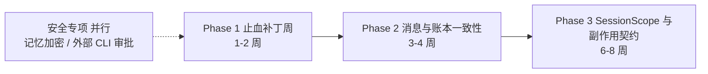

# 05 · 红蓝对抗防御剧本与架构治理 RFC

> Part A：用最刁钻的面试官视角对 `03` 的简历 Bullet、War Stories 与微基准数据做压力测试，并给出三层防御话术。
> Part B：把 `02` Top 缺陷、`04` 未接线技术债与 `patches/` 打包成一份可在公司内部立项的 Staff RFC。
> 数据口径统一为：**本地受控微基准**（`scripts_diag/repro_and_bench.py`，真实仓库类 + 真实补丁，Mock LLM，localhost），结果见 `scripts_diag/results/bench_results.md`。

---

## Part A · 红军挑刺与三层反杀剧本

> 使用守则：**第一层永远先认边界**。P9 面试官打假的方式不是问你知道什么，而是看你会不会把微基准说成线上收益。第一层认得越干脆，第二、三层越有分量。

### 质疑 1："你的压测是 Mock LLM 跑的。线上 LLM 延迟是秒级，你的 ZMQ 队头阻塞和预留制账本在真实分布下还成立吗？"

- **第一层（正面接招）**：对，这是 Mock LLM 的本地微基准，测的是**机制本身**，不是线上吞吐。但这两个问题恰好与 LLM 延迟**正相关**，不是被 Mock 放大的。队头阻塞的代价等于前面那个 handler 的执行时长：微基准里慢 handler 只有 2s，线上一次 handler 里若包含 LLM 轮次就是几十秒，阻塞只会更严重。预留制账本的超支上界等于"估算误差"：Mock 下估算精确所以是 5%，线上输出 token 不可预知，误差会变大，所以补丁里的估算在没有历史时用 `prompt + 1024`，有历史后用实测均值，并且可以按 `max_tokens` 保守预留。
- **第二层（源码反杀）**：baseline 里 ACK 是在 `await self._handle_request` 之后才发的（`pyzmq_backend.py:126-161`），发送端 `wait_for` 用的是 `MessagerTransportConfig.request_timeout`，默认 10s。只要线上任何一个 handler 超过 10s，后面排队的消息**全部**超时，发送端重试又造成重复执行。排查时还挖出一个 Mock 环境下也稳定复现的问题：固定 `node_id` 让每个 DEALER 共用同一个 routing id（L98-102），ROUTER 会**静默丢弃**并发连接。这个问题和 LLM 延迟完全无关，baseline 下 50 条快消息的 handler 一次都没执行。
- **第三层（升维打击）**：这其实是 Little's Law：队列里的等待时间 = 到达率 × 服务时间。LLM 让服务时间变成秒级之后，任何**串行化点**都会成为系统瓶颈。所以我的结论不是"我把 P99 从 1953ms 降到了 8.8ms"，而是"我证明了这个串行化点存在、可复现，而且线上只会更坏"。微基准的价值是**证伪**，而不是预测线上数字——这和 LangGraph、Temporal 用确定性测试验证编排语义、而不是用它预测吞吐，是同一个思路。

### 质疑 2："`add_token_usage` 根本没接线，外循环预算形同虚设。这么明显的问题，原团队为什么没发现？你是不是在拿别人的低级错误包装自己？"

- **第一层**：这不是我修的，我也不会说是我修的。它属于审计发现，列在 04 文档的未接线清单里（共 29 项：已知 6 项 + 新增 23 项）。我的贡献是**把这类问题系统化地找出来**，而不是修一个点。
- **第二层**：它没被发现有三个原因，都能在源码里找到。① 有另一层预算兜底：Goal Mode 的 `GoalEvaluator` 有自己的 `token_budget` 硬上限，表面行为看起来"预算是生效的"。② `TokenBudgetEvaluator` 依赖的 token_usage 恒为 0，就算接上也永远不会触发，所以不存在"触发了却没效果"的可观测症状。③ 单元测试只测 evaluator 本身的判断逻辑，没有测"谁在调用它"。同一类模式在仓库里反复出现：`db_journal_mode` 被 jiuwenswarm 传入，agent-core 却写死 `PRAGMA journal_mode=WAL`；`KIND_CANCEL` 在 `dispatcher.py:188` 有消费端，生产代码里却没有任何发送方。
- **第三层**：这是"沉默配置"（silent config）问题，在大型代码库里极其普遍。配置项和接口的存在会制造一种"已经实现"的错觉，而它不产生任何可观测信号。我在 RFC 里提的治理手段是**配置可达性检查**：每个配置字段必须至少被一条非测试路径读取，用 AST 扫描在 CI 里强制执行。这和 Google 的 dead-flag cleanup、Uber 的 Piranha 自动删除过期 flag 是同一类工程实践。

### 质疑 3："1095 KB / 千会话？一千个会话才泄漏 1MB，这根本不是 OOM 的原因。你在 Story 1 里把它讲成 OOM 的根因，是在夸大。"

- **第一层**：您说得对，**它不是主因**，我在故事里也会这样讲。协调器的会话记录每条只有约 1KB，按这个斜率，泄漏 1GB 需要百万级会话。我用它是因为它**解释了 RSS 曲线中"严格线性"的那一部分**，而且是唯一能在本地完整复现并给出修复前后对比的部分。真正可能撑爆内存的，是持有活 adapter 的 fire-and-forget 后台任务（`interface.py:1250` 记忆抽取等），它们拖住的是整个 agent 对象图。这部分我只有源码证据和探针方法，没有微基准数字，所以不报数字。
- **第二层**：修复的难点不在 `pop`，而在**不能破坏 generation 语义**。`_generations` 的作用是拒绝重新注册后的陈旧工作：陈旧的 `close_session(generation=old)`、陈旧的 scheduler lane、registry 里旧代际的残留条目。直接删除会让被淘汰的 id 从 generation 1 重新开始，陈旧工作就会误匹配到新会话。所以补丁保留了一个 `_generation_floor` 单调下限，而不是维护 tombstone 列表，并保留最近 512 个已关闭会话可读，因为现有测试 `test_close_session_cancels_goal_stream` 会在关闭后读取 CANCELLED 快照。
- **第三层**：这是分布式系统里经典的 **fencing token** 问题（Kleppmann 在《DDIA》里用来防止过期锁持有者写入）：资源回收必须和"拒绝过期持有者"的单调令牌一起设计。很多会话系统只做了回收、没做 fencing，结果出现的是比内存泄漏更难查的"串台"。

### 质疑 4："你把 ZMQ 改成'收到即 ACK'。那 handler 在 ACK 之后崩溃，消息不就丢了吗？你只是把重复执行换成了丢消息。"

- **第一层**：是的，ACK 的语义变了，从"已处理"变成了"已接收并解码"。如果只看消息层，这确实是从 at-least-once（带重复）变成了 at-most-once（带丢失）。补丁里 handler 异常现在会以 exception 级别记录日志，不再静默丢失（实测静默丢失 5 → 0），但消息本身确实不会被重放。
- **第二层**：之所以可以接受，是因为在这个架构里**消息不是事实来源**。Team DB 才是：任务状态用 `claim_task` 的条件 UPDATE 做 CAS（`task_dao.py:906`），消息只携带 id 用于唤醒，另外还有 30s 一次的 POLL 兜底。消息丢了，最多是延迟最多 30s 被 POLL 发现，不会丢状态。反过来，审批之所以会出 P0（`message.py:268`），正是因为审批**违反了**这条原则，把状态放在了消息里。
- **第三层**：这就是 Saltzer、Reed 和 Clark 的**端到端原则**（End-to-End Argument）：可靠性要在端点实现，传输层只需要做到"足够好"。Kafka 的 exactly-once 也只在事务边界内成立。所以在这个架构里，正确的工程决策是：消息层追求**低延迟 + 不阻塞**，一致性交给 DB + 幂等 + 补偿扫描。

### 质疑 5："16 并发、每次 1500 token、上限 10k，这参数是你挑出来让 230% 好看的吧？换一组参数还是 230% 吗？"

- **第一层**：不是 230%。超支量取决于参数，我没有做参数扫描，所以不会说"预留制把超支降低了 98%"这类泛化结论。可以给出解析式：事后记账下，超支上界约等于"同时通过入口检查的调用数 × 单次消耗"，在这组参数下最坏是 16 × 4 次调用全部放行；实测 22 次调用被放行，花费 33,000。
- **第二层**：关键是**换参数时 baseline 怎么变**：超支随并发度线性增长，与锁无关。`BudgetLedger.add` 就是 `spent += n`，单事件循环里这个加法本身没有竞争，问题在"检查"（`_check_budget`）和"扣费"之间隔着一次 LLM 调用。预留制补丁的上界则是"估算误差"，与并发度无关。实测里那 5% 来自一条兼容规则：没有在途调用时，仍按旧规则"spent < total 就放行"，保证纯串行脚本行为不变。
- **第三层**：这是经典的 **TOCTOU**（time-of-check to time-of-use）问题，也是分布式限流里"令牌桶预扣"和"事后计费"的区别。云厂商的配额系统（例如 AWS 的 service quota）普遍先预留再结算，原因相同：**在检查和使用之间存在秒级延迟的系统里，事后记账在数学上无法提供上界保证。**

### 质疑 6："这 6 个补丁合入主干了吗？上线了吗？没上线的东西写进简历叫什么？"

- **第一层**：坦白说：**补丁是可应用、有测试、有复现脚本的 PR 草案，没有合入上游，也没有线上数据。**简历里我会写"定位并提交修复"或"设计并验证修复方案"，不会写"线上收益 X%"。每个补丁都能在 HEAD 上独立 `git apply --check` 通过，相关单元测试修复前后的失败集合一致，并且新增了能捕获回归的测试（例如 0001 与 0002 共新增 6 个测试，在未打补丁的代码上有 5 个失败，唯一通过的是快速 hook 对照用例）。
- **第二层**：每个补丁都有**主动收窄的边界**，这本身就是工程判断的证据。0003 在并发度 >1 时会让同一发送方的消息乱序，所以提供了 `p2p_max_concurrency=1` 恢复顺序；0004 保留最近 512 个已关闭会话可读，以兼容现有测试；0005 的 fsync 每次调用增加 0.8ms，可以用 `JIUWEN_WAL_FSYNC=0` 关闭；0006 在临近上限时会让并发调用等待，这是一个**吞吐换正确性**的显式取舍。这些都写在 `patches/README.md` 的"已知边界"里。
- **第三层**：工程价值的链路是"发现 → 复现 → 修复 → 验证 → 上线 → 度量"。我做到了前四步，而且是可复现的前四步，这恰恰是大多数线上事故复盘做不到的部分。上线和度量依赖组织流程。我在 RFC 里给出了每一期的可观测性验收指标，这样上线后的收益是**可证伪的**，而不是事后编出来的。

---

## Part B · RFC：JiuwenSwarm 运行时高可用与协同一致性治理

| 字段 | 内容 |
|---|---|
| 状态 | Draft · 待评审 |
| 作者 | （你） |
| 范围 | `agent-core`（core / harness / agent_teams）、`jiuwenswarm`（gateway / server / runtime） |
| 关联材料 | `02_PRODUCTION_TROUBLESHOOTING_RUNBOOK.md`、`04_DEEP_SUBSYSTEMS_AND_DEBT.md`、`patches/0001-0006`、`scripts_diag/` |

### 1. 背景与问题陈述

JiuwenSwarm 在单 Agent 引擎、多智能体协同和确定性编排三层都有完整的机制设计，但源码级 FMEA 与静态审计显示，**系统的薄弱点不在"缺功能"，而在"契约没有闭合"**：

1. **状态放在消息里**：审批结果走消息兜底路径时被丢弃（P0）；`human()` 的回复只存在内存里。
2. **取消不是一等协议**：`KIND_CANCEL` 没有发送方；Front 断连、Gateway 超时都不会停止 Worker 上的执行；沙箱 exec 无法取消；沙箱 lease 从不释放。
3. **检查与执行之间有时间差**：预算先检查后扣费；Journal 先检查 abort 再写日志。
4. **沉默配置与半成品机制**：29 项定义了却未接线的配置或接口（包括记忆加密未生效、外部 CLI 成员自动通过审批这两项安全问题）。

### 2. 现状量化（本地受控微基准 + 静态审计）

| 风险 | 证据 | 量化 |
|---|---|---|
| Teammate 审批丢失后永久卡死 | `message.py:258-268`、`team_agent.py:687` | 兜底路径丢弃率 **100%**（N=1000） |
| 挂起的 Rail 阻塞主推理循环 | `framework.py:1129` | 挂起 hook 阻塞 **≥5s**（达到观测上限，实际为无限期） |
| ZMQ 队头阻塞与静默丢失 | `pyzmq_backend.py:98-161` | ACK 超时 **51/51**；快消息 handler 启动 P99 **1953ms**；接收出错时 300ms 内空转 **661,654** 次 |
| 会话记录只增不删 | `coordinator.py:88-119`、`:926` | 稳态 **1095 KB / 千会话** |
| WAL 撕裂导致 resume 崩溃 | `journal.py:195` | 多字节截断时续跑命中率 **0%**（200 步全部作废） |
| 并发预算超支 | `budget.py:23` + `_check_budget` | 16 并发 **超支 230%** |
| 未接线 / 半成品机制 | 04 文档 §4 | **29 项**（其中 2 项安全类） |
| 取消链断点 | 04 文档 §1 | **8 处**（B0–B7） |

> 注意：以上是机制层面的复现数据，不是线上事故统计。Phase 1 的首要任务之一是补齐线上指标，把这张表换成线上数字。

### 3. 目标与非目标

- **目标**：① 消除已复现的 P0/P1 缺陷；② 让"取消、审批、预算、副作用"四类语义具备显式契约；③ 每一项改动都有可观测的验收指标；④ 不破坏现有公开 API 与默认行为。
- **非目标**：替换 PyZMQ 或 SQLite（只做到可插拔）；重写 Rails 框架；改变 SwarmFlow 的脚本编程模型。

### 4. 演进路线图

#### Phase 1 · 止血补丁周（1–2 周）

| 项 | 内容 | 状态 |
|---|---|---|
| 1.1 | 合入 `0001`–`0006`（审批兜底、Rail 超时、ZMQ ACK/去重/routing id、会话有界回收、WAL 容错、预算预留制） | 补丁 + 复现 + 测试已就绪 |
| 1.2 | 修复缺失模块 `openjiuwen.agent_teams.harness.manifest` 导致的约 86 个测试失败，恢复测试基线 | 待做 |
| 1.3 | 部署诊断探针 `scripts_diag/jiuwen_diag_probe.py`（按需 `SIGUSR2`），建立线上基线指标 | 探针已验证可挂载 |
| 1.4 | 安全专项：修复 `LongTermMemory` 加密 codec 未重建（`long_term_memory.py:203/317`）；确认外部 CLI `auto_approve_tools=True`（`member_runtime.py:256`）是否为预期设计，并至少加上开关和审计日志 | 待做（安全评审） |

#### Phase 2 · 消息与账本一致性改造（3–4 周）

| 项 | 内容 |
|---|---|
| 2.1 | **审批落库**：审批请求作为 Team DB 一等实体（pending / approved / denied / expired），恢复时以 DB 为准；审批超时默认 fail-close；启动时校验"挂了审批 Rail 就必须有审批方" |
| 2.2 | **取消协议闭环**：Supervisor 在 Front 断连和 Gateway 超时时发送 `KIND_CANCEL`；沙箱 exec 改为可取消的异步 HTTP，jiuwenbox 增加取消前台 exec 的接口；daemon 超时用 `killpg` |
| 2.3 | **团队级预算与环检测**：复用 `BudgetLedger` 预留制做团队预算；消息携带 `hop_count`；`PingPongDetector` 改为滑动窗口 + 强连通分量检测；可靠性框架默认开启 |
| 2.4 | **Team DB 跨进程安全**：`update_task*` 改为"条件 UPDATE + 版本号"，加 `retry_on_locked`；恢复扫描 `verify_and_fix_task_consistency` 接入启动流程 |
| 2.5 | **演进存储**：跨进程文件锁；`evolutions.json` 损坏时隔离为 `.corrupt` 而不是覆盖；SKILL.md 原子写 |

#### Phase 3 · SessionScope 与副作用幂等契约化（6–8 周）

| 项 | 内容 |
|---|---|
| 3.1 | **SessionScope 一等公民**：从 Gateway 到 Worker、DeepAgent、沙箱统一一个会话作用域，持有后台任务、沙箱 lease、订阅、缓存条目；关闭时统一回收；禁止裸 `asyncio.create_task`（lint） |
| 3.2 | **工具副作用声明**：工具注册时声明 `side_effect: none / idempotent / non_idempotent`；Journal 重放、Rail 重试、上下文溢出重试都依据这个声明决定能否自动重做 |
| 3.3 | **Journal intent / done 两阶段**：non_idempotent 步骤先写 intent，遇到"有 intent 无 done"时转人工确认；签名纳入 `schema_version`、validator 哈希和外部依赖指纹 |
| 3.4 | **配置可达性 CI**：AST 扫描每个配置字段与公开接口至少有一条非测试读取路径，沉默配置在 CI 中失败；逐项清理 04 §4 的未接线清单 |

### 5. 工时估算（人日，单人；含评审与测试，不含线上灰度观察期）

| Phase | 项 | 估算 | 依据 |
|---|---|---|---|
| 1 | 1.1 补丁合入与评审 | 5 | 6 个补丁已就绪，主要成本在评审与回归 |
| 1 | 1.2 测试基线恢复 | 2–3 | 缺失模块范围待确认 |
| 1 | 1.3 探针部署与基线 | 2 | — |
| 1 | 1.4 安全专项 | 3–5 | 含数据兼容（已明文写入的记忆） |
| 2 | 2.1 审批落库 | 6–8 | 数据模型 + 迁移 + 两条恢复路径 |
| 2 | 2.2 取消协议闭环 | 8–10 | 跨三个进程 + jiuwenbox 服务端接口 |
| 2 | 2.3 团队预算与环检测 | 5–6 | — |
| 2 | 2.4 Team DB 跨进程安全 | 3–4 | — |
| 2 | 2.5 演进存储 | 3 | — |
| 3 | 3.1 SessionScope | 12–15 | 影响面最大，需要分批迁移 |
| 3 | 3.2 + 3.3 副作用契约与两阶段 Journal | 10–12 | — |
| 3 | 3.4 配置可达性 CI + 清理 | 5–8 | 29 项逐条确认保留或删除 |
| | **合计** | **约 64–81 人日** | 以上为估算，评审后修正 |

### 6. 向后兼容性保证

| 改动 | 兼容策略 |
|---|---|
| Rail 超时（0002） | 默认 fail-open，与原"吞异常"语义一致；fail-close 为新增可选参数 |
| ZMQ（0003） | 公开签名不变；新配置均为可选 metadata；ACK 语义变化写入变更说明；`p2p_max_concurrency=1` 可恢复顺序 |
| 会话回收（0004） | 最近 512 个已关闭会话快照仍可读；被淘汰会话返回 None 或 `existed=False`，现有调用方已按"已关闭"处理 |
| WAL（0005） | 旧 WAL 可直接读取；fsync 可通过环境变量关闭 |
| 预算（0006） | `add()` / `remaining()` / `exhausted` 不变；串行脚本行为不变 |
| 审批落库、SessionScope、副作用声明 | 新增字段均有默认值（未声明副作用的工具视为 `idempotent`，维持现状）；分阶段灰度，保留旧路径一个版本周期 |
| 记忆加密修复 | 解码路径兼容已明文写入的数据；提供一次性迁移脚本 |

### 7. 可观测性验收指标

| 指标 | 采集方式 | Phase 1 验收 | Phase 3 验收 |
|---|---|---|---|
| 审批丢弃数 | `team` logger 中 `dropping stale interrupt resume input` 计数 | 0 | 0，且新增 `approval.request_sent → approval.resolved` 延迟直方图 |
| Rail 超时次数 / 单 Rail 耗时 | `[RailChain] callback timeout` 日志 + per-rail 直方图 | 有指标 | P99 < 声明的 timeout |
| ZMQ ACK 超时率、handler 异常数 | messager 日志 / 计数器 | 慢 handler 场景超时 = 0 | 线上 ACK 超时率 < 0.1% |
| Worker RSS 斜率、在途后台 Task 数 | 探针 B/C 段，`asyncio` Task 按协程聚合 | 有基线 | 稳态斜率接近 0；无主 Task 数不随会话数增长 |
| 断连后沙箱存活时长 | jiuwenbox 注册表 | 有基线 | P99 < 宽限期 + 回收周期 |
| Journal 坏行数 / 续跑命中率 | `Journal.load_stats` + `CACHE_HIT/MISS` | 坏行不导致 resume 失败 | 新增 `swarmflow.step` span（含 cache 命中标记） |
| 预算超支率 | `BudgetLedger` spent / total | 并发场景 ≤ 估算误差 | 团队级预算覆盖 Team 模式 |
| 沉默配置数 | 配置可达性 CI | 有清单 | 0（或逐项登记豁免） |

### 8. 风险与回滚

- **ZMQ 乱序**：并发执行可能暴露依赖消息顺序的隐性假设。缓解：灰度期先设 `p2p_max_concurrency=1`，观察后再放开。
- **预算等待降低并发**：临近上限时调用串行化。缓解：可配置的预留系数，并在 TUI `/swarmflows` 中展示等待次数。
- **SessionScope 改动面大**：分模块迁移，旧的 `create_task` 调用先经 lint 告警，再改为 error。
- **回滚**：Phase 1 每个补丁可独立 revert；Phase 2/3 的新行为都有开关，默认关闭一个版本周期。

### 9. 开放问题

1. 外部 CLI 成员自动通过审批是产品设计还是遗漏？（需要产品与安全团队确认）
2. Web 断连"不等于取消"是有意设计：是否需要为长时间无人连接的会话设置最长执行时间？
3. `openjiuwen-protocol` 的 `ReqMethod.CHAT_CANCEL` 与 `chat.interrupt` 的对应关系需要在协议仓库中确认。
